# Informe general acumulativo — tesis ENASEM

**Edición pública revisada10:** originales íntegros y PDF previo bajo acceso privado. Los detalles retirados no se utilizan para sostener conclusiones. La versión pública no acredita saneamiento del historial de GitHub.

**Orientación editorial vigente, 23 de octubre de 2026.**
La pregunta del manuscrito se centra ahora en distinguir incorporación a una
primera vía propia K/A observada y complementariedad con otra vía ya declarada,
y en describir diferencias monetarias y socioeconómicas.
Los cálculos del informe fueron generados bajo la pregunta anterior de cobertura
y montos; permanecen como evidencia auditada. Las menciones a «pregunta central»
en los apartados originales pertenecen a su contexto de generación. Véase
[la introducción vigente](../manuscrito/capitulos/01_introduccion.tex).
La información existente cuantifica las nuevas recepciones con o sin la otra
vía inicial, pero **no** ha comprobado focalización conjunta según desventaja
basal y monto posterior. Esta actualización es editorial: no recalcula
estimaciones ni altera microdatos.

**Actualización del análisis acumulativo:** 14 de octubre de 2026.

Exploración de pensiones, titularidad, apoyos gubernamentales, características socioeconómicas y seguimiento longitudinal, 2001–2021. Síntesis académica acumulativa, actualizada con los notebooks 03–08. La etapa 06 examina la pregunta orientadora de la autora sobre brechas de cobertura/monto; la igualación y la suficiencia permanecen hipótesis por contrastar. La etapa 07 añade precios constantes de septiembre de 2026, umbrales históricos y cronología oficial, con resultados condicionados por definición y periodo monetario.

El Markdown es la única fuente editable; el PDF es una versión generada. Los notebooks conservan la exploración exhaustiva. La selección prioriza relevancia conceptual, contrastes entre grupos, comparabilidad y calidad; no se basa en significancia estadística. Se muestran también asociaciones débiles y rupturas de medición.

## Índice

- [1. Resumen de principales hallazgos](#seccion-resumen)
- [2. Fuentes e integración de ENASEM](#seccion-fuentes)
- [3. Características de la población](#seccion-poblacion)
- [4. Calidad y disponibilidad de datos](#seccion-calidad)
- [5. Pensiones, titularidad y apoyos](#seccion-pensiones)
- [6. Resultados univariados relevantes](#seccion-univariado)
- [7. Relaciones bivariadas](#seccion-bivariado)
- [8. Relaciones trivariadas](#seccion-trivariado)
- [9. Trayectorias longitudinales](#seccion-longitudinal)
- [10. Interpretación integrada](#seccion-interpretacion)
- [11. Limitaciones y pendientes de investigación](#seccion-limites)

## 1. Resumen de principales hallazgos

La integración preserva **99,676 observaciones persona-ronda y 27,171 personas**, sin exclusiones ni multiplicación de filas. La selección pensionaria de 60 años o más en cada visita reúne **56,004 observaciones y 18,754 personas**. Son universos diferentes: el segundo no reemplaza el maestro.

En 2021 se observan **3,599 recepciones propias K y 5,583 apoyos propios A**; **2,019** registros tienen ambas respuestas afirmativas y **3,558** apoyo con negativa explícita K. K no identifica automáticamente pensión contributiva; A incluye donativos públicos y no identifica automáticamente pensión no contributiva.

La recepción K propia difiere por sexo: **41.94% entre 4,578 hombres con respuesta conocida y 28.79% entre 5,831 mujeres con respuesta conocida**. La coexistencia K/A presenta una asociación global débil (**V de Cramér=0.03756; 10,396 pares conocidos**), que convive con contrastes por localidad y sexo. La debilidad global también es un hallazgo; no se elimina por falta de un efecto grande.

El seguimiento separa continuidad de observación, fallecimiento registrado, ausencia y reaparición. Los cambios de instrumentos impiden tratar todas las diferencias entre visitas como altas o bajas pensionarias. Ninguno de estos resultados acredita causalidad, suficiencia económica o cobertura nacional.

**Procedencia:** ENASEM, agregados conservados en [resultados.json](../data/interim/eda_pensionaria/resultados.json); notebook [02_EDA_COMPLETO](../notebooks/02_EDA_COMPLETO.ipynb), bloque Hallazgos, pensiones y trayectorias.

## 2. Fuentes e integración de ENASEM

**Pregunta:** ¿cómo se construye una base longitudinal sin alterar el universo original ni atribuir prestaciones de hogar a personas? ENASEMsimple actúa como maestro. Se integran 17 fuentes económicas distintas y se conservan 4,736 columnas fuente; F05 es duplicado binario de F04 y 2024 permanece fuera de las seis rondas de trabajo. La integración incorpora 8,668 columnas, que no equivalen a 8,668 conceptos homologados.

El identificador conserva exactamente `cunicah:np`; la clave única de observación es `id+ronda`. `ronda` identifica la visita nominal y no sustituye `a_o_ent`. Los LEFT JOIN preservan el maestro y comprueban claves y cardinalidad: ninguna unión muchos-a-muchos está admitida.

En 2001, el puente enlaza por `cunicah/codent01` y aporta `unhhid`; en 2003 enlaza por `cunicah/codent03` y aporta la clave económica `cunicah/acthog`. No se usa directamente el `acthog` del maestro de 2003. La coincidencia de una clave económica acredita enlace, no titularidad individual. Las variables originales, imputadas y construidas se conservan como versiones, sin sumarlas como ingresos independientes.

**Estado:** validación técnica de integración realizada; homologación académica y aceptación de muestra parciales. Diccionarios y contratos: [diccionario integrado](../diccionarios/diccionario_integrado.json), [inventario](../diccionarios/inventario_fuentes.json). Bibliografía activa: [referencias](../investigacion/referencias.bib).

**Procedencia:** ENASEM, agregados conservados en [validacion.json](../data/interim/integracion/validacion.json); notebook [01_INTEGRACION](../notebooks/01_INTEGRACION.ipynb), bloque Fuentes, puentes y cardinalidad.

## 3. Características de la población

**Cuadro 1. Universo original y selección de 60+ por visita**

**Pregunta y aporte:** Distinguir el universo completo de la submuestra descriptiva y localizar exclusiones por edad desconocida.

| Ronda | N maestro | N 60+ | N <60 | Edad ND | Sobre fallecido |
| --- | --- | --- | --- | --- | --- |
| 2001 | 15186 | 7416 | 7770 | 0 | 0 |
| 2003 | 14250 | 7691 | 6002 | 557 | 546 |
| 2012 | 18465 | 9886 | 5815 | 2764 | 2742 |
| 2015 | 15988 | 10416 | 4359 | 1213 | 1209 |
| 2018 | 18249 | 10113 | 6981 | 1155 | 1135 |
| 2021 | 17538 | 10482 | 5247 | 1809 | 1799 |

**Nota:** Cada fila corresponde a una ronda. Personas únicas dentro de ronda; no sumar estas filas como personas únicas del periodo. Fallecimiento y edad ND no son categorías excluyentes.

**Procedencia:** ENASEM, agregados conservados en [resultados.json](../data/interim/eda_pensionaria/resultados.json); notebook [02_EDA_COMPLETO](../notebooks/02_EDA_COMPLETO.ipynb), bloque EDA pensionario.

### 3.1 Edad por visita

**Figura 1. Comparación de edad entre rondas**

**Pregunta y aporte:** Caracterizar cambios de composición de las seis muestras, sin confundirlos con trayectorias individuales.

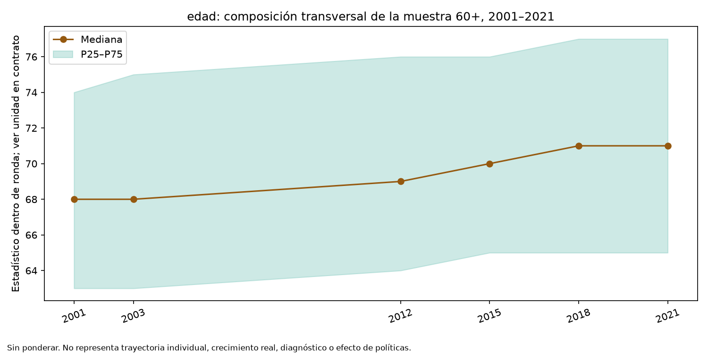

**Fuente y nota:** ENASEM, figura previamente calculada; Universo: 60+ por visita; denominadores e IQR o categorías en el agregado de procedencia.

**Interpretación y alcance:** Mediana descriptiva 2001=68.00 (N válido 7,416), 2021=71.00 (N válido 10,482); IQR y ND de cada ronda en tabla. Cambia la composición de personas observadas: no evolución de las mismas personas, incidencia o efecto causal. Los contratos del indicador y su cobertura condicionan comparabilidad.

**Procedencia:** ENASEM, agregados conservados en [U_comparativa_edad.json](../data/interim/eda_pensionaria/tablas/U_comparativa_edad.json); notebook [02_EDA_COMPLETO](../notebooks/02_EDA_COMPLETO.ipynb), bloque Comparaciones entre rondas.

### 3.2 Escolaridad inicial

**Figura 2. Comparación de escolaridad inicial entre rondas**

**Pregunta y aporte:** Caracterizar cambios de composición de las seis muestras, sin confundirlos con trayectorias individuales.

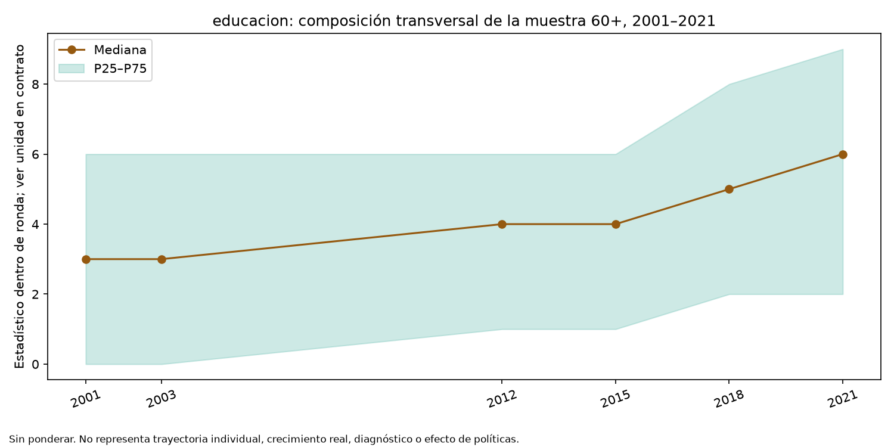

**Fuente y nota:** ENASEM, figura previamente calculada; Universo: 60+ por visita; denominadores e IQR o categorías en el agregado de procedencia.

**Interpretación y alcance:** Mediana descriptiva 2001=3.00 (N válido 7,403), 2021=6.00 (N válido 10,327); IQR y ND de cada ronda en tabla. Cambia la composición de personas observadas: no evolución de las mismas personas, incidencia o efecto causal. Los contratos del indicador y su cobertura condicionan comparabilidad.

**Procedencia:** ENASEM, agregados conservados en [U_comparativa_educacion.json](../data/interim/eda_pensionaria/tablas/U_comparativa_educacion.json); notebook [02_EDA_COMPLETO](../notebooks/02_EDA_COMPLETO.ipynb), bloque Comparaciones entre rondas.

### 3.3 Composición por sexo

**Figura 3. Comparación de sexo entre rondas**

**Pregunta y aporte:** Caracterizar cambios de composición de las seis muestras, sin confundirlos con trayectorias individuales.

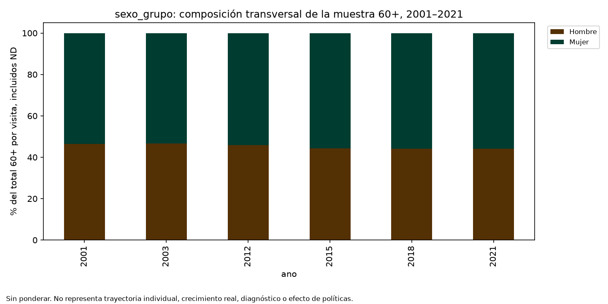

**Fuente y nota:** ENASEM, figura previamente calculada; Universo: 60+ por visita; denominadores e IQR o categorías en el agregado de procedencia.

**Interpretación y alcance:** La categoría Hombre cambia descriptivamente de 3,451/7,416 (46.53%) a 4,627/10,482 (44.14%): -2.39 pp del total de la muestra por visita. Cambia la composición de personas observadas: no evolución de las mismas personas, incidencia o efecto causal. Los contratos del indicador y su cobertura condicionan comparabilidad.

**Procedencia:** ENASEM, agregados conservados en [U_comparativa_sexo_grupo.json](../data/interim/eda_pensionaria/tablas/U_comparativa_sexo_grupo.json); notebook [02_EDA_COMPLETO](../notebooks/02_EDA_COMPLETO.ipynb), bloque Comparaciones entre rondas.

### 3.4 Tamaño de localidad

**Figura 4. Comparación de localidad entre rondas**

**Pregunta y aporte:** Caracterizar cambios de composición de las seis muestras, sin confundirlos con trayectorias individuales.

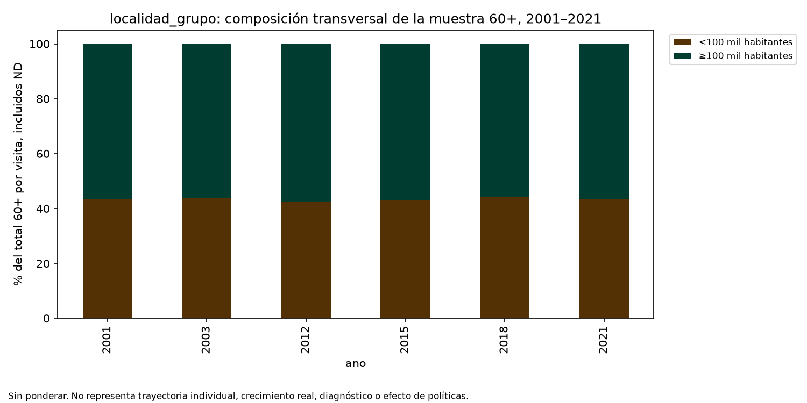

**Fuente y nota:** ENASEM, figura previamente calculada; Universo: 60+ por visita; denominadores e IQR o categorías en el agregado de procedencia.

**Interpretación y alcance:** La categoría <100 mil habitantes cambia descriptivamente de 3,217/7,416 (43.38%) a 4,557/10,482 (43.47%): +0.10 pp del total de la muestra por visita. Cambia la composición de personas observadas: no evolución de las mismas personas, incidencia o efecto causal. Los contratos del indicador y su cobertura condicionan comparabilidad.

**Procedencia:** ENASEM, agregados conservados en [U_comparativa_localidad_grupo.json](../data/interim/eda_pensionaria/tablas/U_comparativa_localidad_grupo.json); notebook [02_EDA_COMPLETO](../notebooks/02_EDA_COMPLETO.ipynb), bloque Comparaciones entre rondas.

## 4. Calidad y disponibilidad de datos

**Cuadro 2. Disponibilidad económica y orientación del titular**

**Pregunta y aporte:** Identificar qué parte de la muestra permite orientar una prestación y cuánto desconocimiento limita su lectura.

| Ronda | N 60+ | N enlazado | N orientado | Titular ND |
| --- | --- | --- | --- | --- |
| 2001 | 7416 | 7394 | 7393 | 23 |
| 2003 | 7691 | 7676 | 7211 | 480 |
| 2012 | 9886 | 9886 | 9066 | 820 |
| 2015 | 10416 | 10416 | 9774 | 642 |
| 2018 | 10113 | 10101 | 10099 | 14 |
| 2021 | 10482 | 10464 | 10417 | 65 |

**Nota:** Enlace, elegibilidad y orientación son comprobaciones diferentes; ND no se completa con cero.

**Procedencia:** ENASEM, agregados conservados en [resultados.json](../data/interim/proteccion_economica/resultados.json); notebook [02_EDA_COMPLETO](../notebooks/02_EDA_COMPLETO.ipynb), bloque EDA pensionario.

**Cuadro 3. Anomalías CP1 conservadas sin corrección automática**

**Pregunta y aporte:** Mostrar problemas que afectan edades, seguimiento y consistencia sin ocultarlos por reorganizar el proyecto.

| Control de calidad | N observado |
| --- | --- |
| registros_despues_de_fallecimiento | 3 |
| personas_con_fallecimiento_repetido | 1 |
| personas_con_sexo_valido_inconsistente | 1 |
| pares_con_edad_decreciente | 226 |
| personas_con_ron_pat_inconsistente_entre_registros | 0 |

**Nota:** Conteos de personas, pares o registros según el nombre del control; no comparten un denominador ni se suman.

**Procedencia:** ENASEM, agregados conservados en [cp1_ejecucion.json](../data/interim/cp1/cp1_ejecucion.json); notebook [02_EDA_COMPLETO](../notebooks/02_EDA_COMPLETO.ipynb), bloque EDA pensionario.

La pérdida de respuesta sustantiva debe distinguirse de la falta de enlace y de no aplicabilidad. Se conservan tags Stata, NR/NS y banderas específicas. J1/2001, punteros discordantes y las 33 firmas candidatas de 2015 permanecen pendientes: no se corrigen automáticamente ni se borran por coincidencia de montos. Los EDA independientes de ENASEMsimple y K 2021 conservan sus universos originales; sus resultados y 429 fichas siguen consultables en [fichas variables](../diccionarios/fichas_variables.json) desde los bloques de fuentes independientes del notebook 02. Seleccionar aquí resultados pensionarios no elimina aquellos análisis.

## 5. Pensiones, titularidad y apoyos

**Pregunta:** ¿qué cambia al distinguir recepción propia, cónyuge y donativos públicos? K reúne jubilación/retiro, viudez, incapacidad y otras pensiones; viudez pertenece al beneficiario efectivo. Una prestación registrada en el hogar no se atribuye a cada integrante. A pregunta donativos adicionales, en dinero o especie, con opciones cambiantes entre rondas. Ni el nombre de bloque ni un monto positivo prueban por sí mismos la recepción, titularidad o contributividad.

**Denominadores:** N total describe la selección; N elegible vivo su ámbito de recepción contemporánea; N conocido exige sí/no admisible; N orientado mide titularidad. La tasa de recepción entre respuestas conocidas no es la composición de todos los receptores.

**Cuadro 4. Recepción propia K en seis rondas**

**Pregunta y aporte:** Comparar la recepción observada con cobertura de respuesta explícita, conservando cada universo de ronda.

| Ronda | N total | N sí | N conocido | N ND | % sí/conocido |
| --- | --- | --- | --- | --- | --- |
| 2001 | 7416 | 1788 | 7393 | 23 | 24.185 |
| 2003 | 7691 | 1837 | 7211 | 480 | 25.475 |
| 2012 | 9886 | 2907 | 9034 | 852 | 32.1784 |
| 2015 | 10416 | 4253 | 9756 | 660 | 43.5937 |
| 2018 | 10113 | 3559 | 10047 | 66 | 35.4235 |
| 2021 | 10482 | 3599 | 10409 | 73 | 34.5758 |

**Nota:** Muestra no ponderada de 60+ por visita; las rupturas de instrumento impiden interpretar automáticamente una diferencia transversal como alta/baja individual.

**Procedencia:** ENASEM, agregados conservados en [resultados.json](../data/interim/proteccion_economica/resultados.json); notebook [02_EDA_COMPLETO](../notebooks/02_EDA_COMPLETO.ipynb), bloque EDA pensionario.

**Cuadro 5. Apoyo propio A en seis rondas**

**Pregunta y aporte:** Comparar la recepción observada con cobertura de respuesta explícita, conservando cada universo de ronda.

| Ronda | N total | N sí | N conocido | N ND | % sí/conocido |
| --- | --- | --- | --- | --- | --- |
| 2001 | 7416 | 726 | 7392 | 24 | 9.8214 |
| 2003 | 7691 | 933 | 7211 | 480 | 12.9386 |
| 2012 | 9886 | 1613 | 9045 | 841 | 17.8331 |
| 2015 | 10416 | 2693 | 9763 | 653 | 27.5837 |
| 2018 | 10113 | 3107 | 10041 | 72 | 30.9431 |
| 2021 | 10482 | 5583 | 10404 | 78 | 53.6621 |

**Nota:** Muestra no ponderada de 60+ por visita; las rupturas de instrumento impiden interpretar automáticamente una diferencia transversal como alta/baja individual.

**Procedencia:** ENASEM, agregados conservados en [resultados.json](../data/interim/proteccion_economica/resultados.json); notebook [02_EDA_COMPLETO](../notebooks/02_EDA_COMPLETO.ipynb), bloque EDA pensionario.

**Cuadro 6. Universo específico de pareja, 2018 y 2021**

**Pregunta y aporte:** Evitar usar toda la muestra como denominador elegible de prestación del cónyuge.

| Ronda | N total 60+ | Pareja confirmada | Sin pareja residente | Pareja no confirmada |
| --- | --- | --- | --- | --- |
| 2018 | 10113 | 6205 | 3893 | 15 |
| 2021 | 10482 | 6071 | 4312 | 99 |

**Nota:** En rondas anteriores el universo de pareja no está confirmado; no inferirlo del estado conyugal o de una negativa operativa. En 2021, 6,071 parejas confirmadas difieren de la muestra total de 10,482.

**Procedencia:** ENASEM, agregados conservados en [resultados.json](../data/interim/eda_pensionaria/resultados.json); notebook [02_EDA_COMPLETO](../notebooks/02_EDA_COMPLETO.ipynb), bloque EDA pensionario.

La rama cónyuge se conserva en los agregados y en los contrastes por sexo de la sección 7. Las instituciones múltiples no distribuyen ni replican el monto, y los slots observados no equivalen al número declarado. El catálogo documental nacional reúne fuentes e instrumentos, no beneficiarios ni cobertura efectiva; es consultable en [investigación de pensiones](../investigacion/).

## 6. Resultados univariados relevantes

**Figura 5. Comparación de situación ocupacional entre rondas**

**Pregunta y aporte:** Contextualizar la recepción pensionaria con actividad y recursos patrimoniales, sin convertir stock en ingreso.

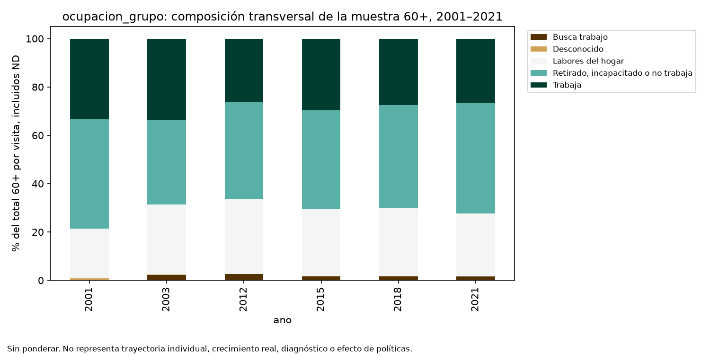

**Fuente y nota:** ENASEM, figura previamente calculada; Muestra 60+ por visita; distribución y ND dependen del indicador.

**Interpretación y alcance:** La categoría Trabaja cambia descriptivamente de 2,470/7,416 (33.31%) a 2,785/10,482 (26.57%): -6.74 pp del total de la muestra por visita. Cambia la composición de personas observadas: no evolución de las mismas personas, incidencia o efecto causal. Los contratos del indicador y su cobertura condicionan comparabilidad.

**Procedencia:** ENASEM, agregados conservados en [U_comparativa_ocupacion_grupo.json](../data/interim/eda_pensionaria/tablas/U_comparativa_ocupacion_grupo.json); notebook [02_EDA_COMPLETO](../notebooks/02_EDA_COMPLETO.ipynb), bloque Comparaciones entre rondas.

**Figura 6. Comparación de patrimonio neto entre rondas**

**Pregunta y aporte:** Contextualizar la recepción pensionaria con actividad y recursos patrimoniales, sin convertir stock en ingreso.

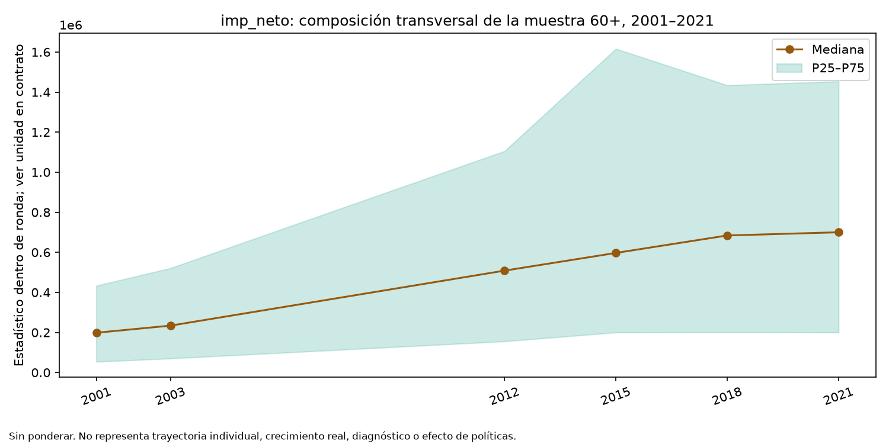

**Fuente y nota:** ENASEM, figura previamente calculada; Muestra 60+ por visita; distribución y ND dependen del indicador.

**Interpretación y alcance:** Mediana descriptiva 2001=198,456.86 (N válido 7,394), 2021=700,000.00 (N válido 10,464); IQR y ND de cada ronda en tabla. Cambia la composición de personas observadas: no evolución de las mismas personas, incidencia o efecto causal. Los contratos del indicador y su cobertura condicionan comparabilidad. Patrimonio compartido, unidades almacenadas nominales: no comparación económica real; deflactor pendiente.

**Procedencia:** ENASEM, agregados conservados en [U_comparativa_imp_neto.json](../data/interim/eda_pensionaria/tablas/U_comparativa_imp_neto.json); notebook [02_EDA_COMPLETO](../notebooks/02_EDA_COMPLETO.ipynb), bloque Comparaciones entre rondas.

**Cuadro 7. Montos mensuales nominales por evento K y A**

**Pregunta y aporte:** Separar monto, recepción y cobertura; resumir distribuciones sin repetir doce histogramas.

| Ronda | Bloque | N eventos | Monto válido | Monto ND | Mediana | P25 | P75 |
| --- | --- | --- | --- | --- | --- | --- | --- |
| 2001 | K | 1846 | 1758 | 88 | 1227 | 1150 | 2000 |
| 2001 | A | 726 | 676 | 50 | 207 | 125 | 500 |
| 2003 | K | 1888 | 1833 | 55 | 1480 | 1300 | 2365 |
| 2003 | A | 933 | 854 | 79 | 250 | 150 | 600 |
| 2012 | K | 3066 | 2855 | 211 | 2100 | 1800 | 4550 |
| 2012 | A | 1613 | 1573 | 40 | 500 | 500 | 800 |
| 2015 | K | 4551 | 4331 | 220 | 2100 | 585 | 4000 |
| 2015 | A | 2693 | 2643 | 50 | 550 | 500 | 600 |
| 2018 | K | 3816 | 3482 | 334 | 2700 | 2011.25 | 6000 |
| 2018 | A | 3407 | 3292 | 115 | 580 | 550 | 750 |
| 2021 | K | 3899 | 3626 | 273 | 4000 | 2800 | 8200 |
| 2021 | A | 5693 | 5615 | 78 | 1550 | 1550 | 1550 |

**Nota:** Unidad: pesos mensuales nominales por evento de beneficiario 60+ identificado. Eventos ≠ personas; montos K/A no se suman como ingresos independientes. Precios y periodicidad pendientes: diferencias nominales no son crecimiento real.

**Procedencia:** ENASEM, agregados conservados en [resultados.json](../data/interim/proteccion_economica/resultados.json); notebook [02_EDA_COMPLETO](../notebooks/02_EDA_COMPLETO.ipynb), bloque EDA pensionario.

En 2021, el agregado K distingue 3,899 eventos de 3,599 beneficiarios; 3,626 eventos tienen monto observado y 273 monto ND. La mediana K de 4,000 y la mediana A de 1,550 son resúmenes nominales por evento, no ingresos totales de una persona ni medidas de suficiencia. La concentración de A en 1,550 no autoriza extrapolar la misma prestación a todos los registros o rondas.

### 6.1 Salud y funcionamiento como contexto complementario

Estos resultados se conservan por su aporte contextual y por mostrar asociaciones pequeñas, sin convertirlos en outcome adoptado.

**Interpretación y alcance:** diabetes: ρ=0.0317, pares válidos 10,399, excluidos 83; salud_glob: ρ=-0.0764, pares válidos 9,366, excluidos 1,116; n_sint_depr: ρ=-0.0862, pares válidos 9,348, excluidos 1,134; n_abvd: ρ=-0.0041, pares válidos 10,353, excluidos 129; recuerdo1: ρ=0.0753, pares válidos 9,366, excluidos 1,116. Sin causalidad, diagnóstico ni significancia; codificación y universos del indicador ENASEMsimple.

**Procedencia:** ENASEM, agregados conservados en [salud_complementaria.json](../data/interim/eda_pensionaria/salud_complementaria.json); notebook [02_EDA_COMPLETO](../notebooks/02_EDA_COMPLETO.ipynb), bloque Salud complementaria.

<!-- BEGIN salud_cobertura -->

### 6.2 Ampliación de cobertura y elegibilidad: notebook 03

La ampliación mantiene 56,004 personas-ronda/18,754 personas de 60+ por visita. Las observaciones de una ronda son personas únicas dentro de ella; no se suman como personas únicas del periodo. No se usa el universo completo de J01/2021 para estos contrastes. La unidad y los dominios se toman de los contratos ENASEMsimple v2, con maestro v3 preservado. Son comparaciones descriptivas condicionadas al indicador, no homologación definitiva de ítems.

**Cuadro 8. Disponibilidad de indicadores y cobertura de salud, referencia 2021**

**Objetivo y aporte:** Distinguir instrumentos disponibles, elegibilidad por modalidad y respuesta válida antes de contrastar pensiones.

| Indicador | Escala / unidad | Rondas disponibles | N elegible 2021 | N válido 2021 | NR/NS | Otros faltantes |
| --- | --- | --- | --- | --- | --- | --- |
| salud_glob | Salud autopercibida (1 excelente–5 mala) | 2001, 2003, 2012, 2015, 2018, 2021 | 9424 | 9424 | 0 | 0 |
| diabetes | Diagnóstico declarado de diabetes | 2001, 2003, 2012, 2015, 2018, 2021 | 10482 | 10472 | 10 | 0 |
| n_enf | Enfermedades crónicas (0–7) | 2001, 2003, 2012, 2015, 2018, 2021 | 10482 | 10455 | 27 | 0 |
| bmi_imp | IMC promedio imputado (kg/m²) | 2001, 2003, 2012, 2015, 2018, 2021 | 10482 | 10482 | 0 | 0 |
| n_sint_depr | Síntomas CES-D (0–9) | 2001, 2003, 2012, 2015, 2018, 2021 | 9424 | 9405 | 19 | 0 |
| cesd_deprimido | CES-D: cinco o más síntomas | 2001, 2003, 2012, 2015, 2018, 2021 | 9424 | 9405 | 19 | 0 |
| solo | Soledad declarada en la última semana | 2001, 2003, 2012, 2015, 2018, 2021 | 9424 | 9418 | 6 | 0 |
| recuerdo1 | Aprendizaje verbal imputado (0–8) | 2001, 2003, 2012, 2015, 2018, 2021 | 9424 | 9424 | 0 | 0 |
| recuerdo2 | Evocación imputada (0–8) | 2001, 2003, 2012, 2015, 2018, 2021 | 9424 | 9424 | 0 | 0 |
| orientacion | Orientación imputada (0–3) | 2003, 2012, 2015, 2018, 2021 | 9424 | 9424 | 0 | 0 |
| serial7 | Restas seriadas imputadas (0–5) | 2015, 2018, 2021 | 9424 | 9424 | 0 | 0 |
| n_abvd | Limitaciones ABVD (0–5) | 2001, 2003, 2012, 2015, 2018, 2021 | 10482 | 10426 | 7 | 49 |
| n_aivd | Limitaciones AIVD (0–4) | 2001, 2003, 2012, 2015, 2018, 2021 | 9424 | 9413 | 7 | 4 |
| n_mov | Limitaciones de movilidad (0–5) | 2001, 2003, 2012, 2015, 2018, 2021 | 9424 | 9422 | 0 | 2 |
| tics | Sin contrato/columna | Pendiente | ND | ND | ND | ND |

**Nota:** N elegible corresponde al indicador construido, no a todos los saltos de cada pregunta bruta. NR/NS conserva .r/.d y códigos específicos; otros faltantes no son ceros. No hubo valores fuera del dominio documentado. N válido incluye representaciones imputadas del proveedor cuando corresponden. TICS no se construye sumando escalas.

**Fuente y procedencia:** ENASEM; [03_PENSIONES_SALUD_COGNICION](../notebooks/03_PENSIONES_SALUD_COGNICION.ipynb), bloque 2: disponibilidad y 1: contratos; [agregados completos](../data/interim/pensiones_salud/resultados.json).

**Imputación y modalidades:** recuerdo1, recuerdo2, orientación y serial7 son puntuaciones imputadas del proveedor. bmi_imp es promedio de diez imputaciones, no diez observaciones independientes; sus IC no recuperan varianza entre imputaciones. Las escalas cognitivas 0–8, 0–3 y 0–5 no son intercambiables. Salud global, CES-D, soledad, cognición, AIVD y movilidad usan entrevistas directas según contrato; diabetes, enfermedades, BMI y ABVD admiten directa/sustituto. Las sensibilidades directas se conservan en el notebook. No se reclasifican tags ni extremos por presentación.

<!-- END salud_cobertura -->

## 7. Relaciones bivariadas

**Pregunta:** ¿cómo se distribuye la recepción propia K entre perfiles y cómo coexiste con A? Se revisan los ocho cruces B en 2021 y sus tamaños de asociación en las seis rondas. Los perfiles de 2021 tienen N total=10,482 personas únicas de 60+ (una fila por persona); cada tasa y asociación conserva su N válido y ND. Son resultados muestrales no ponderados. Se seleccionan por dimensiones conceptuales, no por significancia; los valores de V son descriptivos y no pruebas confirmatorias.

**Cuadro 9. Asociaciones descriptivas seleccionadas en las seis rondas**

**Pregunta y aporte:** Comparar magnitudes descriptivas, incluyendo asociaciones débiles, sin escoger solo el mayor contraste.

| Ronda | Cruce | N válido | N excluido/ND | V de Cramér |
| --- | --- | --- | --- | --- |
| 2001 | Pensión × Sexo | 7393 | 23 | 0.1726 |
| 2001 | Pensión × Edad | 7393 | 23 | 0.0785 |
| 2001 | Pensión × Educación | 7380 | 36 | 0.2627 |
| 2001 | Pensión × Tamaño de localidad | 7393 | 23 | 0.1838 |
| 2001 | Pensión × Apoyos gubernamentales | 7392 | 24 | 0.0845 |
| 2001 | Pensión × Ocupación | 7361 | 55 | 0.1494 |
| 2003 | Pensión × Sexo | 7211 | 480 | 0.1844 |
| 2003 | Pensión × Edad | 7211 | 480 | 0.0936 |
| 2003 | Pensión × Educación | 7164 | 527 | 0.2777 |
| 2003 | Pensión × Tamaño de localidad | 7211 | 480 | 0.1996 |
| 2003 | Pensión × Apoyos gubernamentales | 7211 | 480 | 0.1002 |
| 2003 | Pensión × Ocupación | 7209 | 482 | 0.3325 |
| 2012 | Pensión × Sexo | 9034 | 852 | 0.1596 |
| 2012 | Pensión × Edad | 9034 | 852 | 0.131 |
| 2012 | Pensión × Educación | 8981 | 905 | 0.2168 |
| 2012 | Pensión × Tamaño de localidad | 9034 | 852 | 0.1807 |
| 2012 | Pensión × Apoyos gubernamentales | 9023 | 863 | 0.1614 |
| 2012 | Pensión × Ocupación | 9033 | 853 | 0.3375 |
| 2015 | Pensión × Sexo | 9756 | 660 | 0.1525 |
| 2015 | Pensión × Edad | 9756 | 660 | 0.24 |
| 2015 | Pensión × Educación | 9652 | 764 | 0.1224 |
| 2015 | Pensión × Tamaño de localidad | 9756 | 660 | 0.0612 |
| 2015 | Pensión × Apoyos gubernamentales | 9749 | 667 | 0.2904 |
| 2015 | Pensión × Ocupación | 9748 | 668 | 0.2945 |
| 2018 | Pensión × Sexo | 10047 | 66 | 0.1627 |
| 2018 | Pensión × Edad | 10047 | 66 | 0.1516 |
| 2018 | Pensión × Educación | 9949 | 164 | 0.2556 |
| 2018 | Pensión × Tamaño de localidad | 10047 | 66 | 0.1909 |
| 2018 | Pensión × Apoyos gubernamentales | 10030 | 83 | 0.325 |
| 2018 | Pensión × Ocupación | 10032 | 81 | 0.3147 |
| 2021 | Pensión × Sexo | 10409 | 73 | 0.1372 |
| 2021 | Pensión × Edad | 10409 | 73 | 0.1433 |
| 2021 | Pensión × Educación | 10262 | 220 | 0.272 |
| 2021 | Pensión × Tamaño de localidad | 10409 | 73 | 0.2127 |
| 2021 | Pensión × Apoyos gubernamentales | 10396 | 86 | 0.0376 |
| 2021 | Pensión × Ocupación | 10408 | 74 | 0.3458 |

**Nota:** Cada N pertenece al cruce correspondiente; no sumar. Las tablas originales B1–B5/B7 documentan categorías y exclusiones; no se calculó significancia. Instituciones (B6) y patrimonio (B8) requieren unidades y medidas distintas y se narran por separado.

**Procedencia:** ENASEM, agregados conservados en [resultados.json](../data/interim/eda_pensionaria/resultados.json); notebook [02_EDA_COMPLETO](../notebooks/02_EDA_COMPLETO.ipynb), bloque EDA pensionario.

### 7.1 B1_2021 · Pensión × Sexo

**Interpretación y alcance:** La recepción propia K entre respuestas conocidas alcanza 1,920/4,578 (41.94%) en Hombre, frente a 1,679/5,831 (28.79%) en Mujer: diferencia descriptiva de 13.15 puntos porcentuales. Los desconocidos respectivos son 49 y 24. La tabla distingue esa tasa de la composición de receptores y presenta la rama del cónyuge por separado.

V de Cramér entre pensión propia y la característica estudiada oscila de 0.1372 (N=10,409) a 0.1372 (N=10,409) dentro de los estratos evaluables. No se ejecutan pruebas de significancia ni selección confirmatoria entre múltiples contrastes.

**Figura 7. Pensión × Sexo · 2021**

**Pregunta y aporte:** Comparar perfiles, conservar coexistencia débil y distinguir instituciones o patrimonio de recepción binaria.

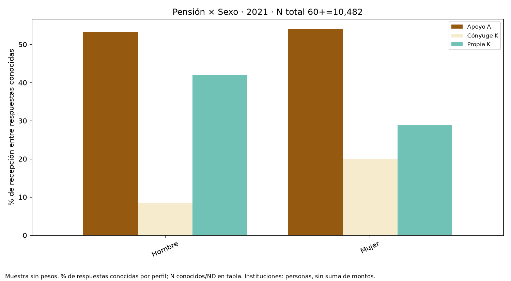

**Fuente y nota:** ENASEM, figura previamente calculada; N total 10,482; denominadores válidos, desconocidos y unidad específica están en la interpretación y tabla de origen. Estado: provisional.

**Cuadro 10. Pensión propia y del cónyuge por sexo, 2021**

**Pregunta y aporte:** Contrastar titularidad por sexo sin confundir tasa de recepción con composición de receptores.

| Sexo | Rama | N sí | N conocido | N ND | % sí/conocido |
| --- | --- | --- | --- | --- | --- |
| Hombre | pension_propia_k | 1920 | 4578 | 49 | 41.9397 |
| Hombre | pension_conyuge_k | 387 | 4566 | 61 | 8.4757 |
| Mujer | pension_propia_k | 1679 | 5831 | 24 | 28.7944 |
| Mujer | pension_conyuge_k | 1160 | 5807 | 48 | 19.9759 |

**Nota:** Son tasas sobre las respuestas conocidas de cada rama en la muestra total; no reemplazan las tasas condicionadas al universo confirmado de pareja.

**Procedencia:** ENASEM, agregados conservados en [B1_2021.json](../data/interim/eda_pensionaria/tablas/B1_2021.json); notebook [02_EDA_COMPLETO](../notebooks/02_EDA_COMPLETO.ipynb), bloque EDA pensionario.

**Procedencia:** ENASEM, agregados conservados en [B1_2021.json](../data/interim/eda_pensionaria/tablas/B1_2021.json); notebook [02_EDA_COMPLETO](../notebooks/02_EDA_COMPLETO.ipynb), bloque Resultados bivariados B1_2021.

### 7.2 B2_2021 · Pensión × Edad

**Interpretación y alcance:** La recepción propia K entre respuestas conocidas alcanza 721/1,763 (40.90%) en 75–79, frente a 555/2,392 (23.20%) en 60–64: diferencia descriptiva de 17.69 puntos porcentuales. Los desconocidos respectivos son 16 y 20. La tabla distingue esa tasa de la composición de receptores y presenta la rama del cónyuge por separado.

V de Cramér entre pensión propia y la característica estudiada oscila de 0.1433 (N=10,409) a 0.1433 (N=10,409) dentro de los estratos evaluables. No se ejecutan pruebas de significancia ni selección confirmatoria entre múltiples contrastes.

Spearman edad–monto_k_propio_mensual_observado_parcial: ρ=-0.2203, N válido=3,347; asociación de rangos dentro de ronda.

**Procedencia:** ENASEM, agregados conservados en [B2_2021.json](../data/interim/eda_pensionaria/tablas/B2_2021.json); notebook [02_EDA_COMPLETO](../notebooks/02_EDA_COMPLETO.ipynb), bloque Resultados bivariados B2_2021.

### 7.3 B3_2021 · Pensión × Educación

**Interpretación y alcance:** La recepción propia K entre respuestas conocidas alcanza 876/1,526 (57.40%) en ≥10 años, frente a 305/1,685 (18.10%) en 0 años: diferencia descriptiva de 39.30 puntos porcentuales. Los desconocidos respectivos son 14 y 8. La tabla distingue esa tasa de la composición de receptores y presenta la rama del cónyuge por separado.

V de Cramér entre pensión propia y la característica estudiada oscila de 0.2720 (N=10,262) a 0.2720 (N=10,262) dentro de los estratos evaluables. No se ejecutan pruebas de significancia ni selección confirmatoria entre múltiples contrastes.

**Figura 8. Pensión × Educación · 2021**

**Pregunta y aporte:** Comparar perfiles, conservar coexistencia débil y distinguir instituciones o patrimonio de recepción binaria.

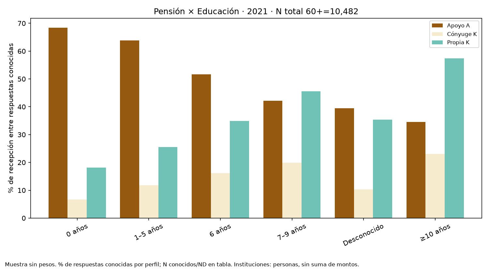

**Fuente y nota:** ENASEM, figura previamente calculada; N total 10,482; denominadores válidos, desconocidos y unidad específica están en la interpretación y tabla de origen. Estado: provisional.

**Procedencia:** ENASEM, agregados conservados en [B3_2021.json](../data/interim/eda_pensionaria/tablas/B3_2021.json); notebook [02_EDA_COMPLETO](../notebooks/02_EDA_COMPLETO.ipynb), bloque Resultados bivariados B3_2021.

### 7.4 B4_2021 · Pensión × Tamaño de localidad

**Interpretación y alcance:** La recepción propia K entre respuestas conocidas alcanza 2,553/5,874 (43.46%) en ≥100 mil habitantes, frente a 1,046/4,535 (23.07%) en <100 mil habitantes: diferencia descriptiva de 20.40 puntos porcentuales. Los desconocidos respectivos son 51 y 22. La tabla distingue esa tasa de la composición de receptores y presenta la rama del cónyuge por separado.

V de Cramér entre pensión propia y la característica estudiada oscila de 0.2127 (N=10,409) a 0.2127 (N=10,409) dentro de los estratos evaluables. No se ejecutan pruebas de significancia ni selección confirmatoria entre múltiples contrastes.

**Procedencia:** ENASEM, agregados conservados en [B4_2021.json](../data/interim/eda_pensionaria/tablas/B4_2021.json); notebook [02_EDA_COMPLETO](../notebooks/02_EDA_COMPLETO.ipynb), bloque Resultados bivariados B4_2021.

### 7.5 B5_2021 · Pensión × Apoyos gubernamentales

**Interpretación y alcance:** Las nueve combinaciones K/A reconcilian 10,482 registros: 2,019 presentan ambas afirmativas, 3,558 apoyo y negativa explícita K, y 86 desconocimiento de al menos una respuesta. Una negativa K no acredita ausencia de cualquier pensión; el apoyo puede incluir dinero o especie.

V de Cramér entre pensión propia y la característica estudiada oscila de 0.0376 (N=10,396) a 0.0376 (N=10,396) dentro de los estratos evaluables. No se ejecutan pruebas de significancia ni selección confirmatoria entre múltiples contrastes.

**Figura 9. Pensión × Apoyos gubernamentales · 2021**

**Pregunta y aporte:** Comparar perfiles, conservar coexistencia débil y distinguir instituciones o patrimonio de recepción binaria.

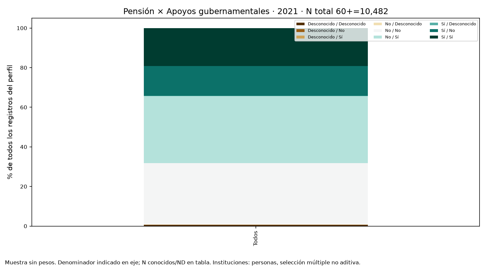

**Fuente y nota:** ENASEM, figura previamente calculada; N total 10,482; denominadores válidos, desconocidos y unidad específica están en la interpretación y tabla de origen. Estado: provisional.

**Procedencia:** ENASEM, agregados conservados en [B5_2021.json](../data/interim/eda_pensionaria/tablas/B5_2021.json); notebook [02_EDA_COMPLETO](../notebooks/02_EDA_COMPLETO.ipynb), bloque Resultados bivariados B5_2021.

### 7.6 B6_2021 · Pensión × Institución otorgante

**Interpretación y alcance:** La categoría institucional más numerosa del cuadro es código 1, 2,540/3,592 receptoras con institución identificada (70.71%). Las afiliaciones múltiples no forman una partición; no se multiplica un monto por cada institución. IMSS/ISSSTE permite identificar sistema, no régimen individual.

**Figura 10. Pensión × Institución otorgante · 2021**

**Pregunta y aporte:** Comparar perfiles, conservar coexistencia débil y distinguir instituciones o patrimonio de recepción binaria.

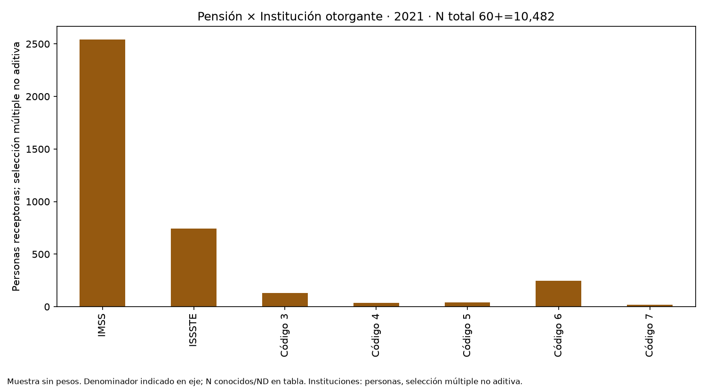

**Fuente y nota:** ENASEM, figura previamente calculada; N total 10,482; denominadores válidos, desconocidos y unidad específica están en la interpretación y tabla de origen. Estado: provisional.

**Procedencia:** ENASEM, agregados conservados en [B6_2021.json](../data/interim/eda_pensionaria/tablas/B6_2021.json); notebook [02_EDA_COMPLETO](../notebooks/02_EDA_COMPLETO.ipynb), bloque Resultados bivariados B6_2021.

### 7.7 B7_2021 · Pensión × Ocupación

**Interpretación y alcance:** La recepción propia K entre respuestas conocidas alcanza 2,500/4,766 (52.45%) en Retirado, incapacitado o no trabaja, frente a 25/164 (15.24%) en Busca trabajo: diferencia descriptiva de 37.21 puntos porcentuales. Los desconocidos respectivos son 33 y 1. La tabla distingue esa tasa de la composición de receptores y presenta la rama del cónyuge por separado.

V de Cramér entre pensión propia y la característica estudiada oscila de 0.3458 (N=10,408) a 0.3458 (N=10,408) dentro de los estratos evaluables. No se ejecutan pruebas de significancia ni selección confirmatoria entre múltiples contrastes.

**Figura 11. Pensión × Ocupación · 2021**

**Pregunta y aporte:** Comparar perfiles, conservar coexistencia débil y distinguir instituciones o patrimonio de recepción binaria.

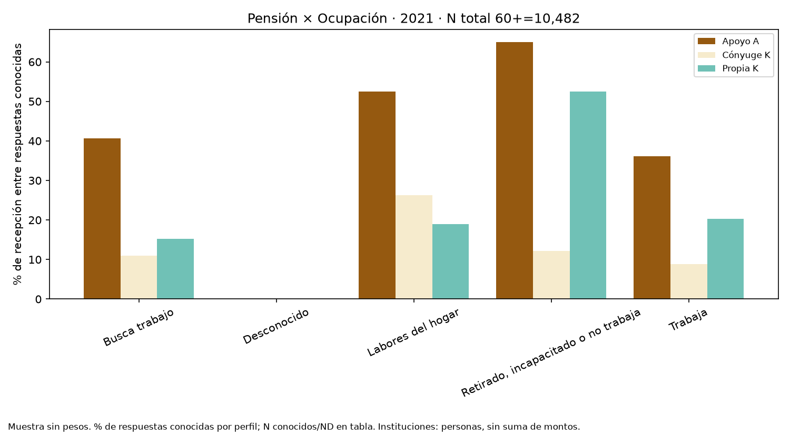

**Fuente y nota:** ENASEM, figura previamente calculada; N total 10,482; denominadores válidos, desconocidos y unidad específica están en la interpretación y tabla de origen. Estado: provisional.

**Procedencia:** ENASEM, agregados conservados en [B7_2021.json](../data/interim/eda_pensionaria/tablas/B7_2021.json); notebook [02_EDA_COMPLETO](../notebooks/02_EDA_COMPLETO.ipynb), bloque Resultados bivariados B7_2021.

### 7.8 B8_2021 · Pensión × Patrimonio e ingresos

**Interpretación y alcance:** Ambas: mediana patrimonial 1,260,000.00, IQR [650,000.00, 2,490,000.00], N válido 473/473.

Ambas negativas K: mediana patrimonial 512,623.42, IQR [107,820.81, 1,096,654.16], N válido 5,712/5,712.

Solo cónyuge: mediana patrimonial 968,864.31, IQR [476,214.66, 1,787,074.84], N válido 1,072/1,072.

Solo propia: mediana patrimonial 819,047.66, IQR [320,000.00, 1,590,000.00], N válido 3,110/3,110.

El patrimonio pertenece al entrevistado y su cónyuge, si lo hay; los registros no son hogares distintos. Se conservan ceros y negativos. Los contrastes son internos a la ronda; no se calcula crecimiento real ni vulnerabilidad.

Spearman imp_neto–monto_k_propio_mensual_observado_parcial: ρ=0.2643, N válido=3,347; asociación de rangos dentro de ronda.

**Figura 12. Pensión × Patrimonio e ingresos · 2021**

**Pregunta y aporte:** Comparar perfiles, conservar coexistencia débil y distinguir instituciones o patrimonio de recepción binaria.

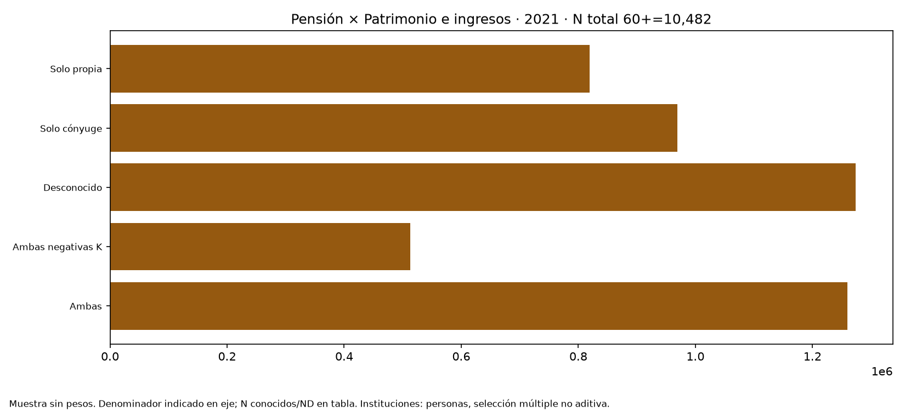

**Fuente y nota:** ENASEM, figura previamente calculada; N total 10,482; denominadores válidos, desconocidos y unidad específica están en la interpretación y tabla de origen. Estado: provisional.

**Procedencia:** ENASEM, agregados conservados en [B8_2021.json](../data/interim/eda_pensionaria/tablas/B8_2021.json); notebook [02_EDA_COMPLETO](../notebooks/02_EDA_COMPLETO.ipynb), bloque Resultados bivariados B8_2021.

<!-- BEGIN salud_principal -->

### 7.9 Pensiones y cuatro dimensiones: ampliación del notebook 03

**Pregunta:** ¿cómo difieren las distribuciones de salud, cognición y funcionalidad entre afirmativa K propia y negativa explícita K propia? La negativa propia puede coexistir con pensión del cónyuge; ND no es ausencia. Para binarios se estima diferencia de proporciones (IC Newcombe/Wilson). Para ordinales, conteos y continuas asimétricas se estima delta de Cliff, P(valor con K mayor) − P(valor con K menor), con empates e IC bootstrap. No se recalculan las 30 correlaciones de Spearman previas: el nuevo contraste incorpora medidas adecuadas, elegibilidad, distribuciones y estratificación.

**Estado:** ejecución y reconciliación técnica verificadas; interpretaciones descriptivas provisionales.

**Alcance:** 80 contrastes principales, 186 contrastes trivariados estimables y 108 complementarios; no selección por p-valores. IC 95% puntuales, condicionales a valores representados y remuestreo iid dentro de grupo/ronda; no diseño de encuesta, dependencia del hogar o incertidumbre MI. No son IC simultáneos ni evidencias confirmatorias aisladas. No se estiman efectos si una rama tiene menos de 30 valores válidos.

**Cuadro 11. Contrastes de salud por recepción K propia, 2021**

**Objetivo y aporte:** Comparar dirección, magnitud y forma de la distribución sin interpretar K como causa de la diferencia.

| Indicador | N válido K sí/no | Mediana K sí/no | Unidad efecto | Sí − no | IC 95% | K propia ND elegible |
| --- | --- | --- | --- | --- | --- | --- |
| salud_glob | 3,261/6,105 | 4.000/4.000 | Delta | -0.083 | [-0.105, -0.061] | 58 |
| diabetes | 3,596/6,803 | 0.000/0.000 | pp | 2.998 | [1.175, 4.841] | 73 |
| n_enf | 3,591/6,791 | 1.000/1.000 | Delta | 0.073 | [0.052, 0.093] | 73 |
| bmi_imp | 3,599/6,810 | 26.630/26.446 | Delta | 0.035 | [0.011, 0.058] | 73 |
| n_sint_depr | 3,258/6,090 | 2.000/3.000 | Delta | -0.103 | [-0.129, -0.079] | 58 |
| cesd_deprimido | 3,258/6,090 | 0.000/0.000 | pp | -6.302 | [-8.154, -4.417] | 58 |
| solo | 3,259/6,102 | 0.000/0.000 | pp | -5.809 | [-7.664, -3.922] | 58 |
| recuerdo1 | 3,261/6,105 | 5.000/4.667 | Delta | 0.091 | [0.069, 0.114] | 58 |
| recuerdo2 | 3,261/6,105 | 5.000/4.000 | Delta | 0.027 | [0.003, 0.052] | 58 |
| orientacion | 3,261/6,105 | 3.000/3.000 | Delta | 0.086 | [0.065, 0.105] | 58 |
| serial7 | 3,261/6,105 | 5.000/4.000 | Delta | 0.121 | [0.100, 0.145] | 58 |
| n_abvd | 3,589/6,764 | 0.000/0.000 | Delta | -0.004 | [-0.020, 0.012] | 73 |
| n_aivd | 3,257/6,098 | 0.000/0.000 | Delta | -0.012 | [-0.027, 0.003] | 58 |
| n_mov | 3,261/6,103 | 1.000/1.000 | Delta | 0.004 | [-0.018, 0.027] | 58 |

**Nota:** Delta va de −1 a 1; pp son puntos porcentuales del indicador binario, no puntos de su escala. Medianas pueden ser iguales con distribuciones distintas. Los desconocidos y salud no válida se reportan por separado; la cobertura del indicador está en el cuadro de disponibilidad.

**Fuente y procedencia:** ENASEM; [03_PENSIONES_SALUD_COGNICION](../notebooks/03_PENSIONES_SALUD_COGNICION.ipynb), bloque 3: comparación principal; [agregados completos](../data/interim/pensiones_salud/resultados.json).

**Figura 13. Física: contrastes por recepción propia K en seis visitas**

**Objetivo y aporte:** Comparar contrastes de la misma dimensión entre visitas sin sumar universos ni imponer una dirección favorable.

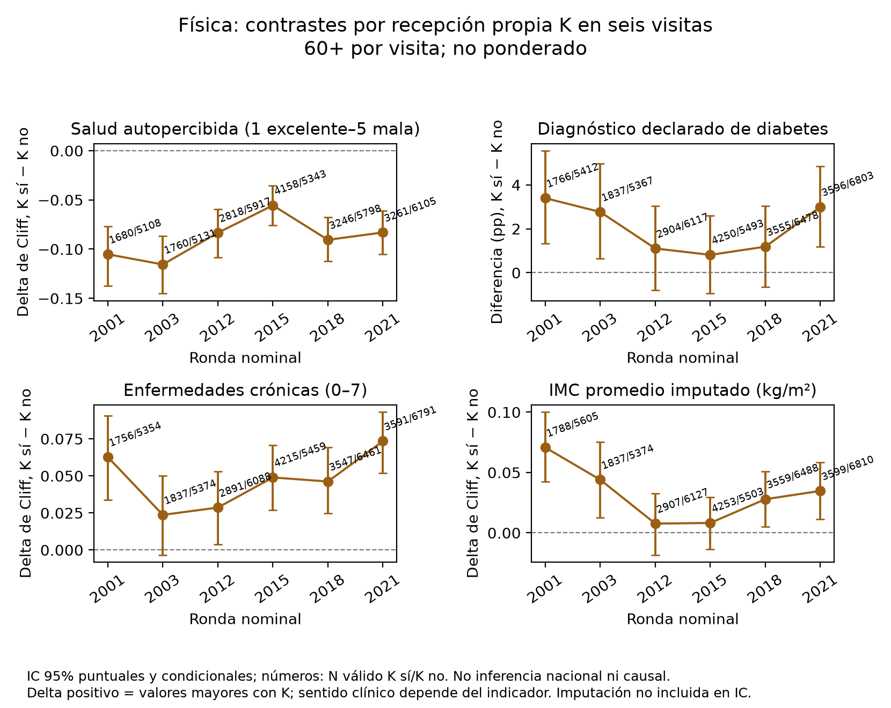

**Interpretación:** Salud autopercibida presenta deltas negativos (1=excelente, 5=mala), pero diabetes diagnosticada y número de enfermedades presentan contrastes positivos pequeños. IMC más alto no se interpreta automáticamente como peor salud o suficiencia. En 2021, diabetes muestra +3.00 pp (IC 1.17–4.84), no una diferencia causal de incidencia; es diagnóstico alguna vez declarado.

**Fuente y nota:** ENASEM; IC 95% puntuales y condicionales; números: N válido K sí/K no. No inferencia nacional ni causal. Delta positivo = valores mayores con K; sentido clínico depende del indicador. Imputación no incluida en IC.

**Fuente y procedencia:** ENASEM; [03_PENSIONES_SALUD_COGNICION](../notebooks/03_PENSIONES_SALUD_COGNICION.ipynb), bloque 3: tamaños de efecto; [agregados completos](../data/interim/pensiones_salud/resultados.json).

**Figura 14. Mental: contrastes por recepción propia K en seis visitas**

**Objetivo y aporte:** Comparar contrastes de la misma dimensión entre visitas sin sumar universos ni imponer una dirección favorable.

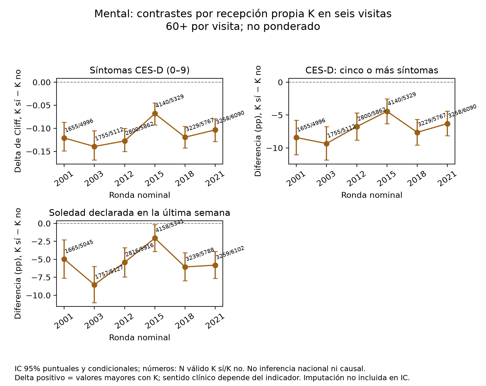

**Interpretación:** Síntomas CES-D, cinco o más síntomas y soledad presentan contrastes brutos negativos en las seis rondas. En 2021, medianas de síntomas son 2/3, con delta −0.103; cinco o más síntomas difieren −6.30 pp y soledad −5.81 pp. No son diagnósticos clínicos ni prueban un efecto protector. La estandarización posterior atenúa el contraste medio de síntomas.

**Fuente y nota:** ENASEM; IC 95% puntuales y condicionales; números: N válido K sí/K no. No inferencia nacional ni causal. Delta positivo = valores mayores con K; sentido clínico depende del indicador. Imputación no incluida en IC.

**Fuente y procedencia:** ENASEM; [03_PENSIONES_SALUD_COGNICION](../notebooks/03_PENSIONES_SALUD_COGNICION.ipynb), bloque 3: tamaños de efecto; [agregados completos](../data/interim/pensiones_salud/resultados.json).

**Figura 15. Cognición: contrastes por recepción propia K en seis visitas**

**Objetivo y aporte:** Comparar contrastes de la misma dimensión entre visitas sin sumar universos ni imponer una dirección favorable.

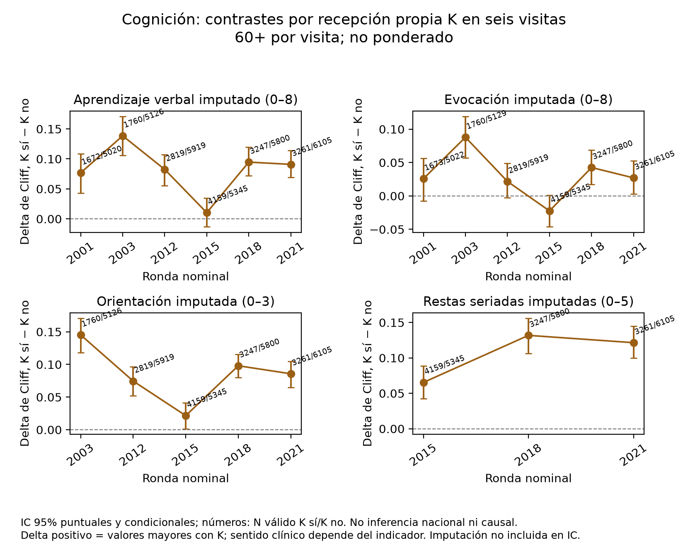

**Interpretación:** Aprendizaje verbal muestra un contraste global positivo pequeño, mínimo en 2015. Evocación cambia de signo en 2015. Orientación no se mide en 2001 y restas seriadas comienzan en 2015. Estas son puntuaciones imputadas en escalas distintas; los IC no incluyen la incertidumbre de sus imputaciones. La lectura global de aprendizaje cambia dentro de escolaridad.

**Fuente y nota:** ENASEM; IC 95% puntuales y condicionales; números: N válido K sí/K no. No inferencia nacional ni causal. Delta positivo = valores mayores con K; sentido clínico depende del indicador. Imputación no incluida en IC.

**Fuente y procedencia:** ENASEM; [03_PENSIONES_SALUD_COGNICION](../notebooks/03_PENSIONES_SALUD_COGNICION.ipynb), bloque 3: tamaños de efecto; [agregados completos](../data/interim/pensiones_salud/resultados.json).

**Figura 16. Funcionalidad: contrastes por recepción propia K en seis visitas**

**Objetivo y aporte:** Comparar contrastes de la misma dimensión entre visitas sin sumar universos ni imponer una dirección favorable.

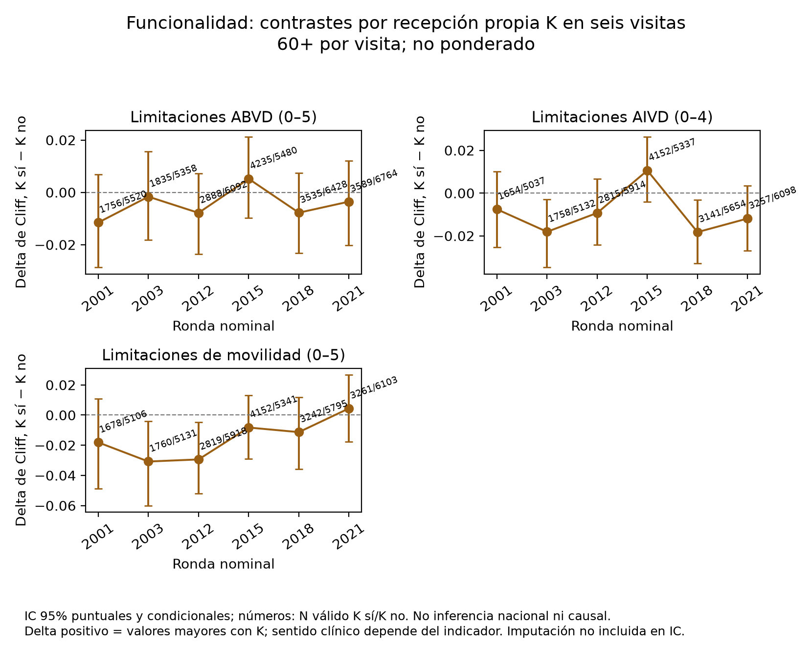

**Interpretación:** ABVD, AIVD y movilidad presentan diferencias pequeñas y algunos cambios de signo; las medianas ABVD/AIVD son cero en 2021 en ambas ramas. Conservar estos contrastes cercanos a cero impide concluir una mejor funcionalidad general asociada a K propia. Los IC no excluyen sistemáticamente efectos pequeños en uno u otro sentido.

**Fuente y nota:** ENASEM; IC 95% puntuales y condicionales; números: N válido K sí/K no. No inferencia nacional ni causal. Delta positivo = valores mayores con K; sentido clínico depende del indicador. Imputación no incluida en IC.

**Fuente y procedencia:** ENASEM; [03_PENSIONES_SALUD_COGNICION](../notebooks/03_PENSIONES_SALUD_COGNICION.ipynb), bloque 3: tamaños de efecto; [agregados completos](../data/interim/pensiones_salud/resultados.json).

**Figura 17. Distribuciones por K propia: cuatro dimensiones, 2021**

**Objetivo y aporte:** Contrastar la forma de las distribuciones, incluidos ceros y asimetría, más allá de medianas.

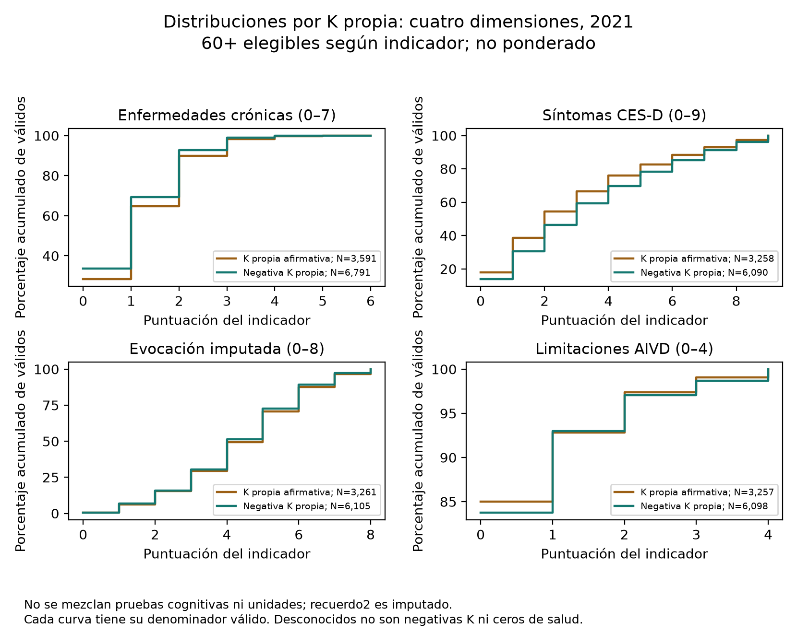

**Interpretación:** Las distribuciones de enfermedades y síntomas no apuntan a una sola dirección de mejor salud; memoria y AIVD tienen escalas y coberturas propias. Las curvas se normalizan por sus N válidos; las filas ND no se agregan a cero.

**Fuente y nota:** ENASEM; No se mezclan pruebas cognitivas ni unidades; recuerdo2 es imputado. Cada curva tiene su denominador válido. Desconocidos no son negativas K ni ceros de salud.

**Fuente y procedencia:** ENASEM; [03_PENSIONES_SALUD_COGNICION](../notebooks/03_PENSIONES_SALUD_COGNICION.ipynb), bloque 4: distribuciones; [agregados completos](../data/interim/pensiones_salud/resultados.json).

<!-- END salud_principal -->

<!-- BEGIN salud_complementarios -->

### 7.10 Otras ramas de recepción y titularidad: notebook 03

**Cuadro 12. Contrastes complementarios por rama de recepción, 2021**

**Objetivo y aporte:** Distinguir K propia, cónyuge confirmado y A sin atribuirles el mismo universo ni la misma definición.

| Indicador | Rama | N elegible | N válido sí/no | Delta | IC 95% |
| --- | --- | --- | --- | --- | --- |
| n_enf | K propia | 10482 | 3,591/6,791 | 0.073 | [0.052, 0.093] |
| n_enf | A propia | 10482 | 5,565/4,812 | 0.081 | [0.062, 0.102] |
| n_enf | K cónyuge confirmado | 6071 | 1,543/4,499 | 0.130 | [0.100, 0.160] |
| n_sint_depr | K propia | 9424 | 3,258/6,090 | -0.103 | [-0.129, -0.079] |
| n_sint_depr | A propia | 9424 | 4,913/4,432 | 0.089 | [0.065, 0.113] |
| n_sint_depr | K cónyuge confirmado | 5589 | 1,445/4,123 | 0.002 | [-0.035, 0.038] |
| recuerdo2 | K propia | 9424 | 3,261/6,105 | 0.027 | [0.003, 0.052] |
| recuerdo2 | A propia | 9424 | 4,924/4,439 | -0.230 | [-0.252, -0.206] |
| recuerdo2 | K cónyuge confirmado | 5589 | 1,446/4,134 | 0.143 | [0.110, 0.176] |
| n_aivd | K propia | 9424 | 3,257/6,098 | -0.012 | [-0.027, 0.003] |
| n_aivd | A propia | 9424 | 4,918/4,434 | 0.113 | [0.100, 0.127] |
| n_aivd | K cónyuge confirmado | 5589 | 1,444/4,127 | 0.024 | [0.005, 0.044] |

**Nota:** Cada fila contrasta afirmativa versus negativa de esa rama. Pueden coexistir; no se comparan grupos mutuamente excluyentes entre filas. Cónyuge exige pareja confirmada; su universo de salud puede restringirse a directas. A no es una pensión no contributiva homologada.

**Fuente y procedencia:** ENASEM; [03_PENSIONES_SALUD_COGNICION](../notebooks/03_PENSIONES_SALUD_COGNICION.ipynb), bloque 7: otras ramas; [agregados completos](../data/interim/pensiones_salud/resultados.json).

En 2021, síntomas con A propia presentan delta +0.089 y con cónyuge confirmado +0.002, frente a −0.103 con K propia. Evocación con A tiene delta −0.230 y con cónyuge +0.143; no son efectos alternativos del mismo tratamiento. El notebook conserva además distribuciones por ambas, solo propia, solo cónyuge, ambas negativas y desconocido; sin pareja residente queda separado. Antes de 2018 el universo de pareja no está confirmado: no se ejecuta su contraste complementario.

<!-- END salud_complementarios -->

## 8. Relaciones trivariadas

**Pregunta:** ¿se mantienen los contrastes al examinar simultáneamente tres variables? Los perfiles de 2021 utilizan las mismas 10,482 personas únicas de 60+; los denominadores de estrato y respuesta válida se reportan en cada resultado. T1–T8 se conservan como cruces exploratorios, sin modelado ajustado, elección de hipótesis principal ni conclusión causal. Las figuras elegidas muestran perfiles complementarios; no se duplican todas las matrices de celdas.

### 8.1 T1_2021 · Pensión × Sexo × Educación

**Interpretación y alcance:** La recepción propia K entre respuestas conocidas alcanza 533/925 (57.62%) en Hombre / ≥10 años, frente a 162/1,052 (15.40%) en Mujer / 0 años: diferencia descriptiva de 42.22 puntos porcentuales. Los desconocidos respectivos son 10 y 1. La tabla distingue esa tasa de la composición de receptores y presenta la rama del cónyuge por separado.

Al fijar escolaridad inicial en 6 años, la amplitud entre categorías de sexo es 18.59 pp, mientras en ≥10 años es 0.55 pp. Este contraste condicionado describe heterogeneidad, no prueba interacción causal o significancia; las celdas pequeñas y sus N conocidos están visibles en el respaldo.

V de Cramér entre pensión propia y la característica estudiada oscila de 0.0054 (N=1,526) a 0.1931 (N=2,243) dentro de los estratos evaluables. No se ejecutan pruebas de significancia ni selección confirmatoria entre múltiples contrastes.

**Figura 18. Pensión × Sexo × Educación · 2021**

**Pregunta y aporte:** Examinar heterogeneidad condicionada y conservar contrastes pequeños junto con los mayores.

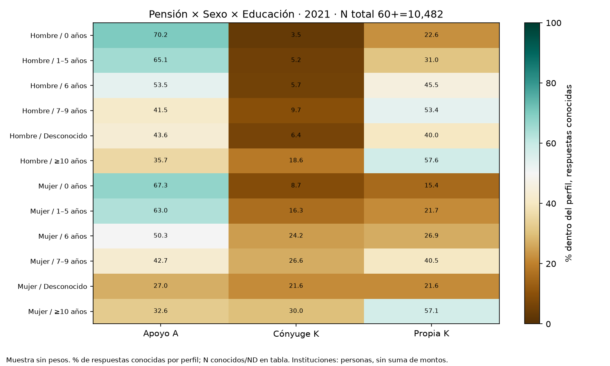

**Fuente y nota:** ENASEM, figura previamente calculada; Tres dimensiones simultáneas; N de estrato y válido en la tabla original. Celdas pequeñas y ND condicionan la interpretación.

**Procedencia:** ENASEM, agregados conservados en [T1_2021.json](../data/interim/eda_pensionaria/tablas/T1_2021.json); notebook [02_EDA_COMPLETO](../notebooks/02_EDA_COMPLETO.ipynb), bloque Resultados trivariados T1_2021.

### 8.2 T2_2021 · Pensión × Edad × Sexo

**Interpretación y alcance:** La recepción propia K entre respuestas conocidas alcanza 531/1,032 (51.45%) en 70–74 / Hombre, frente a 252/1,267 (19.89%) en 60–64 / Mujer: diferencia descriptiva de 31.56 puntos porcentuales. Los desconocidos respectivos son 9 y 7. La tabla distingue esa tasa de la composición de receptores y presenta la rama del cónyuge por separado.

Al fijar sexo en Hombre, la amplitud entre categorías de edad quinquenal es 24.52 pp, mientras en Mujer es 15.30 pp. Este contraste condicionado describe heterogeneidad, no prueba interacción causal o significancia; las celdas pequeñas y sus N conocidos están visibles en el respaldo.

V de Cramér entre pensión propia y la característica estudiada oscila de 0.1185 (N=5,831) a 0.1906 (N=4,578) dentro de los estratos evaluables. No se ejecutan pruebas de significancia ni selección confirmatoria entre múltiples contrastes.

**Procedencia:** ENASEM, agregados conservados en [T2_2021.json](../data/interim/eda_pensionaria/tablas/T2_2021.json); notebook [02_EDA_COMPLETO](../notebooks/02_EDA_COMPLETO.ipynb), bloque Resultados trivariados T2_2021.

### 8.3 T3_2021 · Pensión × Educación × Localidad

**Interpretación y alcance:** La recepción propia K entre respuestas conocidas alcanza 172/297 (57.91%) en ≥10 años / <100 mil habitantes, frente a 128/1,064 (12.03%) en 0 años / <100 mil habitantes: diferencia descriptiva de 45.88 puntos porcentuales. Los desconocidos respectivos son 2 y 4. La tabla distingue esa tasa de la composición de receptores y presenta la rama del cónyuge por separado.

Al fijar tamaño de localidad en <100 mil habitantes, la amplitud entre categorías de escolaridad inicial es 45.88 pp, mientras en ≥100 mil habitantes es 28.78 pp. Este contraste condicionado describe heterogeneidad, no prueba interacción causal o significancia; las celdas pequeñas y sus N conocidos están visibles en el respaldo.

V de Cramér entre pensión propia y la característica estudiada oscila de 0.1928 (N=5,786) a 0.2765 (N=4,476) dentro de los estratos evaluables. No se ejecutan pruebas de significancia ni selección confirmatoria entre múltiples contrastes.

**Figura 19. Pensión × Educación × Localidad · 2021**

**Pregunta y aporte:** Examinar heterogeneidad condicionada y conservar contrastes pequeños junto con los mayores.

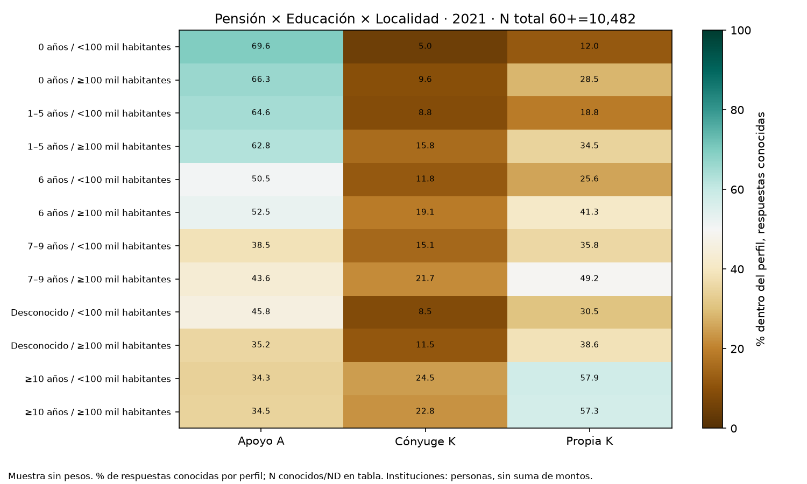

**Fuente y nota:** ENASEM, figura previamente calculada; Tres dimensiones simultáneas; N de estrato y válido en la tabla original. Celdas pequeñas y ND condicionan la interpretación.

**Procedencia:** ENASEM, agregados conservados en [T3_2021.json](../data/interim/eda_pensionaria/tablas/T3_2021.json); notebook [02_EDA_COMPLETO](../notebooks/02_EDA_COMPLETO.ipynb), bloque Resultados trivariados T3_2021.

### 8.4 T4_2021 · Pensión × Apoyo × Localidad

**Interpretación y alcance:** Las nueve combinaciones K/A reconcilian 10,482 registros: 2,019 presentan ambas afirmativas, 3,558 apoyo y negativa explícita K, y 86 desconocimiento de al menos una respuesta. Una negativa K no acredita ausencia de cualquier pensión; el apoyo puede incluir dinero o especie.

Condicionando simultáneamente por tamaño de localidad: <100 mil habitantes: A entre K sí 603/1,045 (57.70%), entre K no 2,026/3,486 (58.12%); ≥100 mil habitantes: A entre K sí 1,416/2,546 (55.62%), entre K no 1,532/3,319 (46.16%).

V de Cramér entre pensión propia y la característica estudiada oscila de 0.0035 (N=4,531) a 0.0938 (N=5,865) dentro de los estratos evaluables. No se ejecutan pruebas de significancia ni selección confirmatoria entre múltiples contrastes.

**Figura 20. Pensión × Apoyo × Localidad · 2021**

**Pregunta y aporte:** Examinar heterogeneidad condicionada y conservar contrastes pequeños junto con los mayores.

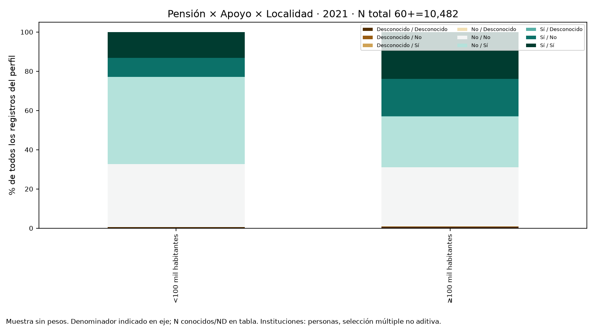

**Fuente y nota:** ENASEM, figura previamente calculada; Tres dimensiones simultáneas; N de estrato y válido en la tabla original. Celdas pequeñas y ND condicionan la interpretación.

**Procedencia:** ENASEM, agregados conservados en [T4_2021.json](../data/interim/eda_pensionaria/tablas/T4_2021.json); notebook [02_EDA_COMPLETO](../notebooks/02_EDA_COMPLETO.ipynb), bloque Resultados trivariados T4_2021.

### 8.5 T5_2021 · Pensión × Apoyo × Sexo

**Interpretación y alcance:** Las nueve combinaciones K/A reconcilian 10,482 registros: 2,019 presentan ambas afirmativas, 3,558 apoyo y negativa explícita K, y 86 desconocimiento de al menos una respuesta. Una negativa K no acredita ausencia de cualquier pensión; el apoyo puede incluir dinero o especie.

Condicionando simultáneamente por sexo: Hombre: A entre K sí 1,095/1,914 (57.21%), entre K no 1,339/2,656 (50.41%); Mujer: A entre K sí 924/1,677 (55.10%), entre K no 2,219/4,149 (53.48%).

V de Cramér entre pensión propia y la característica estudiada oscila de 0.0147 (N=5,826) a 0.0672 (N=4,570) dentro de los estratos evaluables. No se ejecutan pruebas de significancia ni selección confirmatoria entre múltiples contrastes.

**Procedencia:** ENASEM, agregados conservados en [T5_2021.json](../data/interim/eda_pensionaria/tablas/T5_2021.json); notebook [02_EDA_COMPLETO](../notebooks/02_EDA_COMPLETO.ipynb), bloque Resultados trivariados T5_2021.

### 8.6 T6_2021 · Pensión × Edad × Educación

**Interpretación y alcance:** La recepción propia K entre respuestas conocidas alcanza 141/181 (77.90%) en 75–79 / ≥10 años, frente a 20/201 (9.95%) en 60–64 / 0 años: diferencia descriptiva de 67.95 puntos porcentuales. Los desconocidos respectivos son 3 y 1. La tabla distingue esa tasa de la composición de receptores y presenta la rama del cónyuge por separado.

Al fijar escolaridad inicial en ≥10 años, la amplitud entre categorías de edad quinquenal es 38.65 pp, mientras en 0 años es 13.07 pp. Este contraste condicionado describe heterogeneidad, no prueba interacción causal o significancia; las celdas pequeñas y sus N conocidos están visibles en el respaldo.

V de Cramér entre pensión propia y la característica estudiada oscila de 0.1215 (N=1,685) a 0.3478 (N=147) dentro de los estratos evaluables. No se ejecutan pruebas de significancia ni selección confirmatoria entre múltiples contrastes.

**Procedencia:** ENASEM, agregados conservados en [T6_2021.json](../data/interim/eda_pensionaria/tablas/T6_2021.json); notebook [02_EDA_COMPLETO](../notebooks/02_EDA_COMPLETO.ipynb), bloque Resultados trivariados T6_2021.

### 8.7 T7_2021 · Pensión × Ocupación × Edad

**Interpretación y alcance:** La recepción propia K entre respuestas conocidas alcanza 419/689 (60.81%) en Retirado, incapacitado o no trabaja / 65–69, frente a 67/627 (10.69%) en Labores del hogar / 60–64: diferencia descriptiva de 50.13 puntos porcentuales. Los desconocidos respectivos son 7 y 3. La tabla distingue esa tasa de la composición de receptores y presenta la rama del cónyuge por separado.

Al fijar edad quinquenal en 60–64, la amplitud entre categorías de condición de actividad es 48.83 pp, mientras en 80+ es 18.96 pp. Este contraste condicionado describe heterogeneidad, no prueba interacción causal o significancia; las celdas pequeñas y sus N conocidos están visibles en el respaldo.

V de Cramér entre pensión propia y la característica estudiada oscila de 0.1419 (N=1,951) a 0.4858 (N=2,392) dentro de los estratos evaluables. No se ejecutan pruebas de significancia ni selección confirmatoria entre múltiples contrastes.

**Procedencia:** ENASEM, agregados conservados en [T7_2021.json](../data/interim/eda_pensionaria/tablas/T7_2021.json); notebook [02_EDA_COMPLETO](../notebooks/02_EDA_COMPLETO.ipynb), bloque Resultados trivariados T7_2021.

### 8.8 T8_2021 · Pensión × Patrimonio × Educación

**Interpretación y alcance:** El patrimonio pertenece al entrevistado y su cónyuge, si lo hay; los registros no son hogares distintos. Se conservan ceros y negativos. Los contrastes son internos a la ronda; no se calcula crecimiento real ni vulnerabilidad.

La auditoría 10 identifica aquí cruces escasos, incluido un perfil ND menor de 10, y una selección retrospectiva de extremos de mediana. Esa comparación no se conserva como evidencia de necesidad. Se reformula a escolaridad 0–5/6+ y titularidad conocida, aplicando la misma regla a todos los grupos. Los conteos de exclusión y el cuadro corregido aparecen en 10.9; la figura 21 se regenera sin ramas desconocidas y sin grupos no revisados.

Spearman imp_neto–monto_k_propio_mensual_observado_parcial: ρ=0.2643, N válido=3,347; asociación de rangos dentro de ronda.

Asociación condicionada entre recepción propia y patrimonio por escolaridad: 0 años: Spearman ρ=0.0647, N=1,685; 1–5 años: Spearman ρ=0.0987, N=3,043; 6 años: Spearman ρ=0.0887, N=2,243; 7–9 años: Spearman ρ=0.0553, N=1,765; Desconocido: Spearman ρ=0.1132, N=147; ≥10 años: Spearman ρ=0.1247, N=1,526. Patrimonio compartido y composición; no efecto causal ni outcome.

**Figura 21. Pensión × Patrimonio × Educación · 2021**

**Pregunta y aporte:** Examinar heterogeneidad condicionada y conservar contrastes pequeños junto con los mayores.

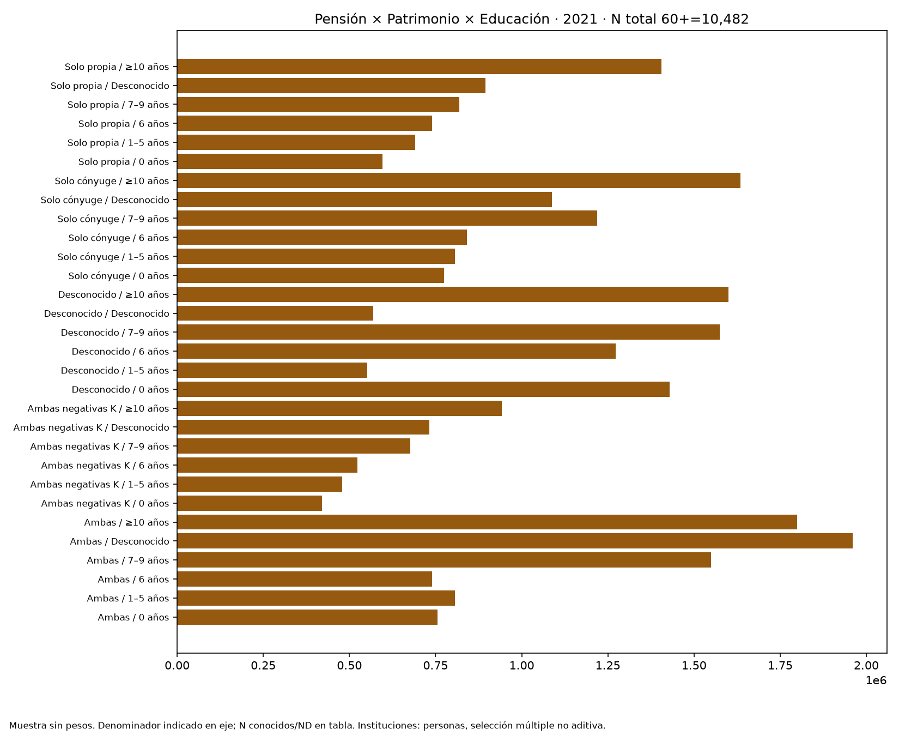

**Fuente y nota:** ENASEM, figura previamente calculada; Tres dimensiones simultáneas; N de estrato y válido en la tabla original. Celdas pequeñas y ND condicionan la interpretación.

**Procedencia:** ENASEM, agregados conservados en [T8_2021.json](../data/interim/eda_pensionaria/tablas/T8_2021.json); notebook [02_EDA_COMPLETO](../notebooks/02_EDA_COMPLETO.ipynb), bloque Resultados trivariados T8_2021.

### 8.9 Instituciones, montos y orientación: contrastes complementarios

C1–C4 no reemplazan los cruces anteriores: utilizan instituciones, montos y roles cuya unidad debe mantenerse explícita.

**Institución × Sexo × Educación**

**Interpretación y alcance:** Institución × Sexo × Educación, 2021: La celda más numerosa es código institucional 1 en Hombre / 6 años: 353/441 personas receptoras con institución identificada (80.05%). No es tasa en toda la población; selección múltiple por contingencia en 2012/2015 impide vincular cada institución a un monto. Descriptivo sin ponderar; las tres dimensiones se usan simultáneamente. Titularidad definitiva pendiente.

**Procedencia:** ENASEM, agregados conservados en [C1_2021.json](../data/interim/eda_pensionaria/tablas/C1_2021.json); notebook [02_EDA_COMPLETO](../notebooks/02_EDA_COMPLETO.ipynb), bloque Complementarios C1_2021.

**Institución × Edad × Localidad**

**Interpretación y alcance:** Institución × Edad × Localidad, 2021: La celda más numerosa es código institucional 1 en 70–74 / ≥100 mil habitantes: 446/639 personas receptoras con institución identificada (69.80%). No es tasa en toda la población; selección múltiple por contingencia en 2012/2015 impide vincular cada institución a un monto. Descriptivo sin ponderar; las tres dimensiones se usan simultáneamente. Titularidad definitiva pendiente.

**Procedencia:** ENASEM, agregados conservados en [C2_2021.json](../data/interim/eda_pensionaria/tablas/C2_2021.json); notebook [02_EDA_COMPLETO](../notebooks/02_EDA_COMPLETO.ipynb), bloque Complementarios C2_2021.

**Monto pensionario × Sexo × Educación**

**Interpretación y alcance:** Monto pensionario × Sexo × Educación, 2021: Mediana mensual por evento: 12,000.00 en Mujer / ≥10 años, N=349, frente a 2,700.00 en Mujer / 0 años, N=165. Un beneficiario puede aportar varios eventos; no es mediana de ingreso total personal ni comparación real entre ondas. Descriptivo sin ponderar; las tres dimensiones se usan simultáneamente. Titularidad definitiva pendiente.

**Procedencia:** ENASEM, agregados conservados en [C3_2021.json](../data/interim/eda_pensionaria/tablas/C3_2021.json); notebook [02_EDA_COMPLETO](../notebooks/02_EDA_COMPLETO.ipynb), bloque Complementarios C3_2021.

**Titularidad × Sexo × Estado conyugal**

**Interpretación y alcance:** Titularidad × Sexo × Estado conyugal, 2021: Ambas en Hombre / Casado o unión libre: 249/3,534 (7.05%). Los estados desconocidos no se reclasifican como ausencia ni se atribuyen pensiones por estado conyugal. Descriptivo sin ponderar; las tres dimensiones se usan simultáneamente. Titularidad definitiva pendiente.

**Procedencia:** ENASEM, agregados conservados en [C4_2021.json](../data/interim/eda_pensionaria/tablas/C4_2021.json); notebook [02_EDA_COMPLETO](../notebooks/02_EDA_COMPLETO.ipynb), bloque Complementarios C4_2021.

<!-- BEGIN salud_trivariados -->

### 8.10 Pensiones, salud y perfiles simultáneos: notebook 03

**Cuadro 13. Contrastes K propia × indicador × estrato seleccionados, 2021**

**Objetivo y aporte:** Examinar simultáneamente recepción, salud y un perfil sustantivo; priorizar los seis cruces solicitados, sin todas las combinaciones posibles.

| Indicador | Tercera variable / estrato | N válido K sí/no | Unidad | Sí − no | IC 95% |
| --- | --- | --- | --- | --- | --- |
| n_sint_depr | Hombre | 1,753/2,372 | Delta | -0.102 | [-0.138, -0.067] |
| n_sint_depr | Mujer | 1,505/3,718 | Delta | -0.048 | [-0.084, -0.008] |
| salud_glob | 60–69 | 1,193/3,075 | Delta | -0.100 | [-0.134, -0.066] |
| salud_glob | 70–79 | 1,471/2,137 | Delta | -0.110 | [-0.143, -0.079] |
| salud_glob | 80+ | 597/893 | Delta | -0.041 | [-0.094, 0.012] |
| recuerdo1 | 0 años | 251/1,130 | Delta | -0.028 | [-0.104, 0.049] |
| recuerdo1 | 1–5 años | 693/2,026 | Delta | -0.017 | [-0.069, 0.029] |
| recuerdo1 | 6 años | 713/1,349 | Delta | -0.075 | [-0.128, -0.021] |
| recuerdo1 | 7–9 años | 758/893 | Delta | -0.066 | [-0.120, -0.007] |
| recuerdo1 | ≥10 años | 801/621 | Delta | -0.041 | [-0.106, 0.018] |
| n_aivd | 60–69 | 1,193/3,072 | Delta | -0.008 | [-0.024, 0.009] |
| n_aivd | 70–79 | 1,468/2,134 | Delta | -0.056 | [-0.077, -0.031] |
| n_aivd | 80+ | 596/892 | Delta | -0.030 | [-0.081, 0.021] |
| diabetes | Hombre | 1,917/2,654 | pp | 7.402 | [4.857, 9.964] |
| diabetes | Mujer | 1,679/4,149 | pp | 0.883 | [-1.721, 3.539] |
| recuerdo1 | Q1 | 580/1,696 | Delta | 0.092 | [0.046, 0.152] |
| recuerdo1 | Q2 | 745/1,612 | Delta | 0.059 | [0.012, 0.107] |
| recuerdo1 | Q3 | 894/1,472 | Delta | 0.062 | [0.016, 0.108] |
| recuerdo1 | Q4 | 1,042/1,325 | Delta | 0.079 | [0.035, 0.122] |

**Nota:** Todos los estratos comparan K propia. IC puntuales y muestras no ponderadas. Q1–Q4 son cuartiles de patrimonio persona/cónyuge válidos dentro de ronda, no pobreza ni ingreso. No se probó interacción formal.

**Fuente y procedencia:** ENASEM; [03_PENSIONES_SALUD_COGNICION](../notebooks/03_PENSIONES_SALUD_COGNICION.ipynb), bloque 5: trivariados; [agregados completos](../data/interim/pensiones_salud/resultados.json).

En diabetes, la diferencia es +7.40 pp entre hombres y +0.88 pp entre mujeres; síntomas tienen delta −0.102/−0.048 respectivamente. Salud global muestra contrastes −0.100/−0.110/−0.041 en edades 60–69/70–79/80+, mientras AIVD muestra −0.008/−0.056/−0.030. Son diferencias de patrones descriptivos; no pruebas confirmadas de que sexo o edad modifiquen un efecto causal. Los cruces de movilidad, evocación y localidad, junto con las seis rondas y celdas no estimables, permanecen completos en el notebook.

**Figura 22. Contrastes condicionados por educacion: 2021**

**Objetivo y aporte:** Contrastar el patrón cognitivo dentro de escolaridad y patrimonio, en lugar de extrapolar el contraste marginal positivo.

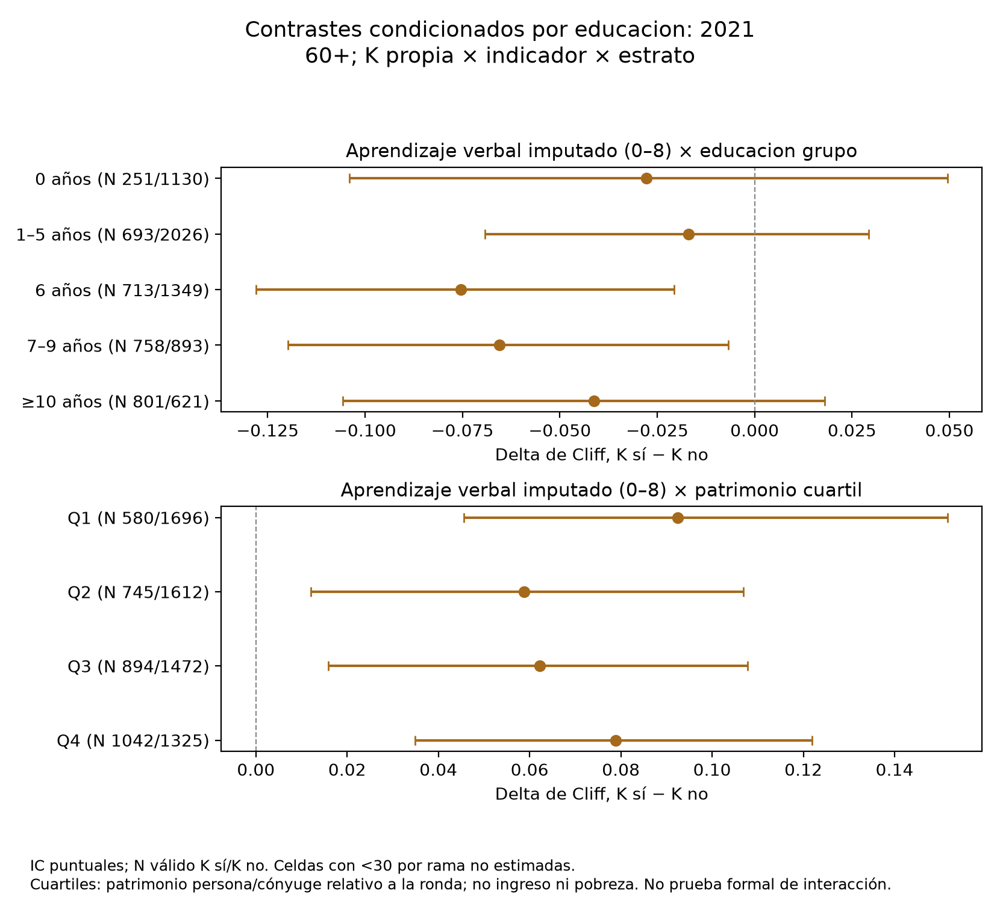

**Interpretación:** Los cinco estratos conocidos de escolaridad muestran deltas negativos de aprendizaje en 2021, aunque el marginal es +0.091; los cuatro cuartiles patrimoniales muestran deltas positivos pequeños. No se ha controlado simultáneamente todo perfil ni comprobado interacción. Composición, agrupación, forma de distribución y ND condicionan estas diferencias.

**Fuente y nota:** ENASEM; IC puntuales; N válido K sí/K no. Celdas con <30 por rama no estimadas. Cuartiles: patrimonio persona/cónyuge relativo a la ronda; no ingreso ni pobreza. No prueba formal de interacción.

**Fuente y procedencia:** ENASEM; [03_PENSIONES_SALUD_COGNICION](../notebooks/03_PENSIONES_SALUD_COGNICION.ipynb), bloque 5: cognición × escolaridad/patrimonio; [agregados completos](../data/interim/pensiones_salud/resultados.json).

<!-- END salud_trivariados -->

<!-- BEGIN salud_ajuste -->

### 8.11 Estandarización descriptiva de composición: notebook 03

**Cuadro 14. Contraste crudo y estandarizado en el mismo soporte, 2021**

**Objetivo y aporte:** Evaluar cuánto cambia la diferencia media/proporcional al usar una composición común de características observadas.

| Indicador | N soporte | N fuera soporte | Unidad | Cruda | Estandarizada | IC inferior | IC superior |
| --- | --- | --- | --- | --- | --- | --- | --- |
| diabetes | 9752 | 647 | pp | 2.990 | 5.500 | 3.407 | 7.594 |
| n_enf | 9738 | 644 | enfermedades | 0.122 | 0.189 | 0.144 | 0.234 |
| bmi_imp | 9762 | 647 | kg/m² | 0.206 | 0.472 | 0.268 | 0.677 |
| n_sint_depr | 9171 | 177 | síntomas | -0.434 | -0.071 | -0.190 | 0.048 |
| recuerdo1 | 9189 | 177 | puntos 0–8 | 0.177 | 0.107 | 0.059 | 0.155 |
| n_aivd | 9179 | 176 | limitaciones | -0.021 | 0.007 | -0.027 | 0.040 |

**Nota:** Target: pares válidos en celdas sexo×edad(60–69/70–79/80+)×escolaridad(0–5/6–9/10+)×modalidad con al menos 20 por rama. Pesos internos de composición, no pesos de encuesta. IC normal condicional a celdas, sin incertidumbre MI/diseño. No hubo regresión ni modelo predictivo.

**Fuente y procedencia:** ENASEM; [03_PENSIONES_SALUD_COGNICION](../notebooks/03_PENSIONES_SALUD_COGNICION.ipynb), bloque 6: estandarización; [agregados completos](../data/interim/pensiones_salud/resultados.json).

La diferencia media de síntomas pasa de −0.434 a −0.071 en el mismo soporte (IC [−0.190, 0.048]); no conserva un contraste claro al considerar esta composición. La diferencia media de aprendizaje estandarizada es +0.107, mientras los deltas por escolaridad son negativos: no son la misma medida ni el mismo condicionamiento. Las bandas de escolaridad del ajuste agrupan niveles, los estratos se restringen a soporte común y las medias dependen de toda la distribución. No elegir la medida que respalde una conclusión; ambas se conservan con sus límites. La estandarización no elimina sesgo de selección, diferencias residuales o incertidumbre de imputación.

<!-- END salud_ajuste -->

## 9. Trayectorias longitudinales

**Cuadro 15. Presencia, fallecimiento registrado y ausencia entre visitas**

**Pregunta y aporte:** Distinguir supervivencia de observación de cambios en recepción, manteniendo la cohorte de origen.

| Origen | Destino | Años | N origen vivo 60+ | Presente | Sobre fallecido | Ausente | Reaparece |
| --- | --- | --- | --- | --- | --- | --- | --- |
| 2001 | 2003 | 2 | 7416 | 7022 | 456 | 394 | 166 |
| 2003 | 2012 | 9 | 7691 | 6939 | 2235 | 752 | 281 |
| 2012 | 2015 | 3 | 9886 | 9423 | 1000 | 463 | 199 |
| 2015 | 2018 | 3 | 10416 | 9391 | 1019 | 1025 | 639 |
| 2018 | 2021 | 3 | 10113 | 9650 | 1415 | 463 | 0 |

**Nota:** Sobre fallecido está dentro de presente en destino; reaparición posterior está dentro de ausente. Las columnas no son todas excluyentes ni deben sumarse entre sí. No se exigen seis visitas completas.

**Procedencia:** ENASEM, agregados conservados en [resultados.json](../data/interim/eda_pensionaria/resultados.json); notebook [02_EDA_COMPLETO](../notebooks/02_EDA_COMPLETO.ipynb), bloque EDA pensionario.

**Cuadro 16. Comparabilidad de la recepción entre instrumentos**

**Pregunta y aporte:** Mostrar qué intervalos no permiten interpretar una diferencia como transición homologada.

| Variable | Origen | Destino | Condicionada comparable | Motivo |
| --- | --- | --- | --- | --- |
| pension_propia_k | 2001 | 2003 | Sí | Mismas cuatro contingencias; orientación 2001 solo del proveedor. Condicionada, no definitiva. |
| pension_propia_k | 2003 | 2012 | No | En 2012 aparece categoría federal/estatal agrupada; no transición homogénea de cobertura K. |
| pension_propia_k | 2012 | 2015 | Sí | Mismas contingencias y selección institucional múltiple; aumenta captura de slots. Recepción binaria condicionada. |
| pension_propia_k | 2015 | 2018 | No | Cambio de lista/estructura institucional y de donativos; no declarar pérdida homogénea de pensión. |
| pension_propia_k | 2018 | 2021 | Sí | Cuatro contingencias y slots similares; se mantiene control doble. Comparación condicionada de K, no de toda pensión. |
| apoyo_propio | 2001 | 2003 | No | Ejemplos y alcance incorporan Seguro Popular en 2003; negativos históricos no equivalentes sin sensibilidad. |
| apoyo_propio | 2003 | 2012 | Sí | Donativo público dinero/especie adicional en año previo; categoría amplia, programa no identificable. Condicionada. |
| apoyo_propio | 2012 | 2015 | Sí | Mismo concepto agregado; nombres de ejemplos cambian. Condicionada al agregado, no continuidad de programas. |
| apoyo_propio | 2015 | 2018 | Sí | Mismo donativo adicional, dinero/especie; 2018 desglosa hasta dos instituciones. Solo recepción agregada condicionada. |
| apoyo_propio | 2018 | 2021 | No | 2021 incorpora explícitamente vejez en opción 5 y cambia programas; no interpretar un inicio como expansión causal. |

**Nota:** Comparabilidad condicionada no es homologación definitiva. K 2003–2012/K 2015–2018 y A 2001–2003/A 2018–2021 requieren especial cautela.

**Procedencia:** ENASEM, agregados conservados en [resultados.json](../data/interim/proteccion_economica/resultados.json); notebook [02_EDA_COMPLETO](../notebooks/02_EDA_COMPLETO.ipynb), bloque EDA pensionario.

### 9.1 L_P_sexo_grupo_2001_2003 · P 2001–2003 por Sexo

**Interpretación y alcance:** Cohorte 60+ viva en 2001: 7,416. Inicio observado 327, continuidad 1,299, pérdida observada 177. Mismas cuatro contingencias; orientación 2001 solo del proveedor. Condicionada, no definitiva.. Los perfiles se fijan en origen. Muerte registrada y ausencia no son pérdida de recepción. El denominador de cada fila de transición está en N_origen_estado; no se requieren seis rondas completas.

Perfil de origen: Hombre: N origen 3,451, fallecidos 233, ausentes 193, recepción final ND 165, inicios 198/1,931 negativas iniciales con final conocido (10.25%); Mujer: N origen 3,965, fallecidos 223, ausentes 201, recepción final ND 273, inicios 129/2,708 negativas iniciales con final conocido (4.76%).

**Figura 23. P 2001–2003 por Sexo**

**Pregunta y aporte:** Comparar trayectorias observadas dentro de cohortes y perfiles de origen, contrastando la comparabilidad.

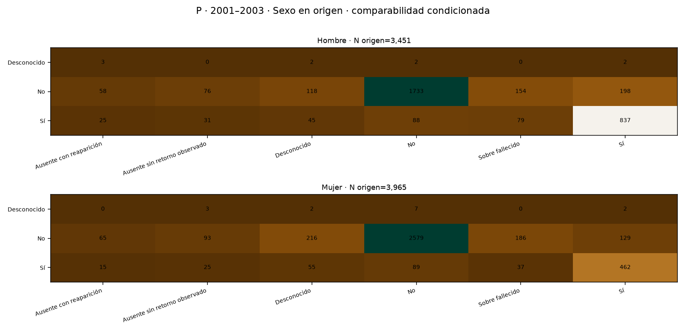

**Fuente y nota:** ENASEM, figura previamente calculada; Denominador por estado de origen; fallecimiento, ausencia, reaparición y desconocimiento separados.

**Procedencia:** ENASEM, agregados conservados en [L_P_sexo_grupo_2001_2003.json](../data/interim/eda_pensionaria/tablas/L_P_sexo_grupo_2001_2003.json); notebook [02_EDA_COMPLETO](../notebooks/02_EDA_COMPLETO.ipynb), bloque Trayectorias L_P_sexo_grupo_2001_2003.

### 9.2 L_P_sexo_grupo_2018_2021 · P 2018–2021 por Sexo

**Interpretación y alcance:** Cohorte 60+ viva en 2018: 10,113. Inicio observado 607, continuidad 2,382, pérdida observada 456. Cuatro contingencias y slots similares; se mantiene control doble. Comparación condicionada de K, no de toda pensión.. Los perfiles se fijan en origen. Muerte registrada y ausencia no son pérdida de recepción. El denominador de cada fila de transición está en N_origen_estado; no se requieren seis rondas completas.

Perfil de origen: Hombre: N origen 4,464, fallecidos 712, ausentes 206, recepción final ND 15, inicios 269/1,987 negativas iniciales con final conocido (13.54%); Mujer: N origen 5,649, fallecidos 703, ausentes 257, recepción final ND 7, inicios 338/3,337 negativas iniciales con final conocido (10.13%).

**Figura 24. P 2018–2021 por Sexo**

**Pregunta y aporte:** Comparar trayectorias observadas dentro de cohortes y perfiles de origen, contrastando la comparabilidad.

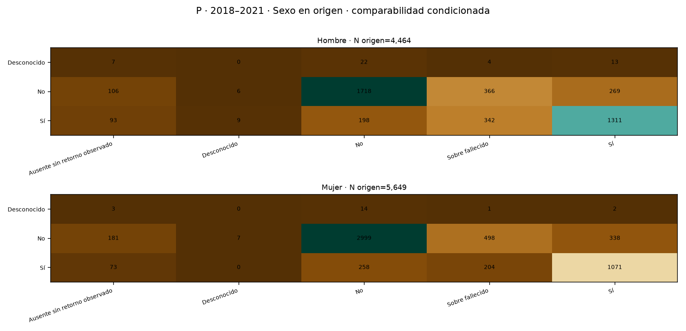

**Fuente y nota:** ENASEM, figura previamente calculada; Denominador por estado de origen; fallecimiento, ausencia, reaparición y desconocimiento separados.

**Procedencia:** ENASEM, agregados conservados en [L_P_sexo_grupo_2018_2021.json](../data/interim/eda_pensionaria/tablas/L_P_sexo_grupo_2018_2021.json); notebook [02_EDA_COMPLETO](../notebooks/02_EDA_COMPLETO.ipynb), bloque Trayectorias L_P_sexo_grupo_2018_2021.

### 9.3 L_A_sexo_grupo_2015_2018 · A 2015–2018 por Sexo

**Interpretación y alcance:** Cohorte 60+ viva en 2015: 10,416. Inicio observado 1,337, continuidad 1,420, pérdida observada 816. Mismo donativo adicional, dinero/especie; 2018 desglosa hasta dos instituciones. Solo recepción agregada condicionada.. Los perfiles se fijan en origen. Muerte registrada y ausencia no son pérdida de recepción. El denominador de cada fila de transición está en N_origen_estado; no se requieren seis rondas completas.

Perfil de origen: Hombre: N origen 4,611, fallecidos 511, ausentes 459, recepción final ND 10, inicios 521/2,605 negativas iniciales con final conocido (20.00%); Mujer: N origen 5,805, fallecidos 508, ausentes 566, recepción final ND 16, inicios 816/3,142 negativas iniciales con final conocido (25.97%).

**Figura 25. A 2015–2018 por Sexo**

**Pregunta y aporte:** Comparar trayectorias observadas dentro de cohortes y perfiles de origen, contrastando la comparabilidad.

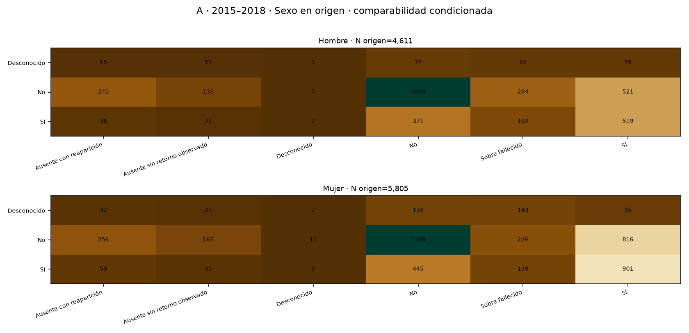

**Fuente y nota:** ENASEM, figura previamente calculada; Denominador por estado de origen; fallecimiento, ausencia, reaparición y desconocimiento separados.

**Procedencia:** ENASEM, agregados conservados en [L_A_sexo_grupo_2015_2018.json](../data/interim/eda_pensionaria/tablas/L_A_sexo_grupo_2015_2018.json); notebook [02_EDA_COMPLETO](../notebooks/02_EDA_COMPLETO.ipynb), bloque Trayectorias L_A_sexo_grupo_2015_2018.

### 9.4 L_A_sexo_grupo_2018_2021 · A 2018–2021 por Sexo

**Interpretación y alcance:** Cohorte 60+ viva en 2018: 10,113. No se interpreta inicio/pérdida a través de una ruptura de instrumento. 2021 incorpora explícitamente vejez en opción 5 y cambia programas; no interpretar un inicio como expansión causal.. Los perfiles se fijan en origen. Muerte registrada y ausencia no son pérdida de recepción. El denominador de cada fila de transición está en N_origen_estado; no se requieren seis rondas completas.

Perfil de origen: Hombre: N origen 4,464, fallecidos 712, ausentes 206, recepción final ND 17; Mujer: N origen 5,649, fallecidos 703, ausentes 257, recepción final ND 10.

**Pendiente de comparabilidad:** no se incorpora la figura como evidencia de altas/bajas homologadas; el archivo original sigue conservado.

**Procedencia:** ENASEM, agregados conservados en [L_A_sexo_grupo_2018_2021.json](../data/interim/eda_pensionaria/tablas/L_A_sexo_grupo_2018_2021.json); notebook [02_EDA_COMPLETO](../notebooks/02_EDA_COMPLETO.ipynb), bloque Trayectorias L_A_sexo_grupo_2018_2021.

<!-- BEGIN salud_longitudinal_04 -->

### 9.5 Seguimiento conjunto de pensiones y salud mental: notebook 04

**Pregunta exploratoria:** ¿cómo se relacionan los cambios de síntomas de las mismas personas con sus respuestas K registradas durante 2001–2021? Se integran población por ronda, los cinco pares consecutivos y trayectorias de múltiples visitas. No se adopta pregunta definitiva, causalidad ni predicción.

**Contrato CES-D y estado:** comparación operacional condicionada de productos construidos. Se verificaron nueve componentes0/1: deprimido, esfuerzo, sueño intranquilo, feliz, solo, disfrute de vida, triste, cansado y energía; los tres componentes positivos se invierten. En casos completos, la suma coincide exactamente con n_sint_depr en todas las rondas. La auditoría 60+ detecta 287 conteos válidos del proveedor con componentes incompletos: el análisis principal exige nueve completos y la sensibilidad conserva el proveedor. No se rellenan faltantes ni se altera la base. Literalidad/números de preguntas brutas e invariancia psicométrica no quedan certificados por esta reconciliación; documentación actual ejemplifica2024. [Contrato y evidencia](../diccionarios/contrato_longitudinal_salud_mental.json).

**Pensión:** comparabilidad condicionada2001–2003,2012–2015,2018–2021; rupturas2003–2012 y 2015–2018. Sí/sí y no/no solo describen extremos; no/sí no identifica fecha o primer acceso. En rupturas son patrones de respuestas, no altas/bajas homologadas.

**Figura 26. Seis rondas: composición observada, no cambios de las mismas personas**

**Objetivo y aporte:** Contextualizar las seis rondas antes del seguimiento de IDs.

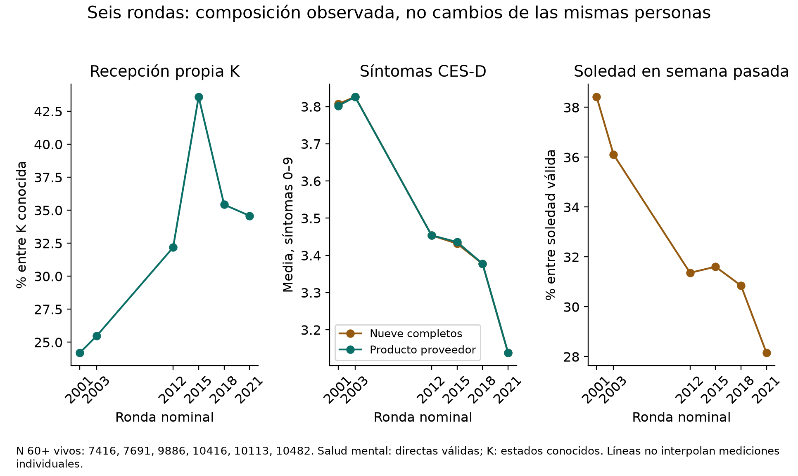

**Interpretación:** Las medias y recepciones por visita corresponden a poblaciones disponibles diferentes; entradas, supervivencia y modalidad cambian composición. No son evolución de una cohorte fija.

**Nota:** N 60+ vivos: 7416, 7691, 9886, 10416, 10113, 10482. Salud mental: directas válidas; K: estados conocidos. Líneas no interpolan mediciones individuales.

**Fuente y procedencia:** ENASEM; [04_TRAYECTORIAS_PENSIONES_SALUD](../notebooks/04_TRAYECTORIAS_PENSIONES_SALUD.ipynb); [agregados completos](../data/interim/trayectorias_pensiones_salud/resultados.json). Bloque 4–5.

**Cuadro 17. Seguimiento de cohortes60+ y selección de pares de salud mental**

**Objetivo y aporte:** Distinguir seguimiento de elegibilidad y criterio de salud.

| Intervalo | Cohorte | Presentes | Sobre fallecido | Ausentes | Retorno posterior | Pares proveedor | Pares completos | % cohorte completo |
| --- | --- | --- | --- | --- | --- | --- | --- | --- |
| 2001–2003 | 7416 | 7022 | 456 | 394 | 121 | 5455 | 5339 | 71.993 |
| 2003–2012 | 7691 | 6939 | 2235 | 752 | 189 | 3667 | 3644 | 47.380 |
| 2012–2015 | 9886 | 9423 | 1000 | 463 | 170 | 7114 | 7072 | 71.536 |
| 2015–2018 | 10416 | 9391 | 1019 | 1025 | 492 | 7177 | 7096 | 68.126 |
| 2018–2021 | 10113 | 9650 | 1415 | 463 | ND | 6939 | 6887 | 68.100 |

**Nota:** Presentes incluye sobre fallecido; retornos son subconjunto de ausentes. Pares completos: directas, nueve ítems y K conocidos en ambas. Las restricciones superpuestas no se suman. Retorno tras2021 no observable.

**Fuente y procedencia:** ENASEM; [04_TRAYECTORIAS_PENSIONES_SALUD](../notebooks/04_TRAYECTORIAS_PENSIONES_SALUD.ipynb); [agregados completos](../data/interim/trayectorias_pensiones_salud/resultados.json). Bloque 6.

Los conteos de la auditoría anterior se reproducen con el proveedor; la reducción del principal deriva de la nueva restricción de componentes completos. Una persona registrada sobre fallecido en 2012 reaparece viva después: anomalía preservada. No se interpreta toda ausencia como muerte o pérdida definitiva.

**Cuadro 18. Cinco intervalos: cambios pareados de síntomas y comparabilidad**

**Objetivo y aporte:** Comparar magnitud y distribución del cambio de las mismas personas.

| Intervalo | Mediana meses | N pares | Media inicial | Media final | Cambio medio | IC95% | % aumenta | % disminuye | % igual | Comparabilidad K |
| --- | --- | --- | --- | --- | --- | --- | --- | --- | --- | --- |
| 2001–2003 | 24.000 | 5339 | 3.736 | 3.845 | 0.108 | [0.028, 0.188] | 43.285 | 40.232 | 16.482 | Condicionada |
| 2003–2012 | 112.000 | 3644 | 3.553 | 3.635 | 0.083 | [-0.012, 0.177] | 43.277 | 40.971 | 15.752 | Ruptura |
| 2012–2015 | 36.000 | 7072 | 3.367 | 3.456 | 0.090 | [0.029, 0.151] | 41.558 | 38.872 | 19.570 | Condicionada |
| 2015–2018 | 37.000 | 7096 | 3.353 | 3.422 | 0.069 | [0.009, 0.129] | 40.657 | 38.867 | 20.476 | Ruptura |
| 2018–2021 | 37.000 | 6887 | 3.261 | 3.244 | -0.017 | [-0.078, 0.044] | 39.625 | 40.511 | 19.864 | Condicionada |

**Nota:** Cambio=destino−origen, síntomas0–9. ICt del cambio por persona dentro de cada intervalo; sin diseño/hogar/ponderación. Duraciones distintas, no tasas anuales. Igual conteo no garantiza mismos componentes.

**Fuente y procedencia:** ENASEM; [04_TRAYECTORIAS_PENSIONES_SALUD](../notebooks/04_TRAYECTORIAS_PENSIONES_SALUD.ipynb); [agregados completos](../data/interim/trayectorias_pensiones_salud/resultados.json). Bloque 7–9.

**Cuadro 19. Respuestas K y cambios medios de síntomas en cinco intervalos**

**Objetivo y aporte:** Identificar diferencias entre respuestas económicas observadas sin asumir efecto de recepción.

| Intervalo | Patrón K | N pares | Cambio medio | Cambio mediano | IC95% del cambio |
| --- | --- | --- | --- | --- | --- |
| 2001–2003 | Sí→Sí | 1164 | 0.111 | 0.000 | [-0.048, 0.270] |
| 2001–2003 | No→No | 3731 | 0.124 | 0.000 | [0.027, 0.221] |
| 2001–2003 | No→Sí | 288 | -0.090 | 0.000 | [-0.429, 0.248] |
| 2001–2003 | Sí→No | 156 | 0.083 | 0.000 | [-0.429, 0.595] |
| 2003–2012 | Sí→Sí | 761 | 0.129 | 0.000 | [-0.074, 0.331] |
| 2003–2012 | No→No | 2144 | 0.095 | 0.000 | [-0.030, 0.219] |
| 2003–2012 | No→Sí | 641 | -0.048 | 0.000 | [-0.278, 0.182] |
| 2003–2012 | Sí→No | 98 | 0.316 | 0.000 | [-0.209, 0.841] |
| 2012–2015 | Sí→Sí | 1938 | 0.200 | 0.000 | [0.090, 0.310] |
| 2012–2015 | No→No | 3384 | 0.046 | 0.000 | [-0.043, 0.135] |
| 2012–2015 | No→Sí | 1445 | 0.046 | 0.000 | [-0.094, 0.187] |
| 2012–2015 | Sí→No | 305 | 0.082 | 0.000 | [-0.218, 0.382] |
| 2015–2018 | Sí→Sí | 2158 | 0.067 | 0.000 | [-0.038, 0.172] |
| 2015–2018 | No→No | 3423 | 0.063 | 0.000 | [-0.025, 0.150] |
| 2015–2018 | No→Sí | 595 | 0.077 | 0.000 | [-0.125, 0.279] |
| 2015–2018 | Sí→No | 920 | 0.095 | 0.000 | [-0.079, 0.268] |
| 2018–2021 | Sí→Sí | 2056 | -0.018 | 0.000 | [-0.126, 0.091] |
| 2018–2021 | No→No | 3950 | 0.005 | 0.000 | [-0.076, 0.087] |
| 2018–2021 | No→Sí | 513 | -0.043 | 0.000 | [-0.273, 0.187] |
| 2018–2021 | Sí→No | 368 | -0.217 | 0.000 | [-0.507, 0.072] |

**Nota:** Los cuatro patrones suman N principal de cada intervalo. Diferencias entre medias no equivalen a efectos. Matrices con % por fila y total están en notebook; rupturas2003–2012 y 2015–2018 no homologadas.

**Fuente y procedencia:** ENASEM; [04_TRAYECTORIAS_PENSIONES_SALUD](../notebooks/04_TRAYECTORIAS_PENSIONES_SALUD.ipynb); [agregados completos](../data/interim/trayectorias_pensiones_salud/resultados.json). Bloque 8–10.

**Cuadro 20. No→Sí menos No→No: cambios según composición inicial y soporte**

**Objetivo y aporte:** Examinar sensibilidad de diferencias longitudinales a composición, síntomas iniciales y duración.

| Intervalo | Especificación | N soporte | Fuera soporte | Cruda mismo soporte | Estandarizada | IC95% condicional |
| --- | --- | --- | --- | --- | --- | --- |
| 2001–2003 | Demográfico | 3499 | 517 | -0.299 | -0.058 | [-0.496, 0.379] |
| 2001–2003 | Basal y duración | 1179 | 2837 | -0.173 | 0.093 | [-0.540, 0.726] |
| 2003–2012 | Demográfico | 2681 | 92 | -0.155 | -0.109 | [-0.386, 0.169] |
| 2003–2012 | Basal y duración | 2495 | 276 | -0.201 | -0.228 | [-0.481, 0.025] |
| 2012–2015 | Demográfico | 4755 | 50 | 0.006 | 0.005 | [-0.168, 0.178] |
| 2012–2015 | Basal y duración | 4278 | 525 | -0.022 | -0.042 | [-0.205, 0.122] |
| 2015–2018 | Demográfico | 3894 | 91 | 0.032 | -0.049 | [-0.290, 0.192] |
| 2015–2018 | Basal y duración | 2397 | 1588 | 0.011 | -0.091 | [-0.370, 0.187] |
| 2018–2021 | Demográfico | 4195 | 230 | -0.018 | -0.058 | [-0.351, 0.235] |
| 2018–2021 | Basal y duración | 2398 | 2027 | 0.165 | 0.287 | [-0.089, 0.663] |

**Nota:** Demográfico: sexo×edad×escolaridad. Basal/duración añade nivel de síntomas y tiempo. Celdas>=10porrama, total>=30. N fuera soporte entre casos completos basales; faltantes adicionales en agregado. No ajustes por variables finales.

**Fuente y procedencia:** ENASEM; [04_TRAYECTORIAS_PENSIONES_SALUD](../notebooks/04_TRAYECTORIAS_PENSIONES_SALUD.ipynb); [agregados completos](../data/interim/trayectorias_pensiones_salud/resultados.json). Bloque 17.

**Figura 27. Cinco intervalos: cambios observados y sensibilidad a composición basal**

**Objetivo y aporte:** Integrar los cinco periodos y visibilizar la sensibilidad del contraste.

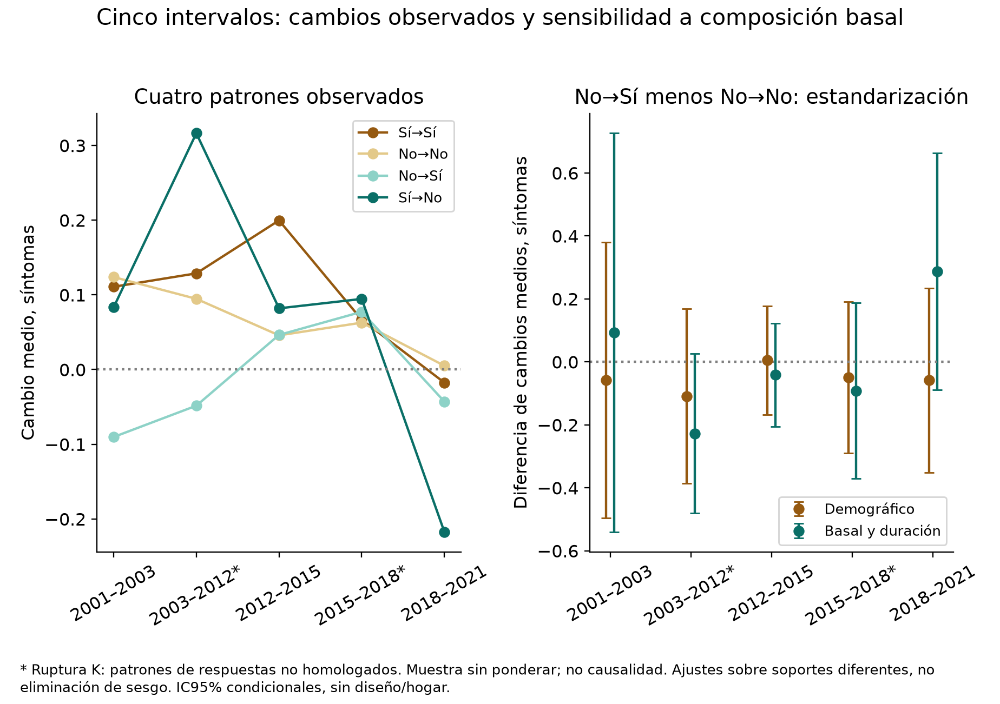

**Interpretación:** No existe una ventaja uniforme de No→Sí en todo el periodo. Considerar síntomas basales y duración puede cambiar signo y soporte; no elimina regresión a la media ni error de medición. La diferencia cruda se compara con ajustada en su mismo soporte.

**Nota:** * Ruptura K: patrones de respuestas no homologados. Muestra sin ponderar; no causalidad. Ajustes sobre soportes diferentes, no eliminación de sesgo. IC95% condicionales, sin diseño/hogar.

**Fuente y procedencia:** ENASEM; [04_TRAYECTORIAS_PENSIONES_SALUD](../notebooks/04_TRAYECTORIAS_PENSIONES_SALUD.ipynb); [agregados completos](../data/interim/trayectorias_pensiones_salud/resultados.json). Bloque 10,17,20.

**Cuadro 21. Personas según visitas observadas y mediciones válidas60+**

**Objetivo y aporte:** Mostrar que observación y disponibilidad analítica no son lo mismo, sin imponer panel balanceado.

| Número | Visitas vivas observadas | Síntomas completos | Síntomas y K conocidos |
| --- | --- | --- | --- |
| 2 | 4909 | 4944 | 4936 |
| 3 | 3118 | 3235 | 3264 |
| 4 | 4251 | 3762 | 3672 |
| 5 | 1428 | 1218 | 1198 |
| 6 | 1528 | 910 | 887 |

**Nota:** Cada columna cuenta personas por su propio número de visitas. Personas con 0/1 mediciones se conservan en cobertura. No sumar columnas ni pares como personas distintas. Universo por visita60+, no cohorte basal única.

**Fuente y procedencia:** ENASEM; [04_TRAYECTORIAS_PENSIONES_SALUD](../notebooks/04_TRAYECTORIAS_PENSIONES_SALUD.ipynb); [agregados completos](../data/interim/trayectorias_pensiones_salud/resultados.json). Bloque 3,11–14.

**Cuadro 22. Secuencias K retrospectivas y cambio primera–última medición**

**Objetivo y aporte:** Describir evolución conjunta multivisita sin asumir estabilidad real de recepción.

| Patrón de respuestas | N personas con dos o más mediciones | Cambio medio primera–última |
| --- | --- | --- |
| Afirmativas repetidas | 2541 | 0.238 |
| Negativas repetidas | 6328 | 0.094 |
| Cambio único registrado | 2298 | 0.135 |
| Múltiples cambios registrados | 1660 | 0.249 |
| Incluye desconocidos | 1242 | 0.240 |

**Nota:** Horizontes y número de visitas distintos. Grupos definidos con todo el seguimiento, no conocidos al inicio; cruzan rupturas K. Descripción retrospectiva, no efecto ni estimación homogénea del periodo. Desagregación por número de mediciones y huecos en notebook.

**Fuente y procedencia:** ENASEM; [04_TRAYECTORIAS_PENSIONES_SALUD](../notebooks/04_TRAYECTORIAS_PENSIONES_SALUD.ipynb); [agregados completos](../data/interim/trayectorias_pensiones_salud/resultados.json). Bloque 12–14.

**Figura 28. Panel incompleto: evolución y patrones según número de mediciones**

**Objetivo y aporte:** Comprender repetición, estabilidad de conteo y fluctuación en panel incompleto.

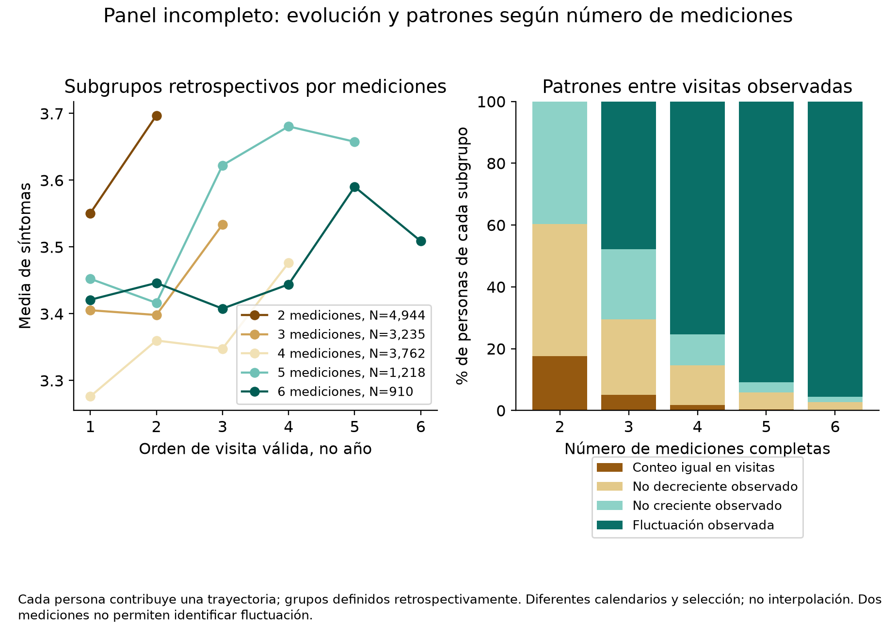

**Interpretación:** La oportunidad de detectar fluctuación aumenta con las visitas. Subgrupos definidos retrospectivamente no son cohortes representativas ni exposiciones conocidas al inicio. No se interpolan años sin entrevista.

**Nota:** Cada persona contribuye una trayectoria; grupos definidos retrospectivamente. Diferentes calendarios y selección; no interpolación. Dos mediciones no permiten identificar fluctuación.

**Fuente y procedencia:** ENASEM; [04_TRAYECTORIAS_PENSIONES_SALUD](../notebooks/04_TRAYECTORIAS_PENSIONES_SALUD.ipynb); [agregados completos](../data/interim/trayectorias_pensiones_salud/resultados.json). Bloque 11–14.

2001–2003: N principal=5,339, frente a 5,455 con conteo del proveedor. Cambio medio=+0.108 síntomas; aumenta 43.3%, disminuye 40.2% y permanece igual 16.5%. No→Sí: N=288, cambio -0.090; No→No: N=3,731, cambio +0.124. Comparabilidad K condicionada.

2003–2012: N principal=3,644, frente a 3,667 con conteo del proveedor. Cambio medio=+0.083 síntomas; aumenta 43.3%, disminuye 41.0% y permanece igual 15.8%. No→Sí: N=641, cambio -0.048; No→No: N=2,144, cambio +0.095. Ruptura K: son patrones de respuestas, no altas/bajas homologadas.

2012–2015: N principal=7,072, frente a 7,114 con conteo del proveedor. Cambio medio=+0.090 síntomas; aumenta 41.6%, disminuye 38.9% y permanece igual 19.6%. No→Sí: N=1,445, cambio +0.046; No→No: N=3,384, cambio +0.046. Comparabilidad K condicionada.

2015–2018: N principal=7,096, frente a 7,177 con conteo del proveedor. Cambio medio=+0.069 síntomas; aumenta 40.7%, disminuye 38.9% y permanece igual 20.5%. No→Sí: N=595, cambio +0.077; No→No: N=3,423, cambio +0.063. Ruptura K: son patrones de respuestas, no altas/bajas homologadas.

2018–2021: N principal=6,887, frente a 6,939 con conteo del proveedor. Cambio medio=-0.017 síntomas; aumenta 39.6%, disminuye 40.5% y permanece igual 19.9%. No→Sí: N=513, cambio -0.043; No→No: N=3,950, cambio +0.005. Comparabilidad K condicionada.

Composición y cambio individual: la media disponible de nueve síntomas completos pasa de 3.807 en 2001 (N=6,570) a 3.138 en 2021 (N=9,381), mientras 4 de cinco intervalos tienen cambios pareados medios positivos pequeños. Universos de visitas disponibles y pares conK conocida son diferentes. El descenso agregado no demuestra mejoría de las mismas personas; entrada, selección, supervivencia y criterio de disponibilidad pueden intervenir, sin identificar aquí su contribución causal.

Multivisita: 14,069 personas tienen al menos dos mediciones completas; 6,357 muestran cambios de dirección y 1,104 el mismo conteo en sus visitas. La media pequeña del cambio no demuestra estabilidad de todas las personas. Las categorías son retrospectivas y el número de oportunidades para fluctuar aumenta con las mediciones.

Los cambios de síntomas entre patrones K no presentan una ventaja uniforme de No→Sí durante todo el periodo. La estandarización modifica algunas magnitudes y signos; los soportes y la inclusión de síntomas basales cambian el estimando. Regresión a la media, selección y error de medición impiden interpretar el ajuste como efecto causal.

La comparación transversal del notebook03 y los cambios pareados responden preguntas distintas. Todos los resultados son muestrales sin ponderación validada; intervalos con diferente duración y rupturas no se combinan en una estimación global.

**Selección y diferencias sociodemográficas:** se comparan sexo, edad inicial, escolaridad, localidad y cuartil patrimonial basal dentro de patrones K. Patrimonio es stock persona/cónyuge, no ingreso ni riqueza real homologada entre rondas. Las diferencias pequeñas y grupos conN<30 se conservan como descriptivos; no se prueban interacciones.

**Cuadro 23. No→Sí: cambios de síntomas por sexo en los cinco periodos**

**Objetivo y aporte:** Examinar si la heterogeneidad por sexo tiene una dirección repetida.

| Intervalo | N hombres | Cambio hombres | N mujeres | Cambio mujeres |
| --- | --- | --- | --- | --- |
| 2001–2003 | 172 | -0.198 | 116 | 0.069 |
| 2003–2012 | 296 | -0.064 | 345 | -0.035 |
| 2012–2015 | 650 | 0.086 | 795 | 0.014 |
| 2015–2018 | 274 | 0.281 | 321 | -0.097 |
| 2018–2021 | 224 | -0.018 | 289 | -0.062 |

**Nota:** Cambio medio de síntomas, no diferencia de efectos. Los signos varían por periodo; ruptura2003–2012 y 2015–2018. IC y demás patrones/estratos en notebook.

**Fuente y procedencia:** ENASEM; [04_TRAYECTORIAS_PENSIONES_SALUD](../notebooks/04_TRAYECTORIAS_PENSIONES_SALUD.ipynb); [agregados completos](../data/interim/trayectorias_pensiones_salud/resultados.json). Bloque 16.

En2012–2015, No→Sí de 80+ registra cambio medio+0.529 síntomas (N=136); no permite separar edad, cohorte y periodo. Escolaridad no presenta un gradiente uniforme en los cinco intervalos; conservar inconsistencias es parte del resultado.

**Cuadro 24. Selección: edad y síntomas iniciales según seguimiento**

**Objetivo y aporte:** Identificar selección por mortalidad y modalidad frente a quienes completan el análisis.

| Intervalo | Seguimiento | N grupo | Edad media basal | N síntomas válidos basales | Media síntomas basales |
| --- | --- | --- | --- | --- | --- |
| 2001–2003 | Análisis principal | 5339 | 68.879 | 5339 | 3.736 |
| 2001–2003 | Sobre fallecido | 456 | 75.671 | 355 | 4.868 |
| 2001–2003 | Sustituto destino | 618 | 71.906 | 450 | 3.827 |
| 2003–2012 | Análisis principal | 3644 | 66.914 | 3644 | 3.553 |
| 2003–2012 | Sobre fallecido | 2235 | 74.272 | 1931 | 4.317 |
| 2003–2012 | Sustituto destino | 653 | 71.161 | 562 | 4.224 |
| 2012–2015 | Análisis principal | 7072 | 69.155 | 7072 | 3.367 |
| 2012–2015 | Sobre fallecido | 1000 | 76.639 | 724 | 4.206 |
| 2012–2015 | Sustituto destino | 647 | 76.063 | 374 | 3.880 |
| 2015–2018 | Análisis principal | 7096 | 69.825 | 7096 | 3.353 |
| 2015–2018 | Sobre fallecido | 1019 | 77.604 | 764 | 4.169 |
| 2015–2018 | Sustituto destino | 863 | 75.629 | 611 | 3.912 |
| 2018–2021 | Análisis principal | 6887 | 70.209 | 6887 | 3.261 |
| 2018–2021 | Sobre fallecido | 1415 | 77.633 | 1061 | 4.007 |
| 2018–2021 | Sustituto destino | 895 | 76.297 | 592 | 3.755 |

**Nota:** Síntomas basales aquí: proveedor válido en directa para describir cohorte; no exactamente criterio principal de nueve componentes. Muertes registradas no abarcan todas las muertes de ausentes.

**Fuente y procedencia:** ENASEM; [04_TRAYECTORIAS_PENSIONES_SALUD](../notebooks/04_TRAYECTORIAS_PENSIONES_SALUD.ipynb); [agregados completos](../data/interim/trayectorias_pensiones_salud/resultados.json). Bloque 18.

**Figura 29. Selección longitudinal: perfiles basales según seguimiento**

**Objetivo y aporte:** Evaluar cómo se diferencia la muestra analítica de otros estados de seguimiento.

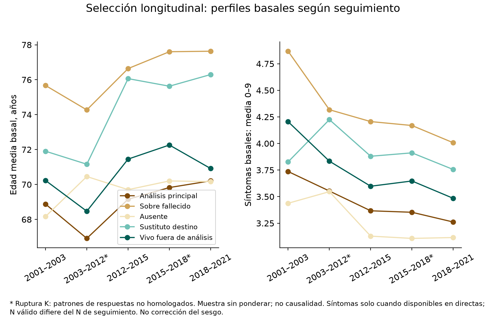

**Interpretación:** Edad y síntomas basales difieren según seguimiento; las personas observadas repetidamente son seleccionadas. Cada media utiliza su N válido, especialmente síntomas disponibles solo en directas. No se corrige selección con esta figura.

**Nota:** * Ruptura K: patrones de respuestas no homologados. Muestra sin ponderar; no causalidad. Síntomas solo cuando disponibles en directas; N válido difiere del N de seguimiento. No corrección del sesgo.

**Fuente y procedencia:** ENASEM; [04_TRAYECTORIAS_PENSIONES_SALUD](../notebooks/04_TRAYECTORIAS_PENSIONES_SALUD.ipynb); [agregados completos](../data/interim/trayectorias_pensiones_salud/resultados.json). Bloque 18.

**Cuadro 25. Soledad: cambio pareado entre respuestas No→Sí y No→No K**

**Objetivo y aporte:** Examinar si soledad comparte el patrón agregado de síntomas.

| Intervalo | N No→Sí | Cambio soledad pp No→Sí | IC95% pareado No→Sí | N No→No | Cambio soledad pp No→No |
| --- | --- | --- | --- | --- | --- |
| 2001–2003 | 295 | 4.407 | [-2.36, 11.17] | 3856 | -0.648 |
| 2003–2012 | 653 | 4.288 | [-0.20, 8.78] | 2180 | 3.119 |
| 2012–2015 | 1467 | 2.727 | [-0.04, 5.49] | 3436 | 1.077 |
| 2015–2018 | 603 | 0.663 | [-3.41, 4.73] | 3482 | 1.522 |
| 2018–2021 | 521 | 1.727 | [-2.78, 6.24] | 4002 | 0.250 |

**Nota:** Cambio de proporción a partir de diferencia individual0/±1; ICt pareado, no dos proporciones independientes. Denominadores propios. Rupturas K no homologadas; IC puntuales sin diseño/hogar.

**Fuente y procedencia:** ENASEM; [04_TRAYECTORIAS_PENSIONES_SALUD](../notebooks/04_TRAYECTORIAS_PENSIONES_SALUD.ipynb); [agregados completos](../data/interim/trayectorias_pensiones_salud/resultados.json). Bloque 15.

En No→Sí, la soledad registrada aumenta en los cinco intervalos, aunque el cambio medio de síntomas no tiene esa dirección uniforme. Son estimaciones puntuales; sus IC permiten aumentos pequeños, ausencia de diferencia o disminución en varios periodos. Esto describe un componente específico del mismo conteo y no un efecto de recibir pensión.

**Soledad:** matrices por patrón K y secuencias multivisita usan denominadores propios. Persistencia significa respuesta repetida en visitas, no experiencia continua; es componente CES-D. Los cálculos completos y sensibilidades a proveedor, edad, anomalías y soporte permanecen en notebook04.

**Límites y potencial:** 30038 pares corresponden a 13570 personas, 8322 contribuyen más de un intervalo. No poolingiid ni estimación global de periodos incompatibles. Seguir personas distingue cambio individual de composición y permite estudiar selección actuarial; no demuestra causalidad. Próximas etapas: cerrar concordancia bruta, medición, dependencia y diseño antes de inferencia confirmatoria. No TICS ni modelos predictivos.

<!-- END salud_longitudinal_04 -->

<!-- BEGIN mortalidad_seleccion_05 -->

### 9.6 Pensiones, mortalidad registrada y selección multidimensional: notebook 05

**Pregunta exploratoria:** ¿cómo se relaciona K inicial con el registro posterior de fallecimiento y quién permanece disponible para estudiar cada dimensión? Se integran los cinco intervalos y las seis rondas, sin población balanceada ni estimación causal global.

**Auditoría vital:** fallecido y tipent5 concuerdan en el maestro; ello no es verificación externa de todas las muertes. Ausencias mantienen estado vital desconocido. Una persona con registro sobre fallecido reaparece viva: se conserva y evalúa como inconsistencia. No se identificó localmente el Master Follow-up completo de no entrevistas; el producto oficial requiere acceso registrado. [Documentación oficial histórica2018](https://www.mhasweb.org/resources/DOCUMENTS/2018/MHAS_Master_Follow_up_File_2001_2003_2012_2015_2018.pdf) describe información adicional de no entrevista, motivo de sustituto y estado vital, sin certificar aquí versión2021.

**Cuadro 26. K inicial y registro sobre fallecido: comparación de cinco cohortes**

**Objetivo y aporte:** Distinguir asociación registrada y cambios al considerar composición basal.

| Intervalo | N K sí | N K no | D K sí | D K no | % D K sí | % D K no | Bruta cohorte pp | Cruda soporte pp | N soporte | Demográfica pp | IC95% demográfico |
| --- | --- | --- | --- | --- | --- | --- | --- | --- | --- | --- | --- |
| 2001–2003 | 1788 | 5605 | 116 | 340 | 6.488 | 6.066 | 0.422 | 0.274 | 7305 | 0.040 | [-1.35, 1.43] |
| 2003–2012 | 1837 | 5374 | 581 | 1449 | 31.628 | 26.963 | 4.664 | 4.319 | 7088 | 3.533 | [0.94, 6.12] |
| 2012–2015 | 2907 | 6127 | 272 | 499 | 9.357 | 8.144 | 1.212 | 1.199 | 8925 | 0.448 | [-0.82, 1.72] |
| 2015–2018 | 4253 | 5503 | 361 | 450 | 8.488 | 8.177 | 0.311 | 0.328 | 9582 | -1.248 | [-2.36, -0.14] |
| 2018–2021 | 3559 | 6488 | 546 | 864 | 15.341 | 13.317 | 2.024 | 1.837 | 9852 | 0.679 | [-0.77, 2.13] |

**Nota:** D/N de cohorte basal no es mortalidad completa ni tasa anual. ND inicial separado en notebook. Ajuste sexo×edad×escolaridad; cada comparación cruda/ajustada del mismo soporte se conserva en agregado. IC sin diseño/hogar. K no implica contributividad.

**Fuente y procedencia:** ENASEM; [05_PENSIONES_MORTALIDAD_SELECCION](../notebooks/05_PENSIONES_MORTALIDAD_SELECCION.ipynb); [agregados](../data/interim/pensiones_mortalidad_seleccion/resultados.json). Bloque 3–4.

**Figura 30. Pensión inicial y fallecimiento registrado en los cinco intervalos**

**Objetivo y aporte:** Comparar todos los periodos sin equiparar duraciones.

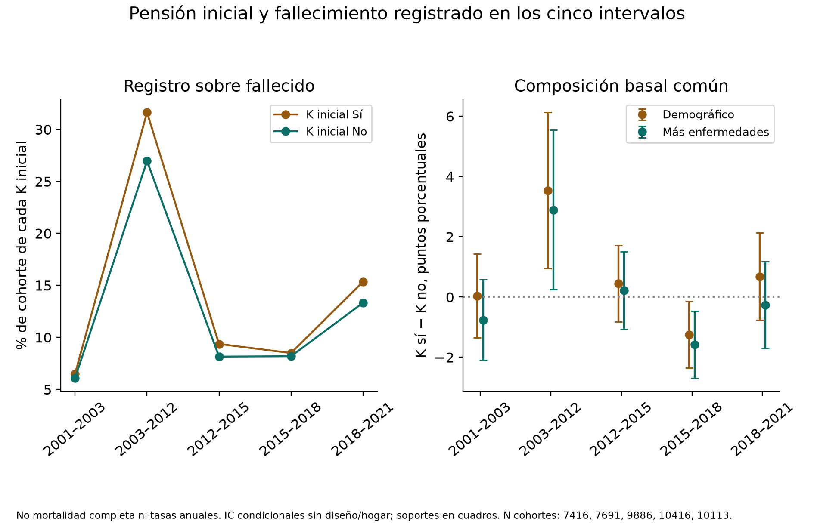

**Interpretación:** La dirección ajustada no es uniforme. Más registro de muerte puede combinar composición y captura; no demuestra efecto pensionario. Los nueve años2003–2012 no se anualizan.

**Nota:** No mortalidad completa ni tasas anuales. IC condicionales sin diseño/hogar; soportes en cuadros. N cohortes: 7416, 7691, 9886, 10416, 10113.

**Fuente y procedencia:** ENASEM; [05_PENSIONES_MORTALIDAD_SELECCION](../notebooks/05_PENSIONES_MORTALIDAD_SELECCION.ipynb); [agregados](../data/interim/pensiones_mortalidad_seleccion/resultados.json). Bloque 3–4.

**Cuadro 27. Perfiles basales y registro de fallecimiento: diferencias estandarizadas**

**Objetivo y aporte:** Examinar salud, memoria y funcionalidad iniciales considerando edad/sexo/escolaridad.

| Intervalo | Indicador basal | Comparación | N soporte | Cruda mismo soporte pp | Demográfica pp | IC95% condicional |
| --- | --- | --- | --- | --- | --- | --- |
| 2001–2003 | n_enf | > 1 frente a <= 1 | 6993 | 3.862 | 4.024 | [2.60, 5.45] |
| 2001–2003 | n_sint_depr | > 4 frente a <= 4 | 6375 | 3.394 | 3.102 | [1.87, 4.33] |
| 2001–2003 | n_abvd | > 0 frente a <= 0 | 6237 | 15.750 | 12.115 | [9.37, 14.86] |
| 2001–2003 | recuerdo1 | <= 4 frente a > 4 | 6449 | 2.808 | 1.104 | [-0.08, 2.29] |
| 2003–2012 | n_enf | > 1 frente a <= 1 | 7560 | 12.284 | 12.757 | [10.70, 14.82] |
| 2003–2012 | n_sint_depr | > 4 frente a <= 4 | 6699 | 7.578 | 6.207 | [4.00, 8.42] |
| 2003–2012 | n_abvd | > 0 frente a <= 0 | 6855 | 31.390 | 23.754 | [19.82, 27.69] |
| 2003–2012 | recuerdo1 | <= 4 frente a > 4 | 6594 | 13.307 | 5.856 | [3.56, 8.15] |
| 2012–2015 | n_enf | > 1 frente a <= 1 | 9704 | 6.363 | 6.781 | [5.34, 8.22] |
| 2012–2015 | n_sint_depr | > 4 frente a <= 4 | 8511 | 4.260 | 3.894 | [2.49, 5.30] |
| 2012–2015 | n_abvd | > 0 frente a <= 0 | 9264 | 16.884 | 12.947 | [10.80, 15.09] |
| 2012–2015 | recuerdo1 | <= 4 frente a > 4 | 8363 | 6.801 | 3.929 | [2.54, 5.31] |
| 2015–2018 | n_enf | > 1 frente a <= 1 | 10127 | 6.020 | 6.174 | [4.88, 7.47] |
| 2015–2018 | n_sint_depr | > 4 frente a <= 4 | 9376 | 4.815 | 4.252 | [2.94, 5.57] |
| 2015–2018 | n_abvd | > 0 frente a <= 0 | 9386 | 17.419 | 13.403 | [11.43, 15.37] |
| 2015–2018 | recuerdo1 | <= 4 frente a > 4 | 9089 | 7.342 | 3.719 | [2.42, 5.02] |
| 2018–2021 | n_enf | > 1 frente a <= 1 | 9875 | 8.185 | 8.033 | [6.48, 9.58] |
| 2018–2021 | n_sint_depr | > 4 frente a <= 4 | 8837 | 4.963 | 4.460 | [2.88, 6.04] |
| 2018–2021 | n_abvd | > 0 frente a <= 0 | 8864 | 22.767 | 16.878 | [14.50, 19.25] |
| 2018–2021 | recuerdo1 | <= 4 frente a > 4 | 8846 | 8.451 | 3.725 | [2.15, 5.30] |

**Nota:** ≥2 enfermedades, ≥5 síntomas completos, ≥1 ABVD y aprendizaje≤4 son comparaciones seleccionadas; memoria no es punto de corte clínico. CES-D no diagnóstico. Basales válidos y soportes cambian por indicador.

**Fuente y procedencia:** ENASEM; [05_PENSIONES_MORTALIDAD_SELECCION](../notebooks/05_PENSIONES_MORTALIDAD_SELECCION.ipynb); [agregados](../data/interim/pensiones_mortalidad_seleccion/resultados.json). Bloque 5.

**Supervivencia actuarial:** no Kaplan–Meier ni Cox: fechas verificadas de muerte y censura no disponibles, y ausentes no necesariamente vivos. Datos agrupados/censura por intervalos podrían evaluarse tras resolver seguimiento vital y fechas de notificación; no se asignaron eventos a rondas nominales como si fueran fechas exactas.

**Cuadro 28. Sensibilidad a estado vital desconocido: límites de diferencia K sí−no**

**Objetivo y aporte:** Mostrar qué parte de la asociación no queda identificada por los registros disponibles.

| Intervalo | Límite inferior pp | Límite superior pp |
| --- | --- | --- |
| 2001–2003 | -4.788 | 5.791 |
| 2003–2012 | -3.784 | 16.913 |
| 2012–2015 | -2.786 | 6.957 |
| 2015–2018 | -9.011 | 10.445 |
| 2018–2021 | -2.399 | 6.689 |

**Nota:** Límites lógicos: D/N a(D+U)/N por grupo, suponiendo registros correctos y cada ausente vivo o muerto. No IC, ajuste ni corrección de otros errores.

**Fuente y procedencia:** ENASEM; [05_PENSIONES_MORTALIDAD_SELECCION](../notebooks/05_PENSIONES_MORTALIDAD_SELECCION.ipynb); [agregados](../data/interim/pensiones_mortalidad_seleccion/resultados.json). Bloque 7.

**Cuadro 29. Universos longitudinales propios de cada indicador**

**Objetivo y aporte:** Evitar utilizar la misma muestra para salud, cognición, funcionalidad y economía.

| Indicador | Dimensión | ≥2 mediciones | ≥3 mediciones | Personas con par consecutivo | Personas con par y K |
| --- | --- | --- | --- | --- | --- |
| salud_glob | Física | 14233 | 9236 | 13882 | 13757 |
| diabetes | Física | 15159 | 10284 | 14959 | 14446 |
| n_enf | Física | 15118 | 10244 | 14909 | 14401 |
| bmi_imp | Física | 15234 | 10325 | 15042 | 14538 |
| n_sint_depr | Mental | 14069 | 9125 | 13693 | 13570 |
| solo | Mental | 14194 | 9215 | 13845 | 13724 |
| recuerdo1 | Cognición | 14195 | 9225 | 13848 | 13730 |
| recuerdo2 | Cognición | 14202 | 9228 | 13856 | 13732 |
| orientacion | Cognición | 11717 | 8425 | 11327 | 11191 |
| serial7 | Cognición | 9387 | 5594 | 8773 | 8690 |
| n_abvd | Funcionalidad | 15128 | 10246 | 14922 | 14432 |
| n_aivd | Funcionalidad | 14151 | 9166 | 13780 | 13665 |
| n_mov | Funcionalidad | 14218 | 9224 | 13870 | 13757 |
| imp_neto | Económica | 15209 | 10308 | 15010 | 14536 |
| ocupacion | Económica | 15202 | 10309 | 15010 | 14521 |
| est_conyugal | Económica | 15164 | 10300 | 14971 | 14468 |

**Nota:** Personas únicas, no suma de pares. CES-D nueve completos. Multimedición60+ por visita; pares mantienen destino de origen60+. Serial2021 cuenta disponibilidad, no comparabilidad con tarea previa.

**Fuente y procedencia:** ENASEM; [05_PENSIONES_MORTALIDAD_SELECCION](../notebooks/05_PENSIONES_MORTALIDAD_SELECCION.ipynb); [agregados](../data/interim/pensiones_mortalidad_seleccion/resultados.json). Bloque 8–9,13.

**Figura 31. Disponibilidad longitudinal por indicador y periodo**

**Objetivo y aporte:** Separar elegibilidad, seguimiento y medición de cada indicador.

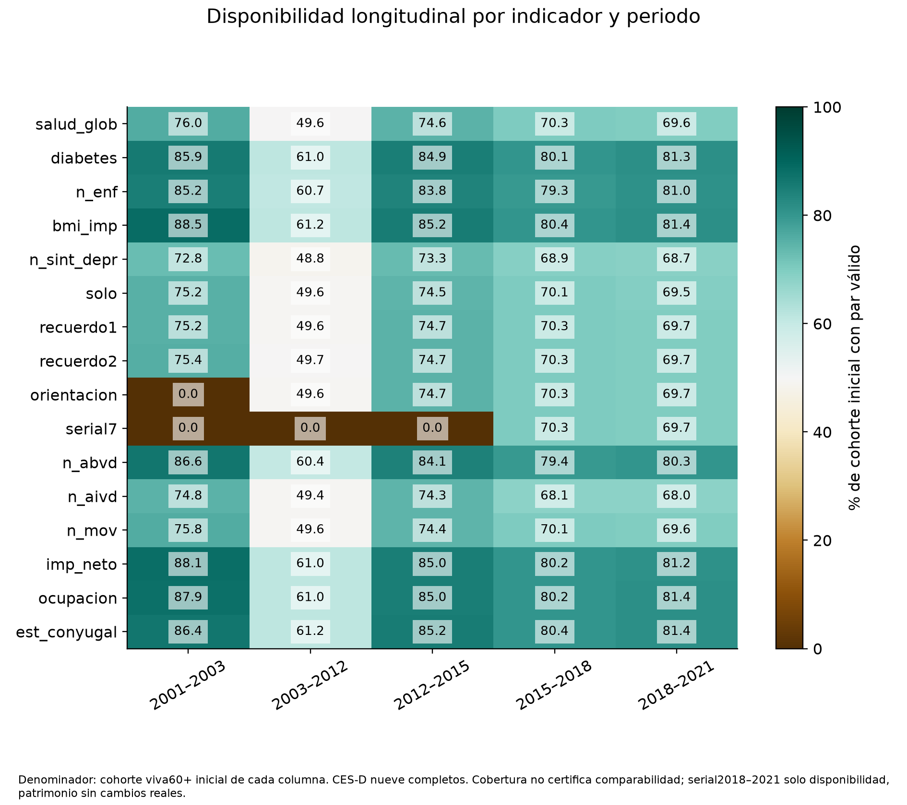

**Interpretación:** Las variables que admiten sustituto tienen cobertura distinta de indicadores directos. Ceros por ausencia de instrumento no son pérdidas ni valores cero del indicador.

**Nota:** Denominador: cohorte viva60+ inicial de cada columna. CES-D nueve completos. Cobertura no certifica comparabilidad; serial2018–2021 solo disponibilidad, patrimonio sin cambios reales.

**Fuente y procedencia:** ENASEM; [05_PENSIONES_MORTALIDAD_SELECCION](../notebooks/05_PENSIONES_MORTALIDAD_SELECCION.ipynb); [agregados](../data/interim/pensiones_mortalidad_seleccion/resultados.json). Bloque 8–9.

**Reconciliación04:** se reproducen13,570personas con pares de salud mental/K y 14,069con≥2mediciones de síntomas:13,560comunes,10solo pares y 509solo multimedición. Las10 tienen edad final<60 registrada, que se conserva; no son exclusiones corregidas automáticamente. No interpretar diferencia neta como pérdidas.

**Figura 32. Composición por visita frente a subconjuntos observados repetidamente**

**Objetivo y aporte:** Comparar disponibilidad por ronda y subconjuntos retrospectivos multimedición.

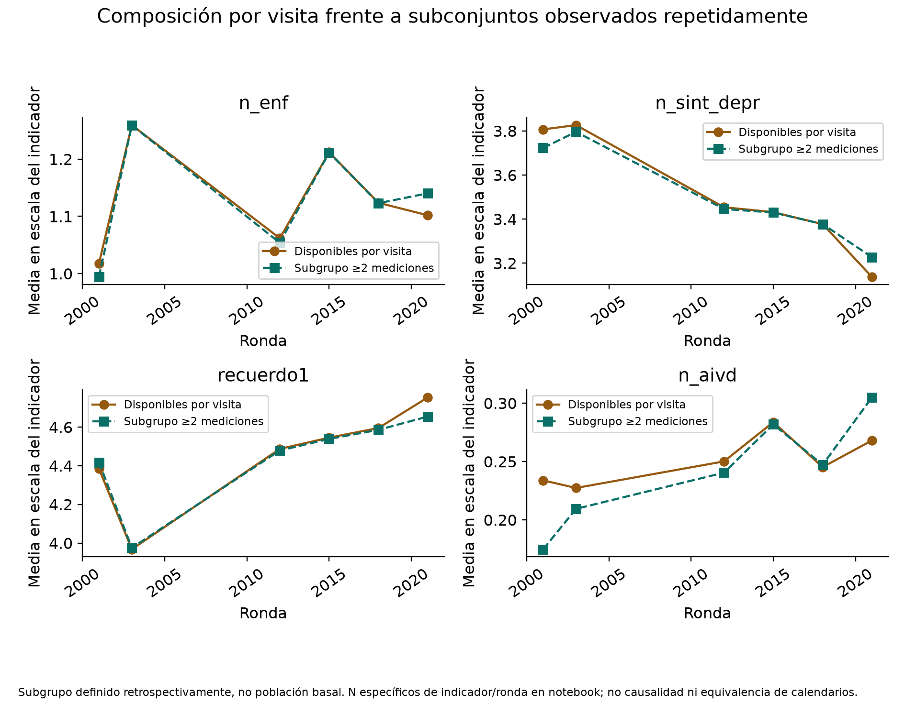

**Interpretación:** La composición del subconjunto repetido difiere del universo disponible. Sus tendencias no separan edad, cohorte y periodo ni describen una población fija representativa.

**Nota:** Subgrupo definido retrospectivamente, no población basal. N específicos de indicador/ronda en notebook; no causalidad ni equivalencia de calendarios.

**Fuente y procedencia:** ENASEM; [05_PENSIONES_MORTALIDAD_SELECCION](../notebooks/05_PENSIONES_MORTALIDAD_SELECCION.ipynb); [agregados](../data/interim/pensiones_mortalidad_seleccion/resultados.json). Bloque 11,13.

**Cuadro 30. Composición basal de retenidos frente al target de soporte común**

**Objetivo y aporte:** Cuantificar composición observable sin inventar salud posterior de fallecidos.

| Intervalo | Indicador | N target basal | N retenido | Media target | Media retenida cruda | Media retenida estandarizada |
| --- | --- | --- | --- | --- | --- | --- |
| 2001–2003 | n_enf | 7081 | 6282 | 1.016 | 0.996 | 0.996 |
| 2001–2003 | n_sint_depr | 6535 | 5376 | 3.807 | 3.749 | 3.749 |
| 2001–2003 | recuerdo1 | 6667 | 5551 | 4.384 | 4.409 | 4.396 |
| 2001–2003 | n_aivd | 6666 | 5525 | 0.232 | 0.180 | 0.185 |
| 2003–2012 | n_enf | 7538 | 4626 | 1.260 | 1.139 | 1.133 |
| 2003–2012 | n_sint_depr | 6685 | 3713 | 3.821 | 3.561 | 3.590 |
| 2003–2012 | recuerdo1 | 6747 | 3774 | 3.971 | 4.203 | 4.092 |
| 2003–2012 | n_aivd | 6752 | 3763 | 0.216 | 0.080 | 0.095 |
| 2012–2015 | n_enf | 9744 | 8227 | 1.063 | 1.033 | 1.032 |
| 2012–2015 | n_sint_depr | 8740 | 7201 | 3.457 | 3.375 | 3.385 |
| 2012–2015 | recuerdo1 | 8819 | 7329 | 4.488 | 4.573 | 4.540 |
| 2012–2015 | n_aivd | 8808 | 7297 | 0.251 | 0.178 | 0.188 |
| 2015–2018 | n_enf | 10256 | 8224 | 1.212 | 1.179 | 1.179 |
| 2015–2018 | n_sint_depr | 9464 | 7130 | 3.431 | 3.351 | 3.358 |
| 2015–2018 | recuerdo1 | 9560 | 7272 | 4.544 | 4.638 | 4.601 |
| 2015–2018 | n_aivd | 9521 | 7044 | 0.283 | 0.195 | 0.206 |
| 2018–2021 | n_enf | 10033 | 8165 | 1.123 | 1.069 | 1.070 |
| 2018–2021 | n_sint_depr | 8949 | 6911 | 3.377 | 3.261 | 3.271 |
| 2018–2021 | recuerdo1 | 9051 | 7009 | 4.595 | 4.717 | 4.666 |
| 2018–2021 | n_aivd | 8798 | 6844 | 0.246 | 0.158 | 0.172 |

**Nota:** Todos son valores BASALES observados; target sexo×edad×escolaridad dentro de celdas con≥20retenidos. No ICiid de muestras anidadas. Reponderación no explica causalmente la tendencia posterior.

**Fuente y procedencia:** ENASEM; [05_PENSIONES_MORTALIDAD_SELECCION](../notebooks/05_PENSIONES_MORTALIDAD_SELECCION.ipynb); [agregados](../data/interim/pensiones_mortalidad_seleccion/resultados.json). Bloque 10,15.

**Figura 33. Sensibilidades de mediciones faltantes entre vivos confirmados**

**Objetivo y aporte:** Evaluar cuán sensibles pueden ser los cambios a mediciones no disponibles entre vivos.

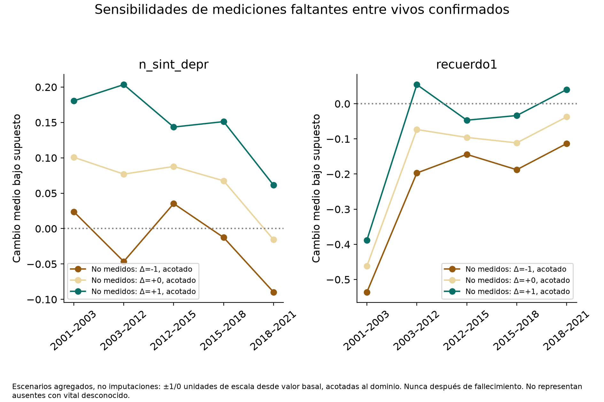

**Interpretación:** Escenarios0/±1unidad desde basal cambian medias según cantidad no medida; son supuestos, no datos imputados ni estimaciones corregidas. Muertos y ausentes de vital desconocido quedan fuera de esos escenarios.

**Nota:** Escenarios agregados, no imputaciones: ±1/0 unidades de escala desde valor basal, acotadas al dominio. Nunca después de fallecimiento. No representan ausentes con vital desconocido.

**Fuente y procedencia:** ENASEM; [05_PENSIONES_MORTALIDAD_SELECCION](../notebooks/05_PENSIONES_MORTALIDAD_SELECCION.ipynb); [agregados](../data/interim/pensiones_mortalidad_seleccion/resultados.json). Bloque 16.

**Comparabilidad adicional:** [documentación cognitiva oficial](https://www.mhasweb.org/resources/DOCUMENTS/Constructed_Imputed/MHAS_2018_2021_Cognitive_Function_Measures_Scoring_and_Classification.pdf) indica restas3 desde20 en 2021 en lugar de restas7 desde100. Se bloquea el cambio2018–2021 de serial7; nombre/rango común no demuestra equivalencia. Orientación falta2001. Aprendizaje/evocación conservan flags y sensibilidad no imputada. No TICS ni índice nuevo.

**Economía:** se estudia cobertura y selección de patrimonio, ocupación y estado conyugal. No cambios monetarios reales por unidades/deflactación pendientes ni diferencias numéricas de categorías. Stock compartido no es ingreso. A y cónyuge se analizan como ramas complementarias de universo propio.

2001–2003: registros sobre fallecidos 116/1,788 con K inicial afirmativa (6.49%) y 340/5,605 con negativa (6.07%). Diferencia bruta +0.42pp; demográfica +0.04pp en soporte N=7,305. No riesgo completo, tasa anual ni efecto causal.

2003–2012: registros sobre fallecidos 581/1,837 con K inicial afirmativa (31.63%) y 1,449/5,374 con negativa (26.96%). Diferencia bruta +4.66pp; demográfica +3.53pp en soporte N=7,088. No riesgo completo, tasa anual ni efecto causal.

2012–2015: registros sobre fallecidos 272/2,907 con K inicial afirmativa (9.36%) y 499/6,127 con negativa (8.14%). Diferencia bruta +1.21pp; demográfica +0.45pp en soporte N=8,925. No riesgo completo, tasa anual ni efecto causal.

2015–2018: registros sobre fallecidos 361/4,253 con K inicial afirmativa (8.49%) y 450/5,503 con negativa (8.18%). Diferencia bruta +0.31pp; demográfica -1.25pp en soporte N=9,582. No riesgo completo, tasa anual ni efecto causal.

2018–2021: registros sobre fallecidos 546/3,559 con K inicial afirmativa (15.34%) y 864/6,488 con negativa (13.32%). Diferencia bruta +2.02pp; demográfica +0.68pp en soporte N=9,852. No riesgo completo, tasa anual ni efecto causal.

Los ajustes cambian magnitud y en algunos periodos dirección de la asociación K–registro de fallecimiento. Especificaciones agregan variables basales por separado, no un modelo con todo; los soportes distintos impiden atribuir diferencias entre especificaciones únicamente al ajuste.

Las pruebas cognitivas y los indicadores directos pierden disponibilidad por modalidad además de mortalidad y ausencia. Indicadores que admiten sustituto conservan un universo más amplio; las diferencias de cobertura no equivalen a diferencias de calidad ni permiten sumar muestras.

La estandarización de valores basales permite cuantificar cambios de composición observados dentro de soporte. No recupera salud posterior de quienes murieron ni identifica cuánto de una tendencia temporal explica la mortalidad.

Sin estado vital de todos los ausentes y fechas de defunción verificadas no se implementan Kaplan–Meier, Cox ni IPW. Los límites lógicos y escenarios son sensibilidades, no estimaciones corregidas. Serial2018–2021 bloqueado por cambio de tarea; patrimonio sin cambios reales por homologación monetaria pendiente.

Aprendizaje verbal: media disponible 4.384 en 2001 (N=6,704) y 4.753 en 2021 (N=9,424); cambios pareados del indicador, sin exigirK: 2001–2003: -0.499 (N=5,576); 2003–2012: -0.084 (N=3,814); 2012–2015: -0.101 (N=7,381); 2015–2018: -0.121 (N=7,323); 2018–2021: -0.041 (N=7,044). Poblaciones disponibles y pares son distintos; no sumar cambios como trayectoria completa ni atribuir divergencia exclusivamente a mortalidad. Cognición conserva incertidumbre de imputación/instrumento; AIVD mide limitaciones declaradas.

AIVD: media disponible 0.234 en 2001 (N=6,702) y 0.268 en 2021 (N=9,413); cambios pareados del indicador, sin exigirK: 2001–2003: +0.057 (N=5,550); 2003–2012: +0.286 (N=3,803); 2012–2015: +0.127 (N=7,348); 2015–2018: +0.080 (N=7,092); 2018–2021: +0.135 (N=6,879). Poblaciones disponibles y pares son distintos; no sumar cambios como trayectoria completa ni atribuir divergencia exclusivamente a mortalidad. Cognición conserva incertidumbre de imputación/instrumento; AIVD mide limitaciones declaradas.

**Estado y próximos pasos:** ejecución y reconciliación operacional verificadas; interpretación exploratoria condicionada. IPW no implementada por incertidumbre vital y selección de modalidad/medición; pesos, extremos, ESS y balance no se declararon validados. Requiere seguimiento completo, historial basal, positividad y dependencia por persona/hogar. No reconstruir síntomas después de muerte. Aportación: distinguir condiciones basales, supervivencia documentada y proceso de medición multidimensional antes de elegir enfoque definitivo.

<!-- END mortalidad_seleccion_05 -->

## 10. Interpretación integrada

La lectura conjunta requiere tres planos. Primero, la muestra y la disponibilidad cambian entre visitas; una diferencia agregada puede reflejar composición, respuesta o instrumento. Segundo, la recepción propia, del cónyuge y del hogar son relaciones distintas: no basta con que un monto esté enlazado a una fila personal. Tercero, los recursos económicos combinan prestaciones y patrimonio, pero patrimonio compartido es un stock y los montos observados, imputados o construidos no forman ingresos independientes.

Los contrastes por sexo, escolaridad, actividad y tamaño de localidad describen heterogeneidad dentro de la muestra. Los cruces K/A permiten observar coexistencia y asociaciones débiles; sus estratificaciones muestran que un resumen global no sustituye el análisis de perfiles. Esto justifica conservar resultados contrastantes sin elegir solo los de mayor magnitud. Los cruces de instituciones y montos amplían la descripción, pero no prueban régimen contributivo individual, elegibilidad ni suficiencia.

La dimensión longitudinal añade estados de observación que las comparaciones transversales no recuperan. Seguir los mismos IDs permite formular preguntas sobre continuidad y cambio, pero las rupturas documentales, ausencia, muerte y ND limitan la atribución de transiciones. Ningún contraste presentado constituye un efecto de política o una prueba causal.

La autora orienta la etapa 06 hacia brechas de cobertura y monto, con selección como sensibilidad. Esto no establece una hipótesis confirmada, efecto causal ni modelo predictivo. Las explicaciones laborales, familiares e institucionales permanecen hipótesis para contrastar con documentación y diseños futuros autorizados.

<!-- BEGIN salud_integracion -->

### 10.1 Interpretación integrada de la ampliación de salud: notebook 03

En 2021, síntomas CES-D presentan mediana 2 entre K propias afirmativas y 3 entre negativas K propias (N válido 3,258/6,090); delta=-0.103. La diferencia de diabetes diagnosticada declarada es 3.00 pp, en dirección contraria a una lectura de mejor salud física general. Diagnóstico declarado puede depender también de detección y contacto sanitario; no se identifica ese mecanismo en estos datos.

Los síntomas depresivos y la soledad muestran contrastes brutos negativos en las seis rondas; el número de enfermedades crónicas presenta contrastes positivos pequeños. La salud autopercibida usa 1=excelente y 5=mala: un delta negativo implica valores declarados mejores. Las diferencias ABVD/AIVD/movilidad son pequeñas o cambian de signo; se conservan porque no respaldan una mejora funcional general asociada a K.

Aprendizaje verbal imputado tiene delta global 0.091 en 2021, pero los cinco estratos de escolaridad conocidos muestran deltas negativos. Evocación no conserva una dirección positiva en todas las rondas. No son pruebas intercambiables; orientación falta en 2001 y restas seriadas antes de 2015. El contraste marginal no reemplaza las comparaciones condicionadas.

Los contrastes físicos varían por sexo: diabetes y enfermedades crónicas muestran diferencias mayores entre hombres en 2021; síntomas depresivos tienen un contraste negativo en ambos sexos, de mayor magnitud entre hombres. Salud global y funcionalidad se contrastan dentro de grupos de edad; aprendizaje verbal se contrasta dentro de escolaridad y cuartiles de patrimonio. Son patrones descriptivos, no pruebas de modificación causal o interacción confirmatoria.

La estandarización de síntomas CES-D por sexo, edad, escolaridad agrupada y modalidad cambia la diferencia media cruda en el mismo soporte de -0.434 a -0.071 síntomas (IC condicional [-0.190, 0.048]; N soporte=9,171, fuera de soporte=177). Su IC incluye cero. Esta media estandarizada no es el delta de rangos; agrupación de escolaridad, forma de la distribución y selección del soporte pueden mantener diferencias residuales. El ajuste no elimina automáticamente sesgo.

A propia y pensión del cónyuge muestran perfiles distintos de K propia. En 2021, el contraste de síntomas CES-D con A es positivo, mientras que con cónyuge confirmado es cercano a cero. La comparación de cónyuge utiliza solo parejas confirmadas (2018/2021); antes queda pendiente. A reúne donativos públicos adicionales en dinero o especie, no una pensión no contributiva homologada. Ninguna de estas ramas se interpreta como ingreso del hogar distribuido entre personas.

Las siguientes etapas podrían estudiar continuidad de recepción y cambios en síntomas, memoria y funcionalidad siguiendo los mismos IDs, con muerte, ausencia, reaparición y ND separados, y contratos explícitos por intervalo. El seguimiento descriptivo de salud se presenta en el notebook04; no se adopta una pregunta definitiva. Los IC presentes son puntuales, no simultáneos ni representativos del diseño nacional; tampoco incluyen incertidumbre entre imputaciones.

<!-- END salud_integracion -->

<!-- BEGIN proteccion_economica_06 -->

### 10.2 Cobertura y monto de protección económica: notebook 06

**Pregunta orientadora de la autora:** ¿qué tanto es consistente la expansión de las pensiones y los apoyos públicos con una reducción de las brechas de cobertura y monto de protección económica de personas mayores, qué grupos siguen sin vía propia identificada y cómo cambia la lectura al considerar muerte y no entrevista? La hipótesis de igualación del acceso sin igualación de monto/suficiencia se somete a evidencia. La expansión política no se mide causalmente ni se atribuyen cambios a reformas no verificadas.

**Universo y estimando:** personas vivas de 60+ por visita; 56,004 observaciones/18,754 personas únicas. Por elección expresa de la autora, el principal utiliza solo entrevistas directas, conservando sustitutos como sensibilidad. K propia no es K del hogar; A propia admite dinero o especie y no equivale a pensión no contributiva homologada. La unión K∨A es afirmativa si cualquiera es afirmativa, negativa solo si ambas son negativas, y ND en el resto. Una unión conocida no garantiza una tipología exclusiva conocida.

**Cuadro 31. Cobertura propia K y unión K/A: principal de entrevistas directas**

**Pregunta y aporte:** Distinguir cobertura de respuestas, recepción y cambios de instrumentos.

| Ronda | N directas 60+ | N unión conocida | N unión ND | K % conocido | K o A % conocido |
| --- | --- | --- | --- | --- | --- |
| 2,001 | 6,812 | 6,789 | 23 | 24.74 | 33.23 |
| 2,003 | 6,970 | 6,894 | 76 | 25.53 | 36.64 |
| 2,012 | 8,888 | 8,734 | 154 | 32.26 | 47.42 |
| 2,015 | 9,640 | 9,508 | 132 | 43.76 | 65.79 |
| 2,018 | 9,107 | 9,039 | 68 | 35.89 | 62.74 |
| 2,021 | 9,424 | 9,366 | 58 | 34.82 | 67.97 |

**Nota:** N de K conocida y N de unión conocida difieren; para comparar K frente a unión en grupos se usa soporte conjunto en el cuadro siguiente. Sustitutos excluidos por ronda: 604,721,998,776,1,006,1,058. Cifras muestrales no ponderadas. K rompe 2003–2012/2015–2018; A 2001–2003/2018–2021. Solo 2012–2015 mantiene comparabilidad condicionada conjunta de la unión.

**Fuente y procedencia:** ENASEM; [06_COBERTURA_PROTECCION_ECONOMICA](../notebooks/06_COBERTURA_PROTECCION_ECONOMICA.ipynb); [agregados 06](../data/interim/cobertura_proteccion_economica/resultados.json); [contrato](../diccionarios/contrato_proteccion_economica.json). Bloque 1,2,5.

**Comparabilidad:** las brechas de cada ronda son interpretables para su propio cuestionario. Restarlas entre rondas con ruptura no elimina diferencias de medición, composición o selección. La cobertura de la unión no crece de manera monotónica en los registros; los descensos no son bajas de protección homologadas. Tampoco hay una cobertura monetaria comprobada para todos los apoyos A.

**Cuadro 32. Tipología exhaustiva de personas por contexto de pareja, 2018 y 2021**

**Pregunta y aporte:** No perder las combinaciones cónyuge+A y las tres vías ni clasificar la ausencia de pareja como negativa.

| Contexto | Categoría | N 2018 | N 2021 |
| --- | --- | --- | --- |
| Pareja confirmada | K del cónyuge + A propia | 306 | 470 |
| Pareja confirmada | K propia + A propia | 107 | 679 |
| Pareja confirmada | K propia + K del cónyuge | 530 | 233 |
| Pareja confirmada | K propia + K del cónyuge + A propia | 33 | 202 |
| Pareja confirmada | ND de recepción/titularidad | 71 | 17 |
| Pareja confirmada | No reporta ninguna de las vías identificadas | 1,672 | 1,562 |
| Pareja confirmada | Solo A propia | 1,134 | 1,304 |
| Pareja confirmada | Solo K del cónyuge | 705 | 538 |
| Pareja confirmada | Solo K propia | 1,148 | 584 |
| Pareja confirmada | Sustituto excluido del principal | 499 | 482 |
| Pareja indeterminada | ND de contexto de pareja | 15 | 85 |
| Pareja indeterminada | Sustituto excluido del principal | 0 | 14 |
| Sin pareja residente | K propia + A propia | 199 | 928 |
| Sin pareja residente | ND de recepción/titularidad | 6 | 2 |
| Sin pareja residente | Negativas propias K y A; sin pareja residente | 980 | 884 |
| Sin pareja residente | Solo A propia | 981 | 1,320 |
| Sin pareja residente | Solo K propia | 1,220 | 616 |
| Sin pareja residente | Sustituto excluido del principal | 507 | 562 |

**Nota:** Partición disjunta de todos los 60+ vivos de cada ronda. Pareja confirmada: 6,205/6,071, con tipología conocida directa 5,635/5,572; sin pareja residente:3,893/4,312, con tipología conocida directa 3,380/3,748. ND de recepción/contexto entre directas 92/104; sustitutos 1,006/1,058. Escolaridad, sexo, edad 60–64/65–69/70+, localidad y ocupación detallados en notebook/agregados.

**Fuente y procedencia:** ENASEM; [06_COBERTURA_PROTECCION_ECONOMICA](../notebooks/06_COBERTURA_PROTECCION_ECONOMICA.ipynb); [agregados 06](../data/interim/cobertura_proteccion_economica/resultados.json); [contrato](../diccionarios/contrato_proteccion_economica.json). Bloque 3,4.

**Interpretación de la tipología:** en 2021, 538 personas directas con pareja confirmada reportan solo K del cónyuge y negativas propias K/A. Son una parte de las 3,000 personas con ambas negativas propias; no deben confundirse con pensión propia ni ausencia de todo recurso. Otras 884 tienen negativas propias K/A y ausencia explícita de pareja residente. El recurso del cónyuge es contextual; no demuestra una transferencia ni disponibilidad efectiva de dinero para la persona focal. A del cónyuge permanece fuera de esta tipología solicitada.

**Figura 34. Combinaciones de vías identificadas, con y sin pareja residente**

**Pregunta y aporte:** Comparar las combinaciones dentro de contextos con diferente elegibilidad.

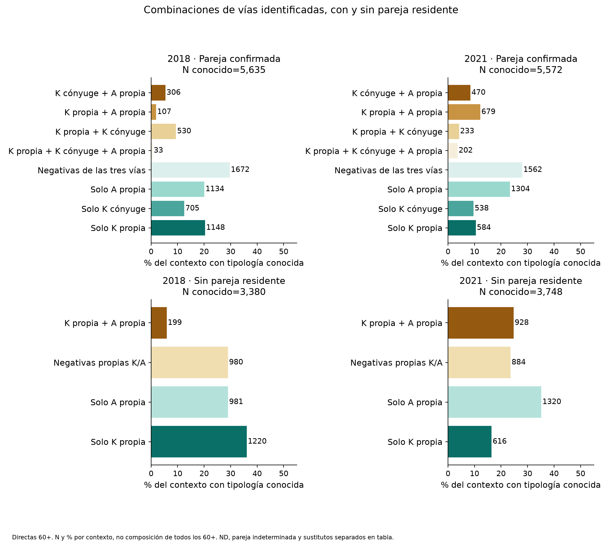

**Interpretación:** Las proporciones se condicionan a tipología conocida en cada contexto; los cambios 2018–2021 también están afectados por la ruptura de A. No son altas/bajas homogéneas ni evolución de las mismas personas.

**Nota:** Directas 60+. N y % por contexto, no composición de todos los 60+. ND, pareja indeterminada y sustitutos separados en tabla.

**Fuente y procedencia:** ENASEM; [06_COBERTURA_PROTECCION_ECONOMICA](../notebooks/06_COBERTURA_PROTECCION_ECONOMICA.ipynb); [agregados 06](../data/interim/cobertura_proteccion_economica/resultados.json); [contrato](../diccionarios/contrato_proteccion_economica.json). Bloque 3,4.

**Cuadro 33. Cobertura K y unión K/A en idéntico soporte por grupo, 2021**

**Pregunta y aporte:** Comparar el alcance de ampliar la definición de cobertura dentro de cada grupo.

| Variable | Grupo | N ambas conocidas | K % | K o A % |
| --- | --- | --- | --- | --- |
| Sexo | Hombre | 4,128 | 42.44 | 70.64 |
| Sexo | Mujer | 5,230 | 28.78 | 65.81 |
| Edad por visita | 60–64 | 2,262 | 23.39 | 26.44 |
| Edad por visita | 65–69 | 2,003 | 33.10 | 51.57 |
| Edad por visita | 70+ | 5,093 | 40.55 | 92.81 |
| Escolaridad inicial | 0 años | 1,380 | 18.19 | 73.33 |
| Escolaridad inicial | 1–5 años | 2,718 | 25.50 | 70.90 |
| Escolaridad inicial | 6 años | 2,061 | 34.59 | 65.60 |
| Escolaridad inicial | 7–9 años | 1,650 | 45.88 | 64.12 |
| Escolaridad inicial | ≥10 años | 1,418 | 56.28 | 66.01 |
| Localidad | <100 mil habitantes | 3,999 | 23.56 | 66.97 |
| Localidad | ≥100 mil habitantes | 5,359 | 43.20 | 68.67 |
| Ocupación | Busca trabajo | 158 | 15.19 | 50.00 |
| Ocupación | Labores del hogar | 2,535 | 18.86 | 60.51 |
| Ocupación | Retiro, incapacidad o sin trabajo | 4,007 | 55.20 | 87.15 |
| Ocupación | Trabaja | 2,657 | 20.44 | 47.16 |

**Nota:** Directas 60+, N de ambas respuestas conocidas por grupo. La tasa de la unión lógicamente conocida puede incorporar casos adicionales y se informa aparte. Los grupos ND no se asignan a ninguna categoría conocida; completos en notebook. Localidad a 100 mil no ruralidad estricta; escolaridad al inicio. Ocupación 4 no es jubilación exclusiva.

**Fuente y procedencia:** ENASEM; [06_COBERTURA_PROTECCION_ECONOMICA](../notebooks/06_COBERTURA_PROTECCION_ECONOMICA.ipynb); [agregados 06](../data/interim/cobertura_proteccion_economica/resultados.json); [contrato](../diccionarios/contrato_proteccion_economica.json). Bloque 5,6.

**Figura 35. Cobertura propia K y unión K/A por perfil, 2021**

**Pregunta y aporte:** Evaluar heterogeneidad de la unión propia sin sumar porcentajes de K y A.

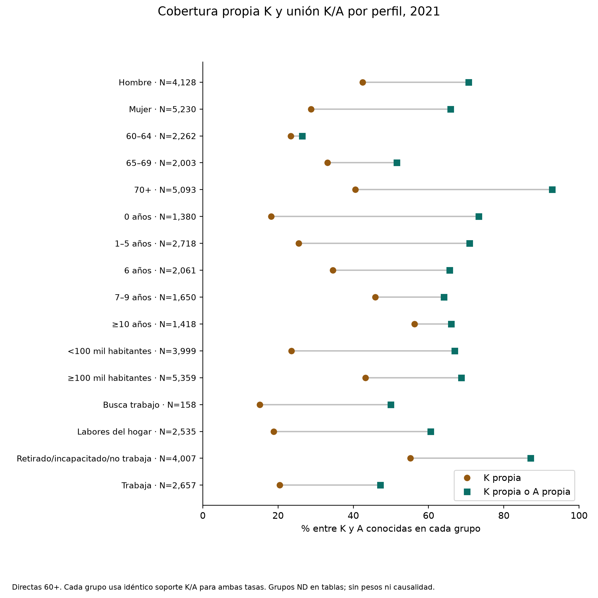

**Interpretación:** La unión acerca sexo/localidad, pero separa más edades. No implica una convergencia general ni atribuye el contraste a una política.

**Nota:** Directas 60+. Cada grupo usa idéntico soporte K/A para ambas tasas. Grupos ND en tablas; sin pesos ni causalidad.

**Fuente y procedencia:** ENASEM; [06_COBERTURA_PROTECCION_ECONOMICA](../notebooks/06_COBERTURA_PROTECCION_ECONOMICA.ipynb); [agregados 06](../data/interim/cobertura_proteccion_economica/resultados.json); [contrato](../diccionarios/contrato_proteccion_economica.json). Bloque 5.

**Figura 36. Brechas dentro de cada ronda: K frente a unión K/A**

**Pregunta y aporte:** Conservar rondas con dirección cambiante o contradicción de la hipótesis.

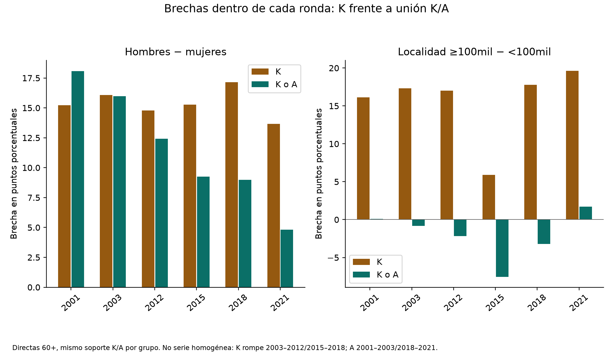

**Interpretación:** En 2001 la unión tiene mayor brecha por sexo que K; localidad cambia de dirección en rondas intermedias. Las rupturas limitan cualquier tendencia de brechas 2001–2021, aunque se compare dentro de ronda.

**Nota:** Directas 60+, mismo soporte K/A por grupo. No serie homogénea: K rompe 2003–2012/2015–2018; A 2001–2003/2018–2021.

**Fuente y procedencia:** ENASEM; [06_COBERTURA_PROTECCION_ECONOMICA](../notebooks/06_COBERTURA_PROTECCION_ECONOMICA.ipynb); [agregados 06](../data/interim/cobertura_proteccion_economica/resultados.json); [contrato](../diccionarios/contrato_proteccion_economica.json). Bloque 5,6.

**Cuadro 34. Montos nominales por vía y perfil: evento frente a suma parcial personal, 2021**

**Pregunta y aporte:** Identificar diferencias monetarias sin confundir eventos y beneficiarios ni afirmar suficiencia.

| Vía propia | Grupo | N receptores | N personas con monto | N eventos válidos | Mediana evento / suma parcial |
| --- | --- | --- | --- | --- | --- |
| K | Todas | 3,261 | 3,062 | 3,312 | 4,000 / 4,000 |
| K | Hombre | 1,756 | 1,625 | 1,737 | 4,290 / 4,700 |
| K | Mujer | 1,505 | 1,437 | 1,575 | 3,300 / 3,700 |
| K | 0 años | 251 | 242 | 254 | 3,000 / 3,000 |
| K | ≥10 años | 801 | 715 | 796 | 10,950 / 12,000 |
| A | Todas | 4,924 | 4,883 | 4,961 | 1,550 / 1,550 |
| A | Hombre | 2,164 | 2,147 | 2,199 | 1,550 / 1,550 |
| A | Mujer | 2,760 | 2,736 | 2,762 | 1,550 / 1,550 |
| A | 0 años | 930 | 925 | 941 | 1,550 / 1,550 |
| A | ≥10 años | 479 | 470 | 472 | 1,550 / 1,550 |

**Nota:** Pesos mensuales nominales, originales observados; los faltantes no son cero. Las sumas parciales incluyen solo eventos capturados con monto. K: 3,526 eventos (214 con monto ND). A: 5,027 eventos (66 con monto ND). Subconjuntos completos/parciales en agregados. No sumar K+A ni montos de cónyuge con propios. A puede representar especie y no es efectivo separado. Eventos de una persona no son observaciones independientes.

**Fuente y procedencia:** ENASEM; [06_COBERTURA_PROTECCION_ECONOMICA](../notebooks/06_COBERTURA_PROTECCION_ECONOMICA.ipynb); [agregados 06](../data/interim/cobertura_proteccion_economica/resultados.json); [contrato](../diccionarios/contrato_proteccion_economica.json). Bloque 7,8.

**Figura 37. Montos por evento según sexo y escolaridad, 2021**

**Pregunta y aporte:** Separar distribución de monto e igualdad de recepción.

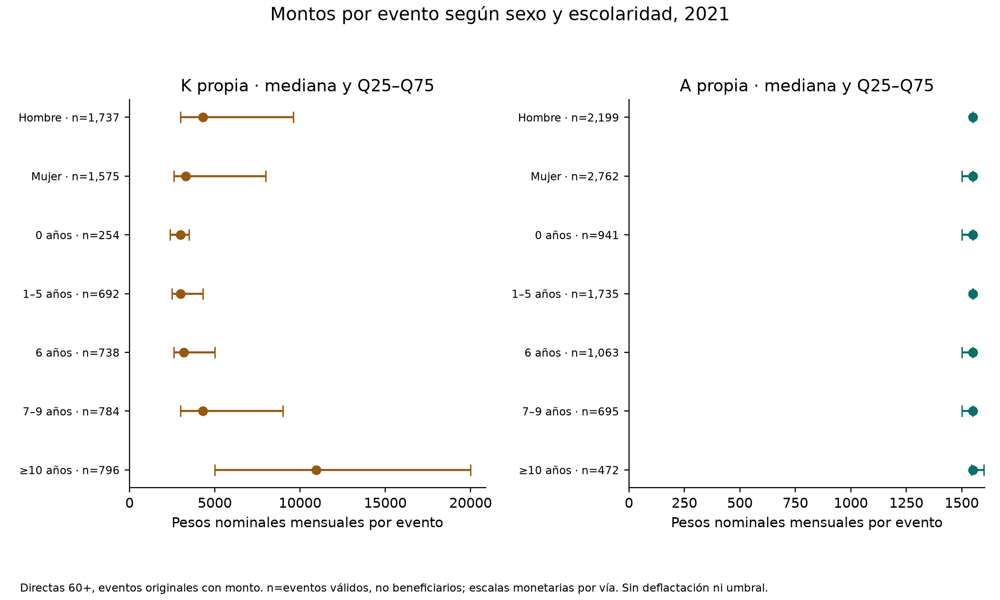

**Interpretación:** K mantiene contrastes de mediana por sexo/escolaridad en 2021. A comparte mediana en estos perfiles, lo que no prueba igualdad distributiva. Las escalas son propias de cada vía; no interpretar cocientes como suficiencia real.

**Nota:** Directas 60+, eventos originales con monto. n=eventos válidos, no beneficiarios; escalas monetarias por vía. Sin deflactación ni umbral.

**Fuente y procedencia:** ENASEM; [06_COBERTURA_PROTECCION_ECONOMICA](../notebooks/06_COBERTURA_PROTECCION_ECONOMICA.ipynb); [agregados 06](../data/interim/cobertura_proteccion_economica/resultados.json); [contrato](../diccionarios/contrato_proteccion_economica.json). Bloque 7,8.

**Suficiencia pendiente:** el contrato deja preparada una función parametrizada de deflactación y relación prestación/umbral. No se ejecutó: faltan fuente/base/frecuencia del INPC y referencia mensual confirmadas, además de localidad/unidad cuando corresponda. Esta ruta mide una prestación observada; no clasifica pobreza del hogar o ingreso económico total. Los montos del cónyuge solo se describen como recurso contextual en parejas confirmadas.

**Cuadro 35. Estados posteriores de cohortes con negativa propia K directa inicial**

**Pregunta y aporte:** Evitar que persistencia entre observados o ausencia sustituyan el universo basal.

| Intervalo | N K negativa basal | Negativa viva | K afirmativa viva | Fallecido registrado | Ausente vitalND | Vivo KND/modalidad |
| --- | --- | --- | --- | --- | --- | --- |
| 2001–2003 | 5,110 | 3,903 | 298 | 261 | 245 | 403 |
| 2012–2015 | 5,919 | 3,440 | 1,469 | 464 | 226 | 320 |
| 2018–2021 | 5,800 | 4,009 | 521 | 642 | 239 | 389 |

**Nota:** Cohorte 60+ basal, sin filtrar edad final/supervivencia.2001–2003 sensibilidad;2012–2015 y 2018–2021 principales. Ventanas K comparables de forma condicionada, no fecha efectiva de inicio. Otro estado no clasificable=0 en estas cohortes. Sustitutos con K válido quedan en sensibilidad. Negativa K no prueba ausencia A ni protección integral.

**Fuente y procedencia:** ENASEM; [06_COBERTURA_PROTECCION_ECONOMICA](../notebooks/06_COBERTURA_PROTECCION_ECONOMICA.ipynb); [agregados 06](../data/interim/cobertura_proteccion_economica/resultados.json); [contrato](../diccionarios/contrato_proteccion_economica.json). Bloque 10,11.

**Figura 38. Destino de quienes reportan negativa propia K al inicio**

**Pregunta y aporte:** Comparar destinos observados sin imputar recepción después de muerte.

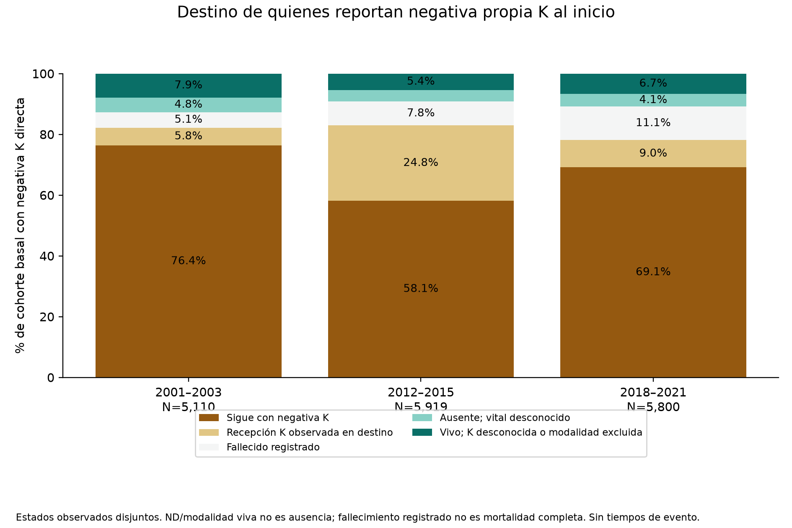

**Interpretación:** El porcentaje entre sobrevivientes con K conocido describe una selección distinta de toda la cohorte inicial. Muerte, ausencia y KND/modalidad cambian el denominador y permanecen separados.

**Nota:** Estados observados disjuntos. ND/modalidad viva no es ausencia; fallecimiento registrado no es mortalidad completa. Sin tiempos de evento.

**Fuente y procedencia:** ENASEM; [06_COBERTURA_PROTECCION_ECONOMICA](../notebooks/06_COBERTURA_PROTECCION_ECONOMICA.ipynb); [agregados 06](../data/interim/cobertura_proteccion_economica/resultados.json); [contrato](../diccionarios/contrato_proteccion_economica.json). Bloque 10,11.

**Cuadro 36. Cotas de negativa viva y fallecimiento en la cohorte basal sin K**

**Pregunta y aporte:** Distinguir estimandos condicionados de límites lógicos por cohorte.

| Intervalo | Estimando | N basal | Mínimo % cohorte | Máximo % cohorte | Negativa % vivos K conocidos |
| --- | --- | --- | --- | --- | --- |
| 2001–2003 | Negativa viva / cohorte | 5,110 | 76.38 | 89.06 | 92.91 |
| 2001–2003 | Fallecimiento registrado / cohorte | 5,110 | 5.11 | 9.90 | No aplica |
| 2012–2015 | Negativa viva / cohorte | 5,919 | 58.12 | 67.34 | 70.08 |
| 2012–2015 | Fallecimiento registrado / cohorte | 5,919 | 7.84 | 11.66 | No aplica |
| 2018–2021 | Negativa viva / cohorte | 5,800 | 69.12 | 79.95 | 88.50 |
| 2018–2021 | Fallecimiento registrado / cohorte | 5,800 | 11.07 | 15.19 | No aplica |

**Nota:** Negativa viva: Nno/N a(Nno+ausentes+vivos KND)/N; fallecidos excluidos del extremo superior de recepción/negativa futura. Muerte: D/N a(D+U)/N, suponiendo registros correctos. No IC ni tasas anuales/correcciones. Mortalidad no incluye incertidumbre sobre registros mal clasificados.

**Fuente y procedencia:** ENASEM; [06_COBERTURA_PROTECCION_ECONOMICA](../notebooks/06_COBERTURA_PROTECCION_ECONOMICA.ipynb); [agregados 06](../data/interim/cobertura_proteccion_economica/resultados.json); [contrato](../diccionarios/contrato_proteccion_economica.json). Bloque 11.

**Cuadro 37. Selección de cobertura propia: cohorte inicial frente a pares observados**

**Pregunta y aporte:** Cuantificar diferencia descriptiva por selección de quienes quedan observables.

| Intervalo | N unión basal conocida | N par unión conocida | Basal cohorte % | Basal retenidos % | Destino mismos pares % |
| --- | --- | --- | --- | --- | --- |
| 2001–2003 | 6,789 | 5,568 | 33.23 | 32.87 | 38.31 |
| 2012–2015 | 8,734 | 7,196 | 47.42 | 46.55 | 72.40 |
| 2018–2021 | 9,039 | 6,978 | 62.74 | 61.31 | 76.93 |

**Nota:** Todas las tasas de retenidos usan los mismos pares vivos/directos con unión conocida. No corrección de sesgo. Unión conjuntamente comparable solo 2012–2015; otros intervalos no son transiciones homologadas de K/A. Duración mensual observada de vivos y reapariciones en notebook; ausencia no prueba vida/muerte.

**Fuente y procedencia:** ENASEM; [06_COBERTURA_PROTECCION_ECONOMICA](../notebooks/06_COBERTURA_PROTECCION_ECONOMICA.ipynb); [agregados 06](../data/interim/cobertura_proteccion_economica/resultados.json); [contrato](../diccionarios/contrato_proteccion_economica.json). Bloque 10,11.

**Cobertura y universos.** En 2021, 6,366/9,366 respuestas directas con unión K/A conocida reportan al menos una vía propia (67.97%). 3,000 tienen negativas propias K/A. Hay 58 directas con uniónND y 1,058 sustitutos separados. Una afirmativa basta para conocer la unión aun si la otra vía esND; no basta para clasificar una combinación exclusiva. No equivale a algún ingreso monetario garantizado: A puede ser especie y faltan otras fuentes de protección.

**Brechas que se estrechan dentro de la ronda.** En 2021, sobre el mismo soporte K y A conocido, la diferencia hombres−mujeres pasa de 13.67 pp con K a 4.83 pp con K∨A. La diferencia localidad≥100 mil−<100 mil pasa de 19.64 a 1.70 pp. Se amplía la definición de cobertura en la misma muestra; no se estima efecto de A ni de una reforma. Composición, escolaridad y actividad siguen sin ajustarse.

**Límites de una igualación general.** En 2021, la unión K/A es 26.44% entre 60–64 (N=2,262) y 92.82% entre 70+ (N=5,099); la brecha por edad se amplía respecto de K sola. Las diferencias por escolaridad y ocupación no se resumen con la brecha de sexo/localidad. En 2001 la brecha hombres−mujeres de la unión es mayor que la de K; la localidad puede invertir dirección en rondas intermedias. Los cambios de instrumentos y composición impiden afirmar convergencia monotónica 2001–2021, incluso comparando brechas.

**Escolaridad, actividad y ausencia de vía propia identificada.** En 2021, en el mismo soporte K/A conocido, quienes tienen 0 años de escolaridad registran K=18.19% y unión=73.33% (N=1,380); con≥10 años, K=56.28% y unión=66.01% (N=1,418). El gradiente marginal cambia de dirección, no solo de magnitud; edades, cohortes y elegibilidad no ajustadas pueden contribuir. Entre quienes trabajan, unión=47.16% (N=2,657), frente a 87.15% en la categoría que agrupa retiro/incapacidad/no trabajo (N=4,007). No es efecto del trabajo ni jubilación homologada. De las 3,000 negativas propias K/A, 1,664 corresponden a 60–64 y 366 a 70+: conteos por su denominador, no ausencias de toda protección. Conviene comparar composición antes de interpretar estos gradientes como igualación económica.

**Monto observado y suficiencia pendiente.** En 2021 K tiene 3,261 receptores directos, 3,062 con algún monto y 3,312/3,526 eventos con monto; mediana por evento 4,000 pesos. Para A, 4,924 receptores, 4,883 con algún monto y 4,961/5,027 eventos válidos; mediana 1,550. La mediana K por evento es 4,290 en hombres frente a 3,300 en mujeres; por escolaridad, 3,000 con 0 años frente a 10,950 con≥10. A tiene mediana 1,550 en esos grupos, pero compartir mediana no equivale a igualdad de distribución. Eventos repetidos por persona no son beneficiarios independientes. No sumar K+A ni declarar suficiencia/pobreza: faltan INPC/umbral confirmados y dinero/especie no separable.

**Selección y persistencia.** De 5,800 personas 60+ con negativa K directa en 2018, 4,009 conservan negativa observada en 2021, 521 reportan K, 642 tienen registro sobre fallecido, 239 no aparecen y 389 son vivos con K no disponible para el principal. Entre sobrevivientes con K conocido, persistencia=88.50%; respecto de toda la cohorte basal, las cotas lógicas de negativa viva en destino son [69.12,79.95]%. Son estimandos distintos: la segunda no es una corrección de la primera ni un riesgo competitivo con tiempos. Los fallecidos no reciben un estado pensionario posterior imputado.

**Sensibilidad de cobertura.** La cobertura basal de la unión en 2018 es 62.74% entre respuestas conocidas de la cohorte y 61.31% en quienes además tienen unión conocida viva en 2021. Esa diferencia describe selección de composición; no reconstruye protección entre fallecidos/ausentes. Las trayectorias de K son condicionadamente comparables en las tres ventanas; la unión K/A solo en 2012–2015, porque A cambia en 2001–2003 y 2018–2021. 'No→Sí' es inicio observado de respuesta, no fecha efectiva de otorgamiento.

**Aportación y decisión metodológica.** La evidencia respalda estudiar por separado acceso identificado y monto parcial, con tipología exhaustiva de personas, incertidumbre y selección. La hipótesis 'se iguala acceso pero no monto/suficiencia' es parcialmente compatible con los contrastes de sexo/localidad en 2021, pero no se sostiene como conclusión general para todos los grupos ni como convergencia temporal validada; la suficiencia todavía no está evaluada. No se ejecutaron modelos opcionales, KM, Cox o IPW. Un modelo futuro requeriría definir si predice negativa viva o un estado multiclase, evitar etiquetar muertos/ausentes como negativas, validar por ventana comparable y mostrar calibración/soporte; no explicaría políticas.

**Estado validado y límites:** cálculos, exclusividad, conteos, eventos/beneficiarios, soporte y reproducción operacional verificados. Permanecen pendientes homologación definitiva, diseño/ponderación, medición económica completa y suficiencia. Sin modelos opcionales; antes de predecir habría que definir negativa viva o estados múltiples y evitar fuga temporal/selección de sobrevivientes. No se modificaron las bases, notebooks 01–05 ni el manuscrito.

<!-- END proteccion_economica_06 -->

<!-- BEGIN politicas_montos_07 -->

### 10.3 Políticas, poder adquisitivo y brechas de prestaciones parciales

**Pregunta central de la autora:** ¿Qué tanto es consistente la expansión de las pensiones y los apoyos públicos con una reducción de las brechas de cobertura y de monto de la protección económica de los adultos mayores en México (ENASEM 2001–2021), qué grupos siguen sin vía propia de protección y cómo cambia esta lectura al considerar a quienes mueren o dejan de ser entrevistados?

La hipótesis de acceso más igualado que monto o suficiencia se contrasta por vía, grupo y periodo. La mortalidad y la no observación funcionan como sensibilidad actuarial. La etapa 07 completa las fuentes de precios y umbrales pendientes en 06: los resultados nominales anteriores se conservan como evidencia de esa etapa.

**Población y estimandos.** Principal: personas vivas 60+ por visita con entrevista directa, sin exigir panel balanceado. Se conservan respuestas válidas por sustituto en sensibilidad. Montos originales mensuales por evento y sumas parciales por persona, separadas entre K propia, A propia y cónyuge contextual. K no prueba contributividad; A incluye valoraciones de especie y distintos programas. No se suman K+A, originales+imputados, instituciones ni personas entre rondas. Las cifras describen muestra no ponderada; diseño y pesos no validados.

**Fecha y precios.** Se verificó y descargó la serie mensual oficial INEGI 865541, base segunda quincena julio 2018=100, actualización 2024: 321 meses enero 2000–septiembre 2026. **Referencia común: septiembre 2026, INPC 146.075**, último mes mensual disponible al consultar 14 octubre 2026, cotejado con el aviso INEGI publicado DOF 9 octubre. Fórmula: **monto constante = nominal ×146.075 / INPC del periodo original**. [Serie oficial](https://www.inegi.org.mx/app/indicesdeprecios/Estructura.aspx?idEstructura=112001700010), [aviso INEGI](https://sidof.segob.gob.mx/notas/docFuente/5800864).

Las preguntas dicen año pasado y mes normal, sin identificar mes de pago. Principal: promedio del año calendario anterior al **año real de entrevista**, criterio explícito de valoración, no fecha observada. Sensibilidades: doce meses anteriores al mes real, promedio del año de entrevista y extremos mensuales del año previo. En ronda 2021 hay 6794 directas entrevistadas 2021 y 2630 en 2022; sus precios principales son 2020 y 2021 respectivamente. Ronda 2012 tiene 12 directas en 2013 y una sin año válido; ronda 2018 tiene 202 directas en 2019. Las entrevistas tardías conservan su ronda y se valoran según su fecha real. No se inventan flujos ni fechas de pago.

K/A ya piden cantidades mensuales; las instrucciones 2021 de K indican normalizar otros periodos y descontar impuestos. La entrega bimestral normativa se convierte a equivalente mensual; **no se divide otra vez un importe declarado mensual**. La valoración por INPC no es el valor presente actuarial de una pensión vitalicia. [Pregunta e instrucciones K](https://www.inegi.org.mx/rnm/index.php/catalog/861/variable/F40/V14717?name=K61_1_1_21), [A y valoración de especie](https://www.inegi.org.mx/rnm/index.php/catalog/861/variable/F40/V14790?name=K80_1_1_21).

**Disponibilidad monetaria y alcance.** La auditoría identifica 96 campos originales disponibles,81 con eventos captados, y 198 campos alternativos de archivos imputados. Los 15 campos sin evento no se tratan como importes cero. Las versiones alternativas se documentan, sin sumarlas ni usar cantidades anuales/imputadas sin validar su contrato. ENASEMsimple no ofrece un total pensionario personal homologado validado. Todos los eventos captados con monto válido tampoco garantizan todos los beneficios realmente recibidos.

**Cuadro 38. Montos de prestaciones: receptores, faltantes y cuartiles nominales y reales**

**Pregunta y aporte:** Distinguir aumentos de pesos declarados de cambios de poder adquisitivo entre receptores.

| Ronda | Vía | N receptores | N monto nominal | N monto real | Receptores sin monto | Q 25 nominal $/mes | Mediana nominal $/mes | Q 75 nominal $/mes | Q 25 real $/mes | Mediana real $/mes | Q 75 real $/mes |
| --- | --- | --- | --- | --- | --- | --- | --- | --- | --- | --- | --- |
| 2001 | K | 1,680 | 1,608 | 1,608 | 72 | 1,150.00 | 1,227.00 | 2,100.00 | 3,614.52 | 3,856.54 | 6,600.44 |
| 2003 | K | 1,760 | 1,714 | 1,714 | 46 | 1,300.00 | 1,490.00 | 2,500.00 | 3,657.38 | 4,191.92 | 7,033.42 |
| 2012 | K | 2,819 | 2,633 | 2,633 | 186 | 1,800.00 | 2,200.00 | 5,000.00 | 3,463.91 | 4,233.66 | 9,621.96 |
| 2015 | K | 4,159 | 3,965 | 3,965 | 194 | 600.00 | 2,200.00 | 4,000.00 | 1,027.09 | 3,766.01 | 6,847.29 |
| 2018 | K | 3,247 | 2,994 | 2,994 | 253 | 2,200.00 | 2,800.00 | 7,000.00 | 3,302.36 | 4,279.56 | 10,698.89 |
| 2021 | K | 3,261 | 3,062 | 3,062 | 199 | 3,000.00 | 4,000.00 | 10,000.00 | 3,859.59 | 5,438.89 | 12,865.29 |
| 2001 | A | 666 | 625 | 625 | 41 | 125.00 | 200.00 | 500.00 | 392.88 | 628.61 | 1,571.53 |
| 2003 | A | 895 | 821 | 821 | 74 | 150.00 | 250.00 | 600.00 | 422.01 | 703.34 | 1,688.02 |
| 2012 | A | 1,574 | 1,535 | 1,534 | 39 | 500.00 | 500.00 | 800.00 | 962.20 | 962.20 | 1,539.51 |
| 2015 | A | 2,630 | 2,582 | 2,582 | 48 | 500.00 | 550.00 | 600.00 | 855.91 | 941.50 | 1,027.09 |
| 2018 | A | 2,764 | 2,699 | 2,699 | 65 | 550.00 | 580.00 | 1,000.00 | 840.63 | 886.48 | 1,528.41 |
| 2021 | A | 4,924 | 4,883 | 4,883 | 41 | 1,550.00 | 1,550.00 | 1,550.00 | 1,994.12 | 2,107.57 | 2,107.57 |

**Nota:** Suma personal observada parcial, no ingreso total. Pesos reales septiembre 2026; principal año calendario previo a entrevista real.2012 A:1535 montos nominales,1534 reales por año de entrevistaND. Distribuciones por evento, percentiles 10/90/95, DE/IQR, cobertura monetaria y sensibilidad positiva consultables en 07. Ningún cero en montos generales 60+directos; el inventario original sí conserva la instrucción de cero por especie no valorada.

**Fuente y procedencia:** ENASEM; [07_POLITICAS_MONTOS_SUFICIENCIA](../notebooks/07_POLITICAS_MONTOS_SUFICIENCIA.ipynb); [agregados 07](../data/interim/politicas_montos_suficiencia/resultados.json); [contrato monetario](../diccionarios/contrato_monetario_politicas.json); [fuentes y cronología](../investigacion/notas/politicas_publicas_envejecimiento.md). Bloque 1–7.

**Figura 39. Montos nominales y poder adquisitivo, seis rondas**

**Pregunta y aporte:** Identificar episodios con aumento nominal y erosión real.

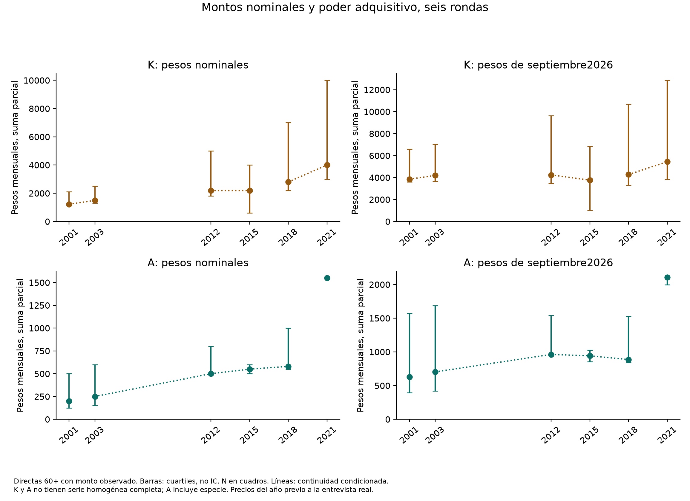

**Nota:** Directas 60+ con monto observado. Barras: cuartiles, no IC. N en cuadros. Líneas: continuidad condicionada.
K y A no tienen serie homogénea completa; A incluye especie. Precios del año previo a la entrevista real.

Las conexiones se restringen a continuidad condicionada del instrumento. La deflactación no elimina las rupturas K 2003–2012/K 2015–2018 o A 2001–2003/A 2018–2021. Tampoco elimina cambios de composición: un nuevo receptor de monto bajo puede reducir la mediana del grupo aunque nadie pierda su prestación.

**Fuente y procedencia:** ENASEM; [07_POLITICAS_MONTOS_SUFICIENCIA](../notebooks/07_POLITICAS_MONTOS_SUFICIENCIA.ipynb); [agregados 07](../data/interim/politicas_montos_suficiencia/resultados.json); [contrato monetario](../diccionarios/contrato_monetario_politicas.json); [fuentes y cronología](../investigacion/notas/politicas_publicas_envejecimiento.md). Bloque 6–7.

**Cuadro 39. Variación de medianas en ventanas con comparabilidad condicionada**

**Pregunta y aporte:** Responder si un incremento nominal representó un incremento real.

| Intervalo | Vía | N monto inicial | N monto final | Variación nominal % | Variación real % |
| --- | --- | --- | --- | --- | --- |
| 2001–2003 | K | 1,608 | 1,714 | 21.43 | 8.70 |
| 2003–2012 | A | 821 | 1,535 | 100.00 | 36.80 |
| 2012–2015 | K | 2,633 | 3,965 | 0.00 | -11.05 |
| 2012–2015 | A | 1,535 | 2,582 | 10.00 | -2.15 |
| 2015–2018 | A | 2,582 | 2,699 | 5.45 | -5.84 |
| 2018–2021 | K | 2,994 | 3,062 | 42.86 | 27.09 |

**Nota:** Muestras transversales de receptores con monto, no mismos individuos. Cambio porcentual de medianas, no mediana del cambio individual. K 2012–15 amplía slots/instrumento; A 2015–18 pasa a programas/eventos. Cada ventana es condicionada, sin invariancia completa. Año previo principal; sensibilidades temporal y de modalidad en 07.

**Fuente y procedencia:** ENASEM; [07_POLITICAS_MONTOS_SUFICIENCIA](../notebooks/07_POLITICAS_MONTOS_SUFICIENCIA.ipynb); [agregados 07](../data/interim/politicas_montos_suficiencia/resultados.json); [contrato monetario](../diccionarios/contrato_monetario_politicas.json); [fuentes y cronología](../investigacion/notas/politicas_publicas_envejecimiento.md). Bloque 7.

**Nominal y real pueden discrepar.** En 2012–2015 la mediana K sigue en $2,200 nominales, mientras baja de $4,234 a $3,766 de septiembre de 2026 (-11.05%). Los N con monto son 2,633 y 3,965. A pasa de $500 a $550 nominales (+10.00%), pero de $962 a $942 reales (-2.15%; N=1,535/2,582). Es una comparación condicionada entre muestras de receptores, con cambios de slots K y composición; no pérdida individual ni efecto causal.

**Poder adquisitivo sin aumento nominal suficiente.** A 2015–2018 sube nominalmente 5.45%, pero la mediana real baja 5.84%. El monto normativo PAM permaneció en $580 mensuales durante 2014–2018. El patrón es compatible con erosión por precios, pero A incluye otros programas y especie; no se identifica a todos los beneficiarios PAM ni se atribuye a la política.

**Composición pensionaria.** Los eventos K con evidencia de programas públicos agrupados pasan de 304/2978 en 2012 a 1190/4453 en 2015; sus medianas declaradas son 500 y 550 pesos nominales. Es una agrupación documental de contingencia con multiselección, sin monto separable por institución; no identifica todo el importe como PAM. El aumento de esa participación ayuda a contextualizar la caída de la mediana K y el gran contraste escolar de 2015, sin atribuir una reducción a cada pensionado ni llamar contributivos a todos los registros K. En 2018/2021 la categoría histórica 8 deja de estar disponible: su ausencia no es cero beneficiarios públicos.

**Cuadro 40. Acceso y montos por perfil en 2021: poblaciones y unidades distintas**

**Pregunta y aporte:** Detectar grupos con acceso relativamente alto y prestación parcial de monto reducido.

| Perfil | N K/A conocidas | K o A % | N monto K | N monto A | Mediana K nominal $ | Mediana K real $ | Mediana A nominal $ | Mediana A real $ | Mediana K/LPI % | Mediana A/LPI % |
| --- | --- | --- | --- | --- | --- | --- | --- | --- | --- | --- |
| Hombre | 4,128 | 70.64 | 1,625 | 2,147 | 4,700.00 | 6,303.99 | 1,550.00 | 2,107.57 | 135.21 | 43.66 |
| Mujer | 5,230 | 65.81 | 1,437 | 2,736 | 3,700.00 | 4,895.00 | 1,550.00 | 2,107.57 | 106.07 | 43.66 |
| 60–64 | 2,262 | 26.44 | 490 | 77 | 6,000.00 | 8,158.34 | 1,550.00 | 2,039.58 | 184.36 | 43.66 |
| 65–69 | 2,003 | 51.57 | 621 | 543 | 4,200.00 | 5,710.83 | 1,550.00 | 2,107.57 | 129.94 | 43.66 |
| 70+ | 5,093 | 92.81 | 1,951 | 4,263 | 3,800.00 | 5,146.12 | 1,550.00 | 2,107.57 | 112.67 | 43.66 |
| 0 años | 1,380 | 73.33 | 242 | 925 | 3,000.00 | 4,033.70 | 1,550.00 | 2,107.57 | 84.51 | 43.66 |
| ≥10 años | 1,418 | 66.01 | 715 | 470 | 12,000.00 | 16,316.67 | 1,550.00 | 2,107.57 | 338.02 | 43.66 |
| <100 mil habitantes | 3,999 | 66.97 | 889 | 2,275 | 3,500.00 | 4,502.85 | 1,550.00 | 2,107.57 | 112.75 | 47.89 |
| ≥100 mil habitantes | 5,359 | 68.67 | 2,173 | 2,608 | 4,700.00 | 6,303.99 | 1,550.00 | 2,107.57 | 129.94 | 43.66 |
| Trabaja | 2,657 | 47.16 | 511 | 960 | 3,500.00 | 4,759.03 | 1,550.00 | 2,107.57 | 106.07 | 43.66 |
| Labores del hogar | 2,535 | 60.51 | 452 | 1,308 | 3,050.00 | 4,079.17 | 1,550.00 | 2,107.57 | 90.14 | 43.66 |
| Retirado/incapacitado/no trabaja | 4,007 | 87.15 | 2,075 | 2,550 | 5,000.00 | 6,526.67 | 1,550.00 | 2,107.57 | 140.84 | 43.66 |

**Nota:** Directas 60+. Cobertura 06: mismo soporte K/A por grupo; montos 07: solo receptores con monto, separados por vía. LPI asignable 2021 cubre todos esos montos. Escolaridad al inicio de participación; localidad 100 mil para perfil,2500 para umbral. Ocupación 4 no identifica solo jubilados. A no es efectivo homogéneo; no comparar las dos medianas como suma personal.

**Fuente y procedencia:** ENASEM; [07_POLITICAS_MONTOS_SUFICIENCIA](../notebooks/07_POLITICAS_MONTOS_SUFICIENCIA.ipynb); [agregados 07](../data/interim/politicas_montos_suficiencia/resultados.json); [contrato monetario](../diccionarios/contrato_monetario_politicas.json); [fuentes y cronología](../investigacion/notas/politicas_publicas_envejecimiento.md). Bloque 8,12–13.

**Figura 40. Medianas por vía y perfil, 2021**

**Pregunta y aporte:** Comparar importes mensuales K con A 5 de vejez identificada, por evento.

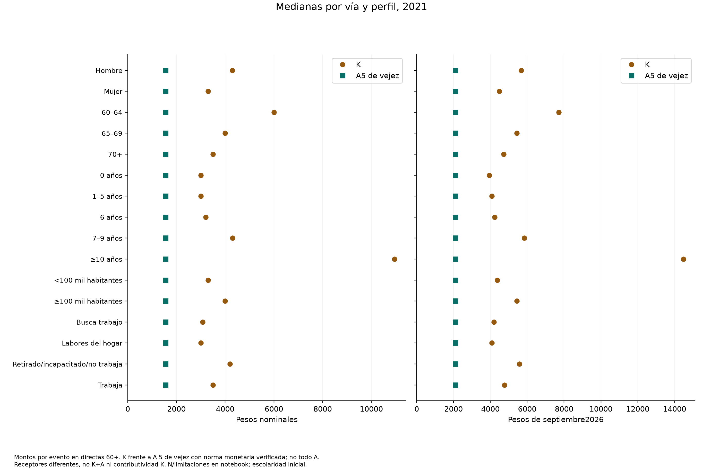

**Nota:** Montos por evento en directas 60+. K frente a A 5 de vejez con norma monetaria verificada; no todo A.
Receptores diferentes, no K+A ni contributividad K. N/limitaciones en notebook; escolaridad inicial.

La comparación monetaria entre vías se restringe a A 5 con norma monetaria verificada; el cuadro anterior describe separadamente toda A, incluyendo especie. Se comparan prestaciones mensuales por evento entre distintos receptores, sin construir ingreso personal total o suponer contributividad K. Las diferencias relativas no desaparecen al cambiar a pesos constantes; las fechas 2021/2022 producen factores distintos antes de resumir. Sin ajuste de edad, sexo o historia laboral.

**Fuente y procedencia:** ENASEM; [07_POLITICAS_MONTOS_SUFICIENCIA](../notebooks/07_POLITICAS_MONTOS_SUFICIENCIA.ipynb); [agregados 07](../data/interim/politicas_montos_suficiencia/resultados.json); [contrato monetario](../diccionarios/contrato_monetario_politicas.json); [fuentes y cronología](../investigacion/notas/politicas_publicas_envejecimiento.md). Bloque 8,11.

**Montos y distribución en 2021.** La suma parcial K tiene mediana $4,000 nominal y $5,439 real (N=3,062); A $1,550/$2,108 (N=4,883). Los receptores son universos distintos. A general valora también especie, de modo que no es una comparación homogénea de efectivo; el programa de vejez identificado se examina por separado. No se suman K+A.

**Brechas entre receptores K.** Hombres: $4,700 nominal/$6,304 real, N=1,625; mujeres: $3,700/$4,895, N=1,437. La brecha de medianas reales es $1,409 y la razón 1.29. Con ≥10 años de escolaridad son $12,000/$16,317 (N=715), frente a $3,000/$4,034 sin escolaridad (N=242); razón real 4.05. Son diferencias descriptivas sin ajuste de composición; escolaridad corresponde al inicio de la participación.

**Una mediana A común no garantiza suficiencia.** En 2021 A tiene mediana de 43.66% de la LPI asignable, con N=4,883; 0 montos no tienen geografía asignable. El 96.35% de los montos parciales A queda por debajo de esa referencia. K tiene mediana 119.49%, pero 40.17% queda por debajo. No son porcentajes de pobreza, ni evaluación de ingreso total o protección completa.

**Cuadro 41. Brechas absolutas y relativas de medianas K entre receptores**

**Pregunta y aporte:** Examinar si las brechas monetarias se estrechan al valorar en precios constantes.

| Ronda | Grupo 1 / grupo 2 | N grupo 1 | N grupo 2 | Diferencia nominal $ | Diferencia real $ | Razón nominal | Razón real |
| --- | --- | --- | --- | --- | --- | --- | --- |
| 2012 | Hombre / Mujer | 1,485 | 1,148 | 262.00 | 504.19 | 1.13 | 1.13 |
| 2012 | ≥10 años / 0 años | 431 | 394 | 6,100.00 | 11,738.79 | 4.21 | 4.21 |
| 2015 | Hombre / Mujer | 2,085 | 1,880 | 400.00 | 684.73 | 1.20 | 1.20 |
| 2015 | ≥10 años / 0 años | 535 | 703 | 8,400.00 | 14,379.31 | 15.00 | 15.00 |
| 2018 | Hombre / Mujer | 1,646 | 1,348 | 500.00 | 764.21 | 1.20 | 1.20 |
| 2018 | ≥10 años / 0 años | 571 | 338 | 7,800.00 | 12,003.71 | 4.55 | 4.66 |
| 2021 | Hombre / Mujer | 1,625 | 1,437 | 1,000.00 | 1,408.99 | 1.27 | 1.29 |
| 2021 | ≥10 años / 0 años | 715 | 242 | 9,000.00 | 12,282.97 | 4.00 | 4.05 |

**Nota:** Diferencia mediana 1−mediana 2 y razón mediana 1/mediana 2; no ajuste sociodemográfico.2012–15 y 2018–21 comparabilidad K condicionada;2015–18 ruptura. La fuerte diferencia escolar 2015 coincide con distinta composición y captación K de programas públicos; no evidencia una caída individual general. Otras 324 comparaciones dirigidas y distribuciones se conservan en 07.

**Fuente y procedencia:** ENASEM; [07_POLITICAS_MONTOS_SUFICIENCIA](../notebooks/07_POLITICAS_MONTOS_SUFICIENCIA.ipynb); [agregados 07](../data/interim/politicas_montos_suficiencia/resultados.json); [contrato monetario](../diccionarios/contrato_monetario_politicas.json); [fuentes y cronología](../investigacion/notas/politicas_publicas_envejecimiento.md). Bloque 8–9.

**Brechas no uniformes.** La razón hombres/mujeres en K se amplía aproximadamente de 1.13 a 1.20 entre 2012–2015 y de 1.20 a 1.29 entre 2018–2021 en pesos reales. La razón escolar ≥10/0 es muy alta en 2015 y menor en 2021; no puede describirse como cierre homogéneo 2001–2021 porque cambian captación, composición y definiciones. Las medianas A coinciden entre sexos y varios niveles escolares en 2021; eso respalda una igualación de ese punto de la distribución entre receptores observados, sin demostrar igualdad de toda la distribución o recursos totales.

**Cuadro 42. Prestación parcial en relación con la LPI histórica asignable**

**Pregunta y aporte:** Medir la referencia cubierta por una prestación sin diagnosticar pobreza de personas.

| Ronda | Vía | N monto/umbral | Montos sin umbral | Q 25 % LPI | Mediana % LPI | Q 75 % LPI | Prestación <LPI % | Mediana diferencia nominal $ | Mediana diferencia real $ |
| --- | --- | --- | --- | --- | --- | --- | --- | --- | --- |
| 2001 | K | 1,170 | 438 | 75.24 | 80.38 | 154.33 | 62.65 | -305.06 | -958.82 |
| 2003 | K | 1,247 | 467 | 75.07 | 86.62 | 161.68 | 61.27 | -231.78 | -652.07 |
| 2012 | K | 2,632 | 1 | 72.66 | 92.84 | 201.82 | 52.39 | -177.41 | -341.40 |
| 2015 | K | 3,963 | 2 | 29.97 | 78.22 | 149.32 | 63.13 | -612.70 | -1,048.84 |
| 2018 | K | 2,994 | 0 | 70.09 | 95.58 | 223.01 | 53.64 | -138.84 | -212.20 |
| 2021 | K | 3,062 | 0 | 83.31 | 119.49 | 281.69 | 40.17 | 649.97 | 878.70 |
| 2001 | A | 81 | 544 | 6.43 | 20.39 | 83.60 | 76.54 | -1,238.06 | -3,891.30 |
| 2003 | A | 142 | 679 | 8.66 | 28.87 | 36.38 | 92.25 | -1,231.78 | -3,465.44 |
| 2012 | A | 1,533 | 2 | 20.18 | 24.09 | 36.33 | 94.72 | -1,477.41 | -2,843.11 |
| 2015 | A | 2,582 | 0 | 19.55 | 20.76 | 30.04 | 98.06 | -2,165.20 | -3,706.44 |
| 2018 | A | 2,699 | 0 | 17.52 | 20.47 | 32.71 | 97.89 | -2,138.84 | -3,269.03 |
| 2021 | A | 4,883 | 0 | 42.25 | 43.66 | 58.26 | 96.35 | -2,000.03 | -2,719.49 |

**Nota:** LPI alimentaria+no alimentaria mensual por persona, promedio del periodo original, geografía 2500. Serie CONEVAL marzo 2025 reestimada 2024; INEGI responsabledesde 2025.2001/03 asignable solo≥100 mil, submuestra distinta; restantes tienen escenarios de ambas líneas, no clasificación arbitraria. Primero razón/diferencia individual, luego cuantiles. Diferencias respecto de línea ND excluidas; no pobreza ni ingreso completo.

**Fuente y procedencia:** ENASEM; [07_POLITICAS_MONTOS_SUFICIENCIA](../notebooks/07_POLITICAS_MONTOS_SUFICIENCIA.ipynb); [agregados 07](../data/interim/politicas_montos_suficiencia/resultados.json); [contrato monetario](../diccionarios/contrato_monetario_politicas.json); [fuentes y cronología](../investigacion/notas/politicas_publicas_envejecimiento.md). Bloque 5,12.

**Figura 41. Prestación parcial respecto de la LPI del periodo**

**Pregunta y aporte:** Distinguir razón de prestación/umbral y elección geográfica.

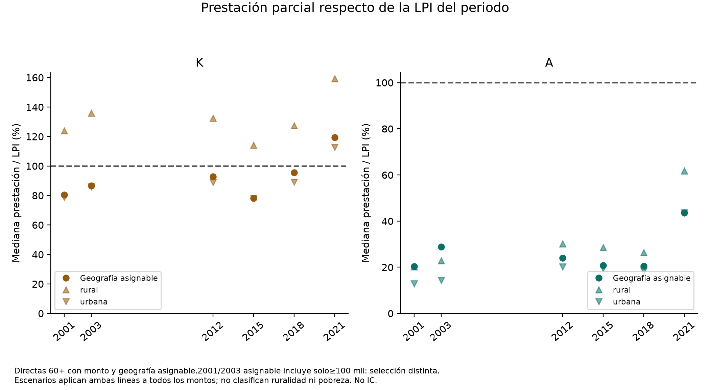

**Nota:** Directas 60+ con monto y geografía asignable.2001/2003 asignable incluye solo≥100 mil: selección distinta.
Escenarios aplican ambas líneas a todos los montos; no clasifican ruralidad ni pobreza. No IC.

Las líneas históricas cubren todos los periodos 2000–2022 usados. Para 2012/2015 se dejaron 2 y 4 discordancias geográficas directas como ND;2018/2021 quedan 12 y 14 sin fuente asignable. No se modificaron localidades. Deflactar prestación y línea con el mismo índice deja invariante su razón. [Serie y método CONEVAL](https://www.coneval.org.mx/Medicion/MP/Paginas/Lineas-de-Pobreza-por-Ingresos.aspx), [LPI INEGI](https://www.inegi.org.mx/desarrollosocial/lp/).

**Fuente y procedencia:** ENASEM; [07_POLITICAS_MONTOS_SUFICIENCIA](../notebooks/07_POLITICAS_MONTOS_SUFICIENCIA.ipynb); [agregados 07](../data/interim/politicas_montos_suficiencia/resultados.json); [contrato monetario](../diccionarios/contrato_monetario_politicas.json); [fuentes y cronología](../investigacion/notas/politicas_publicas_envejecimiento.md). Bloque 5,12.

**Suficiencia de qué recurso.** El 96.35% de montos A y 40.17% de montos K observados 2021 están bajo la LPI de referencia. Son prestaciones parciales inferiores a un umbral, no proporción de personas pobres. Pueden existir otros ingresos, recursos compartidos y gastos distintos; tampoco una prestación sobre la línea prueba suficiencia integral. A como valor de especie tiene una interpretación diferente de efectivo disponible. Los grupos de edad 70+ combinan alta cobertura propia con menores montos K que 60–64, sin demostrar peor ingreso total.

**Cuadro 43. Cronología federal y monto normativo mensual nominal y real**

**Pregunta y aporte:** Contextualizar acceso, edades y montos sin atribuir automáticamente registros a programas.

| Periodo | Regla y población objetivo | Norma nominal $/mes | Norma real $/mes | Fuente oficial |
| --- | --- | --- | --- | --- |
| 2007 | RO 28 febrero 2007, vigencia día siguiente:70+, localidades hasta 2500, restricciones de duplicación federal y presupuesto. | 500 | 1,147.16 | [DOF](https://sidof.segob.gob.mx/notas/docFuente/4964186) |
| 2008–2009 | Expansión territorial: hasta 20 mil habitantes en 2008 y 30 mil en 2009, documentada en antecedentes oficiales.2009 apoyo 500 mensuales. | 500 | 1,036.34 | [DOF](https://sidof.segob.gob.mx/notas/docFuente/5676228) |
| 2012 | 70+, sin ingresos de jubilación/pensión; alcance nacional, incorporación de localidades mayores 30 mil y dispersión electrónica. | 500 | 924.20 | [DOF](https://sidof.segob.gob.mx/notas/docFuente/5228700) |
| 2013 | RO 26 febrero 2013: edad 65+, incremento 525 mensuales desde segundo bimestre; reforma posterior admite pensión contributiva hasta 1092 mensuales. | 525 | 934.82 | [DOF](https://sidof.segob.gob.mx/notas/docFuente/5309974) |
| 2014–2018 | 65+, mexicanas o 25 años de residencia; pensión contributiva no mayor 1092 mensuales. Importe 580 mensuales,1160 bimestrales, sin aumento nominal hasta 2018. | 580 | 992.86 | [DOF](https://sidof.segob.gob.mx/notas/docFuente/5509626) |
| 2019 | RO 28 febrero 2019: 68+ general,65+ indígenas en municipios catalogados, continuidad 65–67 del padrón activo diciembre 2018;1275 mensuales. | 1,275 | 1,792.54 | [DOF](https://sidof.segob.gob.mx/notas/docFuente/5551445) |
| 2020 | 1310 mensuales,2620 bimestrales;68+ general y 65+ indígenas, continuidad de padrón 65–67. | 1,310 | 1,781.24 | [DOF](https://sidof.segob.gob.mx/notas/docFuente/5583304) |
| 2021 enero–junio | RO 22 diciembre 2020: 1350 mensuales,2700 bimestrales;68+ general,65+ indígenas/afromexicanos y continuidad del padrón. | 1,350 | 1,764.49 | [DOF](https://sidof.segob.gob.mx/notas/docFuente/5608440) |
| 2021 julio–diciembre | Modificación publicada 7 julio, vigencia 8 julio 2021: 65+ general,1550 mensuales,3100 bimestrales. | 1,550 | 1,963.33 | [DOF](https://sidof.segob.gob.mx/notas/docFuente/5623150) |

**Nota:** Montos oficiales mensuales; entrega bimestral general. Norma real usa INPC medio del periodo indicado, distinto del año previo usado para respuestasENASEM.2008–09 columna real refiere 2009;2014–18 a 2014, evolución completa en figura.2013 incremento desde segundo bimestre;2021 julio vigencia 8 julio, sin flujo diario reconstruido. Antecedentes localesDF y otros programas documentados en nota; no toda A corresponde a estas normas.

**Fuente y procedencia:** ENASEM; [07_POLITICAS_MONTOS_SUFICIENCIA](../notebooks/07_POLITICAS_MONTOS_SUFICIENCIA.ipynb); [agregados 07](../data/interim/politicas_montos_suficiencia/resultados.json); [contrato monetario](../diccionarios/contrato_monetario_politicas.json); [fuentes y cronología](../investigacion/notas/politicas_publicas_envejecimiento.md). Bloque 10.

**Figura 42. Monto normativo federal nominal y real**

**Pregunta y aporte:** Identificar cambios de poder adquisitivo de importes normativos.

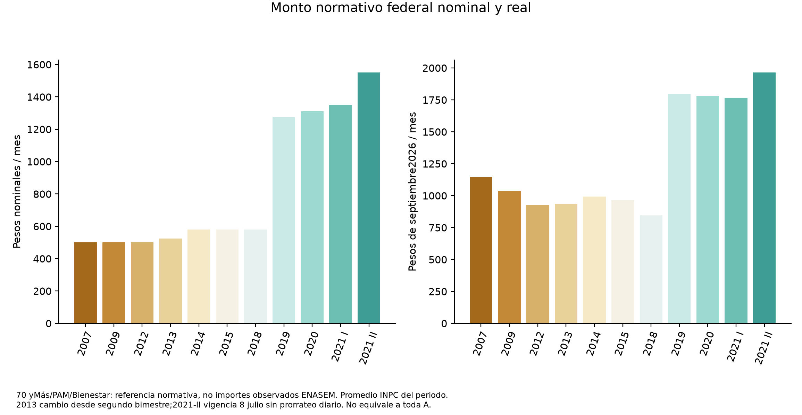

**Nota:** 70 yMás/PAM/Bienestar: referencia normativa, no importes observados ENASEM. Promedio INPC del periodo.
2013 cambio desde segundo bimestre;2021-II vigencia 8 julio sin prorrateo diario. No equivale a toda A.

El monto PAM 580 sin cambio nominal 2014–2018 pasa de$993 a$845 reales de septiembre 2026, una caída aproximada 14.88%. El aumento normativo de 580 en 2018 a 1275 en 2019 aumenta el equivalente real, de$845 a$1793. El salto normativo no prueba el cambio efectivamente recibido por toda A ni su efecto sobre pobreza.

**Fuente y procedencia:** ENASEM; [07_POLITICAS_MONTOS_SUFICIENCIA](../notebooks/07_POLITICAS_MONTOS_SUFICIENCIA.ipynb); [agregados 07](../data/interim/politicas_montos_suficiencia/resultados.json); [contrato monetario](../diccionarios/contrato_monetario_politicas.json); [fuentes y cronología](../investigacion/notas/politicas_publicas_envejecimiento.md). Bloque 10.

**Cuadro 44. Programa de vejez identificado A 5 en 2021 y dos referencias normativas**

**Pregunta y aporte:** Comparar declaraciones con importes normativos sin confundir ventana de recuerdo con fecha de entrevista.

| Importe o referencia | N eventos con monto | Mediana nominal mensual $ | Mediana real mensual $ |
| --- | --- | --- | --- |
| A 5 declarado | 4,758 | 1,550.00 | 2,107.57 |
| Norma año previo principal | 4,758 | 1,310.00 | 1,781.24 |
| Norma mes real de entrevista | 4,758 | 1,550.00 | 2,107.57 |

**Nota:** 4784 eventos A 5/4784 personas directas 60+; N de montos válidos específico. Solo código 5 del programa identificado, sin incluir todos los apoyos. Norma año previo:1310 para entrevistas 2021 y promedio 1450 para 2022; norma entrevista:1350/1550 en 2021 según semestre,1925 en 2022. Equivalentes normativos mensuales, no fechas de pago. Códigos de programa no certifican efectivo pagado o elegibilidad;20 eventos en 60–64 se conservan sin corregir.

**Fuente y procedencia:** ENASEM; [07_POLITICAS_MONTOS_SUFICIENCIA](../notebooks/07_POLITICAS_MONTOS_SUFICIENCIA.ipynb); [agregados 07](../data/interim/politicas_montos_suficiencia/resultados.json); [contrato monetario](../diccionarios/contrato_monetario_politicas.json); [fuentes y cronología](../investigacion/notas/politicas_publicas_envejecimiento.md). Bloque 11.

**Programa identificado y ambigüedad temporal.** A 5 de vejez 2021 reúne 4,784 eventos/4,784 personas, mediana $1,550 nominal. Es 118.32% de la referencia normativa del año previo bajo el criterio principal. Solo 1,932 importes coinciden exactamente con la norma del mes de entrevista. El año previo, la ventana de recuerdo y la regla vigente son referencias diferentes; no demuestra sobrepago, incumplimiento o cobertura legal. Hay respuestas de menores de 65 y entrevistas 2022, conservadas y documentadas.

**Comparación monetaria defendible K/A 5.** En 2021, los 3,312 eventos K con monto tienen mediana$4,000 nominal/$5,303 real; los 4,758 eventos A 5 de vejez, $1,550/$2,108. La diferencia de medianas es$2,450 nominal y$3,195 real; la razón es 2.52 en pesos reales. Se compara un importe mensual por evento de programa A 5 con norma económica verificada, no toda A como efectivo. Titularidad, poblaciones receptoras y ventanas de recuerdo siguen siendo distintos; no diferencia causal ni ingresos personales completos.

**Lectura política defendible.** La ampliación 65+ de 2021 es consistente con recepción muy distinta por edad, pero el acceso observado de 65–69 queda muy por debajo de 70+: reglas previas 68+, inscripción escalonada, año de recuerdo y entrevistas 2022 impiden atribuir esa distancia a una única política. El predominio de A 5 y la concentración de importes en 1550 coinciden descriptivamente con la norma de segundo semestre 2021, pero el criterio año previo produce discrepancia y exige sensibilidad. La reforma territorial no puede estudiarse con el corte 100 mil como si fuera 20/30 mil. Sin geografía fina histórica, fecha efectiva de alta, padrón o pagos, no se identifica un efecto causal.

**Cuadro 45. Selección económica: basal completo, retenidos y cambios monetarios pareados**

**Pregunta y aporte:** Examinar cuánto cambia la lectura al condicionar a observación posterior.

| Intervalo | Vía | N basal recepción conocida | N pares recepción conocida | Basal recepción % | Basal retenidos % | Basal mediana nominal $ | Retenidos mediana nominal $ | Basal mediana real $ | Retenidos mediana real $ | N receptor ambas/monto | Mediana cambio nominal $ | Mediana cambio real $ |
| --- | --- | --- | --- | --- | --- | --- | --- | --- | --- | --- | --- | --- |
| 2001–2003 | K | 6,790 | 5,569 | 24.74 | 24.56 | 1,227.00 | 1,227.00 | 3,856.54 | 3,856.54 | 1,137 | 200.00 | 167.04 |
| 2012–2015 | K | 8,738 | 7,195 | 32.26 | 31.77 | 2,200.00 | 2,200.00 | 4,233.66 | 4,233.66 | 1,762 | 223.50 | -40.26 |
| 2018–2021 | K | 9,047 | 6,984 | 35.89 | 35.14 | 2,800.00 | 2,900.00 | 4,279.56 | 4,432.40 | 1,835 | 500.00 | 104.27 |
| 2003–2012 | A | 6,894 | 3,714 | 12.98 | 13.89 | 250.00 | 250.00 | 703.34 | 703.34 | 263 | 345.00 | 492.36 |
| 2012–2015 | A | 8,750 | 7,212 | 17.99 | 17.43 | 500.00 | 500.00 | 962.20 | 962.20 | 718 | 27.50 | -58.58 |
| 2015–2018 | A | 9,513 | 7,241 | 27.65 | 27.66 | 550.00 | 550.00 | 941.50 | 941.50 | 1,240 | 30.00 | -55.02 |

**Nota:** Cohorte basal 60+ directa. Pares de recepción conocida vivos/directos, sin filtro de edadfinal. Montosbasales solo receptores con monto; pares monetarios solo receptor/monto válido en ambas. Muerte registrada, ausencia vitalND, sustituto vivo y recepciónND separados en 07; cotas 06 preservadas. No corrección de sesgo, ni pagos posteriores a fallecimiento.2001–03 K sensibilidad; restantes ventanas condicionadas de cada vía, no unión completa en todos intervalos.

**Fuente y procedencia:** ENASEM; [07_POLITICAS_MONTOS_SUFICIENCIA](../notebooks/07_POLITICAS_MONTOS_SUFICIENCIA.ipynb); [agregados 07](../data/interim/politicas_montos_suficiencia/resultados.json); [contrato monetario](../diccionarios/contrato_monetario_politicas.json); [fuentes y cronología](../investigacion/notas/politicas_publicas_envejecimiento.md). Bloque 14–15.

**Figura 43. Monto K basal de la cohorte y de quienes permanecen observables**

**Pregunta y aporte:** Comprobar si retención modifica la brecha monetaria basal por sexo.

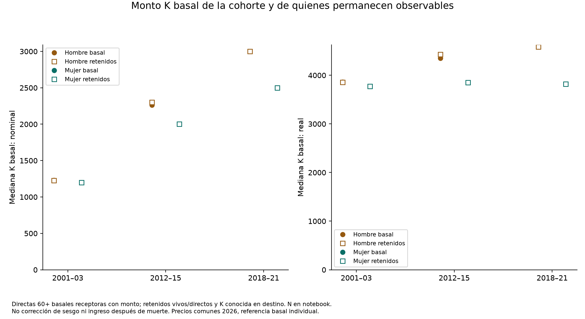

**Nota:** Directas 60+ basales receptoras con monto; retenidos vivos/directos y K conocida en destino. N en notebook.
No corrección de sesgo ni ingreso después de muerte. Precios comunes 2026, referencia basal individual.

En K 2018–2021, el porcentaje basal entre quienes quedan en pares conocidos es 35.14%, frente a 35.89% de la cohorte basal conocida; la mediana K basal de receptores con monto pasa de$4280 a$4432 reales al seleccionar retenidos. Estas diferencias son descriptivas y no garantizan ausencia de selección en otros cuantiles o subgrupos.

**Fuente y procedencia:** ENASEM; [07_POLITICAS_MONTOS_SUFICIENCIA](../notebooks/07_POLITICAS_MONTOS_SUFICIENCIA.ipynb); [agregados 07](../data/interim/politicas_montos_suficiencia/resultados.json); [contrato monetario](../diccionarios/contrato_monetario_politicas.json); [fuentes y cronología](../investigacion/notas/politicas_publicas_envejecimiento.md). Bloque 14–15.

**Selección por perfil.** En K 2018–2021, la brecha basal hombres−mujeres de medianas reales entre receptores con monto permanece en$764.21 al seleccionar retenidos. La brecha entre localidades≥100 mil y menores pasa de$764.21 a$1,069.89; la brecha escolar ≥10/0 años pasa de$12,003.71 a$12,541.39. La retención puede ampliar contrastes sin cambiar mucho la mediana global. Los N específicos por perfil están en 07; no se atribuyen recursos a quienes mueren o dejan de observarse.

**Transversal frente a individual.** En K 2012–2015, la mediana transversal real cae aproximadamente$468; entre 1762 receptores con monto válido en ambas visitas, la mediana del cambio individual es−$40.26 reales y+$223.50 nominales. En K 2018–2021 la mediana transversal aumenta aproximadamente$1159, pero entre 1835 receptores pareados la mediana del cambio es+$104.27 reales y+$500 nominales. Estos contrastes no son una descomposición causal: se condiciona a recepción en ambas visitas y se excluyen nuevos receptores, fallecidos y pérdidas. En A 2012–2015/2015–2018 los cambios pareados medianos son−$58.58/−$55.02 reales, respectivamente, pese a cambios nominales positivos.

**Alcance de la hipótesis.** En 2021 la unión K/A reduce las brechas de acceso por sexo/localidad en el mismo soporte del notebook 06, pero persisten diferencias grandes de montos K y A aporta un valor bajo relativo a la LPI. Sin escolaridad combina mayor cobertura de unión que ≥10 años con menor monto K. La evidencia es parcialmente consistente con acceso más extendido que recursos suficientes; no demuestra convergencia general 2001–2021. La mediana A común y algunos aumentos reales son evidencia favorable para ciertos componentes; las rupturas, faltantes y composición impiden una conclusión única.

**Selección actuarial como sensibilidad.** La comparación basal frente a retenidos y los cambios de quienes reciben en ambas visitas son estimandos diferentes de las medianas transversales. Muerte registrada, ausencia vital desconocida, sustituto vivo y recepción ND permanecen separados. Las cotas 06 no asignan prestaciones después de morir; no corrigen automáticamente montos ni sesgo de selección. Sin pesos longitudinales, mortalidad completa ni fechas de pago no se estima valor presente actuarial, causalidad o representatividad nacional.

**Respuesta a las preguntas monetarias y estado.** Algunos incrementos nominales sí representan aumentos reales, como K 2018–2021; otros no, como A 2012–2015/A 2015–2018. Las brechas no se reducen de forma uniforme: persisten contrastes K por sexo/escolaridad y las fechas afectan su escala. Mayor acceso puede coexistir con montos parciales bajos, particularmente los perfiles de poca escolaridad y mayor edad. La expansión de unión propia y suficiencia solo se comparan conjuntamente de manera condicionada 2012–2015; para todo 2001–2021 la respuesta es parcial por rupturas. Validación operacional y reproducción realizadas; permanecen abiertas interpretación exacta del periodo monetario, ingresos completos, imputaciones, ponderación, instrumentación y atribución política. El siguiente paso útil es validar el periodo de recuerdo/pago y la composición K de programas agrupados antes de un diseño causal o valor presente actuarial.

<!-- END politicas_montos_07 -->

<!-- BEGIN sintesis06_07 -->

### 10.4 Síntesis de acceso, poder adquisitivo y prestación frente al umbral

**Pregunta central:** ¿Qué tanto es consistente la expansión de las pensiones y los apoyos públicos con una reducción de las brechas de cobertura y de monto de la protección económica de los adultos mayores en México (ENASEM 2001–2021), qué grupos siguen sin vía propia de protección y cómo cambia esta lectura al considerar a quienes mueren o dejan de ser entrevistados?

**Respuesta integrada.** Las dimensiones evolucionaron de manera diferente en las ventanas que permiten comparación condicionada. En 2012–2015 aumenta la recepción identificada K, A y su unión, pero las medianas reales de las sumas personales parciales K y A disminuyen. En 2015–2018 aumenta la recepción A y disminuye su mediana real. En 2018–2021 K ofrece el contraste opuesto: su tasa muestral baja ligeramente y su mediana real aumenta. El acceso y el monto entre receptores miden poblaciones y resultados distintos; no constituyen un único indicador de bienestar. Las brechas se estrechan en algunos perfiles y se amplían o invierten en otros. La evidencia respalda una respuesta específica por vía, periodo y grupo, sin identificar una convergencia general de protección económica entre 2001 y 2021.

Esta síntesis utiliza exclusivamente los resultados ya calculados en 06/07 y la cronología oficial documentada. Conserva septiembre de 2026 como referencia común, con INPC 146.075. No añade notebook, microanálisis, imputación, modelo ni hipótesis causal. Las cifras no ponderadas describen la muestra. A incluye dinero y especie; K no acredita contributividad. La unión de recepción K/A no significa un ingreso monetario total ni tiene un monto que pueda obtenerse sumando medianas.

**Reproducción de los dos ejemplos.** Ambos cambios solicitados se recuperan de la sección 7 de 07, celda física 22: variación porcentual de la mediana transversal de la suma mensual personal observada parcial. El denominador del cambio porcentual es la mediana inicial; el N de observaciones válidas se documenta aparte. Las personas de ambas rondas no tienen que ser las mismas. No son montos por evento ni una prestación identificada como PAM, Bienestar o una pensión contributiva.

**K propia, 2012–2015.** Se incluyen personas vivas de 60+ por visita, con entrevista directa, recepción propia afirmativa y al menos un monto observado válido de esa vía. En 2012: 2,633 personas con monto de 2,819 receptoras, entre 8,888 directas elegibles; en 2015: 3,965/4,159, entre 9,640 directas elegibles. Quedan 186/194 receptoras sin monto, respectivamente. El campo `monto_k_propio_mensual_observado_parcial` suma solo los eventos captados válidos; no acredita todas las prestaciones ni ingreso total.

Las medianas nominales son $2,200.00 y $2,200.00: `100 × (2200.00/2200.00 − 1)` = **+0.00%**. Las medianas constantes son $4,233.662866 y $3,766.010805: `100 × (3766.010805/4233.662866 − 1)` = **-11.046039%**, que se presenta como **-11.05%**. Son pesos por mes de septiembre de 2026. Las cantidades ya estaban mensualizadas como mes normal; no se vuelven a dividir por dos debido a la entrega bimestral de determinados programas.

**Fechas y deflactor:** ronda 2012, entrevista 2012: año de precios 2011, INPC medio 75.907083, factor 1.924392 (N de directas 8,875); ronda 2012, entrevista 2013: año de precios 2012, INPC medio 79.028083, factor 1.848394 (N de directas 12); ronda 2015, entrevista 2015: año de precios 2014, INPC medio 85.333000, factor 1.711823 (N de directas 9,640). Se actualizó cada importe antes de calcular los cuantiles. El mes de pago no está identificado; año calendario previo a la entrevista real es un criterio explícito para interpretar año pasado. En 2012 hay además una directa sin año válido, conservada sin actualización; los N con fecha válida pueden diferir de los nominales.

**Sensibilidad y personas seguidas:** con doce meses anteriores al mes real el cambio de mediana es -10.09%; con promedio del año de entrevista, -9.84%. Los extremos de meses posibles del año previo dan un rango descriptivo de -13.80% a -7.96%, siempre negativo. No es un intervalo de confianza. Entre 1,762 receptoras con monto válido en ambas visitas, la **mediana del cambio individual** es $+223.50 nominal y $-40.26 real: otro estimando y una selección distinta. El resultado transversal no demuestra una pérdida para cada individuo.

**A propia, 2015–2018.** Se incluyen personas vivas de 60+ por visita, con entrevista directa, recepción propia afirmativa y al menos un monto observado válido de esa vía. En 2015: 2,582 personas con monto de 2,630 receptoras, entre 9,640 directas elegibles; en 2018: 2,699/2,764, entre 9,107 directas elegibles. Quedan 48/65 receptoras sin monto, respectivamente. El campo `monto_a_propio_mensual_observado_parcial` suma solo los eventos captados válidos; no acredita todas las prestaciones ni ingreso total.

Las medianas nominales son $550.00 y $580.00: `100 × (580.00/550.00 − 1)` = **+5.45%**. Las medianas constantes son $941.502701 y $886.479445: `100 × (886.479445/941.502701 − 1)` = **-5.844195%**, que se presenta como **-5.84%**. Son pesos por mes de septiembre de 2026. Las cantidades ya estaban mensualizadas como mes normal; no se vuelven a dividir por dos debido a la entrega bimestral de determinados programas.

**Fechas y deflactor:** ronda 2015, entrevista 2015: año de precios 2014, INPC medio 85.333000, factor 1.711823 (N de directas 9,640); ronda 2018, entrevista 2018: año de precios 2017, INPC medio 95.573000, factor 1.528413 (N de directas 8,905); ronda 2018, entrevista 2019: año de precios 2018, INPC medio 100.255333, factor 1.457030 (N de directas 202). Se actualizó cada importe antes de calcular los cuantiles. El mes de pago no está identificado; año calendario previo a la entrevista real es un criterio explícito para interpretar año pasado. En 2012 hay además una directa sin año válido, conservada sin actualización; los N con fecha válida pueden diferir de los nominales.

**Sensibilidad y personas seguidas:** con doce meses anteriores al mes real el cambio de mediana es -7.77%; con promedio del año de entrevista, -7.80%. Los extremos de meses posibles del año previo dan un rango descriptivo de -9.30% a -1.77%, siempre negativo. No es un intervalo de confianza. Entre 1,240 receptoras con monto válido en ambas visitas, la **mediana del cambio individual** es $+30.00 nominal y $-55.02 real: otro estimando y una selección distinta. El resultado transversal no demuestra una pérdida para cada individuo.

El ejemplo K agrega jubilación, viudez, invalidez y otras pensiones captadas por K. Cambian los slots y la composición de instituciones entre 2012 y 2015; el aumento de registros de programas agrupados puede coexistir con una menor mediana entre receptores. El ejemplo A agrega distintos donativos propios, sin identificar PAM individualmente en ambas rondas; 2018 pasa a captar eventos y programas. La comparabilidad es condicionada, no una invariancia completa de medición. Estos ejemplos respaldan H2, pero no bastan por sí solos para validar las restantes proposiciones.

**Cuadro 46. Integración de cobertura, monto y referencia económica en periodos defendibles**

**Pregunta y aporte:** Determinar si mayor acceso coincide con mayores recursos centrales y menores brechas.

| Periodo | Vía | Cambio de política documentado | Recepción y denominador | Brecha cobertura sexo | Mediana nominal mensual | Mediana real mensual | Brecha monetaria real | Referencia de LPI | Población de cada indicador | Comparabilidad | Conclusión defendible |
| --- | --- | --- | --- | --- | --- | --- | --- | --- | --- | --- | --- |
| 2001–2003 | K | Apoyos diversos y antecedentes locales; la ley DF de noviembre 2003 es posterior a las entrevistas 2003. | 24.74% → 25.53% (+0.79 pp); N=6,790/6,894 | H−M: 15.22 → 16.07 pp | $1,227 → $1,490 (+21.43%) | $3,857 → $4,192 (+8.70%) | H−M: $88 → $253; razónH/M 1.02 → 1.06 | Mediana prestación/LPI 80.38% → 86.62%; N=1,170/1,247; solo≥100 mil | 60+ directas por visita; recepción conocida por vía. Montos: N=1,608/1,714 entre receptores. | Condicionada por instrumento, composición y fecha; no efecto causal ni cambios de las mismas personas. | Cobertura y mediana real K mayores; brecha por sexo mayor. No igualación general. |
| 2003–2012 | A | 70 y Más desde 2007; expansión territorial 2008/2009/2012. A no identifica el programa individual. | 12.98% → 17.99% (+5.01 pp); N=6,894/8,750 | H−M: 1.27 → -0.73 pp | $250 → $500 (+100.00%) | $703 → $962 (+36.80%) | H−M: $464 → $0; razónH/M 2.06 → 1.00 | No identificable globalmente: geografía asignable 2003 selecciona ciudades grandes; 2012 incluye otras localidades. | 60+ directas por visita; recepción conocida por vía. Montos: N=821/1,534 entre receptores. | Condicionada por instrumento, composición y fecha; no efecto causal ni cambios de las mismas personas. | Cobertura y mediana real A mayores; no identifica efecto federal ni convergencia de umbral total. |
| 2012–2015 | K | PAM: 65+ desde 2013; $525 y $580 desde 2014. K/A incluyen otras instituciones o programas. | 32.26% → 43.76% (+11.50 pp); N=8,738/9,504 | H−M: 14.79 → 15.27 pp | $2,200 → $2,200 (+0.00%) | $4,234 → $3,766 (-11.05%) | H−M: $504 → $685; razónH/M 1.13 → 1.20 | Mediana prestación/LPI 92.84% → 78.22%; N=2,632/3,963 | 60+ directas por visita; recepción conocida por vía. Montos: N=2,633/3,965 entre receptores. | Condicionada por instrumento, composición y fecha; no efecto causal ni cambios de las mismas personas. | Más recepción K y menor mediana real; determinadas brechas de acceso menores, brechas monetarias mayores. |
| 2012–2015 | A | PAM: 65+ desde 2013; $525 y $580 desde 2014. K/A incluyen otras instituciones o programas. | 17.99% → 27.65% (+9.66 pp); N=8,750/9,513 | H−M: -0.73 → -4.21 pp | $500 → $550 (+10.00%) | $962 → $942 (-2.15%) | H−M: $0 → $0; razónH/M 1.00 → 1.00 | Mediana prestación/LPI 24.09% → 20.76%; N=1,533/2,582 | 60+ directas por visita; recepción conocida por vía. Montos: N=1,534/2,582 entre receptores. | Condicionada por instrumento, composición y fecha; no efecto causal ni cambios de las mismas personas. | Más recepción A; mediana nominal mayor y real ligeramente menor; proporción mediana de LPI menor. |
| 2012–2015 | KA | PAM: 65+ desde 2013; $525 y $580 desde 2014. K/A incluyen otras instituciones o programas. | 47.42% → 65.79% (+18.36 pp); N=8,734/9,508 | H−M: 12.43 → 9.24 pp | No identificable: no monto de unión | No identificable: no sumar K+A | No identificable para unión; componentes K/A separados | No identificable para unión | 60+ directas por visita; recepción conocida por vía. | Solo esta ventana tiene continuidad conjunta condicionada K y A. | La unión crece y la brecha por sexo se estrecha; edad, escolaridad y localidad no convergen uniformemente. |
| 2015–2018 | A | PAM mantiene $580; A incluye otros apoyos, dinero/especie y cambios de captación. | 27.65% → 30.56% (+2.91 pp); N=9,513/9,045 | H−M: -4.21 → -8.12 pp | $550 → $580 (+5.45%) | $942 → $886 (-5.84%) | H−M: $0 → $0; razónH/M 1.00 → 1.00 | Mediana prestación/LPI 20.76% → 20.47%; N=2,582/2,699 | 60+ directas por visita; recepción conocida por vía. Montos: N=2,582/2,699 entre receptores. | Condicionada por instrumento, composición y fecha; no efecto causal ni cambios de las mismas personas. | Más recepción A y menor mediana real; no se puede extender al conjunto K/A. |
| 2018–2021 | K | Bienestar: cambios de edad e importe; A incorpora código 5. No adjudicar el cambio K a esa reforma. | 35.89% → 34.82% (-1.07 pp); N=9,047/9,366 | H−M: 17.17 → 13.73 pp | $2,800 → $4,000 (+42.86%) | $4,280 → $5,439 (+27.09%) | H−M: $764 → $1,409; razónH/M 1.20 → 1.29 | Mediana prestación/LPI 95.58% → 119.49%; N=2,994/3,062 | 60+ directas por visita; recepción conocida por vía. Montos: N=2,994/3,062 entre receptores. | Condicionada por instrumento, composición y fecha; no efecto causal ni cambios de las mismas personas. | Tasa K ligeramente menor, mediana real mayor y brecha monetaria por sexo mayor. |
| 2001–2021 | Conjunto | Expansión normativa documentada; cambios de instrumentos. | No identificable como serie homogénea. | No identificable como cierre uniforme. | No monto único de protección propia. | No serie agregada K+A defendible. | No identificable de forma homogénea. | No suficiencia integral de persona/hogar. | Los universos de cada vía y de montos válidos son distintos. | Rupturas K 2003–12/K 2015–18 y A 2001–03/A 2018–21. | Respuesta parcial por ventanas y perfiles; no estimar un único efecto o cierre 2001–2021. |

**Nota:** Montos: sumas personales mensuales observadas parciales, pesos de septiembre 2026. Cada vía de cobertura usa su N conocido; no sumar porcentajes. La unión exige ambas negativas para no, una afirmativa basta para sí; restantes ND. Brecha H−M firmada: hombres menos mujeres. N de cobertura no es N monetario. LPI mensual por persona del periodo original, rural/urbana 2500; no pobreza ni ingreso completo. Los campos no identificables permanecen explícitos. Los cambios a través de rupturas no se interpretan como tendencias homologadas.

**Fuente y procedencia:** ENASEM; [notebook 06](../notebooks/06_COBERTURA_PROTECCION_ECONOMICA.ipynb), bloques 5–12; [notebook 07](../notebooks/07_POLITICAS_MONTOS_SUFICIENCIA.ipynb), bloques 4–15; [agregados 06](../data/interim/cobertura_proteccion_economica/resultados.json), [agregados 07](../data/interim/politicas_montos_suficiencia/resultados.json) y [cotejo de esta síntesis](../data/interim/sintesis_proteccion_economica/resultados.json).

**Figura 44. Cobertura y poder adquisitivo: dos contrastes condicionados**

**Pregunta y aporte:** Distinguir acceso, pesos nominales y pesos constantes en los dos ejemplos.

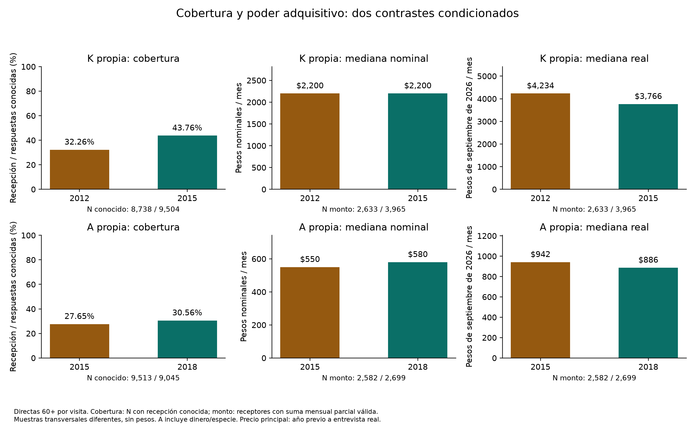

**Nota:** Directas 60+ por visita. Cobertura: N con recepción conocida; monto: receptores con suma mensual parcial válida.
Muestras transversales diferentes, sin pesos. A incluye dinero/especie. Precio principal: año previo a entrevista real.

Las barras reutilizan resultados ya calculados. Las escalas monetarias son separadas; los N indican poblaciones diferentes. No se interpreta el aumento del número de receptores como incremento de recursos de cada persona.

**Fuente y procedencia:** ENASEM; [notebook 06](../notebooks/06_COBERTURA_PROTECCION_ECONOMICA.ipynb), bloques 5–12; [notebook 07](../notebooks/07_POLITICAS_MONTOS_SUFICIENCIA.ipynb), bloques 4–15; [agregados 06](../data/interim/cobertura_proteccion_economica/resultados.json), [agregados 07](../data/interim/politicas_montos_suficiencia/resultados.json) y [cotejo de esta síntesis](../data/interim/sintesis_proteccion_economica/resultados.json).

**Desigualdades: dirección, magnitud y composición.** Una brecha firmada describe qué grupo tiene más recepción; su valor absoluto describe la distancia entre grupos. Pasar de una ventaja positiva a una negativa no basta para hablar de convergencia. Se usan medianas, diferencias de medianas, razones e IQR ya disponibles, que reducen el dominio de importes extremos sobre la lectura. No se calcula Gini con seis cuantiles, se recortan valores ni se inventan intervalos de confianza. IQR/mediana es dispersión relativa robusta entre receptores, no desigualdad total en toda la población.

**Cuadro 47. Brechas de acceso y del componente K entre perfiles en 2012–2015**

**Pregunta y aporte:** Contrastar H1/H3 sin confundir cierre, inversión de brecha y monto de la unión.

| Grupo 1 / grupo 2 | Brecha K en pp | Brecha unión en pp | Magnitud de brecha unión | N unión conocidos g 1/g 2 | N monto K g 1/g 2 | Diferencia nominal K | Diferencia real K | Razón real K g 1/g 2 |
| --- | --- | --- | --- | --- | --- | --- | --- | --- |
| Hombre / Mujer | 14.79 → 15.27 | 12.43 → 9.24 | Se estrecha | 2012: 3,995/4,739;2015: 4,229/5,279 | 2012: 1,485/1,148;2015: 2,085/1,880 | $262 → $400 | $504 → $685 | 1.13 → 1.20 |
| 70+ / 60–64 | 14.40 → 30.72 | 31.52 → 50.50 | Se amplía | 2012: 3,907/2,491;2015: 4,673/2,124 | 2012: 1,403/547;2015: 2,372/433 | $-1,050 → $-1,500 | $-2,021 → $-2,568 | 0.66 → 0.57 |
| ≥10 años / 0 años | 32.54 → 18.34 | 5.92 → -9.13 | Se amplía e invierte dirección | 2012: 889/1,883;2015: 1,056/1,863 | 2012: 431/394;2015: 535/703 | $6,100 → $8,400 | $11,739 → $14,379 | 4.21 → 15.00 |
| ≥100 mil habitantes / <100 mil habitantes | 17.04 → 5.87 | -2.14 → -7.58 | Se amplía | 2012: 5,108/3,626;2015: 5,465/4,043 | 2012: 1,844/789;2015: 2,371/1,594 | $300 → $1,250 | $577 → $2,140 | 1.15 → 2.09 |
| Retirado/incapacitado/no trabaja / Trabaja | 30.13 → 27.84 | 30.47 → 26.95 | Se estrecha | 2012: 3,287/2,401;2015: 3,625/2,974 | 2012: 1,594/514;2015: 2,127/996 | $500 → $500 | $962 → $856 | 1.25 → 1.25 |

**Nota:** Periodo conjunto condicionadamente comparable. Cobertura: cada vía y grupo con su denominador conocido; comparación K frente a unión dentro de 2021 en soporte común está en cuadro 33, y para otras rondas en bloque 5 de 06. Aquí se compara la evolución de cada definición, no se resta K a unión con denominadores distintos. Montos K solo receptores válidos, nunca monto total de personas con unión. Razón g 1/g 2, diferencias g 1−g 2, mediana personal parcial. Edad 70+/60–64, escolaridad inicial, localidad 100 mil y ocupación 4 agrupada; no ajuste multivariado.

**Fuente y procedencia:** ENASEM; [notebook 06](../notebooks/06_COBERTURA_PROTECCION_ECONOMICA.ipynb), bloques 5–12; [notebook 07](../notebooks/07_POLITICAS_MONTOS_SUFICIENCIA.ipynb), bloques 4–15; [agregados 06](../data/interim/cobertura_proteccion_economica/resultados.json), [agregados 07](../data/interim/politicas_montos_suficiencia/resultados.json) y [cotejo de esta síntesis](../data/interim/sintesis_proteccion_economica/resultados.json).

En 2012–2015 la brecha de unión por sexo baja de 12.43 a 9.24 pp, mientras la razón de medianas reales K hombres/mujeres sube de 1.13 a 1.20 y su diferencia de $504 a $685. En escolaridad, la brecha K se reduce de 32.54 a 18.34 pp, pero la razón monetaria K ≥10/0 años aumenta de 4.21 a 15.00. La brecha de unión escolar pasa de +5.92 a −9.13 pp: favorece después al grupo sin escolaridad, y su magnitud crece 3.21 pp. La brecha de unión por localidad ya favorecía a las menores de 100 mil y aumenta en valor absoluto; la brecha por edad aumenta de 31.52 a 50.50 pp. Por tanto, mayor incorporación de ciertos grupos no es igualación de todas las tasas. En ocupación, la brecha de unión se estrecha de 30.47 a 26.95 pp y la razón K permanece 1.25: no toda evidencia monetaria indica ampliación.

La distinción también aparece fuera de esa ventana conjunta: K 2018–2021 reduce la brecha de cobertura por sexo de 17.17 a 13.73 pp, pero la razón de medianas reales hombres/mujeres pasa de 1.20 a 1.29. A 2015–2018 aumenta su recepción total, mientras la brecha firmada hombres−mujeres pasa de −4.21 a −8.12 pp, una ampliación de la ventaja femenina; las medianas A de ambos sexos coinciden dentro de cada ronda. No se extiende esa lectura a la unión K/A porque K presenta ruptura 2015–2018.

**Distribución, más allá de la mediana.** K 2012–2015 tiene cuartiles reales $3,464/$9,622 y $1,027/$6,847; IQR/mediana pasa de 1.45 a 1.55, con N=2,633/3,965. A 2015–2018 tiene cuartiles $856/$1,027 y $841/$1,528; IQR/mediana pasa de 0.18 a 0.78, con N=2,582/2,699. Son señales de cambios en la distribución captada entre receptores; no una descomposición del efecto de inflación, composición y programas. Una mediana igual entre sexos tampoco prueba igualdad de todos los cuantiles.

**Cuadro 48. Perfiles con negativas propias o prestaciones parciales bajas en 2021**

**Pregunta y aporte:** Localizar ausencia declarada de las dos vías propias y distinguirla de montos bajos entre receptores.

| Perfil | N unión conocida | N negativas K y A | Negativas % conocidas | Unión ND | Unión propia % | N monto K | N monto A | Mediana K nominal $ | Mediana K real $ | Mediana A nominal $ | Mediana A real $ | Mediana K/LPI % | Mediana A/LPI % |
| --- | --- | --- | --- | --- | --- | --- | --- | --- | --- | --- | --- | --- | --- |
| 60–64 | 2262 | 1664 | 73.56 | 20 | 26.44 | 490 | 77 | 6,000.00 | 8,158.34 | 1,550.00 | 2,039.58 | 184.36 | 43.66 |
| 70+ | 5099 | 366 | 7.18 | 26 | 92.82 | 1951 | 4263 | 3,800.00 | 5,146.12 | 1,550.00 | 2,107.57 | 112.67 | 43.66 |
| 0 años | 1381 | 368 | 26.65 | 5 | 73.35 | 242 | 925 | 3,000.00 | 4,033.70 | 1,550.00 | 2,107.57 | 84.51 | 43.66 |
| ≥10 años | 1422 | 482 | 33.90 | 11 | 66.10 | 715 | 470 | 12,000.00 | 16,316.67 | 1,550.00 | 2,107.57 | 338.02 | 43.66 |
| Trabaja | 2659 | 1404 | 52.80 | 23 | 47.20 | 511 | 960 | 3,500.00 | 4,759.03 | 1,550.00 | 2,107.57 | 106.07 | 43.66 |
| Labores del hogar | 2536 | 1001 | 39.47 | 11 | 60.53 | 452 | 1308 | 3,050.00 | 4,079.17 | 1,550.00 | 2,107.57 | 90.14 | 43.66 |
| Mujer | 5232 | 1788 | 34.17 | 20 | 65.83 | 1437 | 2736 | 3,700.00 | 4,895.00 | 1,550.00 | 2,107.57 | 106.07 | 43.66 |

**Nota:** Directas 60+, denominadores de unión y montos separados. Los grupos de diferentes dimensiones se solapan: no sumar sus N. Unión ND no es negativa. LPI asignable cubre todos los montos de estos perfiles 2021, usando periodo original y geografía 2500. Perfil de localidad del cuadro previo corta 100 mil. Las cifras A valoran dinero/especie y no son todas A 5. La ausencia propia no excluye cónyuge, transferencias familiares, patrimonio u otros ingresos. Ningún porcentaje es prevalencia de pobreza.

**Fuente y procedencia:** ENASEM; [notebook 06](../notebooks/06_COBERTURA_PROTECCION_ECONOMICA.ipynb), bloques 5–12; [notebook 07](../notebooks/07_POLITICAS_MONTOS_SUFICIENCIA.ipynb), bloques 4–15; [agregados 06](../data/interim/cobertura_proteccion_economica/resultados.json), [agregados 07](../data/interim/politicas_montos_suficiencia/resultados.json) y [cotejo de esta síntesis](../data/interim/sintesis_proteccion_economica/resultados.json).

**Situación pensionaria y alcance de suficiencia.** En 2021 hay 3000 negativas explícitas K/A entre 9366 respuestas directas con unión conocida (32.03%), 58 uniones desconocidas y 1058 sustitutos fuera del principal. De la tipología, 538 personas con pareja confirmada reportan solo K del cónyuge: no tienen K/A propia identificada, pero tampoco se puede afirmar ausencia de recurso contextual.884 personas sin pareja residente tienen negativas K/A. Entre quienes solo reportan A propia, las medianas son 1550 nominales y 2108 reales: N con monto 1291 de 1304 con pareja confirmada y 1313 de 1320 sin pareja residente. Ambos componentes representan una mediana de 43.66% de su LPI asignada. No se convierten las negativas en monto cero ni se suman la pensión del cónyuge y el apoyo propio.

La situación de recepción también distingue montos del mismo componente entre personas diferentes. En 2021, comparando solo K propia frente a K propia+A propia, dentro del mismo contexto de pareja:

- **Pareja confirmada:** mediana parcial K de $5,000 nominales/$6,799 reales en solo K (N monto=519 de 584 receptoras), frente a $4,000/$5,303 entre quienes también reportan A propia (N=636/679). La mediana K/LPI es 157.85% frente a 112.67%, con esos mismos N válidos.
- **Sin pareja residente:** mediana parcial K de $4,500 nominales/$5,983 reales en solo K (N monto=588 de 616 receptoras), frente a $3,200/$4,351 entre quienes también reportan A propia (N=900/928). La mediana K/LPI es 128.17% frente a 99.02%, con esos mismos N válidos.

La coexistencia de dos vías propias se asocia aquí con un componente K central menor. No permite concluir que A reduzca K, que el importe total K+A sea menor ni que exista una compensación diseñada por el programa: las categorías tienen composiciones diferentes y no se ajustaron sus perfiles. El importe del cónyuge no entra en estas cifras. Los grupos con contexto o recepción indeterminados permanecen separados en los agregados y cuadros previos.

**K, A y A 5 son distintos.** A 5 de vejez se identifica solo en 2021 en 4,784 eventos/4,784 personas directas 60+, con 4,758 montos válidos. No existe una serie A 5 homologada desde 2001 ni se estima aquí cobertura A 5 completa sin un denominador de conocimiento del programa validado. La comparación monetaria entre vías se restringe a ese componente con norma monetaria verificada: por evento, K tiene mediana nominal $4,000/real $5,303 (N=3,312) y A 5 $1,550/$2,108 (N=4,758), razón real 2.52. Son eventos entre receptores distintos, no ingresos personales completos ni un contraste de todos los apoyos como efectivo.

La razón prestación/LPI es una referencia para el componente observado, no diagnóstico de pobreza o suficiencia integral. En A general 2015–2018 su mediana pasa de 20.76% a 20.47% (N=2582/2699); el ligero descenso de esa razón no tiene que igualar −5.84%, porque la línea cambia con su canasta y geografía, no solo con el índice general. En 2021 A 5 tiene mediana 43.66% de la LPI y 97.33% de los importes están bajo ella; con el criterio de doce meses previos la mediana de razón es 41.38%. No permite afirmar que esas personas sean pobres o que carezcan de otros ingresos. Un monto por encima de la línea tampoco acredita protección integral.

**Cuadro 49. Política, indicador, resultado y límite de interpretación**

**Pregunta y aporte:** Vincular cronología y datos sin atribuir efectos por coincidencia temporal.

| Política documentada | Indicador disponible | Resultado observado | Límite metodológico |
| --- | --- | --- | --- |
| 70 y Más: ampliaciones territoriales 2008–2012 y PAM 65+ desde 2013 | A propia; K con programas agrupados; edad y localidad 100 mil | En 2012–2015 crecen K, A y unión; sube más el acceso de ciertos grupos de menor escolaridad/localidad. | Programa individual no identificado en A histórica; corte 100 mil no reproduce 20/30 mil; slots y composición cambian. |
| PAM $580 mensuales 2014–2018, sin aumento nominal | Monto normativo separado; monto parcial A 2015–2018 | Norma real disminuye 14.88% en 2014–2018; A mediana real −5.84% en 2015–2018, con recepción +2.91 pp. | Periodos y recursos distintos: coincidencia compatible con erosión por precios, sin atribuir toda A a PAM. |
| Bienestar 2018–2019: 580 a 1275 mensuales; edad 68 general/65 indígena | Importe normativo mensual oficial | Norma nominal +119.83%; equivalente real +112.11% según precios de sus periodos. | No hay rondas anuales 2019/2020; A 2018–2021 rompe definición. No estima efecto de la reforma sobre hogares. |
| Bienestar 2021: 1350 a 1550 mensuales y ampliación 65+ desde julio | A 5 identificada 2021; perfiles por edad; fecha real de entrevista | Norma nominal +14.81%, real +11.27%; mediana A 5 declarada 1550; unión propia mucho mayor en 70+ que 60–64. | Inscripción escalonada, recuerdo incierto y 2630 directas en 2022. Coincidencia no es causalidad ni certificación de cobro. |

**Nota:** Importes normativos y respuestas ENASEM conservan sus diferentes periodos. Norma usa precio medio del periodo indicado; ENASEM, año calendario previo a entrevista real. Beneficio bimestral convertido a equivalente mensual normativo; no rescalar automáticamente lo declarado mensual. Fechas, condiciones y fuentes oficiales en cuadro 43 y nota documental de políticas. La reforma 2021 entra en vigor 8 julio, sin reconstruir pagos diarios; ampliación legal no equivale a incorporación efectiva.

**Fuente y procedencia:** ENASEM; [notebook 06](../notebooks/06_COBERTURA_PROTECCION_ECONOMICA.ipynb), bloques 5–12; [notebook 07](../notebooks/07_POLITICAS_MONTOS_SUFICIENCIA.ipynb), bloques 4–15; [agregados 06](../data/interim/cobertura_proteccion_economica/resultados.json), [agregados 07](../data/interim/politicas_montos_suficiencia/resultados.json) y [cotejo de esta síntesis](../data/interim/sintesis_proteccion_economica/resultados.json).

**Sensibilidad actuarial: qué cambia y qué no queda demostrado.** El crecimiento de unión 2012–2015 también aparece en 7196 pares vivos/directos con unión conocida: 46.55% al inicio y 72.40% al destino, frente a 47.42%/65.79% en las muestras transversales 60+. El aumento no desaparece al seleccionar pares, pero su magnitud cambia y el destino de una cohorte basal no es la población 60+ completa de 2015. La brecha de unión por sexo entre esos pares pasa de 12.53 a 7.93 pp (N hombres 3266, mujeres 3930), compatible con estrechamiento; no es corrección de mortalidad o sesgo. Hay 25 edades finales discordantes menores de 60 en la cohorte 2012–2015, conservadas en el estimando de seguimiento.

En la cohorte basal directa de 2012, el seguimiento K separa 738 fallecimientos registrados, 388 ausencias con estado vital desconocido, 381 sustitutos vivos, 88 directas con K desconocida y 7293 directas con K conocida. El universo basal de negativas K es 5919: 70.08% de los 4909 sobrevivientes con K conocida mantienen negativa, pero la proporción de negativa viva sobre toda la cohorte basal está acotada entre 58.12% y 67.34%;464 fallecidos no reciben una prestación futura imputada. No son intervalos de confianza. En 2018–2021 la cohorte directa registra 1069 muertes, 395 ausencias y 599 sustitutos; esos destinos tampoco se convierten en negativas K/A.

Entre las 226 personas inicialmente sin K y ausentes en 2015, 87 reaparecen vivas y 37 tienen un registro de fallecimiento en rondas posteriores. Reaparición y defunción posterior no reconstruyen automáticamente el estado vital, la recepción o el monto en la visita ausente. No se equipara ausencia con muerte ni con negativa pensionaria.

Los montos basales de retenidos pueden cambiar las brechas. En K 2018–2021 la brecha real basal por sexo permanece aproximadamente $764, mientras la de localidad aumenta de $764 a $1070 y la escolar≥10/0 de $12004 a $12541 al restringir a observables. Por tanto, la selección no altera todas las dimensiones por igual y puede ampliar ciertas diferencias. Estos estimandos basales no prueban que las brechas transversales finales hayan sido corregidas. Con respuestas válidas por sustituto, la unión 2021 es 68.81% (N conocido 10410), frente a 67.97% (N 9366) en directas; las medianas generales K/A permanecen 4000/1550 nominales y 5439/2108 reales, aunque los N monetarios se amplían a 3347/5530. La estabilidad de esas medianas no prueba ausencia de selección en todos los grupos o cuantiles.

**Cuadro 50. Balance de las proposiciones de la tesis**

**Pregunta y aporte:** Contrastar las hipótesis sin convertirlas en conclusiones predeterminadas.

| H | Evaluación | Evidencia favorable | Contrastes o evidencia insuficiente | Alcance defendible |
| --- | --- | --- | --- | --- |
| H1 | Respaldo descriptivo parcial | En 2012–2015 unión: brecha sexo 12.43→9.24 pp; K: brecha escolar 32.54→18.34 pp. También hay ventanas con menor brecha K por sexo. | Edad amplía 31.52→50.50 pp; unión escolar invierte +5.92→−9.13 pp y amplía magnitud; localidad no converge. | Determinados grupos/periodos; contradice igualación general. No prueba efecto de una política. |
| H2 | Respaldada para casos verificados | K 2012–15 nominal 0%, real −11.05%; A 2015–18 nominal +5.45%, real −5.84%. | Dirección negativa bajo fechas alternativas; K 2018–21 y cambios normativos específicos sí muestran aumentos reales. | Medianas transversales parciales; no caída universal del ingreso individual ni prueba inferencial. |
| H3 | Respaldo descriptivo condicionado | 2012–15: brecha unión por sexo menor y razón K H/M 1.13→1.20; cobertura K escolar menor brecha, razón de montos 4.21→15.00. | Ocupación: razón K 1.25 estable y brecha absoluta menor. No existe monto agregado de unión validado. | Acceso y componente K en poblaciones distintas; no desigualdad total de protección o ingreso. Generalización 2001–21 insuficiente. |
| H4 | Respaldada descriptivamente | 2021: 3000 negativas propias/9366 conocidas; ciertos perfiles de alto acceso reciben componentes bajos respecto de LPI. | 538 reportan solo pensión del cónyuge; otros recursos no evaluados. A 5 solo identificable 2021. | No cobertura integral, pobreza, suficiencia del hogar ni ausencia de otros ingresos. |

**Nota:** Evaluaciones descriptivas, no pruebas de significancia. Sensibilidades de fechas, modalidad y observación son análisis de robustez o cambios de estimando, no IC, ajuste causal ni corrección automática. Todos los N y unidades en los cuadros previos y los agregados 06/07. La hipótesis de trabajo es parcialmente compatible con ciertos contrastes, no confirmada como ley general.

**Fuente y procedencia:** ENASEM; [notebook 06](../notebooks/06_COBERTURA_PROTECCION_ECONOMICA.ipynb), bloques 5–12; [notebook 07](../notebooks/07_POLITICAS_MONTOS_SUFICIENCIA.ipynb), bloques 4–15; [agregados 06](../data/interim/cobertura_proteccion_economica/resultados.json), [agregados 07](../data/interim/politicas_montos_suficiencia/resultados.json) y [cotejo de esta síntesis](../data/interim/sintesis_proteccion_economica/resultados.json).

**Contribución a la pregunta central.** El resultado académico es distinguir expansión del acceso, valor central de los componentes y referencia económica cubierta, con una evaluación explícita de comparabilidad y selección. Es defendible afirmar que más recepción puede coexistir con menor poder adquisitivo de la prestación parcial mediana y con brechas monetarias persistentes; también existen aumentos reales y contrastes que se estrechan. No es defendible afirmar que toda protección se igualó, que todos los receptores perdieron ingreso, que una reforma causó las diferencias o que una prestación inferior a la línea identifica pobreza. La magnitud de la expansión homogénea y de la suficiencia total 2001–2021 sigue sin identificarse con estos productos.

Las figuras 35–36 del informe permiten consultar cobertura por perfil; las figuras 39–40 muestran nominal/real y componentes monetarios; la figura 41 distingue referencia geográfica y la 43 selección. Se utilizan con sus propios N, definiciones y notas. Esta síntesis aporta la comparación conjunta y el balance de proposiciones; no sustituye los resultados anteriores ni crea otra investigación.

<!-- END sintesis06_07 -->

<!-- BEGIN benefit08 -->

### 10.5 Transiciones, incorporación de receptores y poder adquisitivo

**Pregunta central conservada:** ¿Qué tanto es consistente la expansión de las pensiones y los apoyos públicos con una reducción de las brechas de cobertura y de monto de la protección económica de los adultos mayores en México (ENASEM 2001–2021), qué grupos siguen sin vía propia de protección y cómo cambia esta lectura al considerar a quienes mueren o dejan de ser entrevistados?

**Resultado integrado.** La divergencia entre cobertura y monto central no tiene una explicación única. En K 2012–2015 se observa una incorporación declarada con montos mucho menores que los de continuos, además de erosión por precios. En A 2015–2018 las medianas de nuevos y continuos coinciden, y la caída real también aparece siguiendo a las mismas personas. No se identifica que nuevos receptores con menores medianas expliquen el caso A. La selección, la captación y la composición limitan la generalización.

**Datos, universo y estado.** El análisis 08 se justificó después de la auditoría: nuevas comparaciones de montos por transición, integridad de captura, identidad contable de precios y composición común. Principal: personas registradas vivas, directas y 60+ al inicio; destino directo, sin panel balanceado. Se conservan estados no observados y edad final discordante. Solo dos ventanas monetarias nuevas, K 2012–2015 y A 2015–2018; las matrices de recepción cubren las seis combinaciones vía/intervalo condicionadamente comparables. Sin pesos nacionales, modelos causales, imputación, supervivencia ni identificación administrativa de prestaciones. Cálculos reproducidos desde cero y validados; comparabilidad operacional condicionada e inferencia nacional no acreditadas. No modifica 01–07, bases ni LaTeX.

**Viabilidad antes de analizar.** Se reutilizan recepción, titularidad, eventos y precios de 01–07. Los 1,762 pares K y 1,240 pares A de 07 admitían sumas parciales. Al exigir monto de cada evento captado, fecha válida y ausencia de conflicto vital quedan 1,756 y 1,223. En A hay un par con entrevista viva posterior a registro sobre fallecido: se separa sin corregir el original; 1,224 queda solo como sensibilidad de registros observados. Completo significa íntegro respecto de captura, no totalidad de beneficios reales. No hay identificador administrativo de prestación. K cambia de un importe por contingencia en 2012 a slots en 2015; A pasa de importe agregado a eventos en 2018. La comparabilidad de la suma por persona es condicionada. A es donativo general en dinero o especie; no A 5 de vejez, identificado solo en 2021. Slots y multiselección institucional no acreditan el número total real de beneficios. La periodicidad es mes normal en pesos, ya normalizada en la entrevista; no se divide de nuevo por dos. Variables: `pension_propia_k`, `apoyo_propio`, eventos originales con beneficiario orientado, entrevista real, INPC y características basales validadas.

**Cuadro 51. Viabilidad longitudinal y selección de montos íntegros captados**

**Pregunta y aporte:** Determinar qué cambio personal puede construirse sin sumar importes faltantes o identificar un programa inexistente.

| Vía e intervalo | N basal directa 60+ | N pares de recepción válida | N nuevos observados | N continuos | N pares parciales 07 | N pares íntegros 08 | N un evento ambas | N misma contingencia IMSS/ISSSTE | N conflicto vital separado |
| --- | --- | --- | --- | --- | --- | --- | --- | --- | --- |
| K 2001–2003 | 6812 | 5569 | 298 | 1204 | 1137 | 1136 | 1073 | 798 | 0 |
| K 2012–2015 | 8888 | 7195 | 1469 | 1975 | 1762 | 1756 | 1511 | 1183 | 0 |
| K 2018–2021 | 9107 | 6984 | 521 | 2079 | 1835 | 1819 | 1592 | 1282 | 0 |
| A 2003–2012 | 6970 | 3714 | 776 | 285 | 263 | 263 | 263 | No identificable | 0 |
| A 2012–2015 | 8888 | 7212 | 1512 | 737 | 718 | 718 | 718 | No identificable | 0 |
| A 2015–2018 | 9640 | 7240 | 1212 | 1281 | 1240 | 1223 | 1103 | No identificable | 1 |

**Nota:** Cohorte 60+ directa al inicio; pares de recepción en destinos directos. Íntegro: todos los eventos captados tienen monto y fecha válida en ambas visitas. N de un evento es subconjunto del íntegro. Misma contingencia/institución solo K, sin probar identidad administrativa; A no tiene programa longitudinal identificado. 07 preservado: sus pares incluían parciales; 08 añade criterio vital. Las rupturas no se interpretan como transiciones válidas. Solo las dos ventanas centrales tienen nuevo análisis monetario detallado.

**Fuente y procedencia:** ENASEM; [notebook 08](../notebooks/08_TRANSICIONES_MONTOS_PENSIONARIOS.ipynb), bloques 1–16; [copia ejecutada](../data/interim/notebooks_ejecutados/08_TRANSICIONES_MONTOS_PENSIONARIOS_ejecutado.ipynb); [auditoría](../data/interim/transiciones_montos_pensionarios/auditoria.json) y [agregados 08](../data/interim/transiciones_montos_pensionarios/resultados.json). Integración, definiciones, precios y seguimiento reutilizados de 01–07; INPC oficial congelado.

**Cuadro 52. Transiciones de recepción y destinos de seguimiento en las dos ventanas centrales**

**Pregunta y aporte:** Separar incorporación y continuidad observadas de mortalidad, ausencia, modalidad y ND.

| Vía e intervalo | Estado observado | N | % cohorte basal | % pares conocidos | Denominadores |
| --- | --- | --- | --- | --- | --- |
| K 2012–2015 | No→No | 3440 | 38.70 | 47.81 | Basal=8,888; pares=7,195 |
| K 2012–2015 | No→Sí | 1469 | 16.53 | 20.42 | Basal=8,888; pares=7,195 |
| K 2012–2015 | Sí→Sí | 1975 | 22.22 | 27.45 | Basal=8,888; pares=7,195 |
| K 2012–2015 | Sí→No | 311 | 3.50 | 4.32 | Basal=8,888; pares=7,195 |
| K 2012–2015 | Fallecido registrado | 738 | 8.30 | No identificable | Basal=8,888; pares=7,195 |
| K 2012–2015 | Ausente; vital desconocido | 388 | 4.37 | No identificable | Basal=8,888; pares=7,195 |
| K 2012–2015 | Sustituto vivo; fuera del principal | 381 | 4.29 | No identificable | Basal=8,888; pares=7,195 |
| K 2012–2015 | Recepción ND en alguna visita | 186 | 2.09 | No identificable | Basal=8,888; pares=7,195 |
| K 2012–2015 | Conflicto de estado vital registrado | 0 | 0.00 | No identificable | Basal=8,888; pares=7,195 |
| A 2015–2018 | No→No | 4026 | 41.76 | 55.61 | Basal=9,640; pares=7,240 |
| A 2015–2018 | No→Sí | 1212 | 12.57 | 16.74 | Basal=9,640; pares=7,240 |
| A 2015–2018 | Sí→Sí | 1281 | 13.29 | 17.69 | Basal=9,640; pares=7,240 |
| A 2015–2018 | Sí→No | 721 | 7.48 | 9.96 | Basal=9,640; pares=7,240 |
| A 2015–2018 | Fallecido registrado | 771 | 8.00 | No identificable | Basal=9,640; pares=7,240 |
| A 2015–2018 | Ausente; vital desconocido | 928 | 9.63 | No identificable | Basal=9,640; pares=7,240 |
| A 2015–2018 | Sustituto vivo; fuera del principal | 618 | 6.41 | No identificable | Basal=9,640; pares=7,240 |
| A 2015–2018 | Recepción ND en alguna visita | 82 | 0.85 | No identificable | Basal=9,640; pares=7,240 |
| A 2015–2018 | Conflicto de estado vital registrado | 1 | 0.01 | No identificable | Basal=9,640; pares=7,240 |

**Nota:** Cada persona aparece una vez por intervalo. % pares conocidos solo para las cuatro transiciones; no se asigna un porcentaje de ese denominador a muertos o ausentes. El conflicto vital A es dato original discordante, no nueva muerte inferida. No→Sí no alta administrativa ni continuidad garantizada entre entrevistas. Se documentan las otras cuatro ventanas elegibles en notebook/agregados.

**Fuente y procedencia:** ENASEM; [notebook 08](../notebooks/08_TRANSICIONES_MONTOS_PENSIONARIOS.ipynb), bloques 1–16; [copia ejecutada](../data/interim/notebooks_ejecutados/08_TRANSICIONES_MONTOS_PENSIONARIOS_ejecutado.ipynb); [auditoría](../data/interim/transiciones_montos_pensionarios/auditoria.json) y [agregados 08](../data/interim/transiciones_montos_pensionarios/resultados.json). Integración, definiciones, precios y seguimiento reutilizados de 01–07; INPC oficial congelado.

**Figura 45. Recepción observada y destinos de seguimiento de las cohortes basales**

**Pregunta y aporte:** Mismos IDs; destino directo para las cuatro transiciones. Muertes, ausencias, sustitutos y ND se conservan separados. No altas/bajas administrativas.

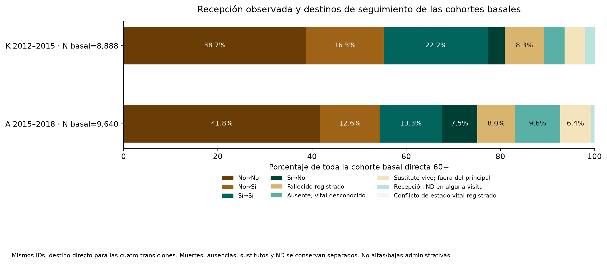

**Nota:** Mismos IDs; destino directo para las cuatro transiciones. Muertes, ausencias, sustitutos y ND se conservan separados. No altas/bajas administrativas.

**Fuente y procedencia:** ENASEM; [notebook 08](../notebooks/08_TRANSICIONES_MONTOS_PENSIONARIOS.ipynb), bloques 1–16; [copia ejecutada](../data/interim/notebooks_ejecutados/08_TRANSICIONES_MONTOS_PENSIONARIOS_ejecutado.ipynb); [auditoría](../data/interim/transiciones_montos_pensionarios/auditoria.json) y [agregados 08](../data/interim/transiciones_montos_pensionarios/resultados.json). Integración, definiciones, precios y seguimiento reutilizados de 01–07; INPC oficial congelado.

**K 2012–2015: denominadores y protección anterior.** El inicio observado es 29.92% entre negativas iniciales con estado conocido en destino, frente a 24.82% sobre todas las 5,919 negativas basales. El cese de declaración es 13.60% entre receptoras reobservadas con estado conocido; 11.03% sobre las 2,819 receptoras iniciales. Los primeros porcentajes están condicionados a observación válida. De los 1,469 nuevos de esta vía, 376 ya tenían la otra vía propia, 1,090 la negaban y 3 son ND. Nuevo en una vía no es necesariamente primera protección ni prueba de un beneficio adicional neto.

**A 2015–2018: denominadores y protección anterior.** El inicio observado es 23.14% entre negativas iniciales con estado conocido en destino, frente a 17.61% sobre todas las 6,883 negativas basales. El cese de declaración es 36.01% entre receptoras reobservadas con estado conocido; 27.41% sobre las 2,630 receptoras iniciales. Los primeros porcentajes están condicionados a observación válida. De los 1,212 nuevos de esta vía, 606 ya tenían la otra vía propia, 603 la negaban y 3 son ND. Nuevo en una vía no es necesariamente primera protección ni prueba de un beneficio adicional neto.

**Incorporación frente a continuidad.** En K los nuevos observados tienen mediana mensual $580 nominales/$992.86 reales (N válido 1,435/1,469); los continuos, $2,500/$4,279.56 (N 1,857/1,975). La diferencia nuevos−continuos es $-3,286.70 reales; la mediana nueva equivale a 23.20% de la continua. Es un contraste sustantivo entre receptores observados, no entre iguales ni de toda la cohorte. En A ambos grupos tienen mediana de $580/$886.48, con N 1,173/1,212 y 1,245/1,281. Su Q 75 real sí difiere ($1,451.99 frente a $1,528.41); la mediana nula no implica distribuciones idénticas. El monto de continuos en destino no exige monto basal válido; los cambios individuales sí. No se suman importes con algún evento faltante.

**Cuadro 53. Montos de nuevos, continuos y quienes dejan de declarar recepción**

**Pregunta y aporte:** Comprobar si los nuevos observados tienen montos menores y distinguir ausencia declarada de dinero no medido.

| Vía e intervalo | Patrón y visita del monto | N recepción | N monto real íntegro | N sin monto íntegro | Mediana nominal $/mes | Mediana real $/mes | Q 25/Q 75 nominal $ | Q 25/Q 75 real $ |
| --- | --- | --- | --- | --- | --- | --- | --- | --- |
| K 2012–2015 | No→Sí · destino | 1469 | 1435 | 34 | 580.00 | 992.86 | 550 / 2,000 | 941.50 / 3,423.65 |
| K 2012–2015 | Sí→Sí · destino | 1975 | 1857 | 118 | 2,500.00 | 4,279.56 | 2,000 / 6,000 | 3,423.65 / 10,270.94 |
| K 2012–2015 | Sí→No · basal | 311 | 293 | 18 | 1,500.00 | 2,886.59 | 500 / 2,350 | 962.20 / 4,522.32 |
| A 2015–2018 | No→Sí · destino | 1212 | 1173 | 39 | 580.00 | 886.48 | 550 / 950 | 840.63 / 1,451.99 |
| A 2015–2018 | Sí→Sí · destino | 1281 | 1245 | 36 | 580.00 | 886.48 | 550 / 1,000 | 840.63 / 1,528.41 |
| A 2015–2018 | Sí→No · basal | 721 | 708 | 13 | 550.00 | 941.50 | 500 / 626 | 855.91 / 1,072.03 |

**Nota:** Moneda real: septiembre 2026. Destino para nuevos/continuos; basal para Sí→No, cuyo monto posterior no se completa con cero. Continua recepción no exige importe basal para este contraste; cambios personales sí. A dinero/especie, no A 5. N sin monto íntegro incluye importe faltante de cualquier evento captado; no total de ingreso. Fechas válidas cubren los importes de estos contrastes.

**Fuente y procedencia:** ENASEM; [notebook 08](../notebooks/08_TRANSICIONES_MONTOS_PENSIONARIOS.ipynb), bloques 1–16; [copia ejecutada](../data/interim/notebooks_ejecutados/08_TRANSICIONES_MONTOS_PENSIONARIOS_ejecutado.ipynb); [auditoría](../data/interim/transiciones_montos_pensionarios/auditoria.json) y [agregados 08](../data/interim/transiciones_montos_pensionarios/resultados.json). Integración, definiciones, precios y seguimiento reutilizados de 01–07; INPC oficial congelado.

**Figura 46. Nuevos y continuos: distribución de los montos íntegros captados en destino**

**Pregunta y aporte:** Punto: mediana; segmento grueso: Q 25–Q 75; fino: P 10–P 90, no IC. Sumados solo eventos captados con todos los montos válidos. No ingreso total.

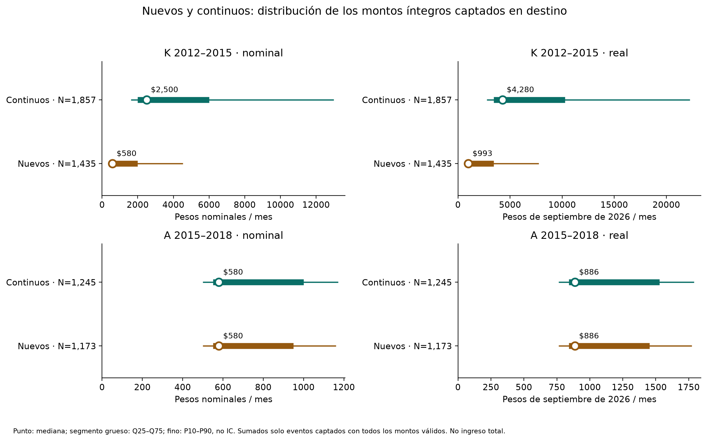

**Nota:** Punto: mediana; segmento grueso: Q 25–Q 75; fino: P 10–P 90, no IC. Sumados solo eventos captados con todos los montos válidos. No ingreso total.

**Fuente y procedencia:** ENASEM; [notebook 08](../notebooks/08_TRANSICIONES_MONTOS_PENSIONARIOS.ipynb), bloques 1–16; [copia ejecutada](../data/interim/notebooks_ejecutados/08_TRANSICIONES_MONTOS_PENSIONARIOS_ejecutado.ipynb); [auditoría](../data/interim/transiciones_montos_pensionarios/auditoria.json) y [agregados 08](../data/interim/transiciones_montos_pensionarios/resultados.json). Integración, definiciones, precios y seguimiento reutilizados de 01–07; INPC oficial congelado.

Entre 3,292 receptores K de la cohorte basal con monto íntegro de destino, la mezcla observada de nuevos y continuos tiene mediana $2,100/$3,594.83; los 1,857 continuos solos, $2,500/$4,279.56. Incluir el grupo nuevo de menor distribución reduce aquí la mediana empírica del conjunto seleccionado. No cuantifica una fracción causal de la caída transversal de 11.05%: excluye entradas por edad, otros orígenes y casos sin monto. En A, la mezcla de 2,418 y los 1,245 continuos solos mantienen la misma mediana $886.48. Es evidencia contraria a una explicación general por menor mediana de nuevos. Una mediana de mezcla no es promedio ponderado de las medianas de sus grupos.

K 2012–2015 (N receptoras 2,819/4,159): Mujer 42.89%→46.89%; 70+ 52.93%→59.27%; 0 años 14.44%→17.14%; <100 mil habitantes 28.70%→39.24%. A 2015–2018 (N receptoras 2,630/2,764): Mujer 59.32%→62.66%; 70+ 65.86%→73.99%; 0 años 28.97%→28.51%; <100 mil habitantes 59.58%→61.40%. Son porcentajes dentro de todos los receptores propios directos 60+ de cada ronda, con denominadores de receptoras, no tasas de cobertura. Se reutilizan los conteos de 06/07. No describe las mismas personas ni separa incorporación, envejecimiento, nueva muestra y muerte. La comparación de patrones y la partición de destino documentan algunos componentes observables, sin una descomposición causal ni completa de la mediana.

**Composición transversal de destino K 2012–2015:** 4,159 receptoras 60+ directas incluyen, además de los pares nuevos/continuos, Basal sustituto 60+: 160 receptoras/152 importes íntegros; Entrada por edad: basal menor 60: 253 receptoras/242 importes íntegros; Origen no clasificable: 1 receptoras/1 importes íntegros; Recepción ND en alguna visita: 36 receptoras/31 importes íntegros; Registro previo sobre fallecido; discordancia conservada: 1 receptoras/1 importes íntegros; Sin registro en ronda basal: 264 receptoras/238 importes íntegros. El universo final incluye entradas por edad y orígenes excluidos del basal directo. Edad final discordante se conserva en seguimiento y puede excluirse del transversal 60+. Los registros vitales conflictivos se describen como evidencia observada, sin inferir vida real o pagos tras fallecimiento.

**Composición transversal de destino A 2015–2018:** 2,764 receptoras 60+ directas incluyen, además de los pares nuevos/continuos, Basal sustituto 60+: 76 receptoras/71 importes íntegros; Conflicto de estado vital registrado: 1 receptoras/1 importes íntegros; Entrada por edad: basal menor 60: 120 receptoras/105 importes íntegros; Recepción ND en alguna visita: 19 receptoras/18 importes íntegros; Sin registro en ronda basal: 56 receptoras/54 importes íntegros. El universo final incluye entradas por edad y orígenes excluidos del basal directo. Edad final discordante se conserva en seguimiento y puede excluirse del transversal 60+. Los registros vitales conflictivos se describen como evidencia observada, sin inferir vida real o pagos tras fallecimiento.

**Mismas personas y tres estimandos.** En 1,756 continuos K con ambas capturas íntegras, la mediana nominal pasa de $2,200 a $2,500; las medianas reales son $4,233.66 y $4,279.56: diferencia +$45.89. La mediana del cambio individual es $-40.26; 932/1,756 (53.08%) muestran reducción. No son resultados incompatibles: cambian los rangos relativos de las personas dentro de la distribución. En A, N=1,223, las medianas nominales son $550/$580, y las reales $941.50/$886.48. La diferencia de medianas y la mediana individual coinciden aquí en $-55.02, por esta distribución, no por identidad estadística. Bajan 736/1,223 (60.18%). Existen aumentos y disminuciones en ambos casos; no todos los receptores pierden poder adquisitivo.

**Cuadro 54. Cambios de montos en pares íntegros y sensibilidades de concepto**

**Pregunta y aporte:** Distinguir desplazamiento de la distribución y cambio personal, con sensibilidad temporal visible.

| Vía e intervalo | Restricción de captura | N pares | Medianas nominales $/mes | Medianas reales $/mes | Diferencia de medianas reales $ | Mediana cambio individual real $ | Q 25/Q 75 cambios reales $ | % cambios reales negativos | Mediana cambio real 12 m $ | Mediana cambio real año entrevista $ |
| --- | --- | --- | --- | --- | --- | --- | --- | --- | --- | --- |
| K 2012–2015 | Íntegro captado | 1756 | $2,200 → $2,500 | $4,233.66 → $4,279.56 | 45.89 | -40.26 | -751.00 / 772.01 | 53.08 | -13.59 | 5.86 |
| K 2012–2015 | Un evento en ambas visitas; no identidad comprobada | 1511 | $2,175 → $2,400 | $4,185.55 → $4,108.38 | -77.18 | -82.77 | -637.71 / 473.85 | 55.06 | -26.35 | -7.63 |
| K 2012–2015 | Un evento, misma contingencia e instituciónIMSS/ISSSTE | 1183 | $2,200 → $2,400 | $4,233.66 → $4,108.38 | -125.29 | -77.18 | -634.89 / 473.29 | 54.02 | -21.48 | 5.86 |
| A 2015–2018 | Íntegro captado | 1223 | $550 → $580 | $941.50 → $886.48 | -55.02 | -55.02 | -152.23 / 376.05 | 60.18 | -68.17 | -71.49 |
| A 2015–2018 | Un evento en ambas visitas; no identidad comprobada | 1103 | $550 → $580 | $941.50 → $886.48 | -55.02 | -58.08 | -160.93 / 137.56 | 65.19 | -74.79 | -73.54 |

**Nota:** Mismos N dentro de cada fila. Concepto K: un evento por visita, misma contingencia y única institución IMSS/ISSSTE; no certifica que sea la misma prestación. A de un evento no identifica programa. No IC ni valoresp. No se interpretan medias dominadas por importes extremos. El original de A conflictivo cambia N 1223→1224 en sensibilidad de registros, sin cambiar la mediana; no se supone cobro posterior a muerte.

**Fuente y procedencia:** ENASEM; [notebook 08](../notebooks/08_TRANSICIONES_MONTOS_PENSIONARIOS.ipynb), bloques 1–16; [copia ejecutada](../data/interim/notebooks_ejecutados/08_TRANSICIONES_MONTOS_PENSIONARIOS_ejecutado.ipynb); [auditoría](../data/interim/transiciones_montos_pensionarios/auditoria.json) y [agregados 08](../data/interim/transiciones_montos_pensionarios/resultados.json). Integración, definiciones, precios y seguimiento reutilizados de 01–07; INPC oficial congelado.

**Figura 47. Cambios reales de las mismas personas: heterogeneidad y sensibilidad de concepto**

**Pregunta y aporte:** Mediana del cambio individual, no diferencia de medianas. Segmentos Q 25–Q 75 y P 10–P 90, no IC. No identidad administrativa del programa ni causalidad.

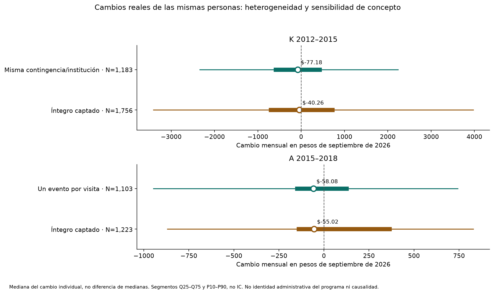

**Nota:** Mediana del cambio individual, no diferencia de medianas. Segmentos Q 25–Q 75 y P 10–P 90, no IC. No identidad administrativa del programa ni causalidad.

**Fuente y procedencia:** ENASEM; [notebook 08](../notebooks/08_TRANSICIONES_MONTOS_PENSIONARIOS.ipynb), bloques 1–16; [copia ejecutada](../data/interim/notebooks_ejecutados/08_TRANSICIONES_MONTOS_PENSIONARIOS_ejecutado.ipynb); [auditoría](../data/interim/transiciones_montos_pensionarios/auditoria.json) y [agregados 08](../data/interim/transiciones_montos_pensionarios/resultados.json). Integración, definiciones, precios y seguimiento reutilizados de 01–07; INPC oficial congelado.

Se mantiene INPC oficial INEGI 146.075, septiembre de 2026. Para cada persona, `R1−R0 = f1×(M1−M0) + M0×(f1−f0)`, donde `ft=146.075/INPCt`. El primer término valora el cambio nominal a precios de destino y el segundo congela el nominal basal. La identidad es exacta, no una estimación de mecanismos causales. Las medianas de esos términos no se suman como medianas de cambios. Un puente adicional de medianas, sobre los mismos pares, primero repricia todos los nominales basales y luego los sustituye por los finales: K: $-467.65 + $+513.55 = $+45.89; A: $-100.88 + $+45.85 = $-55.02. El orden inverso, documentado en los agregados, produce componentes distintos. No se interpreta como porcentaje de inflación frente a composición en la mediana transversal. La inflación mediana bajo el criterio del año calendario previo es 12.42% en K y 12.00% en A. La comparación modal utiliza 2011→2014 y 2014→2017; entrevistas tardías conservan sus índices individuales. Son intervalos de precios elegidos para año pasado, no fechas de pago observadas ni inflación medida exactamente entre las visitas. Bajo un factor común, `1+cambio_real = (1+cambio_nominal)/(1+inflacion)`: 0% nominal y 12.42% de inflación producen −11.05%; +5.45% y 12.00% producen −5.84%. Esta aritmética explica la traducción monetaria, pero no por qué la distribución nominal quedó en esas medianas.

La mediana individual K es pequeña y sensible al periodo: $-13.59 con doce meses previos y $+5.86 con año de entrevista, frente a $-40.26 principal. No se sostiene una caída individual mediana robusta de K a todos los criterios temporales. La restricción de contingencia e institución también cambia el universo: no certifica continuidad administrativa ni contributividad. A mantiene signo negativo con $-68.17/$-71.49. La sensibilidad de un evento por visita no identifica que sea el mismo programa A. Ninguna sensibilidad garantiza invariancia de captura.

**Perfiles y heterogeneidad.** **K perfiles basales:** Mujer: 54.87% nuevos, 40.46% continuos, 58.20% cese; 70+: 44.93% nuevos, 48.10% continuos, 59.16% cese; 0 años: 26.34% nuevos, 12.05% continuos, 26.37% cese; <100 mil habitantes: 54.46% nuevos, 27.85% continuos, 34.08% cese; Trabaja: 31.65% nuevos, 21.11% continuos, 18.97% cese; Viudo: 19.61% nuevos, 32.91% continuos, 27.97% cese. Los N totales de cada patrón son 1469/1975/311.

**A perfiles basales:** Mujer: 61.39% nuevos, 64.01% continuos, 55.06% cese; 70+: 52.39% nuevos, 63.62% continuos, 61.17% cese; 0 años: 26.65% nuevos, 30.44% continuos, 22.61% cese; <100 mil habitantes: 57.43% nuevos, 62.92% continuos, 50.90% cese; Trabaja: 30.45% nuevos, 29.74% continuos, 30.93% cese; Viudo: 22.61% nuevos, 28.42% continuos, 24.41% cese. Los N totales de cada patrón son 1212/1281/721.

Estos porcentajes usan toda la transición conocida, incluyendo personas sin monto íntegro; son composición del grupo, no cobertura de cada perfil. Las personas con variables desconocidas permanecen en el denominador total y se identifican en las tablas completas. Los nuevos K no son simplemente más viejos: tienen mayor presencia femenina, menor escolaridad y localidades pequeñas, pero menor proporción basal 70+ que continuos. El acceso por una vía y el monto central entre receptores describen desigualdades diferentes. En nuevos K, escolaridad 0 tiene mediana $550/$941.50 (N=385), frente a ≥10 años $6,000/$10,270.94 (N=83). Localidad<100 mil: $550/$941.50 (N=791); ≥100 mil: $1,350/$2,310.96 (N=644). La diferencia K nuevos/continuos se observa dentro de ambos sexos y los perfiles seleccionados, aunque su magnitud varía. En A, ambos sexos mantienen la misma mediana general entre nuevos y continuos. Entre personas basales 60–64 aparece el contraste inverso: nuevos $886.48 (N=145) frente a continuos $726.00 (N=99). Grupos basales de edad no equivalen a elegibilidad del programa al destino. Las diferencias de cambios personales son pequeñas, heterogéneas y no pruebas de efectos. La escolaridad es inicial; el corte 100 mil no define ruralidad; ocupación 4 no identifica jubilación efectiva; viudez no acredita pareja residente.

**Cuadro 55. Brechas monetarias dentro de nuevos y continuos por perfil basal**

**Pregunta y aporte:** Reconocer dimensiones de desigualdad y cambios personales sin confundir sus denominadores.

| Vía e intervalo | Grupo 1 / grupo 2 | N nuevos g 1/g 2 | Medianas nominales nuevos $ | Medianas reales nuevos $ | Brecha real nuevos g 1−g 2 $ | Razón nuevos g 1/g 2 | N continuos g 1/g 2 | Medianas nominales continuos $ | Medianas reales continuos $ | Brecha real continuos g 1−g 2 $ | Razón continuos g 1/g 2 | Mediana cambio personal real g 1/g 2 |
| --- | --- | --- | --- | --- | --- | --- | --- | --- | --- | --- | --- | --- |
| K 2012–2015 | Hombre / Mujer | 638/797 | 588 / 575 | 1,006 / 984 | 21.40 | 1.02 | 1,104/753 | 2,600 / 2,400 | 4,451 / 4,108 | 342.36 | 1.08 | $-82.77 (N=1,037) / $-20.69 (N=719) |
| K 2012–2015 | 70+ / 60–64 | 653/322 | 575 / 2,000 | 984 / 3,424 | -2,439.35 | 0.29 | 901/419 | 2,400 / 3,500 | 4,108 / 5,991 | -1,883.01 | 0.69 | $-20.69 (N=853) / $-17.72 (N=397) |
| K 2012–2015 | ≥10 años / 0 años | 83/385 | 6,000 / 550 | 10,271 / 942 | 9,329.44 | 10.91 | 320/234 | 9,000 / 2,100 | 15,406 / 3,595 | 11,811.58 | 4.29 | $-24.56 (N=300) / $-99.84 (N=226) |
| K 2012–2015 | ≥100 mil habitantes / <100 mil habitantes | 644/791 | 1,350 / 550 | 2,311 / 942 | 1,369.46 | 2.45 | 1,323/534 | 2,800 / 2,300 | 4,793 / 3,937 | 855.91 | 1.22 | $-60.39 (N=1,233) / $-20.69 (N=523) |
| K 2012–2015 | Trabaja / Labores del hogar | 445/550 | 600 / 575 | 1,027 / 984 | 42.80 | 1.04 | 398/297 | 2,400 / 2,100 | 4,108 / 3,595 | 513.55 | 1.14 | $-61.52 (N=389) / $-20.69 (N=287) |
| K 2012–2015 | Viudo / Casado/unión | 285/1,008 | 575 / 580 | 984 / 993 | -8.56 | 0.99 | 624/1,052 | 2,300 / 2,790 | 3,937 / 4,776 | -838.79 | 0.82 | $-5.80 (N=599) / $-82.77 (N=981) |
| A 2015–2018 | Hombre / Mujer | 446/727 | 580 / 580 | 886 / 886 | 0.00 | 1.00 | 444/801 | 580 / 580 | 886 / 886 | 0.00 | 1.00 | $-55.02 (N=431) / $-50.90 (N=792) |
| A 2015–2018 | 70+ / 60–64 | 623/145 | 580 / 580 | 886 / 886 | 0.00 | 1.00 | 789/99 | 580 / 475 | 886 / 726 | 160.48 | 1.22 | $-55.02 (N=778) / $-35.15 (N=95) |
| A 2015–2018 | ≥10 años / 0 años | 49/318 | 600 / 580 | 917 / 886 | 30.57 | 1.03 | 28/381 | 600 / 580 | 917 / 886 | 30.57 | 1.03 | $-39.74 (N=28) / $-55.02 (N=374) |
| A 2015–2018 | ≥100 mil habitantes / <100 mil habitantes | 497/676 | 580 / 575 | 886 / 879 | 7.64 | 1.01 | 457/788 | 580 / 580 | 886 / 886 | 0.00 | 1.00 | $-58.08 (N=454) / $-45.85 (N=769) |
| A 2015–2018 | Trabaja / Labores del hogar | 358/445 | 580 / 575 | 886 / 879 | 7.64 | 1.01 | 372/469 | 580 / 580 | 886 / 886 | 0.00 | 1.00 | $-55.02 (N=359) / $-47.08 (N=464) |
| A 2015–2018 | Viudo / Casado/unión | 267/775 | 575 / 580 | 879 / 886 | -7.64 | 0.99 | 356/720 | 580 / 580 | 886 / 886 | 0.00 | 1.00 | $-30.57 (N=353) / $-55.02 (N=702) |

**Nota:** Cada dimensión es una partición diferente y sus N no se suman entre dimensiones. Medianas por perfil redondeadas a pesos enteros; brechas y razones calculadas con valores sin redondear. Montos de destino íntegros; cambios personales solo pares íntegros. Edad y demás perfiles basales, escolaridad inicial, localidad 100 mil. Brechas firmadas g 1−g 2 y razones: dirección no es tamaño absoluto. Comparaciones muestrales sin ajuste conjunto; A de ≥10 años tiene N pequeños. Ambos tipos de unidad mensual; real septiembre 2026. Los otros niveles y faltantes siguen en notebook/agregados.

**Fuente y procedencia:** ENASEM; [notebook 08](../notebooks/08_TRANSICIONES_MONTOS_PENSIONARIOS.ipynb), bloques 1–16; [copia ejecutada](../data/interim/notebooks_ejecutados/08_TRANSICIONES_MONTOS_PENSIONARIOS_ejecutado.ipynb); [auditoría](../data/interim/transiciones_montos_pensionarios/auditoria.json) y [agregados 08](../data/interim/transiciones_montos_pensionarios/resultados.json). Integración, definiciones, precios y seguimiento reutilizados de 01–07; INPC oficial congelado.

**Composición común y soporte.** Se estandarizan las distribuciones de destino a una mezcla común de sexo, edad basal (60–64, 65–69, 70+) y escolaridad inicial (0–5/6+). Cada celda exige al menos 20 nuevos y 20 continuos; se requiere cubrir ≥70% de cada grupo. La mezcla objetivo es la composición conjunta empírica dentro del soporte. Los cuantiles se obtienen de la CDF ponderada, no promediando medianas de celdas. El comparador sin ajuste usa la misma definición de cuantil y el mismo soporte. K conserva 1,428/1,435 nuevos y 1,846/1,857 continuos; las medianas reales ajustadas son $992.86 y $4,108.38. El contraste de K persiste después de equilibrar esa composición basal. A conserva 1,087/1,173 y 1,192/1,245; las medianas ajustadas siguen iguales. Añadir localidad tiene soporte suficiente y no elimina la lectura principal. Ocupación y estado conyugal se describen, sin asegurar equilibrio conjunto. Los pesos son de composición descriptiva, no de encuesta ni de probabilidad de observación. No se corrige selección no observada, mortalidad ni causalidad. No se implementa Oaxaca–Blinder o Kitagawa.

**Cuadro 56. Distribuciones estandarizadas de nuevos y continuos en soporte común**

**Pregunta y aporte:** Evaluar cuánto del contraste de montos persiste entre grupos con composición basal común.

| Vía e intervalo | Grupo | N original con monto | N soporte principal | % retenido en soporte | Mediana real sin ajuste CDF $ | Mediana nominal ajustada $ | Mediana real ajustada $ | ESS pesos descriptivos | N soporte con localidad | Mediana real ajuste con localidad $ |
| --- | --- | --- | --- | --- | --- | --- | --- | --- | --- | --- |
| K 2012–2015 | No→Sí | 1435 | 1428 | 99.51 | 992.86 | 580.00 | 992.86 | 1,285.65 | 1346 | 1,027.09 |
| K 2012–2015 | Sí→Sí | 1857 | 1846 | 99.41 | 4,279.56 | 2,400.00 | 4,108.38 | 1,711.72 | 1816 | 4,108.38 |
| A 2015–2018 | No→Sí | 1173 | 1087 | 92.67 | 886.48 | 580.00 | 886.48 | 1,069.87 | 1054 | 886.48 |
| A 2015–2018 | Sí→Sí | 1245 | 1192 | 95.74 | 886.48 | 580.00 | 886.48 | 1,176.10 | 1170 | 886.48 |

**Nota:** Sexo×edad 3×escolaridad 0–5/6+, y sensibilidad añadiendo localidad 2. ≥20 por grupo/celda; cobertura≥70% y≥4 celdas. Objetivo: mezcla conjunta de los dos grupos dentro de soporte. Cuantil inverso de CDF, distinto del promedio de dos valores centrales de la mediana empírica usual. Comparador sin ajuste mismo soporte/CDF. ESS no es ESS de encuesta o IPW. No ajuste causal ni corrección de pérdidas o muertes.

**Fuente y procedencia:** ENASEM; [notebook 08](../notebooks/08_TRANSICIONES_MONTOS_PENSIONARIOS.ipynb), bloques 1–16; [copia ejecutada](../data/interim/notebooks_ejecutados/08_TRANSICIONES_MONTOS_PENSIONARIOS_ejecutado.ipynb); [auditoría](../data/interim/transiciones_montos_pensionarios/auditoria.json) y [agregados 08](../data/interim/transiciones_montos_pensionarios/resultados.json). Integración, definiciones, precios y seguimiento reutilizados de 01–07; INPC oficial congelado.

**Sensibilidad actuarial.** K 2012–2015: muertes registradas 464/5,919 (7.84%) en negativas iniciales y 249/2,819 (8.83%) en receptoras; ausencias 226 (3.82%) y 157 (5.57%). A 2015–2018: muertes registradas 467/6,883 (6.78%) en negativas iniciales y 282/2,630 (10.72%) en receptoras; ausencias 758 (11.01%) y 147 (5.59%). La dirección de la diferencia de ausencia cambia entre vías. Son asociaciones basales sin ajustar por edad/composición, no efectos pensionarios sobre supervivencia o respuesta. Solo los sobrevivientes reentrevistados con recepción y montos válidos pueden clasificarse como nuevos/continuos para comparar dinero. No se identifica la trayectoria monetaria de toda la cohorte. Las medianas basales similares en ciertos destinos no garantizan retención ignorable: las colas y perfiles pueden variar. Las reapariciones demuestran que ausencia no es muerte; un fallecimiento registrado después no fecha el deceso en la visita ausente. La estandarización de observados no soluciona esta selección. Permitir sustituto válido en destino conserva las medianas generales de nuevos/continuos K y A, con N mayores, pero no prueba ausencia de sesgo en subgrupos. Ningún muerto recibe un monto posterior imputado.

**Cuadro 57. Seguimiento por recepción inicial y evidencia posterior de ausentes**

**Pregunta y aporte:** Delimitar selección antes de interpretar diferencias monetarias de sobrevivientes observados.

| Vía e intervalo | Recepción basal | N basal | Fallecidos N (% basal) | Ausentes N (% basal) | Sustitutos N (% basal) | Ausentes reaparecen vivos | Ausentes registro posterior fallecido | Ambos registros posteriores |
| --- | --- | --- | --- | --- | --- | --- | --- | --- |
| K 2012–2015 | No | 5919 | 464 (7.84%) | 226 (3.82%) | 258 (4.36%) | 87 | 37 | 20 |
| K 2012–2015 | Sí | 2819 | 249 (8.83%) | 157 (5.57%) | 105 (3.72%) | 55 | 13 | 7 |
| K 2012–2015 | ND | 150 | 25 (16.67%) | 5 (3.33%) | 18 (12.00%) | 1 | 0 | 0 |
| A 2015–2018 | No | 6883 | 467 (6.78%) | 758 (11.01%) | 405 (5.88%) | 387 | 90 | 0 |
| A 2015–2018 | Sí | 2630 | 282 (10.72%) | 147 (5.59%) | 194 (7.38%) | 70 | 22 | 0 |
| A 2015–2018 | ND | 127 | 22 (17.32%) | 23 (18.11%) | 19 (14.96%) | 10 | 2 | 0 |

**Nota:** Todas las directas 60+ basales, incluso recepciónND. Fallecimiento registrado no mortalidad completa/tasa anual. Conteos posteriores solo entre ausentes de ese intervalo; vida y muerte posteriores pueden solaparse, no sumar ni asignar estado en la visita ausente. Recepción/montos posteriores de muertos no se imputan. No se estimó IPW, KM, Cox ni escenarios de prestaciones de fallecidos.

**Fuente y procedencia:** ENASEM; [notebook 08](../notebooks/08_TRANSICIONES_MONTOS_PENSIONARIOS.ipynb), bloques 1–16; [copia ejecutada](../data/interim/notebooks_ejecutados/08_TRANSICIONES_MONTOS_PENSIONARIOS_ejecutado.ipynb); [auditoría](../data/interim/transiciones_montos_pensionarios/auditoria.json) y [agregados 08](../data/interim/transiciones_montos_pensionarios/resultados.json). Integración, definiciones, precios y seguimiento reutilizados de 01–07; INPC oficial congelado.

**Política, indicador, resultado y limitación.** **PAM 65+ desde 2013, $580 mensuales desde 2014 → indicador K propio y evidencia código 8 → 927/1,435 nuevos con monto íntegro (64.60%) tienen evidencia de programa público agrupado, frente a 144/1,857 continuos (7.75%) → límite:** código 8 incluye programas federales/estatales y puede coexistir con otras instituciones; no identifica PAM ni permite asignarle toda la suma. Entre personas con evidencia IMSS/ISSSTE, nuevos (N=433) y continuos (N=1,671) tienen la misma mediana personal nominal $2,500; los nuevos con programa agrupado (N=927) tienen mediana $550. Estas sumas personales incluyen todos los eventos íntegros, no montos asignados a cada institución; las evidencias pueden solaparse. Esto documenta heterogeneidad de la incorporación captada, sin atribución causal. 

**PAM mantiene $580 entre 2014–2018 → indicador A general y norma por separado → mediana A pasa 550→580 nominales, mientras precios del criterio principal aumentan aproximadamente 12% y la mediana real cae → límite:** A no identifica PAM en ambas visitas, incluye dinero/especie y cambia captación en 2018. No son una serie individual de monto oficial ni todo el padrón. Las coincidencias son compatibles con expansión de prestaciones pequeñas y erosión normativa, sin demostrar que una reforma produjo el resultado. Se usa la [cronología y sus fuentes oficiales](../investigacion/notas/politicas_publicas_envejecimiento.md) de 07.

**Conclusión para la pregunta central.** **Respuesta a los mecanismos.** La inflación aporta una erosión aritmética verificable bajo fechas explícitas. En K también se observa una diferencia monetaria grande de incorporación y una mezcla institucional diferente, persistente bajo estandarización basal. En A la menor mediana de nuevos no está respaldada; hay diferencias de colas y perfiles, pero la reducción real central también aparece entre continuos. La combinación observable varía por vía. No se puede repartir la caída transversal en porcentajes causales de precios, composición y política. Tampoco se pueden certificar flujos de una misma prestación, suficiencia total o ingreso individual completo. El aporte a la tesis es mostrar por qué expandir recepción no implica igualar recursos centrales y distinguir una expansión con montos menores de una erosión entre continuos. La selección delimita a quién representan las comparaciones.

**Siete respuestas de esta etapa.**

1. La erosión por precios es verificable; la distribución nominal y la mezcla de receptores K también cambian. No se identifica una descomposición causal única de la caída transversal.
2. Los nuevos K tienen montos centrales mucho menores que los continuos, incluso en composición común. En A las medianas coinciden; no extrapolar el mecanismo K a A.
3. Entre las mismas personas, K muestra pequeños cambios heterogéneos y una mediana sensible a fechas; A conserva caída mediana bajo los criterios temporales examinados. No implica pérdida para cada persona.
4. Las diferencias K por escolaridad y localidad son grandes; la composición por sexo y edad cambia y existen contrastes dentro de perfiles. A presenta medianas mucho más próximas, con heterogeneidad de colas y un contraste inverso entre basales 60–64.
5. Sí: recepción y monto entre receptores son estimandos distintos. Incorporar prestaciones pequeñas puede elevar cobertura sin igualar montos. Tampoco se demuestra primera protección cuando ya existía la otra vía.
6. Los cambios son compatibles descriptivamente con elegibilidad e importes normativos. No identifican un efecto de PAM, la identidad de un programa A ni todo el recurso económico propio.
7. La mortalidad y ausencia cambian a quién puede observarse; las sensibilidades de composición/modalidad mantienen la diferencia grande K y el contraste mediano nulo A. No recuperan montos desconocidos ni representan automáticamente la cohorte original.

**Fuente y procedencia:** ENASEM; [notebook 08](../notebooks/08_TRANSICIONES_MONTOS_PENSIONARIOS.ipynb), bloques 1–16; [copia ejecutada](../data/interim/notebooks_ejecutados/08_TRANSICIONES_MONTOS_PENSIONARIOS_ejecutado.ipynb); [auditoría](../data/interim/transiciones_montos_pensionarios/auditoria.json) y [agregados 08](../data/interim/transiciones_montos_pensionarios/resultados.json). Integración, definiciones, precios y seguimiento reutilizados de 01–07; INPC oficial congelado.

<!-- END benefit08 -->

<!-- BEGIN auditoria_cientifica -->

### 10.6 Auditoría de aportación científica y consolidación de resultados

**Pregunta central, sin modificaciones:** ¿Qué tanto es consistente la expansión de las pensiones y los apoyos públicos con una reducción de las brechas de cobertura y de monto de la protección económica de los adultos mayores en México (ENASEM 2001–2021), qué grupos siguen sin vía propia de protección y cómo cambia esta lectura al considerar a quienes mueren o dejan de ser entrevistados?

**Diagnóstico académico al 14 de octubre de 2026.** Hay evidencia suficiente para una tesis descriptiva integrada y para comenzar su redacción. No hay todavía fundamento para declarar una contribución original fuerte y cerrada, convergencia nacional durante veinte años, suficiencia económica total o efecto causal de las reformas. La aportación candidata más específica es contrastar la incorporación observada y la continuidad de recepción K/A con distribuciones monetarias reales, composición institucional y límites de seguimiento. Debe defenderse frente a antecedentes muy próximos, no solo frente a estudios de cobertura.

Esta auditoría lee las ocho fuentes y copias ejecutadas, contratos y agregados existentes. No ejecuta análisis estadísticos nuevos, no cambia la hipótesis en conclusión ni selecciona por significancia. Cifras exportadas desde los resultados guardados. Los cuadros 58–66 son matrices de evaluación y propuesta, no nuevas estimaciones; los cuadros 1–57 y las 47 figuras conservan su contenido. «Validado computacionalmente» significa conciliado con archivos y reglas, no una homologación perfecta, representatividad nacional o validación científica final.

#### Diagnóstico inicial de los ocho notebooks

**Cuadro 58. Diagnóstico y función académica de los ocho notebooks**

**Pregunta y aporte:** Seleccionar por contribución a la pregunta vigente, no por cantidad de salidas.

| Notebook | Ejecución disponible | Papel | Justificación |
| --- | --- | --- | --- |
| 01 · INTEGRACION | 15 celdas; 118 salidas; 0 errores | Fundamento complementario | Integridad de fuentes, claves y titularidad; sustenta el método, no es un resultado de política. |
| 02 · EDA_COMPLETO | 28 celdas; 1822 salidas; 0 errores | Contexto y exploración | Seis rondas y universos; seleccionar protección económica. Salud, cognición y patrimonio no responden por sí solos la pregunta vigente. |
| 03 · PENSIONES_SALUD_COGNICION | 22 celdas; 27 salidas; 0 errores | Exploración secundaria | Asociaciones de salud y composición. Conservar como antecedente; no presentar salud como efecto de recibir pensión. |
| 04 · TRAYECTORIAS_PENSIONES_SALUD | 63 celdas; 62 salidas; 0 errores | Antecedente longitudinal | Distingue cambios individuales de composición transversal y muestra selección; salud mental dejó de ser el eje principal. |
| 05 · PENSIONES_MORTALIDAD_SELECCION | 54 celdas; 41 salidas; 0 errores | Sensibilidad complementaria | Separa muerte, ausencia, sustituto y medición no válida; no estima una mortalidad completa ni recupera ingresos no observados. |
| 06 · COBERTURA_PROTECCION_ECONOMICA | 39 celdas; 67 salidas; 0 errores | Resultado central | Vías propias, cobertura, negativas y brechas; principal solo entrevistas directas por elección de la autora. |
| 07 · POLITICAS_MONTOS_SUFICIENCIA | 51 celdas; 59 salidas; 0 errores | Resultado central | Poder adquisitivo, prestaciones parciales/LPI y cronología; no demuestra pobreza ni efectos de programa. |
| 08 · TRANSICIONES_MONTOS_PENSIONARIOS | 47 celdas; 53 salidas; 0 errores | Resultado central y sensibilidad | Incorporación, continuidad observada y distribución monetaria; aporta el contraste más específico que debe defenderse frente a estudios previos. |

**Nota:** Las celdas se numeran desde 1. Las copias ejecutadas se encuentran en data/interim/notebooks_ejecutados/. Fuente y copia contienen el mismo código; cero errores guardados no certifica todo resultado. No se ejecutaron nuevamente los cálculos.

01 acredita la construcción; 02 contextualiza; 06–08 responden el núcleo económico. 03–04 conservan evidencia válida y motivan cuidados de composición, pero no deben desplazar el problema pensionario hacia salud. 05 y el seguimiento de 06/08 son sensibilidades actuariales: no son modelos de supervivencia ni una corrección de todas las pérdidas.

#### A. Matriz de hallazgos, procedencia y fuerza de evidencia

**Regla de selección.** Central: responde directamente a una parte de la pregunta con población, concepto y ventana explícitos, incluyendo contraejemplos y nulos. Complementario: fundamenta medición o contexto sin resolver por sí solo el eje económico. Sensibilidad: comprueba alcance de una conclusión al cambiar soporte, fechas o seguimiento. Exploratorio: informa asociaciones de una etapa anterior o una identificación demasiado limitada para sostener la conclusión principal. La solidez se evalúa respecto del estimando declarado, nunca como una escala de significancia. Todos los resultados económicos son muestrales y no ponderados.

Las dos primeras matrices registran pregunta, procedencia, periodo, universo, N, definición y cifra. La tercera añade comparabilidad, límites, solidez, clasificación y destino editorial. Se leen conjuntamente por ID; no son universos sumables. Las cantidades reales son pesos mensuales de septiembre de 2026. Las cifras nominales mantienen su periodo original.

**Cuadro 59. Evidencia seleccionada: fundamentos, cobertura y contrastes monetarios**

**Pregunta y aporte:** Hacer trazables las afirmaciones importantes sin duplicar sus cuadros completos.

| ID / notebook / ubicación | Pregunta y rondas | Población y N | Variable y unidad | Resultado guardado |
| --- | --- | --- | --- | --- |
| E01 · 01; Celdas 6, 10, 14; cuadros 1–3 | ¿La integración conserva el universo y distingue beneficiarios? · 2001–2021 | Maestro CP1, todas las edades/modalidades; 99,676 personas-ronda / 27,171 personas | ID cunicah:np; id+ronda único, enlaces orientados al beneficiario | Maestro preservado; no se confunde persona con hogar ni pensión propia con cónyuge. |
| E02 · 02; Celda 4; cuadro 1 | ¿Cuál es el universo descriptivo de personas mayores? · Seis rondas | 60+ por visita, universo pensionario previo; 56,004 personas-ronda / 18,754 personas | Edad ≥60 por visita, sin exigir panel balanceado | Muestra no balanceada; no sumar registros a personas ni a universos independientes. |
| E03 · 03; Celda 15; cuadro 14 | ¿La asociación pensión–síntomas cambia con composición? · 2021 | Directas 60+, K conocida y síntomas válidos; mismo soporte; 9,171 personas; 177 fuera de soporte | Diferencia media Sí K−No K de n_sint_depr; sexo×edad×escolaridad/modalidad | Cruda -0.434; estandarizada -0.071 síntomas; IC condicional [-0.190, 0.048]. |
| E04 · 04; Celdas 16, 28, 43; cuadros 18, 21; figuras 26–29 | ¿La tendencia transversal de síntomas es una trayectoria personal? · 2001–2021; cinco intervalos | Directas 60+, nueve componentes CES-D válidos y K conocida para pares; N transversal 6,570 / 9,381; 30,038 pares / 13,570 personas | Conteo 0–9; media por ronda frente a media del cambio pareado | Media 3.81 → 3.14; cambios medios por intervalo +0.108, +0.083, +0.090, +0.069, −0.017. |
| E05 · 05; Celda 40 (bloque 13); cuadro 29 | ¿Pares completos y múltiples mediciones son el mismo universo? · 2001–2021 | Personas 60+ con síntomas medidos y/o pares K completos; 13,570 con par K/síntomas; 14,069 con ≥2 mediciones completas | Intersección de universos distintos; no panel balanceado | Intersección 13,560; solo pares 10; solo múltiples 509. |
| E06 · 06–07; 06 celda 16; 07 celdas 19, 22; cuadros 39, 46; figura 44 | ¿Más cobertura coincide con más poder adquisitivo? · 2012–2015 | Directas vivas 60+ de cada visita; Cobertura N=8,738 / 9,504; montos N=2,633 / 3,965 | Recepción propia K conocida; monto original mensual, suma parcial personal; real septiembre 2026 | Cobertura 32.26% → 43.76%; medianas nominales $2,200.00 → $2,200.00; reales $4,233.66 → $3,766.01 (-11.05%). |
| E07 · 06–07; 06 celda 16; 07 celdas 19, 22; cuadros 39, 46; figura 44 | ¿Más cobertura coincide con más poder adquisitivo? · 2015–2018 | Directas vivas 60+ de cada visita; Cobertura N=9,513 / 9,045; montos N=2,582 / 2,699 | Recepción propia A conocida; monto original mensual, suma parcial personal; real septiembre 2026 | Cobertura 27.65% → 30.56%; medianas nominales $550.00 → $580.00; reales $941.50 → $886.48 (-5.84%). |
| E08 · 06–07; 06 celda 16; 07 celda 25; cuadro 47 | ¿La brecha de cobertura y la monetaria por sexo evolucionan igual? · 2012–2015 | Directas 60+; cobertura unión; montos entre receptoras K; Unión H/M N=3,995 / 4,739 y 4,229 / 5,279; montos K H/M N=1,485 / 1,148 y 2,085 / 1,880 | Brecha Hombre−Mujer en pp de unión K/A y diferencia de medianas reales K | Unión 12.43 → 9.24 pp; K monetaria $504.19 → $684.73; razón K 1.131 → 1.20. |
| E09 · 07; 07 celda 22; cuadros 39, 46; figura 39 | ¿La erosión real es uniforme en las ventanas válidas? · 2018–2021 | Directas 60+ por visita con K conocida; Cobertura 9,047 / 9,366; montos 2,994 / 3,062 | K propia; suma parcial original mensual; cambio de mediana real | Cobertura 35.89% → 34.82%; mediana real +27.09%. |
| E10 · 06; 06 celdas 10, 13; cuadros 31–32, 48; figura 34 | ¿Quién no tiene una vía propia K/A identificada? · 2021 | Vivas directas 60+; 9,424 elegibles / 9,366 unión conocida | Ambas negativas explícitas; cónyuge contextual no se vuelve propio | 3,000 ambas negativas; 58 ND. 538 con pareja y solo K del cónyuge; 884 sin pareja residente y ambas negativas. |

**Nota:** N monetario siempre entre receptores con importe válido. En E08 se comparan acceso de unión y monto de K; no una brecha monetaria de unión. E16/E17 son las mismas personas por fila. Los agregados y los cuadros citados conservan cuantiles y faltantes adicionales.

**Cuadro 60. Evidencia seleccionada: recurso parcial, incorporación y seguimiento**

**Pregunta y aporte:** Hacer trazables las afirmaciones importantes sin duplicar sus cuadros completos.

| ID / notebook / ubicación | Pregunta y rondas | Población y N | Variable y unidad | Resultado guardado |
| --- | --- | --- | --- | --- |
| E11 · 07; 07 celdas 34, 37; cuadros 42, 44, 48; figura 41 | ¿Qué representa la prestación A 5 frente a una referencia de necesidades? · 2021 | Directas 60+ con evento de programa de vejez A código 5; 4,784 personas/eventos; 4,758 importes válidos | Original por evento mensual; LPI histórica per cápita/mes según geografía 2,500 | Mediana nominal $1,550.00; real $2,107.57. Mediana prestación/LPI 43.66%; 97.33% de estos importes bajo LPI. |
| E12 · 08; Celda 13; cuadro 53; figura 46 | ¿Los nuevos K tienen montos diferentes de los continuos? · 2012–2015 | Directas 60+ basales; directa y K conocida en ambas visitas; Nuevos 1,435 / 1,469; continuos 1,857 / 1,975 | No→Sí / Sí→Sí observados; suma íntegra de eventos captados en destino | Nominales $580.00 / $2,500.00; reales $992.86 / $4,279.56. |
| E13 · 08; Celda 19; texto de 10.5 y figura 46 | ¿La heterogeneidad institucional acompaña el contraste K? · 2012–2015 | Nuevos/continuos K con monto íntegro captado; 1,435 nuevos / 1,857 continuos; IMSS/ISSSTE 433 / 1,671 | Evidencia institucional múltiple por persona, no partición excluyente | Código 8: 927 nuevos (64.60%) / 144 continuos (7.75%). Con evidencia IMSS/ISSSTE: ambas medianas nominales $2,500. |
| E14 · 08; Celdas 37, 40; cuadro 56 | ¿La diferencia K persiste a composición basal común? · K 2012–2015; A 2015–2018 | Nuevos/continuos observados en soporte común; K 1,428 / 1,846; A 1,087 / 1,192 | Sexo×edad 3×escolaridad 0–5/6+; cuantiles de CDF, mezcla común del soporte | K nominal ajustada $580.00 / $2,400.00; A $580.00 / $580.00. |
| E15 · 08; Celda 13; cuadro 53; figura 46 | ¿Se repite en A la menor mediana de nuevos K? · 2015–2018 | Directas 60+ basales, recepción A conocida en dos visitas; Nuevos monto 1,173 / 1,212; continuos 1,245 / 1,281 | A general dinero/especie; montos íntegros captados en destino | Ambas medianas nominales $580.00; reales $886.48. Q75 reales $1,451.99 / $1,528.41. |
| E16 · 08; Celdas 25, 28; cuadro 54; figura 47 | ¿La caída de mediana transversal es una pérdida individual? · 2012–2015 | Sí→Sí; monto íntegro captado en ambas visitas; directas; 1,756 pares/personas; negativos 932 | Mediana de R_final−R_inicial, diferente de diferencia de medianas | Mediana cambio $-40.26; diferencia de medianas $45.89. Fecha 12m $-13.59; año entrevista $5.86. |
| E17 · 08; Celdas 25, 28; cuadro 54; figura 47 | ¿La caída de mediana transversal es una pérdida individual? · 2015–2018 | Sí→Sí; monto íntegro captado en ambas visitas; directas; 1,223 pares/personas; negativos 736 | Mediana de R_final−R_inicial, diferente de diferencia de medianas | Mediana cambio $-55.02; diferencia de medianas $-55.02. Fecha 12m $-68.17; año entrevista $-71.49. |
| E18 · 06–08; 08 celdas 7, 43; 06 celda 34; cuadros 37, 52, 57; figura 45 | ¿La observación posterior cambia a quién representan las trayectorias? · K 2012–2015; A 2015–2018 | Todas las directas 60+ basales, incluidas ND; Basales 8,888 / 9,640; pares K conocidos 7,195 / A 7,240 | Muerte registrada, ausencia vital desconocida, sustituto y ND separados | K: 738 muertos, 388 ausentes, 381 sustitutos; A: 771, 928, 618. Un conflicto vital A excluido. Unión 2012–15: pares 7,196, cobertura 46.55 → 72.40%; transversal 47.42 → 65.79%. |

**Nota:** N monetario siempre entre receptores con importe válido. En E08 se comparan acceso de unión y monto de K; no una brecha monetaria de unión. E16/E17 son las mismas personas por fila. Los agregados y los cuadros citados conservan cuantiles y faltantes adicionales.

**Cuadro 61. Comparabilidad, límites y selección editorial de la evidencia**

**Pregunta y aporte:** Delimitar qué sostiene el argumento y qué funciona como apoyo o sensibilidad.

| ID | Comparabilidad y límite principal | Solidez para el estimando | Clasificación y justificación | Destino |
| --- | --- | --- | --- | --- |
| E01 | Claves comparables; instrumentos no invariantes. Anomalías CP1 conservadas, sin corrección automática. Integridad computacional no valida el contenido de cada respuesta. | Alta para integridad auditada | Complementario: Es condición del análisis, no evidencia de expansión o igualdad. | Método; detalle técnico en anexo |
| E02 | Rondas con selección de edad explícita. Incluye modalidades distintas del principal directo de 06–08; no es su denominador automático. | Alta para selección registrada | Complementario: Evita un denominador incorrecto; los cruces históricos requieren sus contratos. | Método; EDA amplio en informe/anexo |
| E03 | Comparación contemporánea; no cambio individual. IC sin diseño complejo ni toda incertidumbre de composición. No diagnóstico o efecto de ingreso. | Moderada para asociación descriptiva | Exploratorio: Explica la etapa previa; no sostiene la pregunta económica vigente. | Informe; síntesis metodológica o anexo |
| E04 | Síntomas condicionados a respuestas completas; K no homologada en dos rupturas. Distintos universos, duración desigual y selección. No asociación longitudinal uniforme con inicio K. | Moderada para trayectorias observadas | Complementario: Justifica distinguir composición y cambio; no convierte salud en outcome central. | Método o anexo; no capítulo de salud nuevo |
| E05 | Igual criterio por universo; no números intercambiables. Sin Master_followup completo ni fecha de defunción validada; una incoherencia vital separada. | Alta para reconciliación; limitada para selección ignorada | Sensibilidad: Evita atribuir retención a exigencias de pensión cuando solo se exige salud. | Anexo metodológico de selección |
| E06 | Operacional condicionada en esta ventana. Recepción/monto tienen distintos denominadores; sin monto 186 / 194. Transversal, no pérdida personal. A incluye especie. | Fuerte para cifras muestrales; inferencia poblacional pendiente | Central: Responde directamente a acceso frente a recursos en una ventana definida. | Resultados principales |
| E07 | Operacional condicionada en esta ventana. Recepción/monto tienen distintos denominadores; sin monto 48 / 65. Transversal, no pérdida personal. A incluye especie. | Fuerte para cifras muestrales; inferencia poblacional pendiente | Central: Responde directamente a acceso frente a recursos en una ventana definida. | Resultados principales |
| E08 | Unión condicionada solo en 2012–2015. Monto solo K, no toda protección K/A; cobertura K por sexo se amplía 14.79 → 15.27 pp. No estimando común monetario de unión. | Fuerte descriptiva; diferencia temporal sin IC específico | Central: Ilustra divergencia entre indicadores, con su cambio de vía explícito. | Resultados y discusión |
| E09 | Condicionada, no unir a K 2015–2018. Composición, entrevistas tardías y rupturas; no recuperación nacional acreditada. | Fuerte para contraste muestral | Central: Contraejemplo indispensable a una narrativa uniforme de erosión. | Resultados principales |
| E10 | Tipología contemporánea, no tendencia homologada de veinte años. No totalidad de transferencias/ingreso ni falta universal de protección; 1,058 sustitutos fuera del principal. | Fuerte para categorías operativas | Central: Responde a ausencia de vía propia sin borrar la información contextual o ND. | Resultados de cobertura |
| E11 | A 5 identificada solo 2021; no sustituye a A general histórica. Prestación parcial, no ingreso total ni diagnóstico de pobreza. Norma/recuerdo/entrevista diferentes. | Fuerte descriptiva; suficiencia total no identificada | Central: Dimensiona el recurso identificado sin afirmar pobreza por pensión. | Resultados monetarios y discusión |
| E12 | Comparabilidad condicionada; no alta administrativa. No continuidad entre visitas ni ingreso completo. 376 de los 1,469 nuevos ya tenían A. | Fuerte contraste observado; precisión pendiente | Central: Distinción específica de incorporación frente a continuidad monetaria. | Resultado principal de composición |
| E13 | Código institucional condicionado; mismo programa no acreditado. Código 8 agrupa programas; personas pueden solaparse y la suma no es monto de la institución. | Moderada para composición; explicación causal no identificada | Central: Acota el contraste global: no todos los nuevos reciben menos. | Resultados y discusión; no atribución a PAM |
| E14 | Mismo soporte y convención de cuantil en cada contraste. No control de toda composición, mortalidad o ausencia; no pesos de encuesta ni IPW. | Moderada; soporte alto K, restringido A | Sensibilidad: Refuerza contraste K y conserva mediana nula A sin identificar mecanismos. | Junto al resultado principal; detalles en anexo |
| E15 | A condicionada 2015–2018, con cambio de slots. No A 5 homologada. Igual mediana no equivalencia de distribuciones; 606 nuevos ya tenían K. | Fuerte para mediana observada; equivalencia no probada | Central: Resultado nulo imprescindible: limita generalización del mecanismo K. | Resultados principales |
| E16 | Suma de prestaciones captadas; identidad administrativa no verificada. K cambia de signo bajo fecha alternativa; A incluye valor de especie. Heterogeneidad, faltantes y selección. | Moderada; K débil para dirección, A robusta a fechas examinadas | Sensibilidad: Separación de estimandos; evita atribuir pérdida transversal a cada persona. | K como sensibilidad; A como resultado condicionado |
| E17 | Suma de prestaciones captadas; identidad administrativa no verificada. K cambia de signo bajo fecha alternativa; A incluye valor de especie. Heterogeneidad, faltantes y selección. | Moderada; K débil para dirección, A robusta a fechas examinadas | Central: Separación de estimandos; evita atribuir pérdida transversal a cada persona. | K como sensibilidad; A como resultado condicionado |
| E18 | Condicionada a instrumento y observación; no tasas anuales. El archivo completo de no entrevista no está validado; ausencia no muerte. No monto de fallecidos imputado ni desigualdad corregida por selección. | Fuerte para estados registrados; corrección de sesgo no identificada | Sensibilidad: Delimita representados y muestra universos diferentes sin convertir selección en eje causal. | Subsección actuarial; detalle en anexo |

**Nota:** Clasificación académica de esta auditoría, no modificación de cálculos ni eliminación de resultados. Celdas, fuente estructurada y puntero exacto quedan en el registro técnico; las cifras y su interpretación son legibles aquí.

**Lectura sustantiva.** K 2012–2015 aporta el contraste grande de incorporación: $580 frente a $2,500 nominales. Su escala importa más que contar valores p. Persiste bajo composición basal común ($580 frente a $2,400), pero dentro de evidencia IMSS/ISSSTE las medianas coinciden. La heterogeneidad institucional y de conceptos es, por tanto, parte del fenómeno observado; no permite asignar toda la diferencia a un programa. La incorporación K tampoco es necesariamente primera protección: 376 nuevos ya tenían A. En A, 606 nuevos ya tenían K y las medianas monetarias nuevas/continuas coinciden. Estos nulos y excepciones delimitan la interpretación, no deben ocultarse.

El contraste por sexo de E08 responde si dos indicadores de protección evolucionan de modo distinto. No demuestra que el monto total de la unión K/A se volvió más desigual: no se construyó ese monto. Tampoco prueba que la cobertura K por sexo convergiera en 2012–2015, pues su brecha se amplía ligeramente. La reversión del signo de una brecha educativa de unión no debe llamarse reducción: de +5.92 a −9.13 pp aumenta su magnitud absoluta. Edad y localidad también pueden mostrar distancias mayores. Los porcentajes de recepción y la composición de receptoras tienen denominadores distintos.

En K, −11.05% es el cambio entre medianas de dos cortes de receptores. En pares íntegros, la diferencia de medianas finales/iniciales es +$45.89 mientras la mediana de cambios individuales es −$40.26. No existe contradicción aritmética: son funcionales distintos. El signo del segundo cambia con año de entrevista (+$5.86), por lo que una pérdida individual K uniforme no es conclusión principal. En A la mediana del cambio es −$55.02 y permanece negativa en las fechas alternativas, aunque hay personas con aumentos. Igualdad de medianas nuevas/continuas A no demuestra igualdad distributiva: sus Q75 difieren y no se hizo una prueba de equivalencia.

**Trazabilidad de la matriz.** Cuadros 1–57, celdas citadas y agregados de [03](../data/interim/pensiones_salud/resultados.json), [04](../data/interim/trayectorias_pensiones_salud/resultados.json), [05](../data/interim/pensiones_mortalidad_seleccion/resultados.json), [06](../data/interim/cobertura_proteccion_economica/resultados.json), [07](../data/interim/politicas_montos_suficiencia/resultados.json), [síntesis 06/07](../data/interim/sintesis_proteccion_economica/resultados.json) y [08](../data/interim/transiciones_montos_pensionarios/resultados.json). [Registro de auditoría](../data/interim/auditoria_aportacion_cientifica.json): matriz completa y verificación, sin informe académico paralelo.

#### B. Antecedentes verificados y brecha de investigación

**Alcance de la búsqueda.** Revisión dirigida, no revisión sistemática exhaustiva. Consulta 14/10/2026, en español e inglés: ENASEM/MHAS y pensiones, cobertura, género, ingreso real, nuevos beneficiarios, composición, selección y mortalidad. Se siguieron referencias de los trabajos próximos. Se priorizaron textos editoriales, repositorios de autores/instituciones, PubMed, NBER, MRDRC, COLMEX, RAND, Banco Mundial, CONSAR y CONEVAL. La ausencia de una coincidencia exacta en esta búsqueda no acredita ser el primer trabajo mundial.

Se reutilizaron la bibliografía activa, la cronología normativa y las notas disponibles. No se encontró una colección local de artículos científicos completos en investigacion/; los notebooks y el historial estructurado son evidencia del proyecto, no publicaciones revisadas por pares. Las referencias normativas previas de IMSS, ISSSTE y programas siguen siendo útiles para regímenes y reglas, pero no prueban identidad contributiva de toda K. Cada obra nueva tiene metadatos contrastados; se distingue artículo, documento de trabajo, tesis, monografía e informe. Los resultados incompletamente accesibles no se reconstruyen ni se inventa DOI.

**Cuadro 62. Literatura pertinente, resultado conocido y aspecto abierto**

**Pregunta y aporte:** Contrastar la aportación con antecedentes concretos, sin confundir semejanza temática con igualdad de estimandos.

| Obra / fuente verificable | Pregunta, datos y periodo | Método y resultado | Límite, relación y brecha | Verificación |
| --- | --- | --- | --- | --- |
| L01 · Wong, Michaels-Obregón y Palloni (2017; publicación en línea 2015). Cohort Profile: The Mexican Health and Aging Study (MHAS). Artículo, International Journal of Epidemiology 46(2), e2. [Fuente](https://doi.org/10.1093/ije/dyu263) | ¿Qué diseño e información aporta MHAS? ENASEM: 2001, 2003, 2012; 50+ y cónyuges. | Descripción de cohortes, cuestionarios, renovación muestral y seguimiento. Documenta el panel, entrevistas por sustituto y sobre fallecidos, y dimensiones económicas. | Perfil de la encuesta, no evaluación de pensiones ni homologación automática hasta 2021. Fundamenta 01 y selección; ya resolvió el diseño general. Sigue abierta la traducción de preguntas económicas cambiantes a nuestros estimandos. | Texto y metadatos verificados; referencia ya existente. |
| L02 · Aguila, Díaz, Fu, Kapteyn y Pierson (2011). Living Longer in Mexico: Income Security and Health (versión española: Envejecer en México). Monografía RAND, MG-1179/2. [Fuente](https://doi.org/10.7249/MG1179.2) | ¿Cómo se distribuyen recursos y seguridad económica en la vejez? ENASEM 2001 y contexto institucional; población mayor y fuentes de ingreso. | Descriptivos de ingresos, riqueza, pensiones y disparidades territoriales. Documenta heterogeneidad económica y diferencias en montos y dependencia de pensiones; cuadro 4.13 caracteriza pensiones por decil. | Fotografía temprana; agregación y medidas diferentes de nuestra recepción propia y suma captada. Impide llamar novedosa la mera descripción de desigualdad pensionaria con ENASEM. Quedan abiertas nuestras ventanas posteriores y contrastes de incorporación. | Ficha RAND y cuadro 4.13 del PDF verificados; no se atribuye revisión de cada capítulo. |
| L03 · DeGraff, Wong y Orozco-Rocha (2018). Dynamics of Economic Security among the Aging in Mexico: 2001–2012. Artículo, Population Research and Policy Review 37(1), 59–90. [Fuente](https://doi.org/10.1007/s11113-017-9449-x) | ¿Cambian ingresos, activos y fuentes al envejecer y entre periodos? ENASEM 2001/2012, 50+; 12,405 y 13,946 transversales, 7,305 longitudinales. | Descriptivos ponderados, cortes y cohorte; pesos reales de 2001; recursos comunes de pareja divididos entre dos. Ingresos reales menores y portafolios menos diversos; mayor dependencia de pensiones y familia al envejecer. | Recursos equivalizados no recepción propia; selección de sobrevivientes y sin identificación causal de programa. Precedente cercano de dinero real y contraste transversal/longitudinal. Nuestro aporte candidato se restringe a K/A propios, incorporación/continuidad y ventanas posteriores; no inventa esa distinción. | Texto completo y DOI/publicación verificados. |
| L04 · Perez-Arce, Prados, Meijer y Lee (2021). Social Security Coverage Around the World: The Case of China, India, and Mexico. Documento de trabajo MRDRC, WP 2021-439; no artículo acreditado. [Fuente](https://mrdrc.isr.umich.edu/wp-content/uploads/2024/04/wp439.pdf) | ¿Se desacoplan cobertura e ingreso pensionario de los perfiles laborales? MHAS 2001/2003/2012; CHARLS 2011/2013/2015; LASI 2017–2019. Tablas mexicanas principalmente 65+. | Pesos de encuesta, descriptivos, logit/lineal y antecedentes laborales; simulaciones. Con definición inclusiva disminuye el gradiente educativo de acceso, mientras persiste en el monto promedio; cambian perfiles cubiertos. | Definiciones inclusiva/exclusiva distintas de K/A; ingreso anual y medias, no nuestras sumas mensuales originales. Sus fechas de encuesta/ingreso exigen cuidado. Antecedente más directo contra originalidad conceptual de cobertura frente a monto. Queda por contrastar exactamente el estimando nuevos/continuos y composición institucional de 08. | Ficha y texto, secciones 3 y 4.2, cuadros 4.2.1–4.2.7, verificados. |
| L05 · García García, Wendy (2025). Brechas de género en el sistema de pensiones en México. Trabajo de investigación, El Colegio de México; no artículo revisado por pares. [Fuente](https://repositorio.colmex.mx/concern/theses/pv63g387b) | ¿Qué características laborales se relacionan con cobertura y beneficio contributivo por género? ENASEM 2001–2018 y armonizada; historias para corte 2018, mayores de 65; N=6,640 y 1,264 en descomposición. | Heckman y Oaxaca–Blinder con extensión Yun para probit. Cuadro 5: brecha de cobertura 6.06 pp; diferencia del logaritmo del beneficio −0.0637 sin significancia reportada. | Restricciones de selección/modelo y datos retrospectivos; descomposición no equivale a identificar causas. Beneficio condicionado no comparable a mediana K general. Brechas acceso/beneficio por sexo en ENASEM ya estudiadas. Nuestro contraste no la contradice automáticamente: poblaciones, conceptos y estadísticos difieren; siguen abiertos incorporación observada y sensibilidad monetaria concreta. | Autor/año en ficha; PDF original, cuadros 4–5 y conclusiones pp.35–36, verificados. Navegador presenta bloqueo intermitente; PDF recuperado directamente. |
| L06 · Galiani, Gertler y Bando (2016). Non-contributory pensions. Artículo, Labour Economics 38, 47–58; antecedente NBER 2014. [Fuente](https://doi.org/10.1016/j.labeco.2015.11.003) | ¿Qué cambia con una transferencia rural para 70+? Evaluación del programa Adultos Mayores/70 y Más, 2007–2008; umbrales de edad y localidad. | Diseño cuasiexperimental con cortes de elegibilidad y diferencias temporales. Reporta menor puntuación depresiva (12%), menos trabajo remunerado (20%) y mayor consumo (23%). | Programa, poblaciones y horizonte específicos; no K general ni trayectoria de veinte años. Ya estudia consecuencias de una pensión identificada. No equiparar nuestros contrastes de 03–04 a ese efecto ni interpretarlos como refutación. No resuelve las distribuciones monetarias por transición de 08. | NBER y primera página de artículo en repositorio del autor verifican resultado y versión publicada. |
| L07 · Juárez y Pfutze (2015). The Effects of a Noncontributory Pension Program on Labor Force Participation: The Case of 70 y Más in Mexico. Artículo, Economic Development and Cultural Change 63(4), 685–713. [Fuente](https://doi.org/10.1086/681668) | ¿La elegibilidad reduce trabajo de mayores y convivientes? Censo mexicano 2010; 70+ y localidades alrededor de 30,000 habitantes. | Discontinuidad de edad/localidad; análisis de heterogeneidad. Menor participación de hombres mayores, particularmente solos y pobres; efecto más débil entre mujeres. | Efecto local de elegibilidad, no un cambio de monto mensual de todas las personas mayores. Resuelve parte de la relación entre protección y trabajo. Nuestra ocupación actual no es por sí sola historia contributiva ni mecanismo causal; persiste la pregunta distributiva de incorporación. | Editorial y resumen final verificados; manuscrito del autor confirma censo y diseño. |
| L08 · Aguila, Kapteyn y Smith (2015). Effects of income supplementation on health of the poor elderly: The case of Mexico. Artículo, PNAS 112(1), 70–75. [Fuente](https://doi.org/10.1073/pnas.1414453112) | ¿El suplemento de ingreso modifica salud y bienestar? Valladolid y Motul, Yucatán, 70+; basal agosto–septiembre 2008, seguimiento junio–julio 2009, seis meses de prestaciones. | Intervención por ciudad y control comparable; mediciones de salud y gasto. Mejoras de función pulmonar y memoria, con uso adicional de atención y medicamentos. | Dos ciudades, intervención concreta y horizonte corto; no es ENASEM nacional ni cualquier K/A. Conecta pensión identificada con bienestar, ya conocido; nuestro eje actual examina recursos, no reproduce la intervención ni estima sus efectos. | PDF editorial y PubMed, DOI y fechas, verificados. |
| L09 · Herrera Toyos y Velázquez Contreras (2021). La brecha de género en el sistema de capitalización individual de pensiones en México. Artículo, Intersticios Sociales 21, 347–371. [Fuente](https://doi.org/10.55555/IS.21.349) | ¿Cómo se relacionan trayectoria, salarios y supervivencia con pensiones por sexo? Estadísticas y estudios previos sobre generación AFORE desde julio de 1997; no una ventana única ENASEM. | Análisis documental de densidad contributiva, salarios y esperanza de vida. Argumenta desventaja de las trabajadoras en acceso y prestación bajo capitalización individual. | No estima la evolución causal K/A ni nuestros cuantiles; series y supuestos diferentes. Brecha de género y longevidad no son descubrimientos de esta tesis. Aporta mecanismo institucional plausible, no etiqueta contributiva automática para K. | Autores, resumen, publicación y DOI en editorial verificados; no se transcriben cifras sin validar sus fuentes originales. |
| L10 · Ávila-Parra, Escamilla-Guerrero y Gálvez-Soriano (2024; en línea 2023). Minimum eligibility age for social pensions and household poverty: Evidence from Mexico. Artículo, Economic Inquiry 62(1), 175–196. [Fuente](https://doi.org/10.1111/ecin.13170) | ¿La reducción de edad de PAM en 2013 cambia pobreza e ingreso? MCS-ENIGH 2008, 2010, 2012, 2014; principal 2012/2014, edades tratadas 66–69 frente a 61–64; excluye contributivos. | Diferencias en diferencias e instrumentos, efectos ITT/LATE, errores agrupados municipales. Menor pobreza extrema, especialmente rural e indígena; no reducción uniforme de pobreza general. | Supuestos de tendencias/elegibilidad y efecto de programa; mide ingreso per cápita del hogar, no una prestación parcial. Ya investiga expansión versus bienestar; no podemos replicar pobreza con monto/LPI ni trasladar su atribución a K. Quedan abiertos nuestros cambios distributivos observados. | Texto editorial, datos, estrategia y conclusiones verificados. |
| L11 · Rofman, Apella y Vezza, editores (2015). Beyond Contributory Pensions: Fourteen Experiences with Coverage Expansion in Latin America. Libro institucional, Banco Mundial. [Fuente](https://doi.org/10.1596/978-1-4648-0390-1) | ¿Cómo se amplió protección fuera de esquemas contributivos? Experiencias de 14 países latinoamericanos, reformas principalmente 2000–2013. | Comparación documental de diseños e implementación nacional. Expansión con instrumentos y restricciones fiscales/institucionales diversos. | Comparaciones de regímenes, no un panel armonizado de beneficiarios ni identidad K/A. Cobertura, adecuación y sostenibilidad son problemas conocidos. Nuestro alcance es una evaluación empírica específica de distribución, no sostenibilidad fiscal ni novedad del marco. | Documento oficial y DOI verificados; revisión de enfoque general, no reproducción de todas las evaluaciones nacionales. |
| L12 · CONSAR (2022). Equidad de género en pensiones: el caso de México. Documento de trabajo institucional. [Fuente](https://www.gob.mx/consar/documentos/equidad-de-genero-en-pensiones-el-caso-de-mexico) | ¿Qué desigualdades de acumulación y retiro enfrentan las mujeres? Datos administrativos propios del SAR y contexto laboral disponibles en 2022. | Diagnóstico institucional de cuentas, ahorro, trayectorias y mayor longevidad. Describe menores recursos acumulados y barreras femeninas de cotización. | Cuentas y saldos no equivalen a personas 60+ ni pagos K; no una trayectoria ENASEM. Ya establece el problema de género; útil para interpretar diferencias, sin adjudicar origen contributivo a todos los eventos. | Ficha del 28/11 y comunicado del 01/12 verificados; PDF completo no recuperado de forma estable. No se atribuyen coeficientes o periodos adicionales. |
| L13 · CONEVAL (2024). Informe de Evaluación de la Política de Desarrollo Social 2024. Informe institucional; apartado de personas mayores. [Fuente](https://www.coneval.org.mx/EvaluacionDS/PP/CEIPP/Documents/Informes/IEPDS_2024.pdf) | ¿Qué cobertura y recursos ofrecen los esquemas contributivo/no contributivo? SIDS/ENIGH 2022, 65+; contexto de política y pobreza. | Indicadores de cobertura y montos respecto de LPI; diagnóstico documental. En 2022 documenta brecha contributiva por sexo de 16.1 pp y prestaciones insuficientes frente a necesidades. | Su referencia usa promedio rural/urbano y conceptos distintos; no comparar porcentajes directamente con nuestro principal 60+. Acceso sin suficiencia ya documentado oficialmente. Nuestro contraste agrega ventana, titularidad, mediana y geografía asignable; no sustituye medición oficial de pobreza. | Documento oficial, apartado pp.60–61 y notas 46–48 verificados. |
| L14 · DiNardo, Fortin y Lemieux (1996). Labor Market Institutions and the Distribution of Wages, 1973–1992: A Semiparametric Approach. Artículo, Econometrica 64(5), 1001–1044; antecedente NBER 1995. [Fuente](https://www.nber.org/papers/w5093) | ¿Cómo separar composición e instituciones en cambios distributivos? Current Population Survey, Estados Unidos, 1973–1992; cambios centrales 1979–1988. | Reponderación semiparamétrica y densidades contrafactuales. Identifica contribuciones de sindicatos y salario mínimo real a la desigualdad salarial bajo su diseño. | Requiere supuestos de soporte y estructura; resultado salarial no transferible a pensiones mexicanas. Método distributivo conocido. 08 usa estandarización por celdas, no implementa DFL ni prueba una descomposición causal. Innovación debe ser empírica. | Ficha NBER y manuscrito publicado del autor verificados; DOI editorial 10.2307/2171954. |
| L15 · Kurland, Johnson, Egleston y Diehr (2009). Longitudinal Data with Follow-up Truncated by Death: Match the Analysis Method to Research Aims. Artículo, Statistical Science 24(2), 211–222. [Fuente](https://doi.org/10.1214/09-STS293) | ¿Qué estimando describe una respuesta longitudinal cuando ocurre muerte? Ejemplos hipotéticos y cognición del Cardiovascular Health Study; cohortes y seguimiento hasta nueve años en el ejemplo aplicado. | Factorizaciones de respuesta/supervivencia; comparación de estimandos y modelos. Distingue trayectoria personal, distribución entre sobrevivientes y otros objetivos; algunos modelos implican valores posteriores a muerte. | No una técnica universal de corrección ni aplicación ENASEM pensionaria; resultados dependen del objetivo. Separa muerte y ausencia viva, fundamento de 05/08 ya conocido. Aporte local es aplicar esa distinción a denominadores y límites económicos, no inventarla. | Texto publicado y DOI verificados. |
| L16 · Gálvez-Soriano y Ramírez Peralta (2026). The unintended effects of universalizing social pensions: Evidence from Mexico. Prepublicación arXiv v2, 25/07/2026; sin revisión por pares acreditada. [Fuente](https://arxiv.org/abs/2602.14774v2) | ¿Difieren expansión de elegibilidad y generosidad en la reforma de 2019? Encuestas nacionales de hogares; horizonte de reforma 2019 y resultados hasta 2024 según resumen. | Diferencias en diferencias y triple diferencia según resumen. Reporta resultados distintos para aumento de beneficio y universalización; no reducción uniforme de pobreza por la segunda. | Auditoría limitada a ficha/resumen; detalle de rondas, especificaciones y validez no verificados. Resultado provisional, no conclusión adoptada. Vigilancia actual: tampoco es novedosa en abstracto la distinción acceso/generosidad. No determina la originalidad concreta de transiciones K/A en ENASEM. | Autores, DOI 10.48550/arXiv.2602.14774, versión y resumen verificados; lectura integral pendiente. |

**Nota:** Las fichas condensan datos y resultados relevantes, no una revisión integral de cada publicación. Año de volumen y publicación en línea se distinguen. L04/L05/L16 no se presentan como artículos arbitrados. L12/L16 tienen verificación limitada explícita. Bibliografía activa: investigacion/referencias.bib; una referencia por obra, sin duplicar su prepublicación.

**Conclusión de la revisión dirigida.** Existe superposición sustantiva. L03 ya estudió recursos reales y diferencias transversales/longitudinales; L04 ya relacionó ampliación de acceso, perfil de cubiertos y gradiente monetario; L05 ya separó brechas de cobertura y beneficio por género en ENASEM. No basta agregar Python, más rondas o otro índice de precios para afirmar originalidad. L10/L13 muestran que relacionar cobertura y adecuación también tiene antecedentes. Los estimandos son diferentes de los nuestros: no se deben presentar discrepancias entre un ingreso equivalizado/medio/modelado y una mediana propia captada como contradicciones sustantivas sin armonización.

**Brecha candidata delimitada por esta búsqueda:** en ventanas de instrumento documentadas, ¿cómo difieren la distribución mensual real captada de nuevas receptoras y continuas K/A, los perfiles institucionales de incorporación, y la lectura condicionada por seguimiento? Esta combinación merece desarrollarse como argumento integrado. No se verificó en los antecedentes seleccionados una réplica exacta del contraste de 08 con los mismos conceptos, ventanas y restricciones. Eso permite proponer un aporte empírico incremental; aún requiere cotejo de apéndices/definiciones de los trabajos cercanos y validación de precisión. No se declara ausencia universal de estudios ni un mecanismo causal nuevo.

#### C. Evaluación de las tres contribuciones candidatas

**Cuadro 63. Contribución candidata, evidencia y posición frente a literatura**

**Pregunta y aporte:** Separar novedad del problema conocido, evidencia empírica específica y método utilizado.

| Candidata y problema | Evidencia actual | Qué añade / precedente | Solidez y límites | Jerarquía defendible |
| --- | --- | --- | --- | --- |
| 1 · Acceso frente a poder adquisitivo | E06–E09: ventanas con expansión y mediana real menor; sexo unión/K divergentes, junto a K 2018–21 con aumento real. | L03/L04/L13 ya distinguen acceso, perfiles y recursos. Aporte local: mapa de divergencias bajo titularidad y ventanas explícitas. | Defendible descriptivamente; sin monto integral de unión, IC temporal ni estimación nacional. Base 2026 cambia unidad, no aporta mecanismo. | Eje principal de la tesis; aporte empírico incremental, insuficiente como novedad fuerte aislada. |
| 2 · Incorporación y continuidad monetaria | E12–E17: K nuevos muy menores; IMSS/ISSSTE coincide; A medianas iguales; estandarización y pares con fechas alternativas. | Particulariza quién se incorpora, qué suma se captura y cómo cambia el contraste por vía/evidencia institucional. Diferencia concreta que cotejar frente a L03–L05. | Contraste grande observado; soporte alto. No identidad administrativa, institución excluyente o descomposición causal de caída transversal. Faltan IC de contrastes seleccionados. | Mejor candidata a contribución científica principal: integración distributiva de incorporación y continuidad, condicionada y aún por defender. |
| 3 · Selección longitudinal | E05/E18: universos distintos y destinos de muerte/ausencia/modalidad; coberturas de cortes versus pares; cotas ya existentes. | L01/L15 ya fundamentan diseño y estimandos. Aporte aplicado: límites de recepción y recursos que evitan concluir para desaparecidos/fallecidos. | No corrige toda selección ni identifica mortalidad completa, ingreso de no observados o monto de fallecidos. Diferencia entre targets no estima sesgo por sí sola. | Contribución secundaria metodológica/actuarial; detalle en anexo, sin sustituir eje económico. |

**Nota:** Las jerarquías son propuestas argumentadas, no aprobación editorial de una contribución inédita. No se introduce modelo predictivo o causal.

**Enunciado prudente del aporte candidato.** En la muestra directa 60+ de ENASEM, la relación entre ampliación de vías propias y recursos reales depende de la vía y del periodo: K 2012–2015 combina incorporación observada de importes centrales menores y perfiles institucionales diferentes; A 2015–2018 no comparte esa diferencia de medianas entre nuevas y continuas y mantiene una caída mediana real entre continuas bajo fechas examinadas. La identificación de la vía, la integridad de lo captado y la selección de observadas delimitan esa lectura. Esta formulación va más allá de describir cobertura, pero no acredita aún una explicación completa ni originalidad fuerte frente a toda la literatura.

La parte de Ciencia de Datos defendible es la trazabilidad desde cuestionarios a unidades/estimandos, integración reproducible y validación de restricciones de medición. La parte actuarial es el recurso real y su referencia de necesidades, junto a estados de supervivencia/seguimiento que condicionan la observación. Ninguna exige Machine Learning, nuevas rentas vitalicias o técnicas complejas para aparentar aportación.

#### D. Auditoría estadística y comprobaciones pendientes

**Lo que está resuelto operacionalmente.** Se preservan IDs, LEFT JOIN, originales y faltantes; titularidad propia/cónyuge; negativa/ND; directa principal y sustituto sensibilidad. K tiene ventanas condicionadas 2001–2003, 2012–2015 y 2018–2021; A, 2003–2012, 2012–2015 y 2015–2018. La unión solo permite el contraste longitudinal conjunto 2012–2015. No se debe construir una serie de altas y bajas homogénea atravesando rupturas. En 08 nuevos significa No→Sí registrado entre visitas, no fecha efectiva de alta; continuos significa Sí→Sí observado, no pagos ininterrumpidos ni mismo beneficio administrativo.

**Montos.** 07 presenta eventos originales y suma parcial personal. 08 exige importe válido en todos los eventos captados; no garantiza todos los beneficios reales. Múltiples instituciones no replican un evento ni reciben automáticamente la suma personal. Original, imputado y construido no son ingresos independientes. A general valora dinero/especie; A 5 de vejez solo se identifica en 2021 y admite la comparación por evento con K del cuadro 44, sin transformar toda A histórica en efectivo de un programa. Titularidad operativa y recepción tampoco acreditan el derecho legal, historial de cotización o tipo contributivo.

**Precios.** Cantidades declaradas son de mes normal, ya mensualizadas por entrevista; la norma bimestral se divide por dos únicamente al preparar su equivalente mensual. Fórmula: nominal × INPC septiembre2026 / INPC original. Se mantiene la fuente oficial congelada INEGI, serie 865541 y referencia septiembre de 2026 = 146.075. Es unidad común verificada en la etapa 07, no una nueva actualización de fecha ni un valor presente actuarial. Con referencia positiva común, cambiar únicamente el mes base escala los niveles y diferencias absolutas; no cambia razones, porcentajes de variación o dirección. La fecha original supuesta sí puede hacerlo. Año calendario previo a entrevista real es criterio de recuerdo, no mes de pago observado; fechas alternativas ya están examinadas. Ronda no equivale a fecha efectiva de entrevista o ingreso.

**Suficiencia.** La razón prestación/LPI usa umbral histórico del mismo periodo, per cápita/mes y rural/urbano de 2,500 habitantes cuando asignable. El corte 100 mil no identifica ruralidad. La razón de una prestación parcial no mide ingreso disponible total, canasta propia individual, pobreza del hogar, tasa de reemplazo ni adecuación vitalicia. No sumar K y A sin una definición económica homologada. El mes base 2026 tampoco debe sustituir silenciosamente la LPI histórica.

**Distribución y estadística.** Medianas e IQR son razonables para importes muy asimétricos y respuestas concentradas; no justifican descartar extremos automáticamente. El reporte de medias auxiliares no debe dominar la tesis. Diferencia de medianas, mediana de cambios y mediana de porcentaje individual son estimandos distintos. El puente contable de precios y nominales de 08 depende del orden; medianas de términos no se suman como una descomposición causal. Las reponderaciones descriptivas de composición se aplican a CDF en soporte, no a promedios de medianas ni a representatividad. Igual mediana A es un resultado observado nulo del estadístico; no equivalencia probada.

**Cuadro 64. Comprobaciones pendientes y efecto posible sobre conclusiones**

**Pregunta y aporte:** Priorizar rigor antes de ampliar técnicas o resultados.

| Prioridad metodológica | Comprobación | Estado y diseño defendible | Qué podría cambiar |
| --- | --- | --- | --- |
| Indispensable | Cerrar alcance de cada conclusión | Definir muestra directa 60+, ventana y estimando; no serie homogénea 2001–2021. Ya documentado; falta fijarlo en redacción final. | Evita afirmar convergencia nacional o pérdida de todas las personas. |
| Indispensable | Alinear indicadores y denominadores | K, A, unión, evento, parcial 07 e íntegro captado 08 ya distinguidos. La brecha de acceso unión y monto solo K debe declararse como dos indicadores. | Sin un total monetario de unión no se prueba desigualdad de toda protección K/A. |
| Indispensable para afirmación inferencial | Cuantificar incertidumbre de contrastes centrales | Pendiente para 06–08: cambio de brecha por sexo, diferencia de medianas nuevos/continuos K y cambios pareados A. Proponer remuestreo de IDs con historias completas; no ejecutar ahora. | Podría debilitar cambios pequeños de brecha o dirección; no convierte la muestra en nacional ni elimina error de medición. |
| Indispensable para alcance nacional | Validar diseño y factores, o restringir el alcance | No acreditado. Para tesis descriptiva puede adoptarse explícitamente la muestra; para estimaciones de México se requiere diseño, no respuesta, renovación y pesos apropiados. | Ponderar puede cambiar nivel, magnitud y signo. No aplicar factor transversal a seguimiento ni llamar peso de encuesta a estandarización. |
| Indispensable | Precisar comparabilidad operacional | Contratos y rupturas auditados. Consolidar correspondencia literal por pregunta, titularidad, monto y slots en las dos ventanas. Si se afirma prestación individual/institución idéntica, falta evidencia administrativa. | Cambio de instrumento o beneficio limita interpretar altas, ceses o indexación de la misma pensión. |
| Indispensable | Mantener fechas, unidades y seguimiento separados | INPC oficial, mensualización y fechas alternativas ya hechos. Un conflicto vital A ya separado; muerte no ausencia ni monto cero. | K pareada no conserva signo; A sí en fechas examinadas. No omitir este contraste ni corregir fuentes automáticamente. |
| Recomendable | Precisión y convención de cuantiles con muchos empates | Definir mediana empírica usual frente a inverso CDF de estandarización. Examinar distribución, IQR y fracción en valores 550/580; IC de mediana puede colapsar por empates. | Igual mediana A no implica equivalencia, igualdad de colas o ausencia de incertidumbre de medición. |
| Recomendable | Sensibilidad de faltantes e integridad monetaria | 07 parcial frente a 08 íntegro y modalidad ya realizadas. Extender solo si los perfiles con importes faltantes difieren materialmente; nunca completar con cero. | Puede cambiar comparación de colas o subgrupos, aunque mediana global actual coincida. |
| Recomendable | Composición institucional y subgrupos con soporte | Sexo/edad/escolaridad y localidad ya examinados; contrastes IMSS/ISSSTE presentes. Comprobar estabilidad por evento/concepto y principales perfiles, sin sumar grupos superpuestos. | Puede delimitar dónde existe el contraste K y evitar explicación institucional total sin evidencia. |
| Recomendable | Incertidumbre conjunta y dependencia de hogar | Remuestrear personas preserva dependencia temporal; si se identifican hogares/UPM, usar su estructura para sensibilidad o inferencia de diseño. Seleccionar pocos contrastes por pregunta. | IC por filas o visitas independientes pueden ser demasiado estrechos; muchos cruces no aumentan evidencia por sí solos. |
| Opcional, condicionado | Estandarización adicional o reponderación de observación | Solo tras fijar target y disponer de vivo/no observado, covariables previas, positividad y tamaño. Soporte común cambia target. IPW no recupera resultados posteriores a muerte. | Podría evaluar selección entre vivos bajo supuestos; hoy no permite corregir formalmente toda cohorte. |
| Opcional; no necesaria para el eje vigente | Pruebas globales, regresión o descomposición avanzada | Solo por una pregunta concreta y estimando definido. Mann–Whitney no prueba diferencia de medianas general; Heckman no debe adoptarse por existir en literatura. | Agregar técnicas sin justificación no fortalece atribución ni originalidad; no se propone ML, Cox o valor presente actuarial. |

**Nota:** No se ejecutaron IC nuevos, bootstrap, pruebas, regresiones, IPW o supervivencia. Indispensable para inferencia no significa que una cifra exacta de la muestra sea inválida sin IC. Las pruebas técnicas ya superadas no sustituyen estas decisiones académicas.

**Diseño mínimo propuesto de incertidumbre, aún sin implementar.** Seleccionar previamente pocos contrastes: cambio de brecha de acceso por sexo en unión 2012–2015; contraste monetario K nuevos/continuos, crudo y estandarizado en el mismo soporte; cambio pareado A y sensibilidad K. Remuestrear IDs completos con sus visitas, conservando pareja temporal y usando multiplicidad del muestreo en los cálculos. Si se usan varios intervalos, la persona entra como una unidad de remuestreo, no cada par independiente. Para ajuste, declarar si el objetivo y soporte quedan fijados o se reestiman; reestimar añade incertidumbre de composición pero puede cambiar soporte entre réplicas. Comparar al mismo cuantil/CDF antes y después del ajuste. Examinar fallos de soporte, empates y tamaño efectivo. Esa incertidumbre sería condicional a la muestra/metodología; no un IC de diseño nacional. Si se dispone de hogar/UPM, la dependencia adicional exige su consideración.

**No todo lo indispensable está cerrado.** Están hechos los contratos operativos, la periodicidad, fuentes y sensibilidades de fechas, integridad captada y destinos básicos. Faltan cerrar el alcance editorial, reconciliarlo con antecedentes cercanos y evaluar precisión si se formulan conclusiones inferenciales sobre cambios de brechas/distribuciones. No es indispensable aplicar pesos longitudinales inexistentes: sí lo es restringir las afirmaciones a la muestra o validar un diseño apropiado antes de hacerlas nacionales. Tampoco es indispensable estimar IPW: hoy no está acreditada la información de vida/ausencia ni el target requerido para corregir toda selección.

#### E. Evaluación equilibrada de H1–H6

La hipótesis de trabajo conserva carácter provisional. Una proposición existencial («puede ocurrir», «no siempre») admite ventanas diferentes; un contraejemplo limita una interpretación universal, no necesariamente la refuta. La tabla distingue apoyo, límites y evidencia que contradice extender el hallazgo a todas las vías o a veinte años.

**Cuadro 65. Balance crítico de las seis proposiciones**

**Pregunta y aporte:** Responder a la hipótesis sin convertir resultados seleccionados en conclusión predeterminada.

| Hipótesis | Apoyo observado | Contraste nulo, contrario o insuficiente | Población, ventana y límites | Conclusión defendible |
| --- | --- | --- | --- | --- |
| H1 · Expansión y determinadas brechas de acceso | A favor: unión 2012–15 y sexo, 12.43 → 9.24 pp. | Contra extensión general: K sexo 14.79 → 15.27 pp; unión edad/localidad amplía distancia. Escolaridad unión cambia signo y aumenta distancia absoluta. | Directas 60+ en ventanas válidas; comparación de brechas sin IC temporal. | Compatible con reducción de algunas brechas; no convergencia general ni efecto de política. |
| H2 · Nominal no siempre mejora poder adquisitivo | A favor: A 2015–18 nominal +5.45%, real −5.84%; K 2012–15 nominal constante, real −11.05%. | K 2018–21 real +27.09%; no erosión universal. K individual cambia signo bajo fecha alternativa. | Medianas transversales de receptores, suma parcial; 08 cambios personales separados. | Respaldada como proposición condicional, no tendencia uniforme de veinte años. |
| H3 · Acceso y brechas monetarias pueden divergir | A favor: sexo unión reduce brecha y K amplía diferencia real $504 → $685 en 2012–15. | K acceso por sexo no se estrecha en esa ventana; en jubilados/trabajadores la diferencia real disminuye. A muestra medianas próximas. | Indicadores distintos: unión para acceso, K para dinero. No monto integral de unión ni causalidad. | Divergencia descriptiva específica; no prueba desigualdad de toda protección ni siempre mayor desigualdad. |
| H4 · Incorporación puede asociarse con distribución monetaria distinta | A favor: K nuevos $580 vs continuos $2,500; ajustado $580 vs $2,400. | A ambas $580; IMSS/ISSSTE K ambas $2,500. No toda incorporación tiene monto menor. | Nuevos/continuos observados con monto íntegro captado; selección y superposición institucional. | Mayor respaldo específico en K 2012–15. Explica una propiedad de mezcla observada; no porcentaje causal de caída transversal. |
| H5 · Persisten negativas propias y prestaciones parciales bajas | A favor: 3,000 negativas K/A en 2021; A 5 mediana/LPI 43.66%. | 538 personas cuentan con K del cónyuge; otros ingresos/transferencias no están resumidos aquí. K mediana puede superar LPI. | Directas 60+; A 5 4,758 importes válidos; 58 ND en unión, fuera de negativas. | Se identifican grupos sin vía propia K/A o importes parciales bajos; no falta absoluta de protección ni pobreza diagnosticada. |
| H6 · Muerte y ausencia cambian lectura de trayectorias | A favor: universos de pares distintos; K negativos basales muertos 7.84%, ausentes 3.82%; unión pareada 46.55 → 72.40 frente a transversal 47.42 → 65.79%. | Modalidad y estandarización mantienen contraste K; varias medianas basales parecidas no excluyen selección. No cuantificación de distribución corregida. | Estados registrados y soporte observado; vida de ausentes desconocida, sin fecha mortalidad validada. | Selección importa para el estimando; magnitud total y dirección del sesgo monetario no identificadas. |

**Nota:** «A favor» significa compatible con la proposición bajo el estimando descrito. No identificación causal, prueba de equivalencia o inferencia nacional. Las cifras proceden de E06–E18 y cuadros 46–57.

La evidencia respalda una respuesta matizada: acceso y recursos centrales pueden divergir, la incorporación observada K puede ser monetariamente distinta de la continuidad, y selección importa para definir representados. A aporta un contraste nulo de incorporación y una caída real pareada; K 2018–2021 aporta un aumento real. No está respaldada una narrativa de igualación general de cobertura, empeoramiento general de montos o pobreza provocada por pensiones bajas. La hipótesis amplia es compatible con algunos resultados; requiere formulación por vía, grupo y ventana, no una declaración global de confirmación.

#### F. Propuesta de estructura integrada en los archivos existentes

**Inspección del manuscrito.** main.tex incorpora cinco capítulos completos y dos anexos; no ocho capítulos. Existen bloques históricos sobre vulnerabilidad/predicción, preguntas aún no definitivas y actualización monetaria pendiente. Su conservación documental no los convierte en la orientación aprobada. La redacción actual de resultados termina en gran parte en CP1/EDA y no incorpora aún la síntesis económica 06–08. Debe actualizarse posteriormente con autorización, preservando texto válido y separando antecedentes. Esta auditoría no cambia ningún archivo LaTeX ni compila el manuscrito.

**Cuadro 66. Arquitectura propuesta sobre los cinco capítulos y dos anexos existentes**

**Pregunta y aporte:** Adaptar los trece temas académicos a los capítulos reales sin duplicados.

| Archivo en manuscrito/capitulos/ | Temas y función | Qué explicar con evidencia actual | Referencias, cuadros y figuras seleccionables | Qué falta |
| --- | --- | --- | --- | --- |
| 01_introduccion.tex | Problema/justificación; pregunta exacta; objetivos; hipótesis provisional (temas 1–4). | Plantear por qué acceso, recurso real y referencia de necesidades son distintos. Seleccionar E06–E10 como motivación. | L03–L05, L10–L13; una síntesis de cuadro 46, sin repetir todos los resultados. | Sustituir, en revisión futura autorizada, preguntas prospectivas y objetivo predictivo históricos; definir alcance muestral y ventanas. No adoptar conclusión. |
| 02_marco_teorico_antecedentes.tex | Antecedentes/marco y políticas 2001–2021 (temas 5–6). | Explicar titularidad, contributividad, acumulación, inflación, adecuación parcial y composición; separar norma de captación. | L02–L15 según concepto; cuadro 43 y selección de 49; leyes/rules ya en bibliografía activa. | Confrontación explícita con L03–L05; contratos pregunta/programa. Retirar del argumento vigente la predicción de vulnerabilidad histórica, conservando antecedente. |
| 03_datos_metodologia.tex | Datos, muestras, variables, ventanas y métodos; diseño de sensibilidad (tema 7). | Explicar E01–E02; propios/cónyuge/ND; evento/persona; recepción/monto; fecha/INPC/LPI; estimando de estandarización y truncamiento por muerte. | L01, L14–L15 y documentación ENASEM/INEGI; cuadros 1, 16, 51 resumidos; selección de flujo 45. | Cerrar precisión de contrastes y postura sobre representatividad; reconciliar 07 parcial/08 íntegro y criterios vitales; no presentar algoritmos como aporte científico autónomo. |
| 04_analisis_exploratorio_resultados.tex | Cobertura; dinero/umbral; incorporación/cambio; sensibilidad (temas 8–11). | Hilo cobertura→recursos→composición→límites por seguimiento. Principal E06–E17; selección E18 como complemento. | Cuadros 31/32, 46/47, 42/44, 53/54/56 y extracto 57; figuras 35, 44, 46, 47. Solo una versión de cada hallazgo. | Incorporar resultados 06–08 aún no trasladados. Cuadro compacto de incertidumbre tras autorización; reducir EDA de salud/patrimonio al contexto. No ocho capítulos por notebook. |
| 05_discusion_conclusiones.tex | Discusión/literatura, hipótesis, límites e implicaciones (temas 12–13). | Evaluar contribución y H1–H6, nulos A, contraejemplos K y alcance real de selección; responder cada parte de pregunta. | L03–L05, L10–L13 y L15; balance de hipótesis sin repetir matrices exhaustivas. | Posicionar aporte frente a trabajos cercanos, no afirmar primera investigación. Discusión de necesidades no cubiertas y fuentes adicionales requeridas; cerrar implicaciones descriptivas. |
| 06_tablas_complementarias_cp1.tex | Anexo A existente. | Conservar auditorías CP1, diccionarios/universos y cuadros extensos de robustez. E01–E05, detalle de E14/E18. | Cuadros técnicos actuales y resultados no seleccionados; referencias metodológicas L01/L15. | Seleccionar anexo consultable, sin repetir todo el informe; no convertir problemas de calidad preservados en hallazgos de política. |
| 07_estado_redaccion_pendientes_revision.tex | Anexo B de trabajo existente. | Checklist de validaciones, decisiones editoriales y trazabilidad. | Auditoría D y registros de fuentes; no resultados nuevos. | Decidir con dirección si permanece en versión final o solo local. No presentarlo como capítulo científico ni reescribirlo ahora. |

**Nota:** main.tex sigue reuniendo los cinco capítulos y dos anexos. Propuesta editorial: seleccionar y actualizar en una etapa autorizada, manteniendo un archivo .tex por capítulo. Cuadros/figuras del informe son fuentes de selección; su numeración final será por capítulo, no copiada automáticamente.

La selección indicada es un máximo de productos candidatos, no una orden de trasladarlos todos. Un mismo resultado aparece en la tesis una vez y se discute después por referencia. El informe conserva la evidencia amplia; el manuscrito desarrolla un argumento. El anexo B de pendientes puede servir durante el trabajo, pero su permanencia en la versión final debe decidirse editorialmente. No se crean capítulos de salud, notebook ni archivos de sección independientes.

#### G. Diagnóstico final y secuencia para comenzar la redacción

1. **Contribución principal candidata:** integración distributiva de incorporación/continuidad observadas K/A, dinero real y composición institucional en ventanas auditadas; la divergencia cobertura/monto proporciona la pregunta articuladora. Aún no una contribución inédita fuerte acreditada.
2. **Resultados de mayor relevancia:** K 2012–2015 combina más recepción y menor mediana transversal real; K nuevos presentan montos centrales menores, persistentes en soporte común pero no entre todos los grupos institucionales. A 2015–2018 combina expansión modesta, medianas nuevas/continuas iguales y caída real entre continuas. Sexo unión/K muestra divergencia específica; K 2018–2021 impide generalizar erosión.
3. **Más que descripción de cobertura:** separación de distribuciones transversales, incorporación, continuidad y cambios personales; contraste institucional, composición común, fechas alternativas y destinos de seguimiento. La identidad contable de inflación es herramienta conocida, no descubrimiento.
4. **Qué ya encontró la literatura:** desigualdad de acceso y beneficio, recursos reales distintos de nominales, composición relacionada con expansión, y selección de sobrevivientes. Los antecedentes más próximos son L03–L05; no basta citar solo efectos de programas o perfiles de ENASEM.
5. **Qué añade de forma candidata:** evidencia específica en K 2012–2015 y A 2015–2018 bajo titularidad orientada, original mensual e integridad de eventos captados; comparación de mecanismos descriptivos diferentes y límites que impiden una explicación uniforme. La extensión temporal por sí sola es actualización, no novedad científica.
6. **¿Podemos responder la pregunta?** Sí, parcialmente y para la muestra/ventanas defendibles: qué acceso, brechas y recursos se observan y cómo difieren según vía y seguimiento. No una única respuesta homologada y representativa para México 2001–2021 completo. Conservar la pregunta exacta y explicar ese alcance en objetivos/métodos.
7. **Parte no identificada con los insumos actuales:** efectos causales de políticas; fechas administrativas de alta/baja y pagos ininterrumpidos; tipo contributivo de cada K; programa específico de toda A; suma total homologada de protección/ingreso; pobreza individual, tasas de reemplazo o valor presente actuarial; mortalidad completa y distribución monetaria de quienes no se observan. ENASEM aporta otras variables, pero no se han validado aquí las construcciones necesarias; no toda limitación es una imposibilidad universal de la encuesta.
8. **Validación adicional concreta:** primero cerrar estimandos y cotejar L03–L05; después precisión de pocos contrastes, soporte y dependencia; decisión de alcance muestral versus pesos/diseño. Extensiones de faltantes o composición solo si modifican materialmente el argumento, no una nueva exploración masiva.
9. **Qué descartar como soporte principal:** causalidad de coincidencias normativas; serie homogénea cruzando rupturas; llamar pobreza a prestación/LPI; indexación de misma pensión sin identidad; igualdad distributiva por medianas coincidentes; pérdida uniforme K basada en −11.05%; todas las correlaciones de salud/cognición, grupos minúsculos o medias dominadas por extremos. Sus archivos no se eliminan: evidencia válida permanece en informe o anexos. No añadir ML, IPW o supervivencia por sofisticación.
10. **¿Listos para redactar?** Sí para introducción, antecedentes, métodos y resultados descriptivos condicionados. No para cerrar una defensa de originalidad fuerte, resultados nacionales o inferencia causal. El manuscrito actual requiere alineación editorial, no nuevos notebooks automáticos ni cambio de tema. La pregunta sigue siendo defendible si se hace explícito lo que puede y no puede responderse.

**Secuencia razonada.** Primero redactar el problema y mapa de estimandos/ventanas con esta literatura. Segundo discutir con dirección el aporte candidato de incorporación K/A, usando el nulo A y las excepciones como parte del argumento. Tercero, antes de afirmaciones inferenciales finales, autorizar únicamente los contrastes de incertidumbre seleccionados y decidir representatividad; no se ejecutaron aquí. Cuarto actualizar los mismos capítulos 01–05 con resultados seleccionados y discusión. Quinto cerrar límites, anexos y coherencia entre pregunta/objetivos/evidencia. La etapa siguiente es consolidación y validación dirigida, no una novena exploración desde cero.

**Estado de esta entrega.** Auditoría documental/estadística de resultados guardados; literatura verificada con límites de acceso; informe acumulativo y bibliografía actualizados. Bases, notebooks 01–08, resultados estadísticos anteriores, figuras y LaTeX se conservan; sin operaciones de Git/GitHub. Las notas antiguas de precios/umbrales pendientes de la etapa 06 son históricas: 07 resuelve fuentes y actualización operacional, pero no suficiencia económica total o todas las homologaciones. Ninguna recomendación de esta sección equivale a haber ejecutado una prueba nueva.

<!-- END auditoria_cientifica -->

<!-- BEGIN precision08 -->

### 10.7 Validación final de precisión y preparación del manuscrito

**Pregunta central conservada:** ¿Qué tanto es consistente la expansión de las pensiones y los apoyos públicos con una reducción de las brechas de cobertura y de monto de la protección económica de los adultos mayores en México (ENASEM 2001–2021), qué grupos siguen sin vía propia de protección y cómo cambia esta lectura al considerar a quienes mueren o dejan de ser entrevistados?

**Diagnóstico al 14 de octubre de 2026.** Los contrastes priorizados permiten sostener una aportación empírica delimitada: en K 2012–2015, incorporar receptores con montos pequeños y observar a quienes continúan son comparaciones económicas diferentes; el contraste de nuevos frente a continuos es grande y persiste con composición basal común, pero cambia sustancialmente al restringir a evidencia IMSS/ISSSTE. En A 2015–2018, las medianas de nuevos y continuos coinciden y no reproducen ese patrón K. Entre continuos A hay una pequeña caída real mediana estable frente a los criterios temporales examinados. La pequeña caída individual K es mucho menos robusta. Por sexo, la reducción de la brecha de cobertura de unión K/A tiene precisión condicional; el aumento puntual de la brecha monetaria K no queda establecido con la misma claridad. La contribución es una comparación descriptiva de estimandos, periodos y poblaciones, no una explicación causal de la caída transversal ni un descubrimiento de que cobertura e ingreso son conceptos distintos.

Esta sección actualiza las reservas sobre precisión expresadas en 10.6. Conserva íntegros sus registros, los bloques anteriores y los ocho notebooks. Los IC que siguen son **incertidumbre bajo remuestreo de la muestra observada**, condicionada a definiciones, seguimiento y mediciones. No son inferencia representativa de México ni intervalos que incorporen todas las fuentes de error. No se inicia otra investigación ni se implementan modelos de supervivencia, predicción o efectos de programas.

#### A. Estimandos, procedimientos y alcance de la incertidumbre

**Poblaciones diferentes.** Incorporación: directas, registradas vivas y 60+ al inicio, reobservadas directamente con recepción conocida; el monto comparado es el de destino. No→Sí es inicio *observado* de declaración, no alta administrativa. Sí→Sí es continuidad entre dos respuestas, sin acreditar pagos ininterrumpidos o la misma prestación. Cambios personales: subconjunto Sí→Sí con todos los eventos captados monetariamente válidos en ambas visitas. Brechas por sexo: cortes dinámicos de directas 60+ en cada ronda, con K o unión K/A conocida para cobertura y con monto válido entre receptores K para dinero. No se exige panel balanceado, ni se suman sus denominadores.

**Bootstrap no paramétrico por persona.** Se muestrean IDs completos con reemplazo y se mantiene la misma multiplicidad en sus dos visitas y en cada subgrupo solapado. Así, un cambio individual usa sus dos montos juntos; el cambio de brecha entre cortes conserva la dependencia de personas repetidas; y la diferencia entre K total y su subgrupo IMSS/ISSSTE conserva la inclusión del segundo en el primero. Se utilizan 9,999 réplicas y percentiles 2.5/97.5, con semilla base 20261014 y semillas de cada escenario en el manifiesto. No se remuestrean celdas o visitas como si fueran personas independientes. El procedimiento retiene empates y no necesita una distribución normal de montos; tampoco usa la media o una prueba aislada como sustituto de la mediana. [Efron (1982)](https://epubs.siam.org/doi/book/10.1137/1.9781611970319) fundamenta el remuestreo; [Cameron y Miller (2015)](https://cameron.econ.ucdavis.edu/research/Cameron_Miller_JHR_2015.pdf) explican por qué debe respetarse la dependencia dentro del agrupamiento.

**Dos comprobaciones adicionales.** Primero, se repite el bootstrap por folio `cunicah`, manteniendo juntos sus integrantes y visitas. Es una sensibilidad a dependencia compartida de origen, no un diseño de encuesta: el folio no acredita hogar actual, UPM, estrato o probabilidades de inclusión. Segundo, las medianas crudas se contrastan con intervalos por estadísticos de orden, cuyos rangos se eligen con una binomial; para diferencias entre dos grupos disjuntos se combinan dos IC de mediana al 97.5% mediante Bonferroni, con cobertura al menos 95% bajo independencia entre personas. Esta comprobación no se aplica a la resta de contrastes solapados ni al ajuste de composición; para ellos se usa el remuestreo conjunto. Los empates pueden hacer conservadores los intervalos de orden. La convención del cuantil usual reproduce el promedio de valores centrales; el ajuste conserva el inverso de CDF de 08. [Documentación de cuantiles](https://search.r-project.org/R/refmans/stats/html/quantile.html) y [medianas por rangos binomiales](https://search.r-project.org/CRAN/refmans/rcompanion/html/quantileCI.html).

**Ajuste de composición y límites.** Se fija el soporte aprobado en 08 (sexo × edad basal de tres grupos × escolaridad 0–5/6+), y se reestima la mezcla objetivo conjunta en cada réplica. No se promedian medianas de celdas. El IC es condicional al soporte seleccionado, no incorpora incertidumbre de seleccionarlo. No es IPW de observación ni ajuste causal. Los IC son puntuales para los contrastes priorizados por la autora; no ofrecen cobertura simultánea de toda la colección auxiliar. No se introducen BCa, suavizado o ruido artificial para hacer desaparecer empates. Ningún IC incorpora incertidumbre por identidad de programa, error de declaración, omisión de eventos, fechas reales de pago desconocidas o selección no observada. La actualización INPC es poder adquisitivo, no valor presente actuarial.

#### B. Incorporación frente a continuidad: contraste principal e instituciones

**Cuadro 67. Precisión de las diferencias de medianas entre nuevos y continuos**

**Pregunta y aporte:** Determinar si el contraste de incorporación es preciso, persiste a composición común y es uniforme institucionalmente.

| Comparación | N nuevos / continuos | Diferencia nominal [IC 95%] $/mes | Diferencia real [IC 95%] $/mes | Real [IC 95%] por folio |
| --- | --- | --- | --- | --- |
| K 2012–15 · íntegro captado | 1,435 / 1,857 | -1,920.00 [-2,020.00; -1,870.00] | -3,286.70 [-3,457.88; -3,201.11] | -3,286.70 [-3,457.88; -3,201.11] |
| K · composición común CDF | 1,428 / 1,846 | -1,820.00 [-1,920.00; -1,800.00] | -3,115.52 [-3,286.70; -3,081.28] | -3,115.52 [-3,286.70; -3,081.28] |
| K · evidencia IMSS/ISSSTE | 433 / 1,671 | +0.00 [-150.00; +100.00] | +0.00 [-256.77; +171.18] | +0.00 [-256.77; +171.18] |
| K · contraste total menos subgrupo | Mismos grupos solapados | -1,920.00 [-2,020.00; -1,800.00] | -3,286.70 [-3,457.88; -3,081.28] | -3,286.70 [-3,457.88; -3,072.72] |
| A 2015–18 · íntegro captado | 1,173 / 1,245 | +0.00 [-5.00; +0.00] | +0.00 [-7.64; +0.00] | +0.00 [-7.64; +0.00] |
| A · composición común CDF | 1,087 / 1,192 | +0.00 [-5.00; +0.00] | +0.00 [-7.64; +0.00] | +0.00 [-7.64; +0.00] |

**Nota:** Signo: nuevos menos continuos. La cuarta fila resta esos contrastes, no una mediana de personas y su propio subgrupo. Monto personal completo de eventos captados; evidencia IMSS/ISSSTE no limita el dinero a esa institución si hay multiselección. No son regímenes excluyentes, causalidad institucional ni contributividad demostrada.

**Fuente y procedencia:** agregados y definiciones de los notebooks 06–08, sin modificar sus archivos; [validación reproducible de precisión](../data/interim/transiciones_montos_pensionarios/precision.json), [manifiesto, semillas y versiones](../data/interim/transiciones_montos_pensionarios/precision_manifest.json). Ejecución: `python scripts/run_benefit_transitions.py --precision`; 9,999 réplicas por escenario y agrupamiento. Moneda real: septiembre de 2026; INPC oficial de referencia 146.075, conservado de 07.

**K: diferencia grande y estable dentro del universo observado.** Nuevos: mediana nominal $580.00 y real $992.86; continuos: $2,500.00 y $4,279.56. La diferencia representa -76.80% del nivel mediano de continuos. El contraste real crudo es -3,286.70 [-3,457.88; -3,201.11]; el ajustado es -3,115.52 [-3,286.70; -3,081.28]. Las dos comprobaciones de agrupamiento mantienen la conclusión. La comprobación de orden/Bonferroni da [-3,466.44; -3,115.52]; no depende de aproximar la densidad de la mediana. El contraste no desaparece al equilibrar las covariables basales observadas, pero eso no demuestra ausencia de confusión por trayectoria laboral, régimen, otras rentas o modalidad de acceso.

**Instituciones: heterogeneidad sustantiva, mecanismo pendiente.** Con evidencia IMSS/ISSSTE, ambas medianas nominales son $2,500 y ambas reales $4,279.56, con contraste +0.00 [-256.77; +171.18]. No se prueba equivalencia: el IC de orden, más conservador, admite una diferencia de [-385.16; +462.19]. La resta conjunta del contraste total y el del subgrupo permanece muy negativa, aun preservando su solapamiento. Los datos previos muestran código institucional 8 en 927/1,435 nuevos (64.60%) frente a 144/1,857 continuos (7.75%); es compatible con mezclas institucionales distintas. Ese código no identifica por sí solo un programa y puede coexistir con IMSS/ISSSTE. No distribuye el monto personal entre instituciones ni cuantifica qué fracción de la caída transversal explica cada componente. La restricción cambia la población; no estima un efecto de pertenecer al IMSS/ISSSTE.

**A: la igualdad mediana es informativa pero acotada.** Ambas medianas nominales son $580 y reales $886.48; la diferencia es +0.00 [-7.64; +0.00]. El intervalo estrecho describe estabilidad del centro registrado, no igualdad de distribuciones ni una prueba formal de equivalencia. La diferencia Q 75 real es -76.42 [-492.91; +76.42]; no establece una diferencia de la cola superior con precisión comparable. A incluye apoyo general en dinero/especie, sin identificar longitudinalmente el mismo programa ni garantizar que toda respuesta sea pensión no contributiva. Por ello no se replica automáticamente la interpretación de incorporación de K a A.

**Faltantes y empates: lo que el IC no corrige.** K 2012–2015: No→Sí: 1,435/1,469 montos válidos, 34 faltantes (2.31%); 152 importes distintos y 108 exactamente en la mediana; moda $550 (28.50%); Sí→Sí: 1,857/1,975 montos válidos, 118 faltantes (5.97%); 231 importes distintos y 64 exactamente en la mediana; moda $2,000 (12.76%). A 2015–2018: No→Sí: 1,173/1,212 montos válidos, 39 faltantes (3.22%); 112 importes distintos y 200 exactamente en la mediana; moda $550 (24.13%); Sí→Sí: 1,245/1,281 montos válidos, 36 faltantes (2.81%); 145 importes distintos y 201 exactamente en la mediana; moda $550 (20.96%). Estos patrones justifican conservar la distribución discreta. Por ejemplo, el IC Q 25 de A colapsa en cero y el Q 25 de K en una diferencia fija; eso no equivale a ausencia de error monetario o certeza poblacional. No se eliminaron importes repetidos.

**Cotas externas por dinero faltante, separadas de los IC.** Si únicamente se admite que los importes no observados son no negativos y no se fija máximo, el contraste mediano K entre *todos los pares de recepción conocida* queda entre $-3,629.06 y $-3,115.52. Si únicamente se admite que los importes no observados son no negativos y no se fija máximo, el contraste mediano A entre *todos los pares de recepción conocida* queda entre $+0.00 y $+0.00. Son límites de rango extremo de las medianas de registros conocidos, sin rellenar ninguna celda individual. No son IC ni imputación, y no recuperan a muertos, ausentes, sustitutos o recepción ND. El gran contraste K no depende de asignar cero a quienes carecen de monto; la igualdad mediana A puede persistir por su concentración de importes.

**Estabilidad del cálculo.** K conserva 1,428/1,435 nuevos y 1,846/1,857 continuos en 12 celdas; A conserva 1,087/1,173 y 1,192/1,245 en 9 celdas. No hay réplicas con celdas vacías; el mínimo original de 20 se mantiene como regla del soporte, no se vuelve a seleccionar la muestra en cada réplica. Alguna celda K baja de 20 en 0.0100% de réplicas principales; en A, 0%. La división de las réplicas en dos mitades reproduce los límites centrales de incorporación; pequeñas variaciones de extremos en sensibilidades monetarias no cambian el diagnóstico. Los intervalos y las medias de indicadores no fallan por ausencia de grupo.

#### C. Cambios personales: magnitud, fechas y población omitida

**Cuadro 68. Precisión de la mediana del cambio real individual entre continuos**

**Pregunta y aporte:** Distinguir una pérdida personal del cambio de una mediana transversal y comprobar sensibilidad temporal.

| Vía e intervalo | Criterio | N personas/pares | Mediana Δ real [IC 95%] $/mes | Mediana Δ real [IC 95%] por folio |
| --- | --- | --- | --- | --- |
| K 2012–2015 | Periodo principal | 1,756 | -40.26 [-82.77; -19.00] | -40.26 [-82.77; -19.00] |
| K 2012–2015 | Doce meses previos | 1,756 | -13.59 [-40.84; +24.75] | -13.59 [-40.84; +24.75] |
| K 2012–2015 | Año de entrevista | 1,756 | +5.86 [-30.52; +34.03] | +5.86 [-30.52; +34.03] |
| A 2015–2018 | Periodo principal | 1,223 | -55.02 [-55.02; -33.63] | -55.02 [-55.02; -30.57] |
| A 2015–2018 | Doce meses previos | 1,223 | -68.17 [-72.39; -57.79] | -68.17 [-73.32; -55.11] |
| A 2015–2018 | Año de entrevista | 1,223 | -71.49 [-71.49; -57.83] | -71.49 [-71.49; -57.83] |
| K 2012–2015 | Un evento, misma contingencia e IMSS/ISSSTE | 1,183 | -77.18 [-104.03; -39.70] | -77.18 [-104.03; -35.07] |

**Nota:** Δ = monto final real menos inicial real de la misma persona. Tres criterios de fecha de 07/08 sobre los mismos pares, no tres poblaciones. Periodo principal: promedio INPC del año calendario anterior al año real de entrevista, criterio explícito para «año pasado», no fecha de pago observada. La última fila restringe concepto y cambia el universo; no verifica identidad administrativa. Todos los IC son condicionales a dos montos captados íntegros.

**Fuente y procedencia:** agregados y definiciones de los notebooks 06–08, sin modificar sus archivos; [validación reproducible de precisión](../data/interim/transiciones_montos_pensionarios/precision.json), [manifiesto, semillas y versiones](../data/interim/transiciones_montos_pensionarios/precision_manifest.json). Ejecución: `python scripts/run_benefit_transitions.py --precision`; 9,999 réplicas por escenario y agrupamiento. Moneda real: septiembre de 2026; INPC oficial de referencia 146.075, conservado de 07.

**K: precisión local no equivale a robustez sustantiva.** La mediana Δ principal es -40.26 [-82.77; -19.00]; es pequeña frente a los niveles y la dispersión individual: Q 25/Q 75 del cambio son $-751.00/$+772.01. Aunque el IC principal no contiene cero, ambos criterios temporales alternativos lo incluyen y el puntual anual cambia de signo. No debe escribirse «los continuos K perdieron poder adquisitivo de forma robusta», ni asignarles el −11.05% transversal. La restricción de mismo concepto conserva signo negativo bajo el periodo principal, pero no resuelve la incertidumbre temporal general.

**A: caída mediana pequeña pero más estable.** La mediana Δ principal es -55.02 [-55.02; -33.63]; los otros criterios temporales mantienen el signo negativo también en sus IC. Q 25/Q 75 individual $-152.23/$+376.05 muestran que hay personas con aumentos. Cambios negativos: K +53.08 [+50.77; +55.41]% y A +60.18 [+57.46; +62.87]%, con denominadores 1,756 y 1,223, respectivamente. Son proporciones de pares monetarios, no proporciones de toda la cohorte, tasas anuales o pérdidas de bienestar total.

**Faltantes de dos mediciones.** K: 1,756/1,975 continuos con dos montos válidos; 219 sin cambio calculable (11.09%). Las cotas extremas de la mediana Δ entre todos los Sí→Sí conocidos son [-125.29; +64.90] pesos reales. A: 1,223/1,281 continuos con dos montos válidos; 58 sin cambio calculable (4.53%). Las cotas extremas de la mediana Δ entre todos los Sí→Sí conocidos son [-55.02; -39.74] pesos reales. No se acota el cambio faltante ni se asignan importes; solo se pregunta dónde podría caer la mediana según rangos. K puede cruzar cero si la información omitida difiere suficientemente; A conserva mediana negativa bajo este ejercicio y el criterio temporal principal. No son intervalos conjuntos de muestreo y faltantes, ni resultados para la cohorte basal completa.

#### D. Sexo: acceso y dinero responden preguntas diferentes

**Cuadro 69. Brechas por sexo en 2012–2015 y precisión de su cambio**

**Pregunta y aporte:** Evaluar por separado la evolución de acceso y del monto entre receptores.

| Indicador H−M | Brecha 2012 [IC 95%] | Brecha 2015 [IC 95%] | Cambio de brecha [IC 95%] | Cambio [IC 95%] por folio |
| --- | --- | --- | --- | --- |
| Cobertura K · pp | +14.79 [+12.84; +16.74] | +15.27 [+13.25; +17.20] | +0.47 [-1.73; +2.60] | +0.47 [-1.54; +2.53] |
| Cobertura unión K/A · pp | +12.43 [+10.35; +14.54] | +9.24 [+7.33; +11.11] | -3.19 [-5.62; -0.84] | -3.19 [-5.54; -0.88] |
| Mediana K nominal · $/mes | +262.00 [+200.00; +400.00] | +400.00 [+300.00; +400.00] | +138.00 [+0.00; +200.00] | +138.00 [+0.00; +200.00] |
| Mediana K real · $2026/mes | +504.19 [+384.88; +769.76] | +684.73 [+513.55; +684.73] | +180.54 [-85.03; +299.85] | +180.54 [-85.03; +299.85] |

**Nota:** Cobertura: diferencia de tasas entre respuestas conocidas de cada corte. Dinero: diferencia de medianas entre receptores K con suma parcial válida de 07; sensibilidad íntegra 08 conserva las mismas medianas y diagnóstico. Cambio = brecha 2015 − brecha 2012; remuestreo conjunto de IDs mantiene personas comunes a ambos cortes. No es una cohorte balanceada ni brecha monetaria de unión K/A.

**Fuente y procedencia:** agregados y definiciones de los notebooks 06–08, sin modificar sus archivos; [validación reproducible de precisión](../data/interim/transiciones_montos_pensionarios/precision.json), [manifiesto, semillas y versiones](../data/interim/transiciones_montos_pensionarios/precision_manifest.json). Ejecución: `python scripts/run_benefit_transitions.py --precision`; 9,999 réplicas por escenario y agrupamiento. Moneda real: septiembre de 2026; INPC oficial de referencia 146.075, conservado de 07.

**Denominadores y datos no medidos.** 2012: 8,888 directas 60+; K conocidos H/M 3,996/4,742; KA conocidos H/M 3,995/4,739; montos Hombre 1,485/1,610 receptores, 125 sin monto, montos Mujer 1,148/1,209 receptores, 61 sin monto. 2015: 9,640 directas 60+; K conocidos H/M 4,229/5,275; KA conocidos H/M 4,229/5,279; montos Hombre 2,085/2,209 receptores, 124 sin monto, montos Mujer 1,880/1,950 receptores, 70 sin monto. La unión de cortes usa 11,168 IDs y 18,528 personas-ronda; cada réplica retiene las dos visitas de quienes aparecen en ambas. Estados desconocidos no se convierten en negativa ni en monto cero.

**Lectura que debe regir la redacción.** La brecha de cobertura de unión K/A disminuye -3.19 [-5.62; -0.84] pp; la de K cambia +0.47 [-1.73; +2.60] pp y no establece reducción o aumento uniforme. La brecha monetaria K es positiva en ambos cortes, pero su cambio real +180.54 [-85.03; +299.85] incluye cero. El aumento de $504.19 a $684.73 es una descripción puntual de la muestra, no evidencia precisa de ensanchamiento en una población de referencia. **Corrección de alcance respecto de la síntesis H 3/E 08:** puede sostenerse «se reduce el contraste de cobertura de unión, sin demostrar cierre monetario»; no «demostramos que se amplió la brecha monetaria» ni «la expansión causó ese aumento». Los cuadros previos mantienen sus cifras; esta validación precisa su fuerza interpretativa.

**Figura 48. Precisión de incorporación, continuidad y brechas por sexo**

**Pregunta y aporte:** Puntos e IC condicionales por persona y sensibilidad por folio; poblaciones y unidades diferentes en cada panel, sin inferencia nacional.

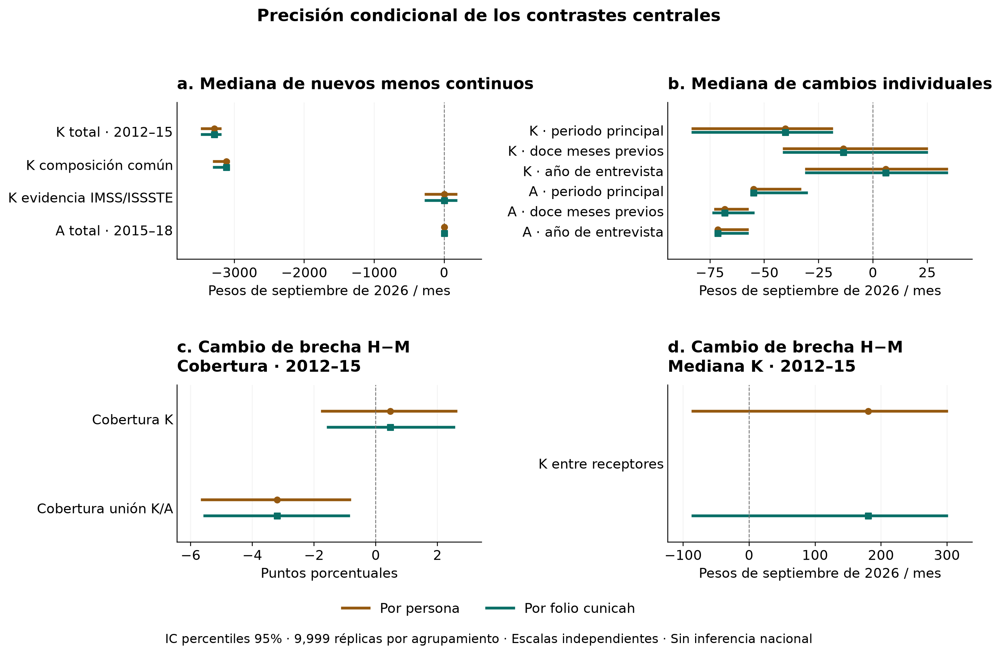

**Nota:** Panel a: cohortes de incorporación con montos de destino; panel b: continuos con dos montos; paneles c–d: cortes directos 60+ de 2012 y 2015. Las escalas monetarias difieren entre paneles para que sean visibles las magnitudes. La cercanía de las dos barras comprueba sensibilidad al agrupamiento observado, sin validar un diseño nacional. A y el subgrupo IMSS/ISSSTE se examinan con más precisión numérica en los cuadros; no se concluye equivalencia.

**Fuente y procedencia:** agregados y definiciones de los notebooks 06–08, sin modificar sus archivos; [validación reproducible de precisión](../data/interim/transiciones_montos_pensionarios/precision.json), [manifiesto, semillas y versiones](../data/interim/transiciones_montos_pensionarios/precision_manifest.json). Ejecución: `python scripts/run_benefit_transitions.py --precision`; 9,999 réplicas por escenario y agrupamiento. Moneda real: septiembre de 2026; INPC oficial de referencia 146.075, conservado de 07.

#### E. Qué añade la comparación frente a los antecedentes más cercanos

**Cuadro 70. Aportación delimitada frente a los tres antecedentes más próximos**

**Pregunta y aporte:** Situar la contribución en la comparación concreta, evitando declarar novedosos conceptos o métodos establecidos.

| Antecedente | Lo que ya estaba estudiado | Qué se añade y qué no se reclama |
| --- | --- | --- |
| DeGraff, Wong y Orozco-Rocha (2018) | ENASEM 2001–2012, 50+; cortes y panel; ingreso y activos, montos reales, fuentes y desigualdad; 12,405/13,946 en cortes y 7,305 longitudinales. Ya diferencia tendencias agregadas y envejecimiento de las mismas personas. | No introducimos esa distinción. Añadimos dos ventanas posteriores y específicas: K 2012–15 y A 2015–18, nuevos/continuos, suma captada íntegra, incertidumbre y contraste institucional. No es una extensión directa de su ingreso total: aquí son prestaciones propias y universos distintos. |
| Perez-Arce, Prados, Meijer y Lee (2021) | ENASEM 2001/2003/2012 y otras encuestas; cobertura e ingreso pensionario, desigualdad por sexo/escolaridad y trayectorias laborales; estimaciones ponderadas y modelos dinámicos. Una definición amplia de cobertura reduce gradientes educativos sin eliminar los de ingreso. | La discordancia acceso/monto y el análisis dinámico no son nuevos. Nuestra adición es el contraste mediano de incorporados/continuos en las dos ventanas, su heterogeneidad K y el nulo mediano A; no atribuir causalidad, adoptar su clasificación contributiva para todo K ni reclamar alcance nacional comparable. |
| García García (2025) | ENASEM 2018, 65+, pensión por jubilación; selección a recepción y descomposiciones de brechas de género, con historia laboral 2001–2018. El estudio no establece la misma brecha significativa para montos que para cobertura. | Nuestra muestra es 60+ y K más amplio; estimamos diferencias de medianas y su cambio 2012–15, en vez de una descomposición del logaritmo de la prestación. El IC del cambio monetario cruza cero: tampoco prueba un ensanchamiento. Selección a recibir pensión en Heckman no equivale a mortalidad o pérdida de seguimiento. |

**Nota:** Comparación de estimandos y ventanas, no un metaanálisis. Se reutiliza la auditoría documental 10.6; los textos de Perez-Arce y García García se cotejaron nuevamente. Las definiciones y ponderadores no son intercambiables con los de esta tesis.

**Fuente y procedencia:** agregados y definiciones de los notebooks 06–08, sin modificar sus archivos; [validación reproducible de precisión](../data/interim/transiciones_montos_pensionarios/precision.json), [manifiesto, semillas y versiones](../data/interim/transiciones_montos_pensionarios/precision_manifest.json). Ejecución: `python scripts/run_benefit_transitions.py --precision`; 9,999 réplicas por escenario y agrupamiento. Moneda real: septiembre de 2026; INPC oficial de referencia 146.075, conservado de 07.

Fuentes verificadas: [DeGraff et al.](https://pmc.ncbi.nlm.nih.gov/articles/PMC6150599/), [Perez-Arce et al., secciones 3 y 4.2, cuadros 4.2.1–4.2.7](https://mrdrc.isr.umich.edu/wp-content/uploads/2024/04/wp439.pdf), [García García, metodología y resultados](https://repositorio.colmex.mx/downloads/p5547w027?locale=es). No se identificó en estos tres antecedentes el mismo contraste mediano nuevos/continuos para nuestras dos ventanas con la batería de precisión actual. Esto delimita una diferencia frente a los trabajos cotejados, no demuestra prioridad frente a toda la literatura existente.

**Aportación defendible para Actuaría y Ciencia de Datos.** Una contribución empírica y de medición: preservar titularidad, eventos y desconocidos; distinguir incorporación de continuidad y niveles transversales de cambios personales; valorar importes en moneda homogénea; mantener dependencia longitudinal y exponer lo que cambian composición, instituciones, fechas y selección. La parte actuarial reside en delimitar quién sobrevive y permanece observable y en comparar recursos reales, con supuestos y límites explícitos. La precisión fortalece el contraste K y la caída A observada, pero no demuestra mecanismos de elección, monto normativo, elegibilidad administrativa, cotización previa o suficiencia de recursos totales. La investigación sostiene una tesis descriptiva con aportación específica; la originalidad debe presentarse como ampliación y contraste de evidencia previa, sin prometer una explicación general de veinte años.

#### F. Conjunto reducido para la redacción definitiva

**Cuadro 71. Propuesta de cinco cuadros y cuatro figuras para el núcleo de resultados**

**Pregunta y aporte:** Preparar un argumento académico breve conservando nulos, contraejemplos y sensibilidad.

| Producto final propuesto | Procedencia actual | Conclusión que documenta | Límite que debe acompañarla |
| --- | --- | --- | --- |
| C 1 · Acceso y exclusión | Cuadros 39/48; figura 44 | Cobertura propia K/A y negativas/ND de cada corte; ventana monetaria K 2012–15 y A 2015–18. En 2021, 3,000 ambas negativas y 58 ND entre 9,424 directas 60+. | Mantener rupturas de K/A visibles; tendencias por ventanas válidas. Sin CI de diseño, convergencia nacional o primeras altas inferidas. |
| C 2 · Monto y referencia económica | Cuadros 46/48; misma figura 44 | Nominal/real y denominadores de 07; caída mediana K −11.05% en 2012–15 y A −5.84% en 2015–18, contraejemplo K +27.09% en 2018–21. A 5/2021 prestación/LPI mediana 43.66%. | Cuantías mensuales de receptoras; la línea per cápita es referencia de prestación parcial, no pobreza personal. A 5/2021 no se traslada a A general longitudinal. |
| C 3 · Nuevos/continuos e instituciones | Primer cuadro de 10.7 + cuadro 56; figura 46 | K bruto/ajustado/IMSS-ISSSTE y A, con N, IC y faltantes. Contraste K grande; subgrupo institucional y A incluyen cero. | Solo K 2012–15/A 2015–18. No distribuye montos por institución, explica causalmente una caída o prueba equivalencia en los nulos. |
| C 4 · Cambios personales | Segundo cuadro de 10.7, cuadro 54; figura 47 | Mismos 1,756 K/1,223 A; IC por persona/folio, fechas y cotas por faltantes. K pequeño sensible; A negativo bajo criterios examinados. | No representa toda la cohorte ni identifica continuidad administrativa. Fallecimiento no es un monto faltante imputable. |
| C 5 · Desigualdad por sexo | Tercer cuadro de 10.7; nueva figura de precisión | Unión: cambio−3.19 pp con IC negativo; K monetario cambio+$180.54 con IC que contiene 0. Mantener nulos junto a contrastes precisos. | Cortes dinámicos 2012–15. Sexo no sustituye ajuste por historia laboral y las dos brechas no comparten denominador. |

**Nota:** Es una propuesta editorial, no nuevos archivos ni renumeración de los cuadros de LaTeX. Figuras propuestas 44,46,47 y la nueva de precisión; las cuatro cumplen funciones diferentes. En la redacción se ensamblarán cinco cuadros desde agregados, sin reproducir las 72 tablas acumulativas. Selección por pregunta y comparabilidad, no por valoresp.

**Fuente y procedencia:** agregados y definiciones de los notebooks 06–08, sin modificar sus archivos; [validación reproducible de precisión](../data/interim/transiciones_montos_pensionarios/precision.json), [manifiesto, semillas y versiones](../data/interim/transiciones_montos_pensionarios/precision_manifest.json). Ejecución: `python scripts/run_benefit_transitions.py --precision`; 9,999 réplicas por escenario y agrupamiento. Moneda real: septiembre de 2026; INPC oficial de referencia 146.075, conservado de 07.

**Selección actuarial, como complemento.** Los cuadros 52/57 y figura 45 documentan, en las cohortes basales K/A de 8,888/9,640 personas, 738/771 muertes registradas, 388/928 ausencias de estado vital desconocido y 381/618 sustitutos; un conflicto vital A se conserva separado. Esto limita el alcance de los cambios observados y documenta diferencias por recepción inicial; no ofrece una corrección de sesgo. No se reponderó por observación, se estimó supervivencia ni se imputaron importes posteriores al fallecimiento. Puede ir en un cuadro complementario o anexo, sin convertirse en el eje de la pregunta central.

#### G. Diagnóstico exacto del manuscrito: propuesta previa a editar

**Cuadro 72. Asignación propuesta a los cinco capítulos y contenidos que requieren actualización**

**Pregunta y aporte:** Identificar qué debe cambiar antes de redactar, sin modificar el manuscrito ni desechar contenido histórico único.

La reorganización del argumento reutilizaría los cinco archivos existentes. Se distinguen las afirmaciones históricas que necesitan actualizarse del contenido metodológico y académico que debe conservarse.

| Capítulo existente | Archivo único | Ubicación exacta en el archivo actual | Actualización propuesta y conservación |
| --- | --- | --- | --- |
| 1 · Introducción | [01_introduccion.tex](../manuscrito/capitulos/01_introduccion.tex) | L 4 y 16: orientación y ausencia de pregunta; L 27: objetivos exploratorios; L 44: vulnerabilidad como eje; L 95/125: problema y justificación prospectivos; L 155/172/195/221: pregunta, objetivos, hipótesis y aportaciones anteriores. | Introducir la pregunta autorizada, protección propia/acceso/monto y ventanas válidas. Conservar contexto demográfico; separar como antecedente el contenido predictivo único sin convertirlo en diseño vigente. No afirmar que los datos confirman una hipótesis causal. |
| 2 · Marco teórico y antecedentes | [02_marco_teorico_antecedentes.tex](../manuscrito/capitulos/02_marco_teorico_antecedentes.tex) | L 5–13: revisión anunciada de vulnerabilidad y predicción; L 62: patrimonio/vulnerabilidad; L 103/127/182/222: cronología y clasificación; L 244/266/315: oferta pública y correspondencia ENASEM. | Conservar L 16/40, regímenes e instituciones válidos; distinguir K/A de contributiva/no contributiva, stock de flujo y prestación de ingreso total. Integrar críticamente los tres antecedentes y el aporte acotado; actualizar cronología 07 sin inferir efecto de política. |
| 3 · Datos y metodología | [03_datos_metodologia.tex](../manuscrito/capitulos/03_datos_metodologia.tex) | L 19,350/354/357/371/375: predicción/estimando pendiente; L 633–636 y 749: deflactación/armonización aún pendientes; L 840: homologación; L 943/974: diseño prospectivo/resultado patrimonial; L 1024: estrategia abierta. | Reutilizar L 32/65/95/145/197/229/260/385/465/524/676/711/759: IDs, rondas reales, entrevistas, faltantes y titularidad. Definir universos 06–08, rupturas, moneda INPC, LPI y estimandos/CIs de 10.7. Separar diseño predictivo histórico y no declarar resueltos problemas de medición por haber calculado precios. |
| 4 · Análisis exploratorio y resultados | [04_analisis_exploratorio_resultados.tex](../manuscrito/capitulos/04_analisis_exploratorio_resultados.tex) | L 5–8: pregunta ausente; L 13/36/64/114/145: EDA amplio; L 244/275: continuación y modelos pendientes; L 473/495/525/539–625: resultados pensionarios aún preliminares, precios pendientes en 621. | Organizar por C 1–C 5, no por ocho notebooks: cobertura y exclusión; montos nominales/reales y referencia parcial; incorporación/continuidad e instituciones; cambios personales; sexo. Integración/titularidad de 181/278/399 como respaldo; salud y patrimonio como contexto o anexo, conservando información única. |
| 5 · Discusión y conclusiones | [05_discusion_conclusiones.tex](../manuscrito/capitulos/05_discusion_conclusiones.tex) | L 4–14: borrador y predicción; L 17/21: líneas posibles sin pregunta aprobada; L 23/31/39/47/55/63: agenda dispersa; L 67: precios pendientes. | Responder la pregunta con magnitud e incertidumbre ya verificadas, comparar con antecedentes y reconocer nulos. Separar K y A, mostrar heterogeneidad y límites de observación; no generalizar convergencia, pérdida individual K, causalidad o suficiencia total. Las conclusiones finales requieren revisión editorial de la autora. |

**Nota:** L significa línea del archivo actual, verificada al 14/10/2026; las huellas se conservan en la evidencia. Permanecen cinco capítulos y los anexos existentes; no se crean módulos por sección. También main.tex, líneas 32–33, conserva en portada la afirmación de que no hay pregunta aprobada; deberá alinearse posteriormente. No se modifica ni compila en esta etapa, porque la autora solicitó primero el diagnóstico.

**Fuente y procedencia:** agregados y definiciones de los notebooks 06–08, sin modificar sus archivos; [validación reproducible de precisión](../data/interim/transiciones_montos_pensionarios/precision.json), [manifiesto, semillas y versiones](../data/interim/transiciones_montos_pensionarios/precision_manifest.json). Ejecución: `python scripts/run_benefit_transitions.py --precision`; 9,999 réplicas por escenario y agrupamiento. Moneda real: septiembre de 2026; INPC oficial de referencia 146.075, conservado de 07.

**Secuencia de redacción propuesta.** Primero revisar este cierre de precisión, la corrección interpretativa de la brecha monetaria y el alcance de la originalidad. Después alinear pregunta y estimandos de capítulos 1–3; exportar C 1–C 5 desde los mismos agregados al capítulo 4; redactar capítulo 5 con las conclusiones validadas y los resultados nulos. Finalmente compilar, cotejar citas/referencias y revisar el PDF del manuscrito. No hace falta otro notebook ni una nueva ronda exploratoria para sostener ese núcleo. Una inferencia nacional o un mecanismo causal requerirían otro diseño y validaciones que esta etapa no acredita.

**Fuente y procedencia:** agregados y definiciones de los notebooks 06–08, sin modificar sus archivos; [validación reproducible de precisión](../data/interim/transiciones_montos_pensionarios/precision.json), [manifiesto, semillas y versiones](../data/interim/transiciones_montos_pensionarios/precision_manifest.json). Ejecución: `python scripts/run_benefit_transitions.py --precision`; 9,999 réplicas por escenario y agrupamiento. Moneda real: septiembre de 2026; INPC oficial de referencia 146.075, conservado de 07.

<!-- END precision08 -->

<!-- BEGIN central09 -->

### 10.8 Contraste central: protección previa, desventaja relativa y montos posteriores (etapa 09)

**Estado:** análisis local reproducible solicitado el 23 de octubre de 2026. Esta sección resuelve los cruces declarados pendientes en 10.6–10.7; sus diagnósticos anteriores permanecen como registros fechados. Fuente: `src/tesis_enasem/central_analysis.py`, `central_supplement.py`, notebook 09 y agregados privados `data/interim/incorporacion_proteccion_propia/`. Se verificaron 379 archivos fuente y se reprodujo exactamente la auditoría 08. No se reconstruyó integración, no se modificaron bases ni se agruparon ventanas como observaciones independientes.

**Pregunta y estimandos:** composición P/nuevos, incorporación P/negativos basales reobservados, unión de personas 2012–2015 y diferencias de medianas posteriores P−C. P exige K y A negativas basales; C exige otra afirmativa. R es continuidad de la vía. N observados, monetarios y patrimoniales difieren. Fallecidos, ausentes, sustitutos, conflictos y ND no son negativas. Cortes descriptivos ambas vías en seis rondas; transiciones solo en las seis combinaciones de vía/intervalo ya aprobadas.

**Incertidumbre:** bootstrap 4999 por folio para contrastes principales y 1999 para proporciones, estratos, instituciones, precios y ajuste. Semilla 20261023 y desplazamiento por años guardados por contraste. IC puntuales, exploratorios, sin diseño nacional ni imputación múltiple. Sensibilidad por persona y Wilson guardadas. Folio no certifica hogar actual. No se eligen hallazgos según significancia; empates e intervalos degenerados no equivalen a igualdad distributiva. Umbral 20 por grupo para IC monetarios.

**Patrimonio:** `imp_neto` compartido entrevistado/cónyuge, en unidades almacenadas sin moneda/precios temporalmente homologados. Cuartiles relativos entre directas de 60+ de cada ronda antes de seleccionar seguimiento. Ceros y negativos preservados; no pobreza ni ingreso personal. Montos de prestaciones: todos los eventos captados válidos, nominal por factor oficial 07, septiembre de 2026. A incluye dinero/especie. Sensibilidades temporales no resuelven fechas de pago desconocidas.

#### Recepción propia y monto real en las seis rondas

| Ronda | Vía | Directas 60+ | Conocidas | Sí | No | ND | Mediana real |
| --- | --- | --- | --- | --- | --- | --- | --- |
| 2001 | K | 6,812 | 6,790 | 1,680 | 5,110 | 22 | 3,856.5 |
| 2001 | A | 6,812 | 6,789 | 666 | 6,123 | 23 | 628.6 |
| 2003 | K | 6,970 | 6,894 | 1,760 | 5,134 | 76 | 4,191.9 |
| 2003 | A | 6,970 | 6,894 | 895 | 5,999 | 76 | 703.3 |
| 2012 | K | 8,888 | 8,738 | 2,819 | 5,919 | 150 | 4,233.7 |
| 2012 | A | 8,888 | 8,750 | 1,574 | 7,176 | 138 | 962.2 |
| 2015 | K | 9,640 | 9,504 | 4,159 | 5,345 | 136 | 3,766.0 |
| 2015 | A | 9,640 | 9,513 | 2,630 | 6,883 | 127 | 941.5 |
| 2018 | K | 9,107 | 9,047 | 3,247 | 5,800 | 60 | 4,279.6 |
| 2018 | A | 9,107 | 9,045 | 2,764 | 6,281 | 62 | 886.5 |
| 2021 | K | 9,424 | 9,366 | 3,261 | 6,105 | 58 | 5,438.9 |
| 2021 | A | 9,424 | 9,363 | 4,924 | 4,439 | 61 | 2,107.6 |

Fuente: etapa 09, bases analíticas existentes y eventos originales, muestra no ponderada. P: ambas negativas basales; C: otra vía basal afirmativa; R: continuidad de la vía. No alta administrativa ni inferencia nacional. Mediana entre receptores con todos los importes captados válidos; pesos de septiembre de 2026. Cortes separados, no serie longitudinal homogénea.

#### Composición de las incorporaciones observadas

| Vía/ventana | N nuevos | N P | P (%) | N C | Otra ND |
| --- | --- | --- | --- | --- | --- |
| K 2001--2003 | 298 | 286 | 96.0 | 12 | 0 |
| K 2012--2015 | 1,469 | 1,090 | 74.2 | 376 | 3 |
| K 2018--2021 | 521 | 384 | 73.7 | 137 | 0 |
| A 2003--2012 | 776 | 678 | 87.4 | 98 | 0 |
| A 2012--2015 | 1,512 | 1,210 | 80.0 | 296 | 6 |
| A 2015--2018 | 1,212 | 603 | 49.8 | 606 | 3 |

Fuente: etapa 09, bases analíticas existentes y eventos originales, muestra no ponderada. P: ambas negativas basales; C: otra vía basal afirmativa; R: continuidad de la vía. No alta administrativa ni inferencia nacional.

#### Probabilidad observada de incorporación por situación inicial

| Vía/ventana | Perfil | N basal | N observado | Incorpora | % [IC95 folio] |
| --- | --- | --- | --- | --- | --- |
| K 2001--2003 | P | 4,533 | 3,738 | 286 | 7.7 [6.8; 8.5] |
| K 2001--2003 | C | 576 | 462 | 12 | 2.6 [1.3; 4.1] |
| K 2012--2015 | P | 4,592 | 3,843 | 1,090 | 28.4 [26.8; 29.9] |
| K 2012--2015 | C | 1,323 | 1,063 | 376 | 35.4 [32.2; 38.6] |
| K 2018--2021 | P | 3,368 | 2,700 | 384 | 14.2 [12.9; 15.6] |
| K 2018--2021 | C | 2,422 | 1,821 | 137 | 7.5 [6.3; 8.8] |
| A 2003--2012 | P | 4,368 | 2,388 | 678 | 28.4 [26.5; 30.2] |
| A 2003--2012 | C | 1,631 | 810 | 98 | 12.1 [10.0; 14.3] |
| A 2012--2015 | P | 4,592 | 3,849 | 1,210 | 31.4 [29.9; 33.1] |
| A 2012--2015 | C | 2,562 | 2,089 | 296 | 14.2 [12.6; 15.7] |
| A 2015--2018 | P | 3,253 | 2,497 | 603 | 24.1 [22.5; 25.9] |
| A 2015--2018 | C | 3,622 | 2,735 | 606 | 22.2 [20.5; 23.9] |

Fuente: etapa 09, bases analíticas existentes y eventos originales, muestra no ponderada. P: ambas negativas basales; C: otra vía basal afirmativa; R: continuidad de la vía. No alta administrativa ni inferencia nacional. N observado: respuesta de la vía conocida en ambas visitas y destino directo sin conflicto vital. Porcentaje entre reobservados, no proporción de todos los nuevos. No tasa anual.

#### Características basales de los perfiles de recepción

| Vía/ventana | Perfil | N | Edad med. | Esc. med. | Mujeres % | Q1 % |
| --- | --- | --- | --- | --- | --- | --- |
| K 2001--2003 | P | 286 | 65.0 | 5.0 | 41.3 | 18.9 |
| K 2001--2003 | C | 12 | 66.5 | 2.0 | 8.3 | 8.3 |
| K 2001--2003 | R | 1,204 | 68.0 | 6.0 | 36.8 | 18.9 |
| K 2012--2015 | P | 1,090 | 67.0 | 4.0 | 54.1 | 25.0 |
| K 2012--2015 | C | 376 | 74.0 | 2.0 | 56.9 | 35.1 |
| K 2012--2015 | R | 1,975 | 69.0 | 6.0 | 40.5 | 17.4 |
| K 2018--2021 | P | 384 | 66.0 | 6.0 | 53.4 | 20.3 |
| K 2018--2021 | C | 137 | 73.0 | 6.0 | 65.0 | 24.1 |
| K 2018--2021 | R | 2,079 | 71.0 | 6.0 | 43.6 | 16.2 |
| A 2003--2012 | P | 678 | 67.0 | 2.0 | 61.7 | 27.0 |
| A 2003--2012 | C | 98 | 67.5 | 5.0 | 37.8 | 12.2 |
| A 2003--2012 | R | 285 | 67.0 | 1.0 | 50.9 | 28.8 |
| A 2012--2015 | P | 1,210 | 68.0 | 3.0 | 62.0 | 27.9 |
| A 2012--2015 | C | 296 | 73.0 | 3.0 | 58.1 | 25.7 |
| A 2012--2015 | R | 737 | 73.0 | 2.0 | 55.9 | 33.8 |
| A 2015--2018 | P | 603 | 67.0 | 3.0 | 65.3 | 28.2 |
| A 2015--2018 | C | 606 | 73.0 | 3.0 | 57.3 | 27.7 |
| A 2015--2018 | R | 1,281 | 72.0 | 3.0 | 64.0 | 32.0 |

Fuente: etapa 09, bases analíticas existentes y eventos originales, muestra no ponderada. P: ambas negativas basales; C: otra vía basal afirmativa; R: continuidad de la vía. No alta administrativa ni inferencia nacional. Edad y escolaridad en años; denominadores válidos específicos en agregados y notebook. Q1 definido entre patrimonio válido de directas de 60+ de la ronda basal, no pobreza. Localidad y estados desconocidos se conservan en el informe.

#### Distribución del patrimonio neto basal compartido

| Vía/ventana | Perfil | N válido | Q25 | Mediana | Q75 |
| --- | --- | --- | --- | --- | --- |
| K 2001--2003 | P | 286 | 90.5 | 225.6 | 442.7 |
| K 2001--2003 | C | 12 | 134.2 | 335.7 | 505.4 |
| K 2001--2003 | R | 1,204 | 90.0 | 250.0 | 506.7 |
| K 2012--2015 | P | 1,090 | 176.9 | 505.7 | 1,089.6 |
| K 2012--2015 | C | 376 | 100.4 | 375.9 | 899.8 |
| K 2012--2015 | R | 1,975 | 300.0 | 663.2 | 1,362.9 |
| K 2018--2021 | P | 384 | 307.5 | 734.0 | 1,520.0 |
| K 2018--2021 | C | 137 | 230.0 | 562.0 | 1,535.1 |
| K 2018--2021 | R | 2,079 | 401.5 | 895.0 | 1,764.1 |
| A 2003--2012 | P | 678 | 60.6 | 195.5 | 430.2 |
| A 2003--2012 | C | 98 | 131.2 | 296.5 | 589.4 |
| A 2003--2012 | R | 285 | 60.0 | 170.0 | 486.6 |
| A 2012--2015 | P | 1,210 | 146.7 | 495.0 | 1,007.2 |
| A 2012--2015 | C | 296 | 165.4 | 574.0 | 1,208.7 |
| A 2012--2015 | R | 737 | 103.4 | 398.1 | 947.5 |
| A 2015--2018 | P | 603 | 155.0 | 550.0 | 1,489.3 |
| A 2015--2018 | C | 606 | 154.0 | 535.5 | 1,333.1 |
| A 2015--2018 | R | 1,281 | 117.6 | 457.3 | 1,303.0 |

Fuente: etapa 09, bases analíticas existentes y eventos originales, muestra no ponderada. P: ambas negativas basales; C: otra vía basal afirmativa; R: continuidad de la vía. No alta administrativa ni inferencia nacional. Miles de unidades almacenadas por el proveedor; contrato sin homologación monetaria temporal. No son pesos reales homologados ni ingreso individual. Incluye ceros y negativos; patrimonio del entrevistado y cónyuge, sin sumarlo por hogar. Precisión condicional al producto del proveedor, sin combinar imputaciones múltiples.

#### Montos posteriores por protección basal y continuidad

| Vía/ventana | Perfil | N válido | Q25 | Mediana | Q75 |
| --- | --- | --- | --- | --- | --- |
| K 2001--2003 | P | 278 | 3,657.4 | 4,062.5 | 5,626.7 |
| K 2001--2003 | C | 11 | 3,376.0 | 3,376.0 | 6,189.4 |
| K 2001--2003 | R | 1,175 | 3,657.4 | 4,191.9 | 7,196.6 |
| K 2012--2015 | P | 1,060 | 941.5 | 1,027.1 | 3,937.2 |
| K 2012--2015 | C | 373 | 941.5 | 941.5 | 996.3 |
| K 2012--2015 | R | 1,857 | 3,423.6 | 4,279.6 | 10,270.9 |
| K 2018--2021 | P | 360 | 3,859.6 | 4,895.0 | 9,314.1 |
| K 2018--2021 | C | 132 | 2,107.6 | 4,079.2 | 5,234.9 |
| K 2018--2021 | R | 1,954 | 3,859.6 | 5,438.9 | 13,140.5 |
| A 2003--2012 | P | 666 | 962.2 | 962.2 | 1,443.3 |
| A 2003--2012 | C | 98 | 962.2 | 962.2 | 1,034.4 |
| A 2003--2012 | R | 278 | 962.2 | 962.2 | 1,732.0 |
| A 2012--2015 | P | 1,196 | 855.9 | 941.5 | 1,027.1 |
| A 2012--2015 | C | 286 | 855.9 | 941.5 | 1,690.4 |
| A 2012--2015 | R | 723 | 855.9 | 941.5 | 1,140.1 |
| A 2015--2018 | P | 581 | 840.6 | 886.5 | 1,299.2 |
| A 2015--2018 | C | 589 | 840.6 | 886.5 | 1,528.4 |
| A 2015--2018 | R | 1,245 | 840.6 | 886.5 | 1,528.4 |

Fuente: etapa 09, bases analíticas existentes y eventos originales, muestra no ponderada. P: ambas negativas basales; C: otra vía basal afirmativa; R: continuidad de la vía. No alta administrativa ni inferencia nacional. Pesos mensuales de septiembre de 2026, importe nominal multiplicado por factor del año calendario previo a entrevista real. Suma íntegra solo de eventos captados, no totalidad real. A incluye dinero/especie; no programa homogéneo. Diferencias de captura de la tabla 3.1 se mantienen.

#### Monto posterior por mitad patrimonial y protección basal

| Vía/ventana | Mitad | N P/C | Mediana P | Mediana C | P-C [IC95] |
| --- | --- | --- | --- | --- | --- |
| K 2001--2003 | Inferior | Sin soporte | Reservado | Reservado | No estimable |
| K 2001--2003 | Superior | Sin soporte | Reservado | Reservado | No estimable |
| K 2012--2015 | Inferior | 553/230 | 992.9 | 941.5 | 51.4 [8.6; 68.5] |
| K 2012--2015 | Superior | 507/143 | 1,985.7 | 941.5 | 1,044.2 [492.1; 2,482.1] |
| K 2018--2021 | Inferior | 176/71 | 4,740.3 | 4,079.2 | 661.1 [37.7; 1,149.4] |
| K 2018--2021 | Superior | 184/61 | 5,438.9 | 4,079.2 | 1,359.7 [564.7; 2,175.6] |
| A 2003--2012 | Inferior | 372/42 | 962.2 | 962.2 | 0.0 [0.0; 0.0] |
| A 2003--2012 | Superior | 294/56 | 962.2 | 962.2 | 0.0 [0.0; 0.0] |
| A 2012--2015 | Inferior | 661/133 | 941.5 | 941.5 | 0.0 [0.0; 0.0] |
| A 2012--2015 | Superior | 535/153 | 941.5 | 941.5 | 0.0 [-51.4; 0.0] |
| A 2015--2018 | Inferior | 316/321 | 886.5 | 886.5 | 0.0 [-39.7; 7.6] |
| A 2015--2018 | Superior | 265/268 | 878.8 | 886.5 | -7.6 [-38.2; 34.4] |

Fuente: auditoría 10, insumos01--09 intactos. Muestra sin ponderación; IC condicionales, sin inferencia nacional o causal. P: primera vía observada; C: otra vía basal afirmativa. Se conserva la evaluación por cuartiles en privado; la simplificación no rescata la ventana escasa.

#### Diferencia de medianas posteriores: P menos C

| Vía/ventana | N P/C | Cruda [IC95] | Mezcla común [IC95] | Retención % |
| --- | --- | --- | --- | --- |
| K 2001--2003 | 278/11 | No estimado | No estimado | 0/0 |
| K 2012--2015 | 1,060/373 | 85.6 [51.4; 409.8] | No estimado | 57/90 |
| K 2018--2021 | 360/132 | 815.8 [543.9; 1,324.3] | No estimado | 20/50 |
| A 2003--2012 | 666/98 | 0.0 [0.0; 0.0] | No estimado | 0/0 |
| A 2012--2015 | 1,196/286 | 0.0 [0.0; 0.0] | No estimado | 51/79 |
| A 2015--2018 | 581/589 | 0.0 [-30.6; 7.6] | -7.6 [-38.2; 7.6] | 73/89 |

Fuente: etapa 09, bases analíticas existentes y eventos originales, muestra no ponderada. P: ambas negativas basales; C: otra vía basal afirmativa; R: continuidad de la vía. No alta administrativa ni inferencia nacional. Pesos reales. Crudo: bootstrap folio 4999. Mezcla común: sexo×edad de tres grupos×escolaridad 0–5/6+, 1999 réplicas y CDF inversa. Mínimo 20 por grupo/celda, 4 celdas y 70% de cada grupo completo antes de excluir covariables ND. No estimado si falta soporte; no se extrapola. Crudo y ajustado pueden usar poblaciones y convenciones distintas; crudo del mismo soporte en agregados.

#### Incorporación desde ambas negativas según patrimonio basal

| Vía/ventana | Q1 % | Q4 % | Q1−Q4 pp [IC95] | Ajustada pp [IC95] |
| --- | --- | --- | --- | --- |
| K 2001--2003 | 5.5 | 8.9 | -3.4 [-5.8; -1.0] | -0.5 [-3.0; 2.1] |
| K 2012--2015 | 29.0 | 27.4 | 1.6 [-2.8; 5.7] | 0.5 [-4.0; 4.8] |
| K 2018--2021 | 11.1 | 15.7 | -4.6 [-8.2; -0.9] | -4.0 [-7.6; -0.4] |
| A 2003--2012 | 33.2 | 22.7 | 10.4 [4.9; 16.1] | 6.8 [0.3; 13.1] |
| A 2012--2015 | 35.8 | 27.9 | 7.9 [3.5; 12.4] | 4.0 [-0.6; 8.6] |
| A 2015--2018 | 28.4 | 21.1 | 7.3 [2.3; 12.4] | 6.2 [0.7; 11.5] |

Fuente: etapa 09, bases analíticas existentes y eventos originales, muestra no ponderada. P: ambas negativas basales; C: otra vía basal afirmativa; R: continuidad de la vía. No alta administrativa ni inferencia nacional. Tasas entre reobservados con recepción conocida. Q1/Q4 relativos dentro de ronda. Ajuste descriptivo de sexo, edad y escolaridad a mezcla combinada en soporte común; no causal ni ponderación ENASEM. IC puntuales por folio. Cambio de soporte y ajuste no son el mismo estimando; véase auditoría en agregados.

#### Heterogeneidad institucional del contraste P menos C

| Vía/ventana | Evidencia destino | N P/C | Diferencia real [IC95] |
| --- | --- | --- | --- |
| K 2012--2015 | IMSS/ISSSTE | 406/27 | 513.5 [0.0; 984.3] |
| K 2012--2015 | Programa agrupado | 599/326 | 0.0 [0.0; 0.0] |
| K 2012--2015 | Un evento IMSS | 305/20 | 428.0 [0.0; 684.7] |
| K 2018--2021 | IMSS/ISSSTE | 309/79 | 679.9 [-40.0; 1,087.8] |
| K 2018--2021 | Un evento IMSS | 259/68 | 271.9 [-193.1; 679.9] |
| A 2015--2018 | A: INAPAM | 163/155 | -30.6 [-45.9; 34.4] |
| A 2015--2018 | A: Otra institución | 217/257 | 0.0 [-7.6; 7.6] |
| A 2015--2018 | A: PROSPERA | 149/119 | -15.3 [-45.9; 30.6] |

Fuente: etapa 09, bases analíticas existentes y eventos originales, muestra no ponderada. P: ambas negativas basales; C: otra vía basal afirmativa; R: continuidad de la vía. No alta administrativa ni inferencia nacional. IC folio 1999. Evidencia K puede solaparse: no sumar filas ni asignar el importe a cada institución. Un evento exige un solo evento captado; IMSS/ISSSTE no identifica régimen. A solo 2018: nombres reportados, no programa longitudinal homologado ni A 5 retrospectivo. Celdas inferiores a 20 no generan IC.

#### Seguimiento de cohortes negativas y límites de observación

| Vía/ventana | Perfil | N basal | Fallecido | Ausente | Cota % sin D |
| --- | --- | --- | --- | --- | --- |
| K 2001--2003 | P | 4,533 | 239 | 223 | 6.7--19.6 |
| K 2001--2003 | C | 576 | 22 | 22 | 2.2--18.8 |
| K 2012--2015 | P | 4,592 | 319 | 199 | 25.5--35.6 |
| K 2012--2015 | C | 1,323 | 145 | 26 | 31.9--41.7 |
| K 2018--2021 | P | 3,368 | 304 | 184 | 12.5--24.4 |
| K 2018--2021 | C | 2,422 | 337 | 55 | 6.6--19.2 |
| A 2003--2012 | P | 4,368 | 1,165 | 400 | 21.2--46.6 |
| A 2003--2012 | C | 1,631 | 504 | 201 | 8.7--36.8 |
| A 2012--2015 | P | 4,592 | 319 | 199 | 28.3--38.2 |
| A 2012--2015 | C | 2,562 | 214 | 150 | 12.6--23.6 |
| A 2015--2018 | P | 3,253 | 194 | 374 | 19.7--38.1 |
| A 2015--2018 | C | 3,622 | 273 | 382 | 18.1--36.4 |

Fuente: etapa 09, bases analíticas existentes y eventos originales, muestra no ponderada. P: ambas negativas basales; C: otra vía basal afirmativa; R: continuidad de la vía. No alta administrativa ni inferencia nacional. Cota sin D: entre quienes no tienen fallecimiento registrado, incorporar a todos los destinos no clasificables o a ninguno. No acredita que ausentes estén vivos ni incidencia previa a morir. Fallecimientos quedan separados, sin imputar recepción post mortem. Sustitutos, ND y conflictos separados en informe y agregados.

#### Unión K/A 2012–2015: personas únicas

En 2012--2015, la única ventana conjunta K/A admitida, 2,188 de 3,846 personas con ambas negativas basales y unión conocida al destino incorporan al menos una vía: 56.9% (IC95 por folio 55.3--58.6%). La cohorte basal contiene 4,592 personas; 746 quedan fuera de ese denominador observado. Permanecen con ambas negativas 1,658. Inician ambas vías 112, contadas una sola vez en la unión. No se suman las incorporaciones K y A. Los restantes destinos son: 319 fallecido registrado, 199 ausente; vital desconocido, 186 sustituto vivo; fuera del principal, 42 unión nd al destino. No se clasifican como negativas de recepción.

#### Interpretación conjunta y contraejemplos

A presenta gradientes crudos Q1−Q4 positivos, pero la auditoría 10.9 muestra sensibilidad de A 2015–2018 al agrupar edades y de K 2018–2021 al soporte mínimo. A 2012–2015 incluye cero ajustado; A 2003–2012 mantiene señal en variantes viables con seguimiento selectivo. No se sostiene una dirección universal ni una focalización por necesidad integral.

En K 2012–2015, P tiene mayor patrimonio mediano y escolaridad que C y es más joven; no corresponde al perfil de mayor desventaja de esos dos grupos. En A 2015–2018, las diferencias patrimoniales y escolares son imprecisas/cero, pero P es más joven. El patrimonio mediano mayor no implica ingreso mayor, liquidez o menor necesidad individual.

Los montos P−C son positivos en K 2012–2015 y 2018–2021, con IC crudos por folio que excluyen cero. En K 2001–2003 C es demasiado pequeño para el contraste. A tiene medianas P/C coincidentes; se conservan los nulos y los empates. Estratos K por sexo/edad e instituciones cambian el tamaño y la precisión. No se han realizado pruebas formales de interacción. Solo A 2015–2018 alcanza soporte monetario ajustado suficiente; cinco contrastes se declaran no estimados, sin reducir umbrales ni extrapolar08.

La cobertura histórica por sexo y los contrastes09 muestran que ampliar recepción no garantiza cierre monetario. La evidencia no demuestra una ley general ni un efecto de políticas. La asociación de desventaja con incorporación depende de vía, ventana y estimando. Solo la ventana conjunta permite cuantificar expansión de unión sin doble conteo.

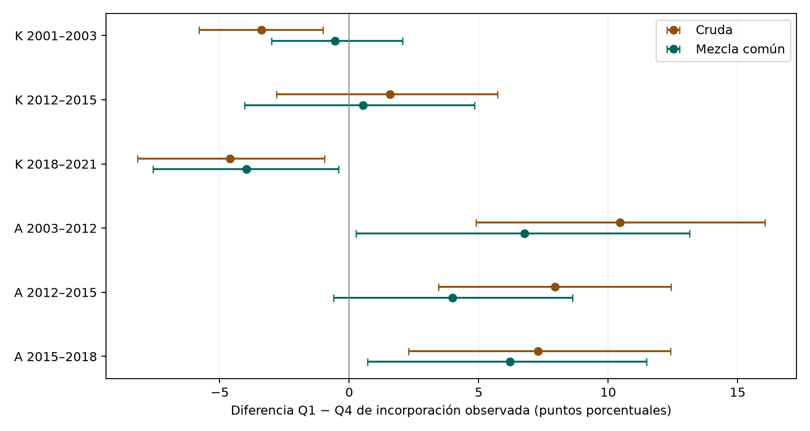

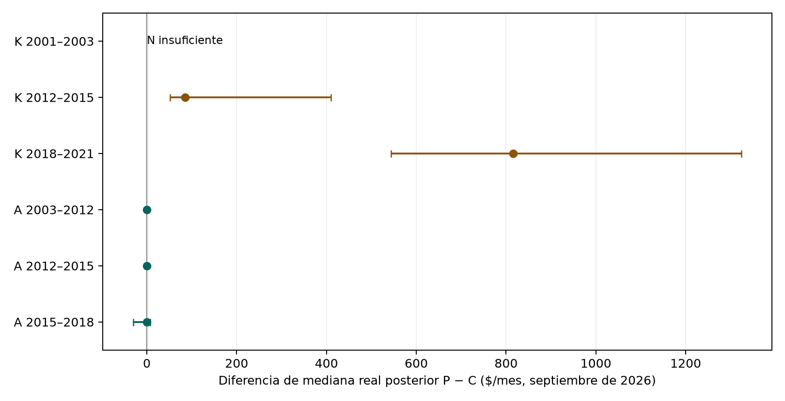

#### Evidencia exhaustiva por grupo y selección

Las siguientes tablas permiten verificar también perfiles desconocidos, fallecidos y ausentes sin trasladarlos al denominador observado. Sexo, edad, escolaridad y localidad son iniciales; patrimonio y montos tienen titulares/unidades diferentes. Porcentajes de perfil incluyen categoría desconocida. Cada grupo informa N, patrimonio válido con Q25/mediana/Q75, monto real válido con Q25/mediana/Q75 y composición completa en los agregados; los cuadros siguientes muestran la síntesis de esas variables para todos los estados.

**K 2001--2003 · todos los destinos basales**

| Grupo | N | Patrimonio válido | P Q25/med/Q75 | Edad med | Esc med | Mujeres % | Localidad basal | Monto válido | Monto real Q25/med/Q75 |
| --- | --- | --- | --- | --- | --- | --- | --- | --- | --- |
| Sustituto vivo; fuera del principal | 468 | 462 | 42,259.4/176,516.1/409,804.6 | 69.0 | 2.0 | 48.9 | ≥100 mil habitantes: 52.4%; <100 mil habitantes: 47.6% | 43 | 3,446.4/3,938.7/6,752.1 |
| No→No | 3,903 | 3,903 | 50,000.0/173,000.0/405,417.6 | 67.0 | 2.0 | 61.5 | <100 mil habitantes: 50.4%; ≥100 mil habitantes: 49.6% | 0 | ND/ND/ND |
| Incorporación desde ambas negativas | 286 | 286 | 90,500.0/225,582.4/442,710.5 | 65.0 | 5.0 | 41.3 | ≥100 mil habitantes: 76.2%; <100 mil habitantes: 23.8% | 278 | 3,657.4/4,062.5/5,626.7 |
| Continuidad de la vía | 1,204 | 1,204 | 90,000.0/250,000.0/506,692.3 | 68.0 | 6.0 | 36.8 | ≥100 mil habitantes: 73.0%; <100 mil habitantes: 27.0% | 1,175 | 3,657.4/4,191.9/7,196.6 |
| Fallecido registrado | 361 | 361 | 25,350.0/140,000.0/345,000.0 | 73.0 | 2.0 | 47.9 | ≥100 mil habitantes: 59.0%; <100 mil habitantes: 41.0% | 0 | ND/ND/ND |
| Ausente; vital desconocido | Reservado | Reservado | Reservado | Reservado | Reservado | Reservado | Reservado | Reservado | Reservado |
| Sí→No | 164 | 164 | 95,164.4/263,519.4/532,320.2 | 69.0 | 4.0 | 51.8 | ≥100 mil habitantes: 71.3%; <100 mil habitantes: 28.7% | 0 | ND/ND/ND |
| Recepción ND en alguna visita | 72 | 63 | 82,500.0/194,428.1/404,513.8 | 69.0 | 2.5 | 66.7 | ≥100 mil habitantes: 62.5%; <100 mil habitantes: 37.5% | 2 | 5,494.5/7,883.1/10,271.6 |
| Incorporación con otra vía basal | 12 | 12 | 134,183.1/335,700.0/505,445.0 | 66.5 | 2.0 | 8.3 | <100 mil habitantes: 75.0%; ≥100 mil habitantes: 25.0% | 11 | 3,376.0/3,376.0/6,189.4 |

**Desglose del seguimiento por perfil inicialmente negativo**

| Perfil | Destino | N |
| --- | --- | --- |
| Ambas negativas | No→No | 3,452 |
| Ambas negativas | Sustituto vivo; fuera del principal | 300 |
| Ambas negativas | No→Sí | 286 |
| Ambas negativas | Fallecido registrado | 239 |
| Ambas negativas | Ausente; vital desconocido | 223 |
| Ambas negativas | Recepción ND en alguna visita | 33 |
| Otra vía basal | No→No | 450 |
| Otra vía basal | Sustituto vivo; fuera del principal | 62 |
| Otra vía basal | Ausente; vital desconocido | 22 |
| Otra vía basal | Fallecido registrado | 22 |
| Otra vía basal | No→Sí | 12 |
| Otra vía basal | Recepción ND en alguna visita | 8 |

**Otra vía al destino: no equivale a continuidad conjunta**

| Perfil | N | Otra sí | Otra no | Otra ND |
| --- | --- | --- | --- | --- |
| Incorporación desde ambas negativas | 286 | 17 | 269 | 0 |
| Incorporación con otra vía basal | 12 | 4 | 8 | 0 |

**Sensibilidad por informante/edad**

| Criterio | N nuevos | Desde ambas negativas | Otra basal sí |
| --- | --- | --- | --- |
| Incluye sustituto destino | 308 | 295 | 13 |
| Edad destino60+ | 298 | 286 | 12 |

**Precios alternativos, diferencia mediana P−C**

| Criterio | Diferencia [IC95 folio] |
| --- | --- |
| factor_12m | No estimado |
| factor_ano_entrevista | No estimado |

**Cotas por importes faltantes entre receptores observados P−C:** 422.0 a 815.9 pesos reales. No son IC ni asignan montos a ausentes o fallecidos.

**Auditoría de soporte y ajuste:**

| Estimando | N inicial P/C o Q1/Q4 | N soporte | Crudo mismo soporte | Ajustado [IC95] |
| --- | --- | --- | --- | --- |
| ajuste_tasa | [977, 864] | [938, 797] | -2.8 | -0.5 [-3.0; 2.1] |
| ajuste_monto | [278, 11] | [0, 0] | ND | No estimado |

**Estratos completos de contraste monetario P−C**

| Dimensión | Categoría | N P/C | Diferencia real [IC95] |
| --- | --- | --- | --- |
| sexo_grupo | Hombre | 161/10 | No estimado |
| sexo_grupo | Mujer | 117/1 | No estimado |
| edad_06 | 60–64 | 129/1 | No estimado |
| edad_06 | 65–69 | 63/6 | No estimado |
| edad_06 | 70+ | 86/4 | No estimado |
| educacion_grupo | 0 años | 45/3 | No estimado |
| educacion_grupo | 1–5 años | 100/7 | No estimado |
| educacion_grupo | 6 años | 64/1 | No estimado |
| educacion_grupo | 7–9 años | 41/0 | No estimado |
| educacion_grupo | Desconocido | 0/0 | No estimado |
| educacion_grupo | ≥10 años | 28/0 | No estimado |
| patrimonio_grupo | Desconocido | 0/0 | No estimado |
| patrimonio_grupo | Q1 | 53/1 | No estimado |
| patrimonio_grupo | Q2 | 71/4 | No estimado |
| patrimonio_grupo | Q3 | 83/3 | No estimado |
| patrimonio_grupo | Q4 | 71/3 | No estimado |

**K 2012--2015 · todos los destinos basales**

| Grupo | N | Patrimonio válido | P Q25/med/Q75 | Edad med | Esc med | Mujeres % | Localidad basal | Monto válido | Monto real Q25/med/Q75 |
| --- | --- | --- | --- | --- | --- | --- | --- | --- | --- |
| Fallecido registrado | 738 | 738 | 110,211.3/429,841.7/1,004,500.0 | 75.0 | 3.0 | 48.6 | ≥100 mil habitantes: 56.1%; <100 mil habitantes: 43.9% | 0 | ND/ND/ND |
| Sí→No | 311 | 311 | 152,211.7/517,617.7/1,046,011.8 | 71.0 | 3.0 | 58.2 | ≥100 mil habitantes: 65.9%; <100 mil habitantes: 34.1% | 0 | ND/ND/ND |
| Recepción ND en alguna visita | 186 | 186 | 68,500.0/535,229.5/985,936.4 | 71.0 | 3.0 | 58.1 | ≥100 mil habitantes: 55.9%; <100 mil habitantes: 44.1% | 31 | 1,069.9/3,766.0/6,830.2 |
| Continuidad de la vía | 1,975 | 1,975 | 300,000.0/663,153.8/1,362,871.2 | 69.0 | 6.0 | 40.5 | ≥100 mil habitantes: 72.2%; <100 mil habitantes: 27.8% | 1,857 | 3,423.6/4,279.6/10,270.9 |
| Persistencia sin ambas vías | 1,658 | 1,658 | 231,064.1/600,944.8/1,264,998.6 | 64.0 | 6.0 | 62.9 | ≥100 mil habitantes: 65.0%; <100 mil habitantes: 35.0% | 0 | ND/ND/ND |
| Sustituto vivo; fuera del principal | 381 | 381 | 99,788.5/417,327.2/1,035,000.0 | 76.0 | 3.0 | 58.3 | ≥100 mil habitantes: 54.1%; <100 mil habitantes: 45.9% | 42 | 1,027.1/3,423.6/6,205.4 |
| No→No | 1,782 | 1,782 | 118,863.9/428,747.4/930,591.0 | 69.0 | 3.0 | 61.7 | <100 mil habitantes: 55.7%; ≥100 mil habitantes: 44.3% | 0 | ND/ND/ND |
| Ausente; vital desconocido | Reservado | Reservado | Reservado | Reservado | Reservado | Reservado | Reservado | Reservado | Reservado |
| Incorporación desde ambas negativas | 1,090 | 1,090 | 176,906.3/505,668.4/1,089,620.4 | 67.0 | 4.0 | 54.1 | ≥100 mil habitantes: 54.8%; <100 mil habitantes: 45.2% | 1,060 | 941.5/1,027.1/3,937.2 |
| Incorporación con otra vía basal | 376 | 376 | 100,375.0/375,881.1/899,775.5 | 74.0 | 2.0 | 56.9 | <100 mil habitantes: 81.4%; ≥100 mil habitantes: 18.6% | 373 | 941.5/941.5/996.3 |
| Incorporación con otra vía ND | Reservado | Reservado | Reservado | Reservado | Reservado | Reservado | Reservado | Reservado | Reservado |

**Desglose del seguimiento por perfil inicialmente negativo**

| Perfil | Destino | N |
| --- | --- | --- |
| Ambas negativas | No→No | 2,753 |
| Ambas negativas | No→Sí | 1,090 |
| Ambas negativas | Fallecido registrado | 319 |
| Ambas negativas | Ausente; vital desconocido | 199 |
| Ambas negativas | Sustituto vivo; fuera del principal | 186 |
| Ambas negativas | Recepción ND en alguna visita | 45 |
| Otra vía basal | No→No | 687 |
| Otra vía basal | No→Sí | 376 |
| Otra vía basal | Fallecido registrado | 145 |
| Otra vía basal | Sustituto vivo; fuera del principal | 72 |
| Otra vía basal | Ausente; vital desconocido | 26 |
| Otra vía basal | Recepción ND en alguna visita | 17 |

**Otra vía al destino: no equivale a continuidad conjunta**

| Perfil | N | Otra sí | Otra no | Otra ND |
| --- | --- | --- | --- | --- |
| Incorporación desde ambas negativas | 1090 | 112 | 978 | 0 |
| Incorporación con otra vía basal | 376 | 130 | 244 | 2 |

**Sensibilidad por informante/edad**

| Criterio | N nuevos | Desde ambas negativas | Otra basal sí |
| --- | --- | --- | --- |
| Incluye sustituto destino | 1492 | 1109 | 380 |
| Edad destino60+ | 1469 | 1090 | 376 |

**Precios alternativos, diferencia mediana P−C**

| Criterio | Diferencia [IC95 folio] |
| --- | --- |
| factor_12m | 81.7 [50.2; 395.3] |
| factor_ano_entrevista | 83.3 [50.0; 395.8] |

**Cotas por importes faltantes entre receptores observados P−C:** 85.6 a 85.6 pesos reales. No son IC ni asignan montos a ausentes o fallecidos.

**Auditoría de soporte y ajuste:**

| Estimando | N inicial P/C o Q1/Q4 | N soporte | Crudo mismo soporte | Ajustado [IC95] |
| --- | --- | --- | --- | --- |
| ajuste_tasa | [943, 950] | [942, 941] | 1.6 | 0.5 [-4.0; 4.8] |
| ajuste_monto | [1060, 373] | [603, 336] | ND | No estimado |

**Estratos completos de contraste monetario P−C**

| Dimensión | Categoría | N P/C | Diferencia real [IC95] |
| --- | --- | --- | --- |
| sexo_grupo | Hombre | 478/160 | 1,112.7 [492.1; 2,482.1] |
| sexo_grupo | Mujer | 582/213 | 51.4 [8.6; 51.4] |
| edad_06 | 60–64 | 295/25 | 2,482.1 [1,626.2; 2,824.5] |
| edad_06 | 65–69 | 388/72 | 51.4 [8.6; 85.6] |
| edad_06 | 70+ | 377/276 | 51.4 [17.1; 85.6] |
| educacion_grupo | 0 años | 233/152 | 0.0 [0.0; 42.8] |
| educacion_grupo | 1–5 años | 377/162 | 51.4 [0.0; 51.4] |
| educacion_grupo | 6 años | 249/40 | 834.5 [25.5; 2,439.6] |
| educacion_grupo | 7–9 años | 113/17 | No estimado |
| educacion_grupo | Desconocido | 6/1 | No estimado |
| educacion_grupo | ≥10 años | 82/1 | No estimado |
| patrimonio_grupo | Q1 | 271/132 | 42.8 [0.0; 51.4] |
| patrimonio_grupo | Q2 | 282/98 | 85.6 [8.6; 813.1] |
| patrimonio_grupo | Q3 | 263/79 | 1,027.1 [85.6; 2,482.1] |
| patrimonio_grupo | Q4 | 244/64 | 1,031.4 [214.0; 2,482.1] |

**K 2018--2021 · todos los destinos basales**

| Grupo | N | Patrimonio válido | P Q25/med/Q75 | Edad med | Esc med | Mujeres % | Localidad basal | Monto válido | Monto real Q25/med/Q75 |
| --- | --- | --- | --- | --- | --- | --- | --- | --- | --- |
| No→No | 4,009 | 4,009 | 165,000.0/600,000.0/1,262,166.5 | 69.0 | 4.0 | 64.5 | <100 mil habitantes: 52.6%; ≥100 mil habitantes: 47.4% | 0 | ND/ND/ND |
| Continuidad de la vía | 2,079 | 2,079 | 401,500.0/895,000.0/1,764,101.1 | 71.0 | 6.0 | 43.6 | ≥100 mil habitantes: 71.8%; <100 mil habitantes: 28.2% | 1,954 | 3,859.6/5,438.9/13,140.5 |
| Sustituto vivo; fuera del principal | 599 | 598 | 140,000.0/689,546.8/1,324,725.1 | 75.0 | 3.0 | 58.4 | ≥100 mil habitantes: 51.1%; <100 mil habitantes: 48.9% | 172 | 3,535.3/5,088.5/11,053.0 |
| Fallecido registrado | 1,069 | 1,069 | 179,260.1/658,291.7/1,453,523.6 | 76.0 | 3.0 | 48.1 | ≥100 mil habitantes: 55.2%; <100 mil habitantes: 44.8% | 0 | ND/ND/ND |
| Sí→No | 375 | 375 | 197,500.0/703,188.8/1,500,000.0 | 73.0 | 3.0 | 55.5 | ≥100 mil habitantes: 53.6%; <100 mil habitantes: 46.4% | 0 | ND/ND/ND |
| Ausente; vital desconocido | Reservado | Reservado | Reservado | Reservado | Reservado | Reservado | Reservado | Reservado | Reservado |
| Recepción ND en alguna visita | 60 | 50 | 127,445.4/551,948.0/1,368,142.5 | 65.5 | 6.0 | 30.0 | ≥100 mil habitantes: 65.0%; <100 mil habitantes: 35.0% | 11 | 4,101.7/6,118.8/11,871.5 |
| Incorporación desde ambas negativas | 384 | 384 | 307,500.0/733,999.2/1,520,000.0 | 66.0 | 6.0 | 53.4 | ≥100 mil habitantes: 70.6%; <100 mil habitantes: 29.4% | 360 | 3,859.6/4,895.0/9,314.1 |
| Incorporación con otra vía basal | 137 | 137 | 230,000.0/562,000.0/1,535,124.9 | 73.0 | 6.0 | 65.0 | ≥100 mil habitantes: 50.4%; <100 mil habitantes: 49.6% | 132 | 2,107.6/4,079.2/5,234.9 |

**Desglose del seguimiento por perfil inicialmente negativo**

| Perfil | Destino | N |
| --- | --- | --- |
| Ambas negativas | No→No | 2,316 |
| Ambas negativas | No→Sí | 384 |
| Ambas negativas | Fallecido registrado | 304 |
| Ambas negativas | Ausente; vital desconocido | 184 |
| Ambas negativas | Sustituto vivo; fuera del principal | 175 |
| Ambas negativas | Recepción ND en alguna visita | 5 |
| Otra vía basal | No→No | 1,684 |
| Otra vía basal | Fallecido registrado | 337 |
| Otra vía basal | Sustituto vivo; fuera del principal | 204 |
| Otra vía basal | No→Sí | 137 |
| Otra vía basal | Ausente; vital desconocido | 55 |
| Otra vía basal | Recepción ND en alguna visita | 5 |

**Otra vía al destino: no equivale a continuidad conjunta**

| Perfil | N | Otra sí | Otra no | Otra ND |
| --- | --- | --- | --- | --- |
| Incorporación desde ambas negativas | 384 | 165 | 219 | 0 |
| Incorporación con otra vía basal | 137 | 95 | 42 | 0 |

**Sensibilidad por informante/edad**

| Criterio | N nuevos | Desde ambas negativas | Otra basal sí |
| --- | --- | --- | --- |
| Incluye sustituto destino | 559 | 412 | 147 |
| Edad destino60+ | 521 | 384 | 137 |

**Precios alternativos, diferencia mediana P−C**

| Criterio | Diferencia [IC95 folio] |
| --- | --- |
| factor_12m | 858.4 [517.7; 1,294.2] |
| factor_ano_entrevista | 771.9 [514.6; 1,157.9] |

**Cotas por importes faltantes entre receptores observados P−C:** 679.9 a 1,077.4 pesos reales. No son IC ni asignan montos a ausentes o fallecidos.

**Auditoría de soporte y ajuste:**

| Estimando | N inicial P/C o Q1/Q4 | N soporte | Crudo mismo soporte | Ajustado [IC95] |
| --- | --- | --- | --- | --- |
| ajuste_tasa | [705, 645] | [697, 639] | -4.9 | -4.0 [-7.6; -0.4] |
| ajuste_monto | [360, 132] | [71, 66] | ND | No estimado |

**Estratos completos de contraste monetario P−C**

| Dimensión | Categoría | N P/C | Diferencia real [IC95] |
| --- | --- | --- | --- |
| sexo_grupo | Hombre | 167/45 | 1,359.7 [644.4; 2,611.3] |
| sexo_grupo | Mujer | 193/87 | 423.7 [136.0; 1,013.9] |
| edad_06 | 60–64 | 131/12 | No estimado |
| edad_06 | 65–69 | 114/25 | 733.5 [0.0; 3,062.3] |
| edad_06 | 70+ | 115/95 | 136.0 [-136.0; 679.9] |
| educacion_grupo | 0 años | 28/20 | 713.9 [-679.9; 2,243.5] |
| educacion_grupo | 1–5 años | 89/44 | 271.9 [0.0; 1,497.4] |
| educacion_grupo | 6 años | 92/41 | -144.4 [-1,021.2; 815.8] |
| educacion_grupo | 7–9 años | 85/19 | No estimado |
| educacion_grupo | Desconocido | 5/0 | No estimado |
| educacion_grupo | ≥10 años | 61/8 | No estimado |
| patrimonio_grupo | Desconocido | 0/0 | No estimado |
| patrimonio_grupo | Q1 | 73/31 | 642.4 [-219.6; 1,495.7] |
| patrimonio_grupo | Q2 | 103/40 | 679.9 [-136.0; 2,076.0] |
| patrimonio_grupo | Q3 | 91/23 | 1,087.8 [-1,768.3; 2,039.6] |
| patrimonio_grupo | Q4 | 93/38 | 1,677.1 [543.9; 3,755.8] |

**A 2003--2012 · todos los destinos basales**

| Grupo | N | Patrimonio válido | P Q25/med/Q75 | Edad med | Esc med | Mujeres % | Localidad basal | Monto válido | Monto real Q25/med/Q75 |
| --- | --- | --- | --- | --- | --- | --- | --- | --- | --- |
| No→No | 2,422 | 2,422 | 100,575.0/291,954.8/568,691.0 | 65.0 | 3.0 | 55.4 | ≥100 mil habitantes: 67.7%; <100 mil habitantes: 32.3% | 0 | ND/ND/ND |
| Fallecido registrado | 1,941 | 1,937 | 46,854.4/199,400.0/463,813.3 | 73.0 | 2.0 | 47.2 | ≥100 mil habitantes: 54.7%; <100 mil habitantes: 45.3% | 0 | ND/ND/ND |
| Ausente; vital desconocido | Reservado | Reservado | Reservado | Reservado | Reservado | Reservado | Reservado | Reservado | Reservado |
| Sí→No | 231 | 231 | 81,218.7/254,284.9/530,731.8 | 67.0 | 2.0 | 56.7 | <100 mil habitantes: 67.1%; ≥100 mil habitantes: 32.9% | 0 | ND/ND/ND |
| Recepción ND en alguna visita | 105 | 99 | 89,469.2/237,259.2/518,573.5 | 70.0 | 2.0 | 68.6 | <100 mil habitantes: 52.4%; ≥100 mil habitantes: 47.6% | 8 | 481.1/962.2/962.2 |
| Continuidad de la vía | 285 | 285 | 60,000.0/170,000.0/486,569.5 | 67.0 | 1.0 | 50.9 | <100 mil habitantes: 88.8%; ≥100 mil habitantes: 11.2% | 278 | 962.2/962.2/1,732.0 |
| Incorporación desde ambas negativas | 678 | 678 | 60,564.0/195,490.4/430,240.0 | 67.0 | 2.0 | 61.7 | <100 mil habitantes: 61.2%; ≥100 mil habitantes: 38.8% | 666 | 962.2/962.2/1,443.3 |
| Sustituto vivo; fuera del principal | 564 | 562 | 50,000.0/200,000.0/500,000.0 | 71.0 | 2.0 | 58.9 | <100 mil habitantes: 51.4%; ≥100 mil habitantes: 48.6% | 23 | 962.2/962.2/962.2 |
| Incorporación con otra vía basal | 98 | 98 | 131,229.8/296,500.6/589,370.5 | 67.5 | 5.0 | 37.8 | <100 mil habitantes: 51.0%; ≥100 mil habitantes: 49.0% | 98 | 962.2/962.2/1,034.4 |

**Desglose del seguimiento por perfil inicialmente negativo**

| Perfil | Destino | N |
| --- | --- | --- |
| Ambas negativas | No→No | 1,710 |
| Ambas negativas | Fallecido registrado | 1,165 |
| Ambas negativas | No→Sí | 678 |
| Ambas negativas | Ausente; vital desconocido | 400 |
| Ambas negativas | Sustituto vivo; fuera del principal | 369 |
| Ambas negativas | Recepción ND en alguna visita | 46 |
| Otra vía basal | No→No | 712 |
| Otra vía basal | Fallecido registrado | 504 |
| Otra vía basal | Ausente; vital desconocido | 201 |
| Otra vía basal | Sustituto vivo; fuera del principal | 102 |
| Otra vía basal | No→Sí | 98 |
| Otra vía basal | Recepción ND en alguna visita | 14 |

**Otra vía al destino: no equivale a continuidad conjunta**

| Perfil | N | Otra sí | Otra no | Otra ND |
| --- | --- | --- | --- | --- |
| Incorporación desde ambas negativas | 678 | 62 | 616 | 0 |
| Incorporación con otra vía basal | 98 | 84 | 14 | 0 |

**Sensibilidad por informante/edad**

| Criterio | N nuevos | Desde ambas negativas | Otra basal sí |
| --- | --- | --- | --- |
| Incluye sustituto destino | 795 | 695 | 100 |
| Edad destino60+ | 775 | 677 | 98 |

**Precios alternativos, diferencia mediana P−C**

| Criterio | Diferencia [IC95 folio] |
| --- | --- |
| factor_12m | 0.0 [0.0; 3.5] |
| factor_ano_entrevista | 0.0 [0.0; 0.0] |

**Cotas por importes faltantes entre receptores observados P−C:** 0.0 a 0.0 pesos reales. No son IC ni asignan montos a ausentes o fallecidos.

**Auditoría de soporte y ajuste:**

| Estimando | N inicial P/C o Q1/Q4 | N soporte | Crudo mismo soporte | Ajustado [IC95] |
| --- | --- | --- | --- | --- |
| ajuste_tasa | [552, 555] | [500, 439] | 10.1 | 6.8 [0.3; 13.1] |
| ajuste_monto | [666, 98] | [0, 0] | ND | No estimado |

**Estratos completos de contraste monetario P−C**

| Dimensión | Categoría | N P/C | Diferencia real [IC95] |
| --- | --- | --- | --- |
| sexo_grupo | Hombre | 255/61 | 0.0 [0.0; 0.0] |
| sexo_grupo | Mujer | 411/37 | 0.0 [0.0; 0.0] |
| edad_06 | 60–64 | 222/29 | 0.0 [-837.1; 0.0] |
| edad_06 | 65–69 | 216/37 | 0.0 [0.0; 0.0] |
| edad_06 | 70+ | 228/32 | 0.0 [0.0; 0.0] |
| educacion_grupo | 0 años | 254/13 | No estimado |
| educacion_grupo | 1–5 años | 286/37 | 0.0 [0.0; 0.0] |
| educacion_grupo | 6 años | 90/26 | 0.0 [0.0; 0.0] |
| educacion_grupo | 7–9 años | 26/13 | No estimado |
| educacion_grupo | Desconocido | 3/0 | No estimado |
| educacion_grupo | ≥10 años | 7/9 | No estimado |
| patrimonio_grupo | Desconocido | 0/0 | No estimado |
| patrimonio_grupo | Q1 | 178/12 | No estimado |
| patrimonio_grupo | Q2 | 194/30 | 0.0 [0.0; 0.0] |
| patrimonio_grupo | Q3 | 172/29 | 0.0 [0.0; 0.0] |
| patrimonio_grupo | Q4 | 122/27 | 0.0 [0.0; 0.0] |

**A 2012--2015 · todos los destinos basales**

| Grupo | N | Patrimonio válido | P Q25/med/Q75 | Edad med | Esc med | Mujeres % | Localidad basal | Monto válido | Monto real Q25/med/Q75 |
| --- | --- | --- | --- | --- | --- | --- | --- | --- | --- |
| Fallecido registrado | 738 | 738 | 110,211.3/429,841.7/1,004,500.0 | 75.0 | 3.0 | 48.6 | ≥100 mil habitantes: 56.1%; <100 mil habitantes: 43.9% | 0 | ND/ND/ND |
| Incorporación con otra vía basal | 296 | 296 | 165,387.0/574,009.0/1,208,655.5 | 73.0 | 3.0 | 58.1 | ≥100 mil habitantes: 56.1%; <100 mil habitantes: 43.9% | 286 | 855.9/941.5/1,690.4 |
| Recepción ND en alguna visita | 169 | 169 | 68,000.0/520,465.5/1,015,000.0 | 72.0 | 3.0 | 56.2 | ≥100 mil habitantes: 52.1%; <100 mil habitantes: 47.9% | 27 | 855.9/941.5/1,014.3 |
| No→No | 2,785 | 2,785 | 250,300.0/600,000.0/1,250,000.0 | 68.0 | 6.0 | 45.5 | ≥100 mil habitantes: 70.2%; <100 mil habitantes: 29.8% | 0 | ND/ND/ND |
| Persistencia sin ambas vías | 1,658 | 1,658 | 231,064.1/600,944.8/1,264,998.6 | 64.0 | 6.0 | 62.9 | ≥100 mil habitantes: 65.0%; <100 mil habitantes: 35.0% | 0 | ND/ND/ND |
| Sustituto vivo; fuera del principal | 381 | 381 | 99,788.5/417,327.2/1,035,000.0 | 76.0 | 3.0 | 58.3 | ≥100 mil habitantes: 54.1%; <100 mil habitantes: 45.9% | 37 | 855.9/941.5/1,027.1 |
| Sí→No | 520 | 520 | 122,293.1/405,870.6/867,902.5 | 74.0 | 2.0 | 56.3 | <100 mil habitantes: 61.9%; ≥100 mil habitantes: 38.1% | 0 | ND/ND/ND |
| Incorporación desde ambas negativas | 1,210 | 1,210 | 146,693.4/495,037.8/1,007,245.3 | 68.0 | 3.0 | 62.0 | <100 mil habitantes: 50.1%; ≥100 mil habitantes: 49.9% | 1,196 | 855.9/941.5/1,027.1 |
| Continuidad de la vía | 737 | 737 | 103,404.3/398,136.7/947,504.9 | 73.0 | 2.0 | 55.9 | <100 mil habitantes: 76.1%; ≥100 mil habitantes: 23.9% | 723 | 855.9/941.5/1,140.1 |
| Ausente; vital desconocido | Reservado | Reservado | Reservado | Reservado | Reservado | Reservado | Reservado | Reservado | Reservado |
| Incorporación con otra vía ND | Reservado | Reservado | Reservado | Reservado | Reservado | Reservado | Reservado | Reservado | Reservado |

**Desglose del seguimiento por perfil inicialmente negativo**

| Perfil | Destino | N |
| --- | --- | --- |
| Ambas negativas | No→No | 2,639 |
| Ambas negativas | No→Sí | 1,210 |
| Ambas negativas | Fallecido registrado | 319 |
| Ambas negativas | Ausente; vital desconocido | 199 |
| Ambas negativas | Sustituto vivo; fuera del principal | 186 |
| Ambas negativas | Recepción ND en alguna visita | 39 |
| Otra vía basal | No→No | 1,793 |
| Otra vía basal | No→Sí | 296 |
| Otra vía basal | Fallecido registrado | 214 |
| Otra vía basal | Ausente; vital desconocido | 150 |
| Otra vía basal | Sustituto vivo; fuera del principal | 91 |
| Otra vía basal | Recepción ND en alguna visita | 18 |

**Otra vía al destino: no equivale a continuidad conjunta**

| Perfil | N | Otra sí | Otra no | Otra ND |
| --- | --- | --- | --- | --- |
| Incorporación desde ambas negativas | 1210 | 112 | 1094 | 4 |
| Incorporación con otra vía basal | 296 | 162 | 134 | 0 |

**Sensibilidad por informante/edad**

| Criterio | N nuevos | Desde ambas negativas | Otra basal sí |
| --- | --- | --- | --- |
| Incluye sustituto destino | 1535 | 1228 | 300 |
| Edad destino60+ | 1511 | 1209 | 296 |

**Precios alternativos, diferencia mediana P−C**

| Criterio | Diferencia [IC95 folio] |
| --- | --- |
| factor_12m | 0.0 [-1.9; 1.9] |
| factor_ano_entrevista | 0.0 [0.0; 0.0] |

**Cotas por importes faltantes entre receptores observados P−C:** 0.0 a 0.0 pesos reales. No son IC ni asignan montos a ausentes o fallecidos.

**Auditoría de soporte y ajuste:**

| Estimando | N inicial P/C o Q1/Q4 | N soporte | Crudo mismo soporte | Ajustado [IC95] |
| --- | --- | --- | --- | --- |
| ajuste_tasa | [944, 951] | [943, 942] | 7.9 | 4.0 [-0.6; 8.6] |
| ajuste_monto | [1196, 286] | [610, 225] | ND | No estimado |

**Estratos completos de contraste monetario P−C**

| Dimensión | Categoría | N P/C | Diferencia real [IC95] |
| --- | --- | --- | --- |
| sexo_grupo | Hombre | 454/117 | -5.1 [-59.9; 0.0] |
| sexo_grupo | Mujer | 742/169 | 0.0 [0.0; 0.0] |
| edad_06 | 60–64 | 283/23 | 85.6 [-25.7; 171.2] |
| edad_06 | 65–69 | 479/63 | 0.0 [-25.7; 85.6] |
| edad_06 | 70+ | 434/200 | 0.0 [-42.8; 0.0] |
| educacion_grupo | 0 años | 297/72 | 0.0 [0.0; 0.0] |
| educacion_grupo | 1–5 años | 490/115 | 0.0 [0.0; 0.0] |
| educacion_grupo | 6 años | 256/50 | 0.0 [-85.6; 38.5] |
| educacion_grupo | 7–9 años | 99/33 | -684.7 [-770.3; 42.8] |
| educacion_grupo | Desconocido | 6/2 | No estimado |
| educacion_grupo | ≥10 años | 48/14 | No estimado |
| patrimonio_grupo | Q1 | 333/73 | 0.0 [0.0; 60.1] |
| patrimonio_grupo | Q2 | 328/60 | 0.0 [0.0; 5.1] |
| patrimonio_grupo | Q3 | 276/80 | 0.0 [-51.4; 0.0] |
| patrimonio_grupo | Q4 | 259/73 | -42.8 [-72.8; 0.0] |

**A 2015--2018 · todos los destinos basales**

| Grupo | N | Patrimonio válido | P Q25/med/Q75 | Edad med | Esc med | Mujeres % | Localidad basal | Monto válido | Monto real Q25/med/Q75 |
| --- | --- | --- | --- | --- | --- | --- | --- | --- | --- |
| Sí→No | 721 | 721 | 177,792.5/600,000.0/1,576,446.9 | 71.0 | 3.0 | 55.1 | <100 mil habitantes: 50.9%; ≥100 mil habitantes: 49.1% | 0 | ND/ND/ND |
| No→No | 4,026 | 4,026 | 278,030.9/678,565.9/1,859,953.8 | 67.0 | 6.0 | 52.9 | ≥100 mil habitantes: 68.8%; <100 mil habitantes: 31.2% | 0 | ND/ND/ND |
| Fallecido registrado | 771 | 769 | 160,000.0/505,000.0/1,130,000.0 | 76.0 | 3.0 | 46.4 | ≥100 mil habitantes: 51.2%; <100 mil habitantes: 48.8% | 0 | ND/ND/ND |
| Continuidad de la vía | 1,281 | 1,281 | 117,620.0/457,328.5/1,303,000.0 | 72.0 | 3.0 | 64.0 | <100 mil habitantes: 62.9%; ≥100 mil habitantes: 37.1% | 1,245 | 840.6/886.5/1,528.4 |
| Incorporación desde ambas negativas | 603 | 603 | 155,000.0/550,000.0/1,489,303.7 | 67.0 | 3.0 | 65.3 | <100 mil habitantes: 51.1%; ≥100 mil habitantes: 48.9% | 581 | 840.6/886.5/1,299.2 |
| Sustituto vivo; fuera del principal | 618 | 618 | 168,738.2/563,112.9/1,731,562.8 | 75.0 | 3.0 | 57.3 | <100 mil habitantes: 50.6%; ≥100 mil habitantes: 49.4% | 221 | 840.6/886.5/1,528.4 |
| Ausente; vital desconocido | Reservado | Reservado | Reservado | Reservado | Reservado | Reservado | Reservado | Reservado | Reservado |
| Recepción ND en alguna visita | 82 | 75 | 151,500.0/667,603.0/3,069,061.9 | 71.0 | 4.0 | 51.2 | ≥100 mil habitantes: 50.0%; <100 mil habitantes: 50.0% | 18 | 773.5/1,108.1/1,750.0 |
| Incorporación con otra vía basal | 606 | 606 | 154,029.5/535,500.0/1,333,069.6 | 73.0 | 3.0 | 57.3 | <100 mil habitantes: 64.0%; ≥100 mil habitantes: 36.0% | 589 | 840.6/886.5/1,528.4 |
| Incorporación con otra vía ND | Reservado | Reservado | Reservado | Reservado | Reservado | Reservado | Reservado | Reservado | Reservado |
| Conflicto de estado vital registrado | Reservado | Reservado | Reservado | Reservado | Reservado | Reservado | Reservado | Reservado | Reservado |

**Desglose del seguimiento por perfil inicialmente negativo**

| Perfil | Destino | N |
| --- | --- | --- |
| Ambas negativas | No→No | 1,894 |
| Ambas negativas | No→Sí | 603 |
| Ambas negativas | Ausente; vital desconocido | 374 |
| Ambas negativas | Fallecido registrado | 194 |
| Ambas negativas | Sustituto vivo; fuera del principal | 176 |
| Ambas negativas | Recepción ND en alguna visita | 12 |
| Otra vía basal | No→No | 2,129 |
| Otra vía basal | No→Sí | 606 |
| Otra vía basal | Ausente; vital desconocido | 382 |
| Otra vía basal | Fallecido registrado | 273 |
| Otra vía basal | Sustituto vivo; fuera del principal | 229 |
| Otra vía basal | Recepción ND en alguna visita | 3 |

**Otra vía al destino: no equivale a continuidad conjunta**

| Perfil | N | Otra sí | Otra no | Otra ND |
| --- | --- | --- | --- | --- |
| Incorporación desde ambas negativas | 603 | 39 | 564 | 0 |
| Incorporación con otra vía basal | 606 | 140 | 465 | 1 |

**Sensibilidad por informante/edad**

| Criterio | N nuevos | Desde ambas negativas | Otra basal sí |
| --- | --- | --- | --- |
| Incluye sustituto destino | 1312 | 637 | 672 |
| Edad destino60+ | 1211 | 602 | 606 |

**Precios alternativos, diferencia mediana P−C**

| Criterio | Diferencia [IC95 folio] |
| --- | --- |
| factor_12m | 0.0 [-26.1; 4.1] |
| factor_ano_entrevista | 0.0 [-29.1; 7.3] |

**Cotas por importes faltantes entre receptores observados P−C:** -7.6 a 0.0 pesos reales. No son IC ni asignan montos a ausentes o fallecidos.

**Auditoría de soporte y ajuste:**

| Estimando | N inicial P/C o Q1/Q4 | N soporte | Crudo mismo soporte | Ajustado [IC95] |
| --- | --- | --- | --- | --- |
| ajuste_tasa | [599, 621] | [533, 559] | 7.6 | 6.2 [0.7; 11.5] |
| ajuste_monto | [581, 589] | [426, 523] | -7.6 | -7.6 [-38.2; 7.6] |

**Estratos completos de contraste monetario P−C**

| Dimensión | Categoría | N P/C | Diferencia real [IC95] |
| --- | --- | --- | --- |
| sexo_grupo | Hombre | 197/249 | 0.0 [-30.6; 7.6] |
| sexo_grupo | Mujer | 384/340 | -7.6 [-45.9; 7.6] |
| edad_06 | 60–64 | 133/12 | No estimado |
| edad_06 | 65–69 | 231/173 | 0.0 [-30.6; 34.6] |
| edad_06 | 70+ | 217/404 | -7.6 [-45.9; 0.0] |
| educacion_grupo | 0 años | 141/176 | 0.0 [-34.4; 7.8] |
| educacion_grupo | 1–5 años | 225/229 | -45.9 [-45.9; 0.0] |
| educacion_grupo | 6 años | 128/122 | 0.0 [-45.9; 36.0] |
| educacion_grupo | 7–9 años | 55/39 | 0.0 [-81.0; 45.9] |
| educacion_grupo | Desconocido | 4/2 | No estimado |
| educacion_grupo | ≥10 años | 28/21 | 68.8 [-855.9; 840.6] |
| patrimonio_grupo | Desconocido | 0/0 | No estimado |
| patrimonio_grupo | Q1 | 166/165 | -3.8 [-45.9; 22.9] |
| patrimonio_grupo | Q2 | 150/156 | 0.0 [-45.9; 7.6] |
| patrimonio_grupo | Q3 | 141/145 | -22.9 [-45.9; 38.2] |
| patrimonio_grupo | Q4 | 124/123 | 0.0 [-30.6; 38.2] |

#### Matriz de objetivos, análisis, tablas y conclusiones

| Objetivo | Análisis | Tabla/evidencia | Conclusión y límite |
| --- | --- | --- | --- |
| 1. Distinguir vías propias/cónyuge/A 5 | 06–07, recepción 09 y coexistencia | Rondas y superposiciones; tabla 3.1 | Demostrado operacionalmente; A 5 solo 2021, cónyuge no recurso propio |
| 2. Cobertura y diferencias sociodemográficas | Seis cortes 06–07 y tasas 09 | Rondas, perfiles, gradiente | Descritas ambas vías; sin representatividad nacional |
| 3. Montos nominales/reales y referencia parcial | 07, dinero 09 y sensibilidad precios | Montos, diferencias, cuadros LPI previos | Poder adquisitivo operativo; no pobreza o ingreso total |
| 4. Primera vía y otra vía basal | Seis ventanas y unión 2012–2015 | Composición, riesgo y unión | Composición y probabilidad distintas; sin alta administrativa |
| 5. Nuevos/continuos e instituciones | 08 precisión +09 P/C/R e institución destino | Montos, diferencias, instituciones | Heterogeneidad demostrada; no atribución causal ni reparto por institución |
| 6. Condiciones socioeconómicas y monto posterior | 09 cruce basal conjunto, estratos y mezcla común | Perfiles, patrimonio, gradiente, diferencias | Asociaciones específicas; cinco ajustes monetarios sin soporte |
| 7. Transversal frente a cambio personal | 08/10.7 conservados, cortes 09 | Cuadros de continuidad y cambios previos | Estimandos distintos; cambios individuales no inferidos de cortes |
| 8. Mortalidad/ausencia/información insuficiente | 05,08 y particiones/cotas09 | Selección y todos los destinos | Observabilidad cuantificada; recepción no observada y antes de morir no identificadas |

**Partes sin respuesta:** pobreza y necesidad económica integral; efectos causales; ingreso total personal/familiar; primera alta administrativa; continuidad entre visitas; programas homogéneos antes de identificación; crecimiento patrimonial real; inferencia nacional; recepción/montos de ausentes o antes de morir; mediana P/C ajustada en cinco ventanas por falta de soporte. Estas carencias son límites explícitos, no resultados inventados.

<!-- END central09 -->

### 10.9 Auditoría de calidad estadística y divulgación (etapa 10)

**Alcance y conservación.** Se censaron 126 cuadros y 50 figuras del informe original; 71 archivos LaTeX de cuadros/macros, activos y auxiliares; fuentes01–09 y 222 tablas EDA externas. El registro privado contiene 135,029 nodos de conteos/estadísticos: **no son ese número de contrastes independientes**. Frecuencias por valor, exclusiones, eventos y N de estimación se separan. Los originales completos, incluido el PDF de 88 páginas y las versiones previas de las figuras, están en la instantánea privada inmutable; no se alteran microdatos ni stash. La edición actual es la versión pública corregida.

**Cierre del filtro y de la publicación.** Se restauró la figura de cambios reales individuales de continuos (figura 47 del informe): N=1,756/1,223 pares principales y 1,183/1,103 en sensibilidades. El filtro anterior leía el separador LaTeX de miles como final del número. La comparación de decisiones sobre las fuentes originales encontró un único bloque LaTeX afectado indebidamente, ninguna estimación recalculada y ningún párrafo Markdown afectado por ese error. Las estadísticas originales se conservan. Los exportadores históricos están bloqueados para evitar sobrescribir salidas revisadas y el flujo de GitHub ya no hace publicaciones automáticas. El manifiesto público define también los retiros propuestos de archivos ya rastreados; excluirlos de una carpeta no equivale a retirarlos de Git. La auditoría aplicada de familias, formatos y rutas se registra en el manifiesto de cierre y sus límites no se confunden con una garantía frente a información externa arbitraria. El historial anterior queda separado, sin reescritura.

**Embudo exacto central.** Hay336 embudos de vía/intervalo/perfil/estrato con N de cohorte, categoría basal, presencia al destino, entrevista directa, ausencia de conflicto vital, recepción conocida/afirmativa, todos los montos captados válidos y factor de precios. Se concilian con 09; IDs únicos y LEFT1:1, sin pérdida nueva por programación detectada. Se preservan las alertas originales del proveedor; ello no certifica toda la integración histórica. Cada fila de intervalo es una persona, pero un evento no es una persona y las ventanas se solapan: las cinco cohortes suman41,417 personas-intervalo y solo 16,447 personas únicas.

**Criterios distintos.** N <10 impide divulgar estadísticas monetarias o perfiles continuos del grupo y no permite una conclusión poblacional. N 10–29 activa revisión de dispersión, IC, empates, influencia y estabilidad. N ≥30 tampoco acredita representatividad, precisión o causalidad. Son criterios operativos conservadores de esta tesis, no mínimos universales de ENASEM ni certificación legal. Las condiciones de acceso MHAS prohíben intentar identificar participantes y redistribuir bases a terceros; la documentación oficial de confidencialidad INEGI exige protección de identificación. No se encontró en las fuentes consultadas una regla universal10/30. Véase [política documentada](../diccionarios/politica_calidad_divulgacion.json).

**Resultado central conservado.** Unión K/A 2012–2015: 2,188/3,846 reobservados desde ambas negativas, 56.9%, IC por folio 9999 réplicas [55.3; 58.5]%. La cohorte inicial es4,592. Dos semillas y la omisión de cada folio mantienen el resultado: máximo cambio de 0.030 puntos porcentuales. Esto evalúa precisión condicional, no corrige la selección de los 746 destinos no incluidos en el denominador observado.

**Causas y efecto científico.** K 2001–2003 contiene 12 receptores C y 11 importes: solo un monto falta; no existe una pérdida masiva que justifique relajar filtros. La rareza de otra vía basal, la baja incorporación K y su subdivisión por cuartiles explican las celdas de 1–4. Incluso al pasar a mitades el contraste sigue sin soporte: se retira de conclusiones direccionales. No se une con otras ventanas. T8 contextual2021 cruza escolaridad detallada y titularidad K; además seleccionaba máximos/mínimos de medianas y trataba ND como perfil. Se reformula uniformemente a0–5/6+ y titularidad conocida, con todos los grupos, sin escoger extremos; los originales siguen privados.

**Sensibilidad que cambia la redacción.** El gradiente patrimonial A 2015–2018 es positivo bajo edad 3/celda20, pero incluye cero con edad 2 y soporte revisado. K 2018–2021 conserva dirección puntual negativa, aunque edad 3/celda30 incluye cero. Por tanto, no se presentan sus signos como hallazgos incondicionales. A 2003–2012 mantiene señal positiva en las especificaciones viables, con seguimiento selectivo y la especificación fina/celda30 sin retención suficiente. A 2012–2015 incluye cero ajustado. Los nulos y contraejemplos se conservan. Los IC de medianas A que colapsan a cero se explican por empates, no por equivalencia distributiva. La diferencia cruda P−C K reciente conserva dirección positiva con dos semillas, rangos binomiales y omisión de folios, pero el extremo superior del IC K 2012–2015 es sensible al remuestreo: no se exagera precisión de su magnitud.

#### Precisión monetaria P menos C y estabilidad de remuestreo

| Vía/ventana | N P/C | IC semilla1 | IC semilla2 | Evaluación |
| --- | --- | --- | --- | --- |
| K 2001--2003 | 278/11 | No confiable | No confiable | Sin soporte direccional |
| K 2012--2015 | 1,060/373 | [51.4; 668.3] | [51.4; 409.1] | Dirección cruda estable |
| K 2018--2021 | 360/132 | [543.9; 1,324.3] | [543.9; 1,281.3] | Dirección cruda estable |
| A 2003--2012 | 666/98 | [0.0; 0.0] | [0.0; 0.0] | Condicional; empates |
| A 2012--2015 | 1,196/286 | [0.0; 0.0] | [0.0; 0.0] | Condicional; empates |
| A 2015--2018 | 581/589 | [-30.6; 7.6] | [-30.6; 7.6] | Medianas coincidentes |

Fuente: auditoría 10, insumos01--09 intactos. Muestra sin ponderación; IC condicionales, sin inferencia nacional o causal. P: primera vía observada; C: otra vía basal afirmativa. 9999 réplicas por folio y dos semillas. Se muestran estimación e IC. Los intervalos por orden e influencia están en el informe. La diferencia K 2001--2003 no se usa como conclusión direccional aunque pueda calcularse.

#### Sensibilidad del gradiente patrimonial de incorporación

| Vía/ventana | Edad3/celda20 pp | Edad2/celda30 pp | N soporte Q1/Q4 |
| --- | --- | --- | --- |
| K 2001--2003 | -0.5 [-3.1; 1.9] | -0.8 [-3.2; 1.7] | 956/831 |
| K 2012--2015 | 0.5 [-4.0; 5.0] | 0.3 [-4.2; 4.9] | 918/894 |
| K 2018--2021 | -4.0 [-7.7; -0.4] | -4.0 [-7.6; -0.4] | 668/596 |
| A 2003--2012 | 6.8 [0.3; 13.2] | 6.9 [0.9; 13.3] | 527/499 |
| A 2012--2015 | 4.0 [-0.8; 8.6] | 4.0 [-1.0; 8.8] | 919/895 |
| A 2015--2018 | 6.2 [0.7; 11.6] | 4.7 [-0.8; 10.2] | 508/490 |

Fuente: auditoría 10, insumos01--09 intactos. Muestra sin ponderación; IC condicionales, sin inferencia nacional o causal. P: primera vía observada; C: otra vía basal afirmativa. Q1 menos Q4 entre negativas K/A reobservadas; sexo y escolaridad se mantienen. Edad2=60--69/70+, edad 3=60--64/65--69/70+. Cambian soporte y mezcla, no es la misma población. Todas las cuatro especificaciones están en el informe; no se elige por significancia.

#### Monto posterior por mitad patrimonial y protección basal

| Vía/ventana | Mitad | N P/C | Mediana P | Mediana C | P-C [IC95] |
| --- | --- | --- | --- | --- | --- |
| K 2001--2003 | Inferior | Sin soporte | Reservado | Reservado | No estimable |
| K 2001--2003 | Superior | Sin soporte | Reservado | Reservado | No estimable |
| K 2012--2015 | Inferior | 553/230 | 992.9 | 941.5 | 51.4 [8.6; 68.5] |
| K 2012--2015 | Superior | 507/143 | 1,985.7 | 941.5 | 1,044.2 [492.1; 2,482.1] |
| K 2018--2021 | Inferior | 176/71 | 4,740.3 | 4,079.2 | 661.1 [37.7; 1,149.4] |
| K 2018--2021 | Superior | 184/61 | 5,438.9 | 4,079.2 | 1,359.7 [564.7; 2,175.6] |
| A 2003--2012 | Inferior | 372/42 | 962.2 | 962.2 | 0.0 [0.0; 0.0] |
| A 2003--2012 | Superior | 294/56 | 962.2 | 962.2 | 0.0 [0.0; 0.0] |
| A 2012--2015 | Inferior | 661/133 | 941.5 | 941.5 | 0.0 [0.0; 0.0] |
| A 2012--2015 | Superior | 535/153 | 941.5 | 941.5 | 0.0 [-51.4; 0.0] |
| A 2015--2018 | Inferior | 316/321 | 886.5 | 886.5 | 0.0 [-39.7; 7.6] |
| A 2015--2018 | Superior | 265/268 | 878.8 | 886.5 | -7.6 [-38.2; 34.4] |

Fuente: auditoría 10, insumos01--09 intactos. Muestra sin ponderación; IC condicionales, sin inferencia nacional o causal. P: primera vía observada; C: otra vía basal afirmativa. Se conserva la evaluación por cuartiles en privado; la simplificación no rescata la ventana escasa.

#### Reformulación del contexto patrimonial por escolaridad y titularidad,2021

| Titularidad K | Esc. años | N | Q25 | Mediana | Q75 |
| --- | --- | --- | --- | --- | --- |
| Ambas | 0–5 | 84 | 419.9 | 805.6 | 1,088.3 |
| Ambas | 6+ | 384 | 800.0 | 1,580.0 | 2,769.7 |
| Ambas negativas K | 0–5 | 3,251 | 90.0 | 450.0 | 1,000.0 |
| Ambas negativas K | 6+ | 2,377 | 152.0 | 650.0 | 1,382.7 |
| Solo cónyuge | 0–5 | 385 | 400.0 | 800.0 | 1,505.0 |
| Solo cónyuge | 6+ | 677 | 530.0 | 1,050.0 | 2,022.0 |
| Solo propia | 0–5 | 996 | 224.9 | 650.8 | 1,222.5 |
| Solo propia | 6+ | 2,067 | 400.0 | 914.3 | 1,800.7 |

Fuente: EDA original 60+ por visita, incluidas modalidades originales; no es la población principal directa09. Patrimonio compartido, miles de unidades almacenadas, no pesos reales. Escolaridad0--5/6+; titularidad o escolaridad ND quedan como exclusiones. Se presentan todos los grupos, no máximos seleccionados.

#### Soporte de los contrastes institucionales P menos C

| Vía/ventana | Institución | N P/C | Diferencia [IC95] | Uso |
| --- | --- | --- | --- | --- |
| K 2001--2003 | Evidencia IMSS/ISSSTE | 244/<10 | No estimable | No confiable |
| K 2001--2003 | Programas agrupados | 0/0 | No estimable | No confiable |
| K 2001--2003 | Un evento IMSS | 214/<10 | No estimable | No confiable |
| K 2001--2003 | Un evento ISSSTE | 25/<10 | No estimable | No confiable |
| K 2012--2015 | Evidencia IMSS/ISSSTE | 406/27 | 513.5 [0.0; 1,027.1] | Exploratorio 10–29 |
| K 2012--2015 | Programas agrupados | 599/326 | 0.0 [0.0; 0.0] | Sin equivalencia |
| K 2012--2015 | Un evento IMSS | 305/20 | 428.0 [0.0; 684.7] | Exploratorio 10–29 |
| K 2012--2015 | Un evento ISSSTE | 63/<10 | No estimable | No confiable |
| K 2018--2021 | Evidencia IMSS/ISSSTE | 309/79 | 679.9 [-61.2; 1,087.8] | Exploratorio |
| K 2018--2021 | Programas agrupados | 0/0 | No estimable | No confiable |
| K 2018--2021 | Un evento IMSS | 259/68 | 271.9 [-192.4; 679.9] | Exploratorio |
| K 2018--2021 | Un evento ISSSTE | 33/10 | No estimable | No confiable |

Fuente: auditoría 10, insumos01--09 intactos. Muestra sin ponderación; IC condicionales, sin inferencia nacional o causal. P: primera vía observada; C: otra vía basal afirmativa. Conteos monetarios pequeños se indican como menos de 10. Las ramas con 10--29 se revisaron por amplitud e influencia: las viables se conservan como exploratorias, incluyan o no cero. Las no confiables se indican sin estimación. No se mezclan instituciones para obtener N. Sin programa común longitudinalA.

#### Todos los embudos centrales con muestras monetarias pequeñas

| Vía/ventana | Perfil | Estrato | N receptor | N monto | Faltantes | Causa/evaluación |
| --- | --- | --- | --- | --- | --- | --- |
| K 2001–2003 | P | educacion_grupo / ≥10 años | 32 | 28 | <10 | Subdivisión; revisar incertidumbre |
| K 2001–2003 | C | General / Todas | 12 | 11 | <10 | Rareza basal; no soporte general |
| K 2001–2003 | C | patrimonio_grupo / Q1 | <10 | <10 | 0 | Rareza basal; no soporte general |
| K 2001–2003 | C | patrimonio_grupo / Q2 | <10 | <10 | 0 | Rareza basal; no soporte general |
| K 2001–2003 | C | patrimonio_grupo / Q3 | <10 | <10 | 0 | Rareza basal; no soporte general |
| K 2001–2003 | C | patrimonio_grupo / Q4 | <10 | <10 | <10 | Rareza basal; no soporte general |
| K 2001–2003 | C | sexo_grupo / Hombre | 11 | 10 | <10 | Rareza basal; no soporte general |
| K 2001–2003 | C | sexo_grupo / Mujer | <10 | <10 | 0 | Rareza basal; no soporte general |
| K 2001–2003 | C | edad_06 / 60–64 | <10 | <10 | <10 | Rareza basal; no soporte general |
| K 2001–2003 | C | edad_06 / 65–69 | <10 | <10 | 0 | Rareza basal; no soporte general |
| K 2001–2003 | C | edad_06 / 70+ | <10 | <10 | 0 | Rareza basal; no soporte general |
| K 2001–2003 | C | educacion_grupo / 0 años | <10 | <10 | 0 | Rareza basal; no soporte general |
| K 2001–2003 | C | educacion_grupo / 1–5 años | <10 | <10 | <10 | Rareza basal; no soporte general |
| K 2001–2003 | C | educacion_grupo / 6 años | <10 | <10 | 0 | Rareza basal; no soporte general |
| K 2001–2003 | C | localidad_grupo / <100 mil habitantes | <10 | <10 | <10 | Rareza basal; no soporte general |
| K 2001–2003 | C | localidad_grupo / ≥100 mil habitantes | <10 | <10 | 0 | Rareza basal; no soporte general |
| K 2001–2003 | R | educacion_grupo / Desconocido | <10 | <10 | 0 | Cruce escaso; ND no es perfil |
| K 2012–2015 | P | educacion_grupo / Desconocido | <10 | <10 | 0 | Cruce escaso; ND no es perfil |
| K 2012–2015 | C | edad_06 / 60–64 | 25 | 25 | 0 | Subdivisión; revisar incertidumbre |
| K 2012–2015 | C | educacion_grupo / 7–9 años | 17 | 17 | 0 | Subdivisión; revisar incertidumbre |
| K 2012–2015 | C | educacion_grupo / Desconocido | <10 | <10 | 0 | Cruce escaso; ND no es perfil |
| K 2012–2015 | C | educacion_grupo / ≥10 años | <10 | <10 | 0 | Subdivisión; revisar incertidumbre |
| K 2012–2015 | R | educacion_grupo / Desconocido | 15 | 11 | <10 | Cruce escaso; ND no es perfil |
| K 2018–2021 | P | educacion_grupo / 0 años | 29 | 28 | <10 | Subdivisión; revisar incertidumbre |
| K 2018–2021 | P | educacion_grupo / Desconocido | <10 | <10 | 0 | Cruce escaso; ND no es perfil |
| K 2018–2021 | C | patrimonio_grupo / Q3 | 24 | 23 | <10 | Subdivisión; revisar incertidumbre |
| K 2018–2021 | C | edad_06 / 60–64 | 12 | 12 | 0 | Subdivisión; revisar incertidumbre |
| K 2018–2021 | C | edad_06 / 65–69 | 27 | 25 | <10 | Subdivisión; revisar incertidumbre |
| K 2018–2021 | C | educacion_grupo / 0 años | 21 | 20 | <10 | Subdivisión; revisar incertidumbre |
| K 2018–2021 | C | educacion_grupo / 7–9 años | 20 | 19 | <10 | Subdivisión; revisar incertidumbre |
| K 2018–2021 | C | educacion_grupo / ≥10 años | <10 | <10 | <10 | Subdivisión; revisar incertidumbre |
| K 2018–2021 | R | educacion_grupo / Desconocido | 22 | 22 | 0 | Cruce escaso; ND no es perfil |
| A 2003–2012 | P | educacion_grupo / 7–9 años | 28 | 26 | <10 | Subdivisión; revisar incertidumbre |
| A 2003–2012 | P | educacion_grupo / Desconocido | <10 | <10 | 0 | Cruce escaso; ND no es perfil |
| A 2003–2012 | P | educacion_grupo / ≥10 años | <10 | <10 | 0 | Subdivisión; revisar incertidumbre |
| A 2003–2012 | C | patrimonio_grupo / Q1 | 12 | 12 | 0 | Subdivisión; revisar incertidumbre |
| A 2003–2012 | C | patrimonio_grupo / Q3 | 29 | 29 | 0 | Subdivisión; revisar incertidumbre |
| A 2003–2012 | C | patrimonio_grupo / Q4 | 27 | 27 | 0 | Subdivisión; revisar incertidumbre |
| A 2003–2012 | C | edad_06 / 60–64 | 29 | 29 | 0 | Subdivisión; revisar incertidumbre |
| A 2003–2012 | C | educacion_grupo / 0 años | 13 | 13 | 0 | Subdivisión; revisar incertidumbre |
| A 2003–2012 | C | educacion_grupo / 6 años | 26 | 26 | 0 | Subdivisión; revisar incertidumbre |
| A 2003–2012 | C | educacion_grupo / 7–9 años | 13 | 13 | 0 | Subdivisión; revisar incertidumbre |
| A 2003–2012 | C | educacion_grupo / ≥10 años | <10 | <10 | 0 | Subdivisión; revisar incertidumbre |
| A 2003–2012 | R | educacion_grupo / 6 años | 24 | 22 | <10 | Subdivisión; revisar incertidumbre |
| A 2003–2012 | R | educacion_grupo / 7–9 años | <10 | <10 | 0 | Subdivisión; revisar incertidumbre |
| A 2003–2012 | R | educacion_grupo / ≥10 años | <10 | <10 | 0 | Subdivisión; revisar incertidumbre |
| A 2012–2015 | P | educacion_grupo / Desconocido | <10 | <10 | 0 | Cruce escaso; ND no es perfil |
| A 2012–2015 | C | edad_06 / 60–64 | 25 | 23 | <10 | Subdivisión; revisar incertidumbre |
| A 2012–2015 | C | educacion_grupo / Desconocido | <10 | <10 | <10 | Cruce escaso; ND no es perfil |
| A 2012–2015 | C | educacion_grupo / ≥10 años | 15 | 14 | <10 | Subdivisión; revisar incertidumbre |
| A 2012–2015 | R | educacion_grupo / 7–9 años | 26 | 25 | <10 | Subdivisión; revisar incertidumbre |
| A 2012–2015 | R | educacion_grupo / ≥10 años | 13 | 13 | 0 | Subdivisión; revisar incertidumbre |
| A 2015–2018 | P | educacion_grupo / Desconocido | <10 | <10 | 0 | Cruce escaso; ND no es perfil |
| A 2015–2018 | P | educacion_grupo / ≥10 años | 28 | 28 | 0 | Subdivisión; revisar incertidumbre |
| A 2015–2018 | C | edad_06 / 60–64 | 14 | 12 | <10 | Subdivisión; revisar incertidumbre |
| A 2015–2018 | C | educacion_grupo / Desconocido | <10 | <10 | 0 | Cruce escaso; ND no es perfil |
| A 2015–2018 | C | educacion_grupo / ≥10 años | 26 | 21 | <10 | Subdivisión; revisar incertidumbre |
| A 2015–2018 | R | educacion_grupo / Desconocido | <10 | <10 | 0 | Cruce escaso; ND no es perfil |
| A 2015–2018 | R | educacion_grupo / ≥10 años | 32 | 28 | <10 | Subdivisión; revisar incertidumbre |

Son59 embudos de 1–29; 29 con menos de 10. Los N exactos y cada paso están en el registro privado sin IDs; la tabla pública usa menos de 10 donde corresponde. El catálogo público [de muestras](../diccionarios/auditoria_calidad_muestras.json) enumera también los nodos de fuentes históricas afectados, sin importes. Un nodo repetido o una frecuencia de clase no es una comparación nueva.

#### Matriz de todos los cuadros del informe original

| Cuadro original | Contenido | Filas | Menor N visible | Trazabilidad y uso |
| --- | --- | --- | --- | --- |
| 1 | Cuadro 1. Universo original y selección de 60+ por visita | 6 | 4,359 | N visible y fuente registrada |
| 2 | Cuadro 2. Disponibilidad económica y orientación del titular | 6 | 7,211 | N visible y fuente registrada |
| 3 | Cuadro 3. Anomalías CP1 conservadas sin corrección automática | 5 | <10 | N visible y fuente registrada |
| 4 | Cuadro 4. Recepción propia K en seis rondas | 6 | 1,788 | N visible y fuente registrada |
| 5 | Cuadro 5. Apoyo propio A en seis rondas | 6 | 726 | N visible y fuente registrada |
| 6 | Cuadro 6. Universo específico de pareja, 2018 y 2021 | 2 | 10,113 | N visible y fuente registrada |
| 7 | Cuadro 7. Montos mensuales nominales por evento K y A | 12 | 726 | N visible y fuente registrada |
| 8 | Cuadro 8. Disponibilidad de indicadores y cobertura de salud, referencia 2021 | 15 | 9,405 | N visible y fuente registrada |
| 9 | Cuadro 9. Asociaciones descriptivas seleccionadas en las seis rondas | 36 | 7,164 | N visible y fuente registrada |
| 10 | Cuadro 10. Pensión propia y del cónyuge por sexo, 2021 | 4 | 387 | N visible y fuente registrada |
| 11 | Cuadro 11. Contrastes de salud por recepción K propia, 2021 | 14 | 3,257 | N visible y fuente registrada |
| 12 | Cuadro 12. Contrastes complementarios por rama de recepción, 2021 | 12 | 1,444 | N visible y fuente registrada |
| 13 | Cuadro 13. Contrastes K propia × indicador × estrato seleccionados, 2021 | 19 | 251 | N visible y fuente registrada |
| 14 | Cuadro 14. Contraste crudo y estandarizado en el mismo soporte, 2021 | 6 | 9,171 | N visible y fuente registrada |
| 15 | Cuadro 15. Presencia, fallecimiento registrado y ausencia entre visitas | 5 | 7,416 | N visible y fuente registrada |
| 16 | Cuadro 16. Comparabilidad de la recepción entre instrumentos | 10 | No consta | Conceptual/normativo; no muestra por celda |
| 17 | Cuadro 17. Seguimiento de cohortes60+ y selección de pares de salud mental | 5 | No consta | N no visible: consultar fuente; no inferencia desde este cuadro |
| 18 | Cuadro 18. Cinco intervalos: cambios pareados de síntomas y comparabilidad | 5 | 3,644 | N visible y fuente registrada |
| 19 | Cuadro 19. Respuestas K y cambios medios de síntomas en cinco intervalos | 20 | 98 | N visible y fuente registrada |
| 20 | Cuadro 20. No→Sí menos No→No: cambios según composición inicial y soporte | 10 | 1,179 | N visible y fuente registrada |
| 21 | Cuadro 21. Personas según visitas observadas y mediciones válidas60+ | 5 | No consta | N no visible: consultar fuente; no inferencia desde este cuadro |
| 22 | Cuadro 22. Secuencias K retrospectivas y cambio primera–última medición | 5 | 1,242 | N visible y fuente registrada |
| 23 | Cuadro 23. No→Sí: cambios de síntomas por sexo en los cinco periodos | 5 | 116 | N visible y fuente registrada |
| 24 | Cuadro 24. Selección: edad y síntomas iniciales según seguimiento | 15 | 355 | N visible y fuente registrada |
| 25 | Cuadro 25. Soledad: cambio pareado entre respuestas No→Sí y No→No K | 5 | 295 | N visible y fuente registrada |
| 26 | Cuadro 26. K inicial y registro sobre fallecido: comparación de cinco cohortes | 5 | 1,788 | N visible y fuente registrada |
| 27 | Cuadro 27. Perfiles basales y registro de fallecimiento: diferencias estandari | 20 | 6,237 | N visible y fuente registrada |
| 28 | Cuadro 28. Sensibilidad a estado vital desconocido: límites de diferencia K sí | 5 | No consta | N no visible: consultar fuente; no inferencia desde este cuadro |
| 29 | Cuadro 29. Universos longitudinales propios de cada indicador | 16 | No consta | N no visible: consultar fuente; no inferencia desde este cuadro |
| 30 | Cuadro 30. Composición basal de retenidos frente al target de soporte común | 20 | 3,713 | N visible y fuente registrada |
| 31 | Cuadro 31. Cobertura propia K y unión K/A: principal de entrevistas directas | 6 | 6,789 | N visible y fuente registrada |
| 32 | Cuadro 32. Tipología exhaustiva de personas por contexto de pareja, 2018 y 202 | 18 | <10 | N visible y fuente registrada |
| 33 | Cuadro 33. Cobertura K y unión K/A en idéntico soporte por grupo, 2021 | 16 | 158 | N visible y fuente registrada |
| 34 | Cuadro 34. Montos nominales por vía y perfil: evento frente a suma parcial per | 10 | 242 | N visible y fuente registrada |
| 35 | Cuadro 35. Estados posteriores de cohortes con negativa propia K directa inici | 3 | 5,110 | N visible y fuente registrada |
| 36 | Cuadro 36. Cotas de negativa viva y fallecimiento en la cohorte basal sin K | 6 | 5,110 | N visible y fuente registrada |
| 37 | Cuadro 37. Selección de cobertura propia: cohorte inicial frente a pares obser | 3 | 5,568 | N visible y fuente registrada |
| 38 | Cuadro 38. Montos de prestaciones: receptores, faltantes y cuartiles nominales | 12 | 625 | N visible y fuente registrada |
| 39 | Cuadro 39. Variación de medianas en ventanas con comparabilidad condicionada | 6 | 821 | N visible y fuente registrada |
| 40 | Cuadro 40. Acceso y montos por perfil en 2021: poblaciones y unidades distinta | 12 | 77 | N visible y fuente registrada |
| 41 | Cuadro 41. Brechas absolutas y relativas de medianas K entre receptores | 8 | 242 | N visible y fuente registrada |
| 42 | Cuadro 42. Prestación parcial en relación con la LPI histórica asignable | 12 | 81 | N visible y fuente registrada |
| 43 | Cuadro 43. Cronología federal y monto normativo mensual nominal y real | 9 | No consta | Conceptual/normativo; no muestra por celda |
| 44 | Cuadro 44. Programa de vejez identificado A 5 en 2021 y dos referencias normat | 3 | 4,758 | N visible y fuente registrada |
| 45 | Cuadro 45. Selección económica: basal completo, retenidos y cambios monetarios | 6 | 263 | N visible y fuente registrada |
| 46 | Cuadro 46. Integración de cobertura, monto y referencia económica en periodos  | 8 | No consta | N no visible: consultar fuente; no inferencia desde este cuadro |
| 47 | Cuadro 47. Brechas de acceso y del componente K entre perfiles en 2012–2015 | 5 | 394 | N visible y fuente registrada |
| 48 | Cuadro 48. Perfiles con negativas propias o prestaciones parciales bajas en 20 | 7 | 77 | N visible y fuente registrada |
| 49 | Cuadro 49. Política, indicador, resultado y límite de interpretación | 4 | No consta | Conceptual/normativo; no muestra por celda |
| 50 | Cuadro 50. Balance de las proposiciones de la tesis | 4 | No consta | Conceptual/normativo; no muestra por celda |
| 51 | Cuadro 51. Viabilidad longitudinal y selección de montos íntegros captados | 6 | <10 | N visible y fuente registrada |
| 52 | Cuadro 52. Transiciones de recepción y destinos de seguimiento en las dos vent | 18 | <10 | N visible y fuente registrada |
| 53 | Cuadro 53. Montos de nuevos, continuos y quienes dejan de declarar recepción | 6 | 293 | N visible y fuente registrada |
| 54 | Cuadro 54. Cambios de montos en pares íntegros y sensibilidades de concepto | 5 | 1,103 | N visible y fuente registrada |
| 55 | Cuadro 55. Brechas monetarias dentro de nuevos y continuos por perfil basal | 12 | 28 | N visible y fuente registrada |
| 56 | Cuadro 56. Distribuciones estandarizadas de nuevos y continuos en soporte comú | 4 | 1,054 | N visible y fuente registrada |
| 57 | Cuadro 57. Seguimiento por recepción inicial y evidencia posterior de ausentes | 6 | <10 | N visible y fuente registrada |
| 58 | Cuadro 58. Diagnóstico y función académica de los ocho notebooks | 8 | No consta | N no visible: consultar fuente; no inferencia desde este cuadro |
| 59 | Cuadro 59. Evidencia seleccionada: fundamentos, cobertura y contrastes monetar | 10 | <10 | N visible y fuente registrada |
| 60 | Cuadro 60. Evidencia seleccionada: recurso parcial, incorporación y seguimient | 8 | <10 | N visible y fuente registrada |
| 61 | Cuadro 61. Comparabilidad, límites y selección editorial de la evidencia | 18 | No consta | Conceptual/normativo; no muestra por celda |
| 62 | Cuadro 62. Literatura pertinente, resultado conocido y aspecto abierto | 16 | No consta | Conceptual/normativo; no muestra por celda |
| 63 | Cuadro 63. Contribución candidata, evidencia y posición frente a literatura | 3 | No consta | Conceptual/normativo; no muestra por celda |
| 64 | Cuadro 64. Comprobaciones pendientes y efecto posible sobre conclusiones | 12 | No consta | Conceptual/normativo; no muestra por celda |
| 65 | Cuadro 65. Balance crítico de las seis proposiciones | 6 | No consta | Conceptual/normativo; no muestra por celda |
| 66 | Cuadro 66. Arquitectura propuesta sobre los cinco capítulos y dos anexos exist | 7 | No consta | Conceptual/normativo; no muestra por celda |
| 67 | Cuadro 67. Precisión de las diferencias de medianas entre nuevos y continuos | 6 | 433 | N visible y fuente registrada |
| 68 | Cuadro 68. Precisión de la mediana del cambio real individual entre continuos | 7 | 1,183 | N visible y fuente registrada |
| 69 | Cuadro 69. Brechas por sexo en 2012–2015 y precisión de su cambio | 4 | No consta | N no visible: consultar fuente; no inferencia desde este cuadro |
| 70 | Cuadro 70. Aportación delimitada frente a los tres antecedentes más próximos | 3 | No consta | N no visible: consultar fuente; no inferencia desde este cuadro |
| 71 | Cuadro 71. Propuesta de cinco cuadros y cuatro figuras para el núcleo de resul | 5 | No consta | N no visible: consultar fuente; no inferencia desde este cuadro |
| 72 | Cuadro 72. Asignación propuesta a los cinco capítulos y contenidos que requier | 5 | No consta | N no visible: consultar fuente; no inferencia desde este cuadro |
| 73 | Recepción propia y monto real en las seis rondas | 12 | No consta | N no visible: consultar fuente; no inferencia desde este cuadro |
| 74 | Composición de las incorporaciones observadas | 6 | 12 | N visible y fuente registrada |
| 75 | Probabilidad observada de incorporación por situación inicial | 12 | 462 | N visible y fuente registrada |
| 76 | Características basales de los perfiles de recepción | 18 | 12 | N visible y fuente registrada |
| 77 | Distribución del patrimonio neto basal compartido | 18 | 12 | N visible y fuente registrada |
| 78 | Montos posteriores por protección basal y continuidad | 18 | 11 | N visible y fuente registrada |
| 79 | Monto posterior por cuartil patrimonial y protección basal | 24 | <10 | N visible y fuente registrada |
| 80 | Diferencia de medianas posteriores: P menos C | 6 | 11 | N visible y fuente registrada |
| 81 | Incorporación desde ambas negativas según patrimonio basal | 6 | No consta | N no visible: consultar fuente; no inferencia desde este cuadro |
| 82 | Heterogeneidad institucional del contraste P menos C | 8 | 20 | N visible y fuente registrada |
| 83 | Seguimiento de cohortes negativas y límites de observación | 12 | 576 | N visible y fuente registrada |
| 84 | Evidencia exhaustiva por grupo y selección | 9 | 12 | N visible y fuente registrada |
| 85 | Evidencia exhaustiva por grupo y selección | 12 | <10 | N visible y fuente registrada |
| 86 | Evidencia exhaustiva por grupo y selección | 2 | 12 | N visible y fuente registrada |
| 87 | Evidencia exhaustiva por grupo y selección | 2 | 298 | N visible y fuente registrada |
| 88 | Evidencia exhaustiva por grupo y selección | 2 | No consta | N no visible: consultar fuente; no inferencia desde este cuadro |
| 89 | Evidencia exhaustiva por grupo y selección | 2 | 11 | N visible y fuente registrada |
| 90 | Evidencia exhaustiva por grupo y selección | 16 | <10 | N visible y fuente registrada |
| 91 | Evidencia exhaustiva por grupo y selección | 11 | <10 | N visible y fuente registrada |
| 92 | Evidencia exhaustiva por grupo y selección | 12 | 17 | N visible y fuente registrada |
| 93 | Evidencia exhaustiva por grupo y selección | 2 | 376 | N visible y fuente registrada |
| 94 | Evidencia exhaustiva por grupo y selección | 2 | 1,469 | N visible y fuente registrada |
| 95 | Evidencia exhaustiva por grupo y selección | 2 | No consta | N no visible: consultar fuente; no inferencia desde este cuadro |
| 96 | Evidencia exhaustiva por grupo y selección | 2 | 336 | N visible y fuente registrada |
| 97 | Evidencia exhaustiva por grupo y selección | 15 | <10 | N visible y fuente registrada |
| 98 | Evidencia exhaustiva por grupo y selección | 9 | 60 | N visible y fuente registrada |
| 99 | Evidencia exhaustiva por grupo y selección | 12 | <10 | N visible y fuente registrada |
| 100 | Evidencia exhaustiva por grupo y selección | 2 | 137 | N visible y fuente registrada |
| 101 | Evidencia exhaustiva por grupo y selección | 2 | 521 | N visible y fuente registrada |
| 102 | Evidencia exhaustiva por grupo y selección | 2 | No consta | N no visible: consultar fuente; no inferencia desde este cuadro |
| 103 | Evidencia exhaustiva por grupo y selección | 2 | 66 | N visible y fuente registrada |
| 104 | Evidencia exhaustiva por grupo y selección | 16 | <10 | N visible y fuente registrada |
| 105 | Evidencia exhaustiva por grupo y selección | 9 | 98 | N visible y fuente registrada |
| 106 | Evidencia exhaustiva por grupo y selección | 12 | 14 | N visible y fuente registrada |
| 107 | Evidencia exhaustiva por grupo y selección | 2 | 98 | N visible y fuente registrada |
| 108 | Evidencia exhaustiva por grupo y selección | 2 | 775 | N visible y fuente registrada |
| 109 | Evidencia exhaustiva por grupo y selección | 2 | No consta | N no visible: consultar fuente; no inferencia desde este cuadro |
| 110 | Evidencia exhaustiva por grupo y selección | 2 | 98 | N visible y fuente registrada |
| 111 | Evidencia exhaustiva por grupo y selección | 16 | <10 | N visible y fuente registrada |
| 112 | Evidencia exhaustiva por grupo y selección | 11 | <10 | N visible y fuente registrada |
| 113 | Evidencia exhaustiva por grupo y selección | 12 | 18 | N visible y fuente registrada |
| 114 | Evidencia exhaustiva por grupo y selección | 2 | 296 | N visible y fuente registrada |
| 115 | Evidencia exhaustiva por grupo y selección | 2 | 1,511 | N visible y fuente registrada |
| 116 | Evidencia exhaustiva por grupo y selección | 2 | No consta | N no visible: consultar fuente; no inferencia desde este cuadro |
| 117 | Evidencia exhaustiva por grupo y selección | 2 | 225 | N visible y fuente registrada |
| 118 | Evidencia exhaustiva por grupo y selección | 15 | <10 | N visible y fuente registrada |
| 119 | Evidencia exhaustiva por grupo y selección | 11 | <10 | N visible y fuente registrada |
| 120 | Evidencia exhaustiva por grupo y selección | 12 | <10 | N visible y fuente registrada |
| 121 | Evidencia exhaustiva por grupo y selección | 2 | 603 | N visible y fuente registrada |
| 122 | Evidencia exhaustiva por grupo y selección | 2 | 1,211 | N visible y fuente registrada |
| 123 | Evidencia exhaustiva por grupo y selección | 2 | No consta | N no visible: consultar fuente; no inferencia desde este cuadro |
| 124 | Evidencia exhaustiva por grupo y selección | 2 | 426 | N visible y fuente registrada |
| 125 | Evidencia exhaustiva por grupo y selección | 16 | <10 | N visible y fuente registrada |
| 126 | Matriz de objetivos, análisis, tablas y conclusiones | 8 | No consta | Conceptual/normativo; no muestra por celda |

La matriz enumera cada cuadro original, no solo el4.14. Los N visibles incluyen márgenes que no son N de estimación: el catálogo identifica ese límite. No se inventa una secuencia retrospectiva de filtros cuando el agregado histórico no la documenta. Los resultados centrales tienen embudos exactos; una comparación auxiliar no trazable no se usa para sostener las conclusiones centrales. La evaluación de frecuencias no debe confundirse con tamaño de una población o con número de IDs.

#### Sensibilidades completas, incluidas especificaciones sin soporte

| Vía/ventana | Estimando | Especificación | N soporte | Retención% | Diferencia [IC95] |
| --- | --- | --- | --- | --- | --- |
| K 2001–2003 | tasa | edad 3/N 20 | 938/797 | 96/92 | -0.5 [-3.1; 1.9] |
| K 2001–2003 | tasa | edad 3/N 30 | 916/724 | 94/84 | -1.8 [-4.2; 0.4] |
| K 2001–2003 | tasa | edad 2/N 20 | 956/831 | 98/96 | -0.8 [-3.2; 1.7] |
| K 2001–2003 | tasa | edad 2/N 30 | 956/831 | 98/96 | -0.8 [-3.2; 1.7] |
| K 2001–2003 | monto | edad 3/N 20 | 0/0 | 0/0 | No estimable |
| K 2001–2003 | monto | edad 3/N 30 | 0/0 | 0/0 | No estimable |
| K 2001–2003 | monto | edad 2/N 20 | 0/0 | 0/0 | No estimable |
| K 2001–2003 | monto | edad 2/N 30 | 0/0 | 0/0 | No estimable |
| K 2012–2015 | tasa | edad 3/N 20 | 942/941 | 100/99 | 0.5 [-4.0; 5.0] |
| K 2012–2015 | tasa | edad 3/N 30 | 889/815 | 94/86 | 0.4 [-4.2; 5.0] |
| K 2012–2015 | tasa | edad 2/N 20 | 942/941 | 100/99 | 1.0 [-3.5; 5.5] |
| K 2012–2015 | tasa | edad 2/N 30 | 918/894 | 97/94 | 0.3 [-4.2; 4.9] |
| K 2012–2015 | monto | edad 3/N 20 | 603/336 | 57/90 | No estimable |
| K 2012–2015 | monto | edad 3/N 30 | 392/268 | 37/72 | No estimable |
| K 2012–2015 | monto | edad 2/N 20 | 739/357 | 70/96 | No estimable |
| K 2012–2015 | monto | edad 2/N 30 | 610/314 | 58/84 | No estimable |
| K 2018–2021 | tasa | edad 3/N 20 | 697/639 | 99/99 | -4.0 [-7.7; -0.4] |
| K 2018–2021 | tasa | edad 3/N 30 | 592/556 | 84/86 | -3.7 [-7.5; 0.1] |
| K 2018–2021 | tasa | edad 2/N 20 | 697/639 | 99/99 | -3.9 [-7.7; -0.3] |
| K 2018–2021 | tasa | edad 2/N 30 | 668/596 | 95/92 | -4.0 [-7.6; -0.4] |
| K 2018–2021 | monto | edad 3/N 20 | 71/66 | 20/50 | No estimable |
| K 2018–2021 | monto | edad 3/N 30 | 38/38 | 11/29 | No estimable |
| K 2018–2021 | monto | edad 2/N 20 | 71/66 | 20/50 | No estimable |
| K 2018–2021 | monto | edad 2/N 30 | 38/38 | 11/29 | No estimable |
| A 2003–2012 | tasa | edad 3/N 20 | 500/439 | 91/79 | 6.8 [0.3; 13.2] |
| A 2003–2012 | tasa | edad 3/N 30 | 433/333 | 78/60 | No estimable |
| A 2003–2012 | tasa | edad 2/N 20 | 527/499 | 95/90 | 6.9 [0.9; 13.3] |
| A 2003–2012 | tasa | edad 2/N 30 | 527/499 | 95/90 | 6.9 [0.9; 13.3] |
| A 2003–2012 | monto | edad 3/N 20 | 0/0 | 0/0 | No estimable |
| A 2003–2012 | monto | edad 3/N 30 | 0/0 | 0/0 | No estimable |
| A 2003–2012 | monto | edad 2/N 20 | 151/44 | 23/45 | No estimable |
| A 2003–2012 | monto | edad 2/N 30 | 0/0 | 0/0 | No estimable |
| A 2012–2015 | tasa | edad 3/N 20 | 943/942 | 100/99 | 4.0 [-0.8; 8.6] |
| A 2012–2015 | tasa | edad 3/N 30 | 890/816 | 94/86 | 2.9 [-1.8; 7.7] |
| A 2012–2015 | tasa | edad 2/N 20 | 943/942 | 100/99 | 4.0 [-0.8; 8.7] |
| A 2012–2015 | tasa | edad 2/N 30 | 919/895 | 97/94 | 4.0 [-1.0; 8.8] |
| A 2012–2015 | monto | edad 3/N 20 | 610/225 | 51/79 | No estimable |
| A 2012–2015 | monto | edad 3/N 30 | 354/170 | 30/59 | No estimable |
| A 2012–2015 | monto | edad 2/N 20 | 896/256 | 75/90 | 0.0 [0.0; 0.0] |
| A 2012–2015 | monto | edad 2/N 30 | 647/207 | 54/72 | No estimable |
| A 2015–2018 | tasa | edad 3/N 20 | 533/559 | 89/90 | 6.2 [0.7; 11.6] |
| A 2015–2018 | tasa | edad 3/N 30 | 398/400 | 66/64 | No estimable |
| A 2015–2018 | tasa | edad 2/N 20 | 576/576 | 96/93 | 5.1 [-0.2; 10.6] |
| A 2015–2018 | tasa | edad 2/N 30 | 508/490 | 85/79 | 4.7 [-0.8; 10.2] |
| A 2015–2018 | monto | edad 3/N 20 | 426/523 | 73/89 | -7.6 [-41.4; 7.6] |
| A 2015–2018 | monto | edad 3/N 30 | 426/523 | 73/89 | -7.6 [-41.4; 7.6] |
| A 2015–2018 | monto | edad 2/N 20 | 558/535 | 96/91 | -7.6 [-38.2; 7.6] |
| A 2015–2018 | monto | edad 2/N 30 | 558/535 | 96/91 | -7.6 [-38.2; 7.6] |

Tasas en puntos porcentuales; montos en pesos de septiembre2026. Las especificaciones no comparten necesariamente población o mezcla; no promediar sus estimadores. No se ha reducido el mínimo de retención para obtener un ajuste. Las diferencias entre estratos no son pruebas formales de interacción.

#### Rangos binomiales, influencia y empates

| Vía/ventana | Cota95 de diferencia por orden | Máximo cambio LOO folio | % exactamente mediana P/C |
| --- | --- | --- | --- |
| K 2001–2003 | [-8,721.4; 1,547.4] | 140.7 | 0.0/36.4 |
| K 2012–2015 | [29.1; 770.3] | 0.0 | 4.2/37.0 |
| K 2018–2021 | [271.9; 1,631.7] | 0.0 | 1.9/12.1 |
| A 2003–2012 | [0.0; 0.0] | 0.0 | 61.9/64.3 |
| A 2012–2015 | [0.0; 0.0] | 0.0 | 29.0/22.0 |
| A 2015–2018 | [-30.6; 7.6] | 0.0 | 14.8/18.3 |

El método de orden combina dos IC97.5% por Bonferroni bajo independencia personal, no reemplaza al remuestreo por folio ni al diseño de encuesta. En N par la mediana puede ser promedio de dos valores y no estar observada: porcentaje exactamente en mediana cero no significa ausencia de empates. LOO cero tampoco prueba precisión o equivalencia.

#### Confidencialidad, reconstrucción e historial

Se retiran conjuntamente la estadística sensible, su IC, contraste, perfiles y derivados de cada rama pequeña. Se retira la familia de cuartiles K 2001–2003 y se muestra la falta de soporte también en mitades. Los resultados ND no se convierten en perfiles socioeconómicos. No se publican distribuciones monetarias exactas por valor, máximos/mínimos individuales, JSON privados completos ni salidas con microdatos. Se conserva un procedimiento de supresión complementaria de conteos/márgenes para tablas enlazadas; si una familia no puede protegerse sin reconstrucción, se excluye completa de la propuesta. Los conteos básicos de recepción o de información ND no equivalen por sí solos a un importe individual y no se usan para reconstruir estadísticas retiradas.

La revisión histórica de `origin/main` no encontró rutas de microdatos o credenciales, pero sí la interpretación T8 con mediana en un grupo N=5 en el Informe General publicado anteriormente. Corregir el documento actual no borra commits, descargas o copias anteriores. No se reescribió historia ni se contactó a terceros. La propuesta de archivos públicos se genera localmente por lista explícita; no se declara que el historial de GitHub esté saneado.

**Estado de la pregunta central.** El núcleo observacional conserva apoyo: composición y probabilidad de incorporación distintas, expansión de unión observada en 2012–2015, heterogeneidad de montos K y coincidencias medianas A. No está completamente respondida en sentido integral o para todas las ventanas: no se identifica pobreza, necesidad total, causalidad, primera alta administrativa, montos de ausentes o una mediana ajustada P/C con soporte suficiente en cinco ventanas de la especificación principal. La sensibilidad de los gradientes se reconoce. La tesis es defendible como respuesta observacional acotada, no como demostración de focalización universal, equivalencia o evaluación causal. La aceptación académica e institucional y el tratamiento del historial permanecen pendientes.

### 10.10 Sensibilidad de medición, atrición y revisión del argumento central

**Estado:** cálculos de la Fase A reproducidos e incorporados editorialmente en Fase B por autorización de la autora. La validación final de esta etapa, la revisión conjunta de divulgación y el PDF actualizado se documentan en el cierre de esta sección. No se recalculó la integración ni se cambiaron microdatos. Esta sección matiza la lectura de 10.5–10.9; conserva sus resultados originales como escenarios identificados, sin afirmar que una limitación conocida los vuelva numéricamente falsos.

**Pregunta:** ¿En qué medida la incorporación a prestaciones económicas observadas en ENASEM representa una ampliación de la protección propia de los adultos mayores previamente sin recepción identificada, y cómo varían los montos recibidos según sus condiciones socioeconómicas y las prestaciones que ya tenían?

**Fuentes y universo:** maestro persona-ronda, eventos pensionarios y apoyos ya armonizados; agregados originales 06–10 y tres agregados privados de Fase A, no redistribuidos. Funciones reutilizadas: `central_analysis`, `benefit_transitions`, `monetary_policy`, `statistical_quality`. Muestra no ponderada, directas 60+ basales y destinos directos sin conflicto vital para contrastes principales; fallecido registrado, ausencia de vital desconocido, sustituto y ND permanecen separados. No hay inferencia nacional ni causal. Los importes reales son mensuales de septiembre 2026, con referencia al promedio del año calendario anterior a la entrevista real. Patrimonio neto basal conserva unidades del proveedor y titularidad compartida cuando corresponde: no es ingreso ni pobreza.

**Protocolo previo:** la definición principal conserva K/A. La alternativa estricta trata K afirmativa con 08 en 2012/2015, institución no resuelta o evento no identificable como desconocida/no comparable; nunca como negativa ni como A. Se restringe toda persona-visita, incluidos casos mixtos, porque no hay monto separable por institución. A no cambia. La variante solo 08 identificado conserva las respuestas de institución no resuelta y no identifica una muestra institucional pura. Código 8 de 2001/2003 no se interpreta como programa. Se mantienen cohortes y ventanas. Hash del protocolo previo: `e757c8449151e03e7a815c1bd0d46ccb64ce4793d9e7ac643d6b866f02d2b144`.

#### 10.10.1 Composición institucional y trayectorias

Se reproducen 927/1435 nuevos K con monto y 144/1857 continuos asociados a 08 en 2012–2015. Los nuevos totales tienen mediana nominal 580, pero los nuevos con 08 tienen 550; una coincidencia con un importe programático no identifica programa. K59 incluye instituciones múltiples en 2012 y hasta 3 en 2015; K79/K79a recogen apoyos públicos adicionales con exclusión de ingresos ya mencionados. [Cuestionario 2012, pp 98/101](https://www.mhasweb.org/resources/DOCUMENTS/2012/Cuestionario_Basico_2012.pdf) y [cuestionario 2015, pp 99/102](https://www.mhasweb.org/resources/DOCUMENTS/2015/Cuestionario_Basico_2015.pdf). Esto hace plausible un cambio de ubicación de declaración, no prueba identidad o sustitución administrativa.

Entre 376 incorporados K con A basal, 130 mantienen A, 244 la niegan y el resto es ND. Entre quienes mantienen A, 109 tienen 08; entre quienes la niegan, 216. Tener otra vía basal no acredita prestación adicional, y tener ambas afirmativas no identifica dos programas distintos. Identidad administrativa: no identificable.

Los pares monetarios válidos A origen/K destino son 127/237, en 117/213 folios; la mediana de diferencia real individual es −20.69 en ambos conjuntos, IC95[−20.69; 85.65] y[−20.69; 22.10], 4999 réplicas por folio, semilla 20261023. A puede incluir especie: son importes captados, no ingreso total o efectivo disponible.

| Vía | Ventana | N cohorte | N clasificable original/estricto | N nuevos original/estricto | NC original/estricto |
| --- | --- | --- | --- | --- | --- |
| K | 2001–2003 | 6812 | 5569/5558 | 298/297 | 12/12 |
| K | 2012–2015 | 8888 | 7195/5933 | 1469/539 | 376/49 |
| K | 2018–2021 | 9107 | 6984/6959 | 521/518 | 137/135 |
| A | 2003–2012 | 6970 | 3714/3714 | 776/776 | 98/98 |
| A | 2012–2015 | 8888 | 7212/7212 | 1512/1512 | 296/166 |
| A | 2015–2018 | 9640 | 7240/7240 | 1212/1212 | 606/153 |

K 2012–2015 P pasa de 1090 receptores/1060 montos a 489/461; C de 376/373 a 49/47. Son cambios de clasificación, no nuevas negativas. En A se conserva recepción y cambia la identificación de K basal. La alternativa solo 08 produce C 167 en A 2012–2015 frente 166 estricto; no deben confundirse las dos reglas.

Probabilidades y composición no se intercambian. Entre negativos K reobservados, P 1090/3843=28.36%, C 376/1063=35.37%. Sobre los mismos denominadores, el resultado institucional distinto sin 08 es 489/3843=12.72%[11.69; 13.84] y 49/1063=4.61%[3.32; 6.00], IC95 folio 1999 semilla 20261023. El orden cambia: no hay efecto identificado de A previa sobre incorporación K.

#### 10.10.2 Unión:56.9%, seguimiento y medición

Cohorte 4592=2188 incorporaciones+1658 negativas+319 fallecimientos registrados+199 ausencias(vital desconocido)+186 sustitutos+42 unión ND. Principal:2188/3846=56.8903%, 3288 folios, IC95 percentil 9999 réplicas/semilla 20261024[55.2830; 58.5026]%. El intervalo original 1999/semilla 20261023[55.3116; 58.5804] es otra ejecución de remuestreo, no otra proporción ni población.

La fracción detectada sobre toda la cohorte es 2188/4592=47.6481%, no una incidencia corregida. Entre 4273 sin defunción registrada, los límites son [2188/4273;(2188+427)/4273]=[51.2052; 61.1982]%; no acreditan supervivencia de ausentes, no son IC ni imputan recepción después de morir. No se usa una cota que atribuya recepción post mortem como escenario sustantivo.

| Definición | N basal | N clasificable | N incorpora | ND adicional | %condicional | Identificada/3846% |
| --- | --- | --- | --- | --- | --- | --- |
| Principal | 4592 | 3846 | 2188 | 0 | 56.89 | 56.89 |
| Conservador 08_ND | 4592 | 3301 | 1643 | 545 | 49.77 | 42.72 |

La alternativa estricta identifica 1643/3846=42.7197% sobre observados originales; 545 pasan a ND y permiten cotas de medición [42.7197; 56.8903]%. Entre 3301 clasificables alternativos, 1643/3301=49.7728%, IC95 folio 1999/semilla 20261023[47.9612; 51.6176]%. No hay una tasa corregida única que sustituya 56.9. Con medición alternativa y sin defunción registrada, las cotas son [38.4507; 61.1982]%. Son supuestos y denominadores distintos, no IC conjuntos.

#### 10.10.3 Montos y patrimonio: qué cambia

Contrastes K 2012–2015 con montos completos válidos, 4999 réplicas por folio/semilla 20261023:

| Contraste | N válidos original | Punto e IC95 original | N válidos estricto | Punto e IC95 estricto |
|---|---|---|---|---|
| P−C |1060/373|85.59[51.35; 406.56]|461/47|1027.09[547.78; 3286.70]|
| Nuevos−continuos |1435/1857|−3286.70[−3457.88;−3201.11]|508/1670|−513.55[−855.91;−171.18]|

El contraste original conserva validez bajo su definición; no se presenta como robusto a composición institucional. Otros IC originales usan semillas desplazadas por años y se etiquetan como tales. En A se mantienen nulos y empates; no se demuestra equivalencia. K 2001–2003 P/C con 11 montos C no sostiene conclusión direccional.

| K ventana | Definición | N P/C inferior/P/C superior | Interacción pesos reales | IC95 |
| --- | --- | --- | --- | --- |
| 2012–2015 | Principal | 553/230/507/143 | 992.86 | [666.97; 2430.79] |
| 2012–2015 | Solo 08_identificado | 206/20/255/27 | -684.73 | [-1883.01; 3595.26] |
| 2018–2021 | Principal | 176/71/184/61 | 698.59 | [-197.37; 1710.21] |

Interacción=(P−C)superior−(P−C)inferior; 4999 réplicas conjuntas por folio, semilla 20261024. La mayor diferencia en mitad patrimonial superior K 2012–2015 está respaldada solo bajo la definición original; pierde robustez al apartar 08. C 20/27 alternativos cuentan personas C con monto posterior íntegro válido en las mitades patrimoniales basales inferior/superior, no frecuencias en la mediana ni folios. Son exploratorios y no prueban una reversión poblacional. El cambio de signo puede reflejar tanto reclasificación como inestabilidad de las muestras reducidas; la sensibilidad no separa sus contribuciones y no sustenta una conclusión patrimonial general. K 2018–2021 tiene dos contrastes por mitad positivos pero interacción compatible con 0. No se infiere interacción por comparar significancias separadas.

Las magnitudes originales K 2012–2015 son 85.59, 51.35 y 1044.21, aproximadamente 9.1%, 5.5% y 110.9% de la mediana C 941.50. La relevancia económica no se deduce solo de precisión; no se introduce umbral de pobreza o importancia arbitrario.

A 2003–2012 conserva gradiente Q1−Q4 ajustado+6.77 pp[0.26; 13.18], soporte 500/439; edad 2+6.95[0.94; 13.25], 527/499. Una variante no es viable: no es robustez a todas las especificaciones. A 2015–2018 incluye 0 al ampliar edad y exigir 30/celda;+4.74[−0.78; 10.23]. K 2018–2021 también depende del mínimo. No hay focalización universal por necesidad.

El ajuste monetario P/C K 2012–2015 no alcanza soporte en ninguna de cuatro configuraciones; 69.72% de P en la más próxima no se redondea a 70%. Las diferencias originales por sexo, escolaridad, edad y localidad se presentan en el capítulo 4 con N válidos e IC; no son efectos independientes. En el gradiente de incorporación K alternativo solo 08, la diferencia Q1−Q4 cruda−3.95 pp[−7.43;−0.44] pasa a−1.41[−5.08; 2.53] ajustada, soporte 749/774, 1999 réplicas, semilla 20261024: el signo crudo no se mantiene inequívocamente tras composición.

Historia previa directa sin conflicto vital entre quienes son P: K 2012–2015, 217/1090; K 2018–2021, 148/384; A 2012–2015, 222/1210; A 2015–2018, 149/603 con declaración K/A positiva anterior. Se respeta la definición de cada ronda y no se validan puentes excluidos. P no es primera recepción conocida de toda la historia; no tener historia tampoco acredita ausencia anterior.

#### 10.10.4 Procedimientos inferenciales y comprobaciones históricas

Los aparentes conflictos institucionales no implican automáticamente persona frente a folio: los IC originales de ambas tablas remuestrean folios. K 2012–2015 IMSS/ISSSTE, N 406/27427 folios, 1999 réplicas/semilla 20265050:[0; 984.30]; 4999/20261024:[0; 1027.09]. K 2018–2021, N 309/79386 folios, 1999/20265062:[−40.03; 1087.78]; 4999/20261024:[−61.23; 1087.78]. Comprobación común 9999/20261024:[0; 1027.09] y[−9.92; 1087.78], sin cambiar punto o población. Los tres procedimientos se etiquetan en el manuscrito; no se elige el favorable.

P/C K 2012–2015, N 1060/373, 1259 folios:4999/20265050 folio[51.35; 409.77], persona[51.35; 171.18]; 9999 folio/20261024[51.35; 668.25],/20261025[51.35; 409.13]. Son intervalos puntuales exploratorios y varían con remuestreo y masas. El folio es agrupación de origen, no hogar actual ni UPM certificada; no hay inferencia de diseño nacional.

La brecha sexo 2015 parcial, N 2085/1880684.73[513.55; 684.73], tiene 54.6% de réplicas en el punto. Los IC degenerados no acreditan certeza o equivalencia. Se preservan empates y multiplicidades de remuestreo.

Cambios transversales con suma parcial original, remuestreo folio conjunto 4999/semilla 20261024: K 2012–2015,−467.65[−467.65;−275.21], N 2633/3965, 4836 personas/4225 folios; A 2015–2018,−55.02[−55.02;−55.02], N 2582/2699, 4041 personas/3341 folios. No se interpreta como pérdida de las mismas personas. La mediana nominal K 2200 en ambos años se reproduce; Q25/Q75 cambian 1800/5000 a 600/4000.

2021 directas 70+:4733/5099 con unión conocida, 92.822%; total 5125, 26 ND. No es toda la muestra 60+ ni cobertura nacional, pobreza resuelta o ingreso suficiente.

#### 10.10.5 Balance científico y estado editorial

**Cierre de validación de esta etapa:** manuscrito recompilado de 96 páginas;199 pruebas aprobadas,0 fallidas;166 comprobaciones independientes del contraste original y450 cotejos de sensibilidades, con reproducción del IC de unión y las interacciones. Se verifican336 embudos de soporte, las fuentes originales y el índice Git. Los validadores históricos que fijaban huellas editoriales anteriores se ejecutaron además con ámbito explícito: se conservan los manifiestos originales y se distinguen cambios de redacción autorizados de insumos de cálculo inmutables. La revisión de divulgación examina139 cuadros,45 fuentes LaTeX y familias de tablas relacionadas; no se detectan filas monetarias sensibles sin proteger bajo las reglas aplicadas. El riesgo histórico T8 permanece. No hay commit, push ni garantía frente a información auxiliar externa arbitraria. La versión está preparada para revisión académica independiente, con alcance descriptivo y pendientes institucionales de portada/normas.

La tesis responde descriptivamente quiénes declaran incorporarse, qué otra vía tenían y qué montos captados se observan después. Requiere distinguir primera desde negativas basales, otra vía inicial, coexistencia final e identidad no identificable. Las conclusiones universales de focalización, prestación adicional o interacción patrimonial robusta se reformulan. Se conservan 56.9 condicional, los originales válidos, las coincidencias A, los contraejemplos y los no estimados por soporte. No se identifican ingreso total, primera alta de vida, pobreza, necesidad integral o causalidad.

El capítulo 4 se reorganiza con el contraste central primero y el contexto histórico después; el capítulo 5 responde la pregunta y limita la interpretación. La introducción deja de presentar como pendiente el cruce ya realizado. La bibliografía elimina notas internas, conservando hechos y referencias; el título y la pregunta permanecen. Se corrigieron fuentes tipográficas, notas y referencias y se revisó visualmente la compilación actual. El PDF previo permanece solo como respaldo privado.

Reproducción editorial: `python scripts/export_central_analysis.py --sensibilidades-fase-a <directorio_local_de_agregados_auditados>`. Este modo selecciona cuatro familias de tablas existentes, no reconstruye microdatos ni recalcula bootstrap; el exportador histórico queda bloqueado para impedir restauración accidental de una redacción anterior. Los agregados originales y el protocolo quedan privados. Las nuevas salidas se revisaron conjuntamente para divulgación en esta etapa: umbral de celda no certifica anonimato frente a tablas relacionadas. La exposición histórica previamente identificada se trata separadamente y no se modifica el historial.

## 11. Limitaciones y pendientes de investigación

### 11.1 Límites transversales a la lectura

- **Ponderación y diseño:** resultados muestrales no ponderados; no estimaciones nacionales. Los factores transversales no se aplican automáticamente a trayectorias.
- **Comparabilidad:** cambios de categorías, instrumentos, slots e instituciones; las negativas operativas no son ausencias universales de pensión.
- **Titularidad y unidad:** hogar ≠ persona; propia ≠ cónyuge; viudez pertenece al beneficiario. Instituciones múltiples no replican ni distribuyen montos.
- **Desconocimiento:** ND, NR, NS, no formulado y falta de enlace no se sustituyen por cero. Los denominadores válidos varían entre análisis.
- **Precios y periodicidad:** el notebook 07 verificó INPC, unidad mensual y LPI histórica compatible, con sensibilidades temporales. Los montos nominales por sí solos no identifican poder adquisitivo; la actualización no acredita ingreso total, suficiencia económica completa o valor presente actuarial.
- **Seguimiento:** fallecimiento registrado, ausencia, reaparición y estado desconocido permanecen separados. No se exige panel balanceado ni se infiere muerte de ausencia.
- **Asociaciones:** sin causalidad ni significancia no probada; medidas de magnitud no confirman hipótesis. Celdas pequeñas y múltiples exploraciones limitan la lectura.
- **Calidad pendiente:** J1/2001, punteros discordantes, 33 firmas 2015, anomalías de edad y coherencia CP1; se conservan sin corrección automática.

### 11.2 Conservación, consulta exhaustiva y mantenimiento

Los cálculos, las figuras originales y los miles de cuadros auxiliares permanecen en los agregados y diccionarios, sin crear archivos separados por tabla. El informe previo completo, incluidas sus explicaciones históricas y bloques únicos, se conserva íntegro en [evidencia estructurada previa](../data/interim/informe_general_evidencia_completa.json). Los notebooks existentes continúan leyendo sus secciones exhaustivas desde esa evidencia mediante `tesis_enasem.workspace.report_section`; no fueron editados. Las propuestas predictivas antiguas son antecedentes, no metodología vigente.

La procedencia específica acompaña cada resultado seleccionado. La [selección razonada](../data/interim/informe_general_seleccion.json) registra pregunta, aporte, fuente y figuras utilizadas. Los análisis de otras rondas, todas las matrices B/T, controles independientes y resultados no seleccionados siguen consultables desde `02_EDA_COMPLETO.ipynb` y sus agregados. No aparecer en esta síntesis no equivale a invalidación o eliminación científica.

Los nuevos análisis tendrán notebooks independientes directamente en notebooks/. Sus resultados relevantes actualizarán este mismo informe y regenerarán su único PDF. No se mantendrán informes paralelos por notebook ni se editará el PDF manualmente.

### 11.3 Pendientes de investigación

Validar diseño y pesos cuando se requieran estimaciones nacionales; cerrar las homologaciones aún pendientes; ampliar evidencia de calidad o seguimiento solo si afecta el argumento. La precisión condicional de los contrastes priorizados quedó documentada en 10.7; no resuelve inferencia nacional, errores de medición o selección no observada. INPC y sensibilidades monetarias operacionales fueron resueltos en 07; no toda identidad de prestación o suficiencia total. La auditoría 10.6 actualiza la revisión de literatura y el alcance de la pregunta central autorizada, manteniendo la hipótesis provisional. La aceptación metodológica y las normas editoriales de tesis siguen abiertas.

<!-- BEGIN salud_limites -->

### 11.4 Pendientes y límites específicos de pensiones y salud

No se calculó TICS por falta de columna y contrato, ni orientación/2001 o serial7 antes de 2015. No se inventan equivalencias entre pruebas, poblaciones ni puntuaciones. La bandera CES-D de cinco o más síntomas deriva del conteo: no es corroboración independiente ni diagnóstico. Se comprobaron 50,480 pares bandera/conteo sin discordancias. Los productos imputados se analizan como representaciones del proveedor; sus IC no son inferencia combinada de imputación múltiple. Los diagnósticos y síntomas declarados no son equivalentes a incidencia o diagnóstico clínico.

La selección de respuestas válidas y de soporte común puede cambiar composición; el bootstrap de personas y los IC de proporciones ignoran dependencia del hogar y diseño complejo. Los contrastes entre rondas no son pruebas de cambio en las mismas personas ni de alta/baja pensionaria homologada. Múltiples IC puntuales se interpretan como exploración conjunta, sin elegir hallazgos aislados porque excluyan cero. Se mantienen explícitos ND, fuera de universo y modalidad.

El notebook 03 conserva resultados exhaustivos y ocho figuras comparativas; el informe incorpora seis figuras y cinco cuadros seleccionados por cobertura, contradicciones, composición y alcance. Los resultados anteriores y los capítulos LaTeX permanecen intactos. El seguimiento conjunto se amplía en notebook04; este bloque conserva las comparaciones transversales del notebook03.

<!-- END salud_limites -->

